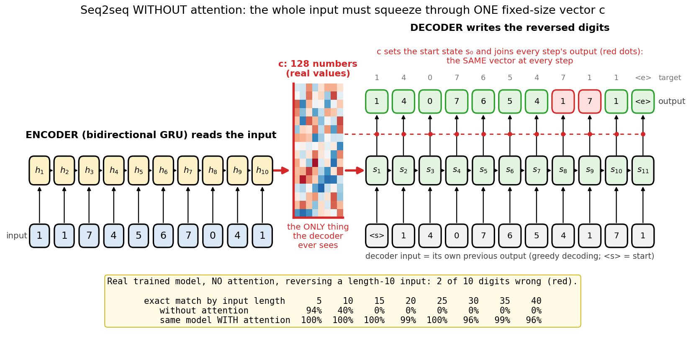
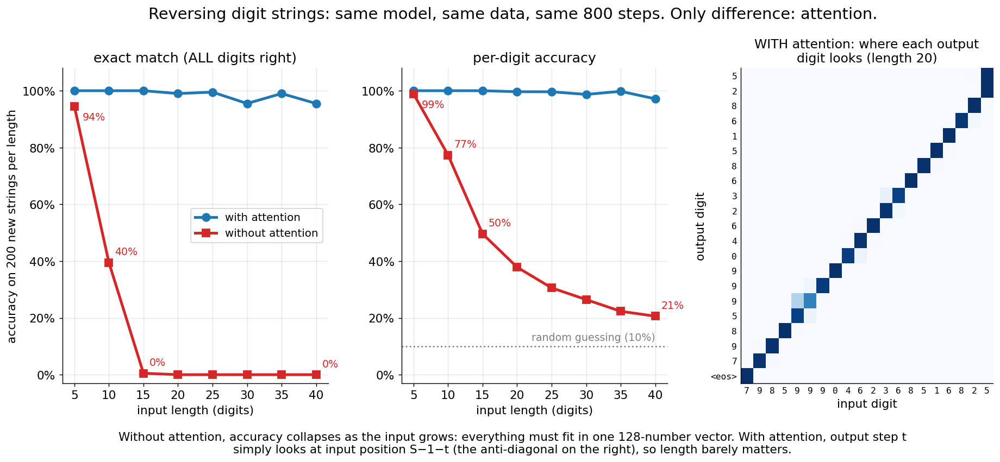
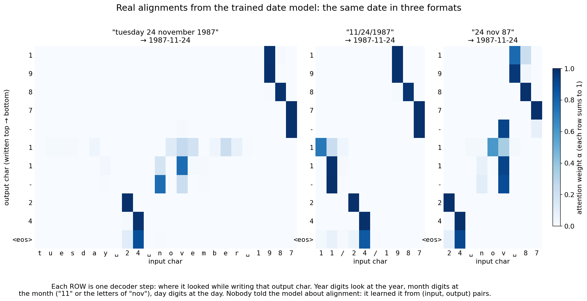
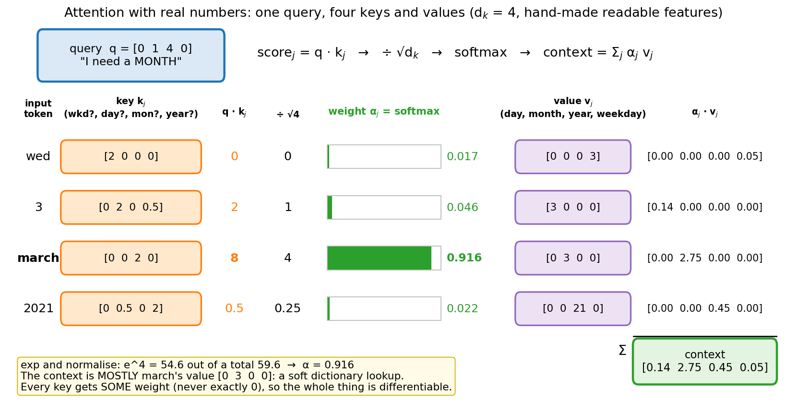
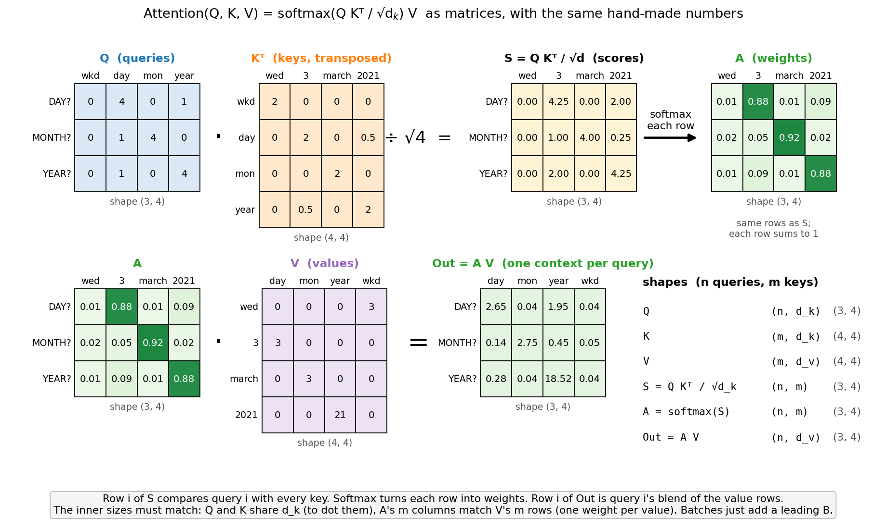
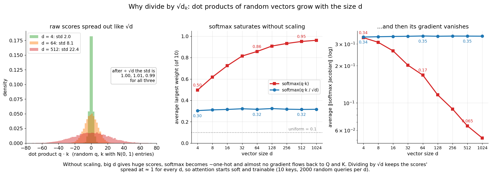
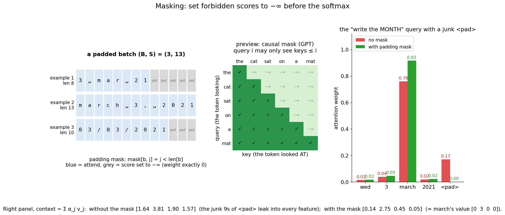
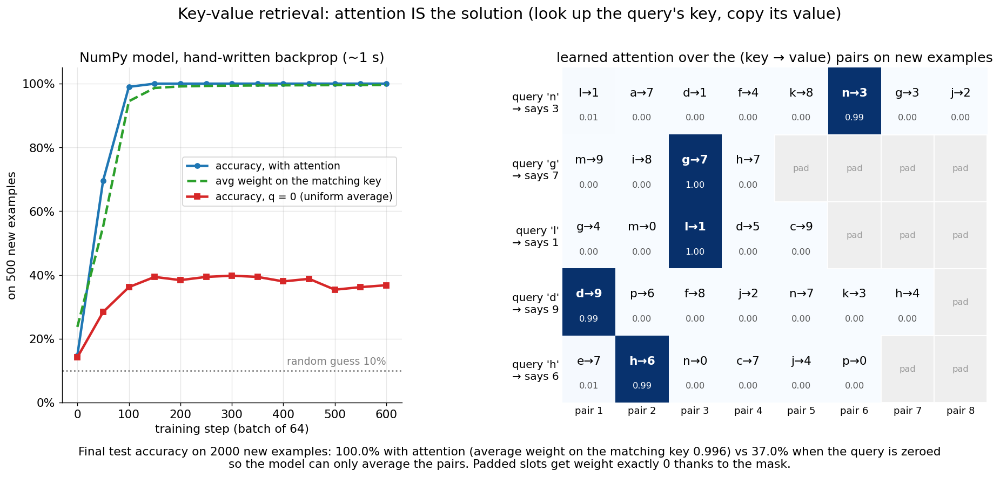
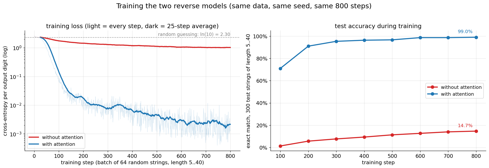

# Seq2seq + Attention: from the bottleneck to `softmax(Q Kᵀ / √d_k) V`

This folder is the bridge between RNNs and Transformers. First we build an
**encoder-decoder** (seq2seq) out of GRUs and watch it hit a wall: it must squeeze a whole
input sequence into **one fixed-size vector**, and that fails as inputs get longer. Then we
add **attention**, a differentiable, soft dictionary lookup that lets the decoder re-read
the whole input at every step, and the wall disappears. We write attention from scratch in
NumPy (forward and backward, gradient-checked), prove PyTorch computes the same thing, and
end with the general form `Attention(Q, K, V) = softmax(Q Kᵀ / √d_k) V` that every
Transformer layer is built on.

> **Prerequisite:** [`../rnn/`](../rnn/) (hidden states, BPTT, teacher forcing) and
> [`../lstm/`](../lstm/) (gated cells; our encoder and decoder are GRUs). Attention was
> invented on top of these models, to fix their biggest weakness.
>
> **Next:** [`../transformer/`](../transformer/). "Attention is all you need" = drop the RNN,
> keep the attention from this folder, and let a sequence attend to *itself* (self-attention).

## Files

| File | What it teaches |
|------|-----------------|
| `attention_visual.py` | **Start here.** Step by step in your terminal: one attention lookup with 4-number vectors you can check by hand (scores, `÷ √d_k`, softmax bars, weighted sum), then the matrix form for several queries, then a padding mask. Part 2 watches the real trained date model write `2021-03-03` one character at a time, showing where it looks. |
| `attention_numpy.py` | From scratch: scaled dot-product attention and additive (Bahdanau) attention, forward **and** backward, with batches and masks. Plus a tiny model trained with hand-written backprop where attention is the whole solution: key-value retrieval (100% test accuracy in ~1 s). Saves `kv_model.npz`. |
| `gradient_check.py` | Numerical vs analytic gradients for `dQ, dK, dV` (no mask, padding mask, causal mask), all 6 gradients of additive attention, and every parameter of the retrieval model. |
| `tasks.py` | The two toy datasets, generated in code: dates in 7 human formats → `YYYY-MM-DD`, and reversing digit strings of length 5..40. |
| `seq2seq_pytorch.py` | (a) Proves `F.scaled_dot_product_attention`, `nn.MultiheadAttention` and autograd match our NumPy forward and backward. (b) A GRU encoder-decoder with `--attention dot / additive / none`, trained on dates (100% exact match on unseen days in ~10 s). Saves `date_model.pt`. |
| `bottleneck.py` | **The key experiment.** Same model with and without attention, same data, same steps: accuracy vs input length on the reverse task (~40 s). |
| `translate.py` | Type a date in any supported format, get `YYYY-MM-DD` plus an ASCII attention heatmap (output chars × input chars). |
| `make_figures.py` → `images/` | Draws every picture in this README from real computations (~3 s if the models exist). |

### Suggested order

1. Read sections 1–2 (look closely at the pictures).
2. Run `python attention/bottleneck.py` and watch the no-attention model collapse on long inputs.
3. Read sections 3–4, then run `python attention/attention_visual.py` and press Enter
   through every step.
4. Read sections 5–7. Read `scaled_dot_product_attention_backward` in `attention_numpy.py`,
   then run `python attention/gradient_check.py`.
5. Read section 8 and train the retrieval model: `python attention/attention_numpy.py`.
   Then `python attention/attention_numpy.py --no-attention` for the ablation.
6. Read section 9 and run `python attention/seq2seq_pytorch.py`. Then play:
   `python attention/translate.py` and type `tuesday 24 november 1987`.
7. Read sections 10–13 (cost, self-attention, tips, and how this becomes an LLM).
8. Answer the interview questions out loud, then do the exercises.

To redraw the pictures: `python attention/make_figures.py` (uses the saved models, or trains
them first; `--retrain` forces it).

Run everything from the repo root with the venv active (see the root `README.md`). The
NumPy files filter the spurious `RuntimeWarning: ... encountered in matmul` messages that
NumPy 2.0 + Apple Accelerate prints on Macs. Saved models (`*.pt`, `*.npz`) are gitignored.

---

## 1. Seq2seq: the encoder-decoder

Many problems map a sequence to a **different** sequence, often of a different length:
translation, summarization, speech → text, and our toy tasks:

```
"wednesday 3 march 2021"  →  "2021-03-03"        (date normalization, character level)
"48213"                   →  "31284"             (reverse the digits)
```

An RNN language model (`../rnn/`) produces one output per input. Here the input and output
don't line up, so we use **two** RNNs (Sutskever et al. 2014, Cho et al. 2014):

1. The **encoder** reads the whole input and summarizes it.
2. The **decoder** is a language model that writes the output one token at a time,
   *conditioned* on that summary.

The equations of the model in `seq2seq_pytorch.py` (rows = examples, like `../mlp/`):

```
encoder:   h_j = [h→_j ; h←_j] = BiGRU(embed(x_j))          one vector per input char
summary:   c   = [h→_S ; h←_1]                              the whole input in ONE vector
decoder:   s_0 = tanh(W_b c + b_b)
           s_t = GRU(embed(y_{t-1}), s_{t-1})               reads its previous output char
context:   c_t = c                        (no attention: the same vector every step)
           c_t = Σ_j α_tj h_j             (attention: section 3)
output:    h̃_t = tanh(W_c [s_t ; c_t] + b_c)
           p(y_t | y_<t, x) = softmax(W_o h̃_t + b_o)
loss:      L = − Σ_t log p(y*_t | y*_<t, x)                 cross-entropy on every output char
```

Shapes (defaults; `B` = batch, `S` = input length, `T` = output length, `V` = vocab size):

| Symbol | Shape | Meaning |
|--------|-------|---------|
| `x`, `y` | (B, S), (B, T) | input and output character ids |
| `embed(·)` | (B, ·, 32) | learned character embeddings (shared by both sides) |
| `h` | (B, S, 128) | encoder states: 64 forward + 64 backward per input char |
| `c` | (B, 128) | the summary vector: the **bottleneck** |
| `s_t` | (B, 128) | decoder state at step t |
| `c_t` | (B, 128) | context the decoder uses at step t |
| `W_c`, `W_o` | (256 → 128), (128 → V) | output layers |

**Special tokens** (`tasks.py`): `<pad>` fills short sequences in a batch, `<sos>` is the
decoder's first input ("start writing"), and `<eos>` is the decoder's way of saying "done".
Because the decoder decides when to stop, the output length can differ from the input length.

**Teacher forcing.** During training, the decoder reads the **true** previous character
`y*_{t-1}`, not its own guess. All decoder inputs are then known in advance, so in our
model all `T` steps run in one call of `nn.GRU`. At test time there is no true answer, so the
decoder must feed back its own predictions. The mismatch is called **exposure bias**: the
model never practised recovering from its own mistakes.

**Decoding.** *Greedy* decoding picks the most likely character at each step (what we use).
*Beam search* keeps the `k` best partial outputs at each step and returns the best complete
one; it fixes cases where a locally best choice leads to a bad sentence. It matters for
translation; for our tasks greedy is already 100% right. LLMs mostly *sample* instead (see
temperature in `../rnn/`).

## 2. The bottleneck problem

Look at what the decoder gets without attention: `c`, **128 numbers**. Every digit of the
input must survive inside that one vector, through 40 encoder steps, and then be pulled
back out in the right order.



**What to look at:** everything the encoder read funnels into one red vector (its real 128
values are drawn). The decoder never sees the input again: `c` sets its start state and is
the same vector at every output step. Even on this length-10 input the trained model gets 2
of 10 digits wrong. The table at the bottom is the whole story: 94% at length 5, 40% at
length 10, 0% from length 15 on.

`bottleneck.py` trains the **same** model twice on the reverse task (lengths 5..40): same
167,789 parameters, same data, same seed, same 800 steps. The only difference is the
context `c_t`. It prints:

```
          |   exact match (all digits right)  |   per-digit accuracy
 length   |  no attention     with attention  |  no attention   with attention
----------+-----------------------------------+--------------------------------
     5    |     94.5%           100.0%       |     98.9%          100.0%
    10    |     39.5%           100.0%       |     77.3%          100.0%
    15    |      0.5%           100.0%       |     49.6%          100.0%
    20    |      0.0%            99.0%       |     37.9%           99.7%
    25    |      0.0%            99.5%       |     30.6%           99.6%
    30    |      0.0%            95.5%       |     26.5%           98.7%
    35    |      0.0%            99.0%       |     22.3%           99.8%
    40    |      0.0%            95.5%       |     20.6%           97.2%
```



**What to look at:** the red curves fall off a cliff as inputs get longer; the blue ones
stay flat near 100%. Per-digit accuracy without attention sinks towards random guessing
(10%): at length 40 it is 21%. The heatmap on the right shows *why* attention wins: to write
output digit `t`, the model simply looks at input position `S−1−t`, the anti-diagonal.

Is this just undertraining? Partly, and that is the point: a bottleneck makes learning
**harder**. With 5× the training (`python attention/bottleneck.py --steps 4000`, ~4 min),
the no-attention model improves on short inputs (95.0% at length 10, 75.0% at length 15),
but still gets 16.5% at length 20, 3.0% at length 25 and 0% from length 30 on, while the
attention model is at 99–100% everywhere. Its mistakes have a telling pattern: on a length-30
input it gets the first 9 output digits right (the *last* input digits, which it read most
recently) and then falls apart. A fixed-size vector remembers the recent past best.

**Short inputs are fine.** On dates (inputs of at most ~27 characters) the no-attention model
also reaches 99.9% exact match (`python attention/seq2seq_pytorch.py --attention none`).
Attention still learns much faster there: 86.7% vs 3.2% after 100 steps, 100% vs 43.1% after
200. The bottleneck bites with **length**, which is exactly what real translation has
(sentences of 50+ words). Sutskever et al. (2014) even found that reversing the *input*
sentence helped, because it put the first source words close to the first target words:
a hack around the same bottleneck.

## 3. The idea of attention

Bahdanau, Cho & Bengio (2014) asked: why throw away the encoder states `h_1 .. h_S`? Keep
them all, and let the decoder **look back** at them at every step, choosing *where* to look
based on what it is about to write:

```
score:     e_tj = score(s_t, h_j)                 how relevant is input j for output step t?
weights:   α_tj = softmax_j(e_tj)                 positive, Σ_j α_tj = 1
context:   c_t  = Σ_j α_tj h_j                    a weighted average of the encoder states
```

Now `c_t` is recomputed for every output character. The decoder doesn't need to remember
the input; it can re-read the relevant part on demand. The model learns *where to look*
end to end, from (input, output) pairs only, because every step is differentiable.

The scoring function is the only design choice:

| Name | `score(s, h)` | Paper |
|------|---------------|-------|
| additive (concat) | `vᵀ tanh(W_q s + W_k h)` | Bahdanau et al. 2014 |
| dot | `sᵀ h` | Luong et al. 2015 |
| general | `sᵀ W_a h` | Luong et al. 2015 |
| scaled dot-product | `(W_q s)·(W_k h) / √d_k` | Vaswani et al. 2017 (Transformer) |

Our `--attention dot` is the last row with `d_k = 64`: it is Luong's "general" score with
`W_a = W_q W_kᵀ` (low rank) plus the `√d_k` scaling. `--attention additive` is Bahdanau's.
Both reach 100% on dates; dot-product is cheaper (one matrix multiply instead of a `tanh` for
every (query, key) pair: 10 s vs 18 s here) and gave sharper alignments, so it is the
default. Two smaller differences from the original papers: Bahdanau used the *previous*
decoder state `s_{t-1}` as the query and fed `c_t` into the GRU; we follow Luong and use the
*current* `s_t` and combine `[s_t ; c_t]` after the GRU. That keeps all decoder steps
parallel under teacher forcing.

**Attention weights are an alignment.** Each `α_t` is a probability distribution over the
input positions, so we can draw them:



**What to look at:** each row is one output character, each column one input character, and
dark = high weight. The year digits look at the year, the day digits look at the day, and
the month digits look at `11` or at the letters of `nov`/`november`. The three formats put
these pieces in different places, and the model finds them anyway. Nobody labelled any
alignment. (The encoder is bidirectional, so `h_j` also knows its neighbours: looking at one
letter of "nov" is enough to read the month.)

Try it yourself: `python attention/translate.py --date "tuesday 24 november 1987"`. Inputs
outside the training formats show the limits: `2021/03/03` comes out as `2003-01-21`. The
model never saw year-first dates, and the heatmap shows it looking in the wrong places.

## 4. The general form: `Attention(Q, K, V)`

Strip away the RNNs and attention is a **soft dictionary lookup**:

- a **query** `q`: what am I looking for? (here: the decoder state)
- **keys** `k_j`: what does item `j` contain? (here: projected encoder states)
- **values** `v_j`: what does item `j` hand over if chosen? (here: the encoder states)

A Python `dict` does a *hard* lookup: exact key match, or `KeyError`. Attention compares the
query with **every** key, turns the similarities into weights, and returns a weighted blend
of **all** values. Because nothing is a hard choice, gradients flow to every query, key and
value. This is also called **content-based addressing**: you find memory by *what* is in
it, not by *where* it is.



**What to look at:** the query asks for a month. Its dot product with `march`'s key is 8,
far above the others (0, 2, 0.5). After `÷ √4` and the softmax, `march` gets 91.6% of the
weight, and the context `[0.14 2.75 0.45 0.05]` is mostly `march`'s value `[0 3 0 0]`.
The other tokens still leak in a little (the year's 21 adds 0.45). These are the same
hand-made numbers that `attention_visual.py` steps through.

With many queries at once (one per output step, or one per token in a Transformer):

```
Attention(Q, K, V) = softmax(Q Kᵀ / √d_k) V          (softmax over each ROW, i.e. over the keys)
```

| Symbol | Shape | Meaning |
|--------|-------|---------|
| `Q` | (n, d_k) | n queries |
| `K` | (m, d_k) | m keys (same size as the queries, so we can dot them) |
| `V` | (m, d_v) | m values, one per key |
| `S = Q Kᵀ / √d_k` | (n, m) | every query's score for every key |
| `A = softmax(S)` | (n, m) | attention weights, each row sums to 1 |
| `Out = A V` | (n, d_v) | one context vector per query |

With a batch, add a leading `B`: `(B, n, d_k)` and so on. In our seq2seq model,
`Q = s W_q` is (B, T, 64), `K = h W_k` is (B, S, 64), `V = h` is (B, S, 128), so the
context is (B, T, 128). `n` and `m` don't have to match: the output can be shorter or
longer than the input.



**What to look at:** row `i` of `S` is query `i` compared with every key. The softmax turns
each row into weights (green, rows sum to 1), and row `i` of `Out` is query `i`'s blend of
the value rows. The DAY query puts 0.88 on `3`, MONTH 0.92 on `march`, YEAR 0.88 on `2021`.
The inner sizes must match: `Q` and `K` share `d_k`, and `A` has one column per row of `V`.

## 5. Why divide by `√d_k`?

If the entries of `q` and `k` are random with mean 0 and variance 1, then `q · k` is a sum
of `d_k` such products, so its variance is `d_k` and its standard deviation is `√d_k`.
Bigger vectors give bigger scores, for no good reason.



**What to look at:** left, raw dot products spread out like `√d`: std 2.0, 8.1 and 22.4 for
`d` = 4, 64, 512 (after `÷ √d` all three have std ≈ 1.00). Middle, over 10 keys the softmax's
largest weight grows from 0.50 (d = 4) to 0.86 (d = 64) to 0.95 (d = 512) without scaling: it
becomes nearly one-hot. With scaling it stays at 0.30–0.32. Right, the size of the softmax's
Jacobian (how much gradient gets through) falls from 0.34 to 0.065 without scaling, and stays
at 0.35 with it.

A saturated softmax is like a saturated `tanh` (`../mlp/`, `../rnn/`): its slope is ≈ 0, so
almost no learning signal reaches `Q` and `K`. Dividing by `√d_k` keeps the scores at unit
scale for any head size, so attention starts out soft and trainable. (The model can still
learn to make scores large when it wants sharp attention, as our trained models do.)

## 6. Masking

Batches pad short inputs with `<pad>`. The pad positions have encoder states too (garbage),
and a query must never attend to them. The fix: before the softmax, set forbidden scores
to `−∞`. Then `exp(−∞) = 0`: exactly zero weight, and zero gradient.

```
S = Q Kᵀ / √d_k
S[mask == False] = −∞          (in NumPy we use −1e9: exp underflows to exactly 0)
A = softmax(S)
```



**What to look at:** left, a real padded batch: each row gets its own mask from its length.
Right, the junk `<pad>` (key `[0 1 1 1]`, value `[9 9 9 9]`) steals 17% of the MONTH
query's weight and pollutes the context to `[1.64 3.81 1.90 1.57]`. With the mask it gets
0.00 and the context is back to `[0.14 2.75 0.45 0.05]`. Middle: a **causal mask** (query `i`
may only see keys `≤ i`) is how GPT-style models stop a token from looking at the future.
That is the Transformer's job, in `../transformer/`.

Mask conventions differ between libraries, a classic bug source: in our code and in
`F.scaled_dot_product_attention(attn_mask=...)`, `True` means *may attend*; in
`nn.MultiheadAttention(key_padding_mask=...)`, `True` means *ignore*. `seq2seq_pytorch.py`
checks both against our NumPy code.

## 7. The backward pass of attention

Forward, for one batch element (rows = queries):

```
S   = Q Kᵀ / √d          (n, m)
A   = softmax(S)          (n, m)   row-wise
Out = A V                 (n, d_v)
```

Backward, given `dOut = ∂L/∂Out`:

```
dV = Aᵀ dOut                                   (m, d_v)   like dW = Xᵀ dZ in ../mlp/
dA = dOut Vᵀ                                   (n, m)
dS = A ⊙ (dA − sum(dA ⊙ A, axis=-1))           (n, m)     softmax backward, row by row
dQ = dS K / √d                                 (n, d)
dK = dSᵀ Q / √d                                (m, d)
```

The only new piece is the softmax. For one row, `a = softmax(s)` has Jacobian
`∂a_i/∂s_j = a_i (δ_ij − a_j)`. Chain rule:

```
dS_j = Σ_i dA_i · a_i (δ_ij − a_j) = a_j dA_j − a_j Σ_i dA_i a_i = a_j (dA_j − Σ_i dA_i a_i)
```

which is the `dS` line, vectorized. Two things to notice:

- **Masked positions get no gradient** automatically: their `a_j = 0`, so `dS_j = 0`.
- **The backward pass needs `A`**, an (n, m) matrix per head. For long sequences this is
  the memory problem of section 10.

Additive attention adds a `tanh` layer inside the score; its backward (in
`additive_attention_backward`) is the same softmax step followed by ordinary MLP backprop
through `vᵀ tanh(q W_q + k W_k)`, summing over all (query, key) pairs.

`python attention/gradient_check.py` compares all of this with central differences in
float64. Every gradient matches to within `1e-6` (the largest relative error is `1.5e-07`,
for `dW_q` of additive attention), with and without padding and causal masks. And
`seq2seq_pytorch.py` checks that PyTorch's autograd gives the same `dQ, dK, dV` and the same
6 additive-attention gradients as our NumPy code.

## 8. A model where attention is everything: key-value retrieval

`attention_numpy.py` trains a tiny model on a task that is *literally* a dictionary lookup:

```
pairs: c→7  k→2  a→5  f→9      query: a      answer: 5       (2..8 pairs, padded to 8)

q    = E_key[query] W_q          (B, 1, 16)
k_i  = E_key[key_i] W_k          (B, 8, 16)
v_i  = E_val[value_i]            (B, 8, 16)
ctx  = softmax(q kᵀ / √16 + mask) v
p    = softmax(ctx W_o + b_o)    (B, 10)
```

1,098 parameters, Adam, hand-written backprop (the embedding backward uses `np.add.at`,
because the same row can be looked up several times).



**What to look at:** test accuracy goes from 14.8% to 99.0% in 100 steps and 100% after 150;
the green dashed line (average weight on the matching key) follows it to 0.996. On new
examples (right) each row puts ~all its weight on the pair whose key matches the query, and
pad slots get exactly 0. The red line is the ablation (`--no-attention`, `q = 0`, so all
pairs get equal weight): it plateaus at 37.0%, because averaging the pairs can't tell
*which* value you asked for. (Not 10%: with 2–3 pairs, guessing any value in the set is
often right.)

Notice what the model has to learn: `W_q W_kᵀ` must make `q · k` large only when the two
symbols are the same. The same embedding table feeds both sides, just like the shared token
embeddings feeding `W_Q` and `W_K` in a Transformer. Also notice there is no notion of
**position**: shuffle the pairs and the answer is identical. Attention is a *set*
operation; Transformers must add position information explicitly.

## 9. Training the seq2seq models

`seq2seq_pytorch.py` and `bottleneck.py` use the same loop: fresh random examples every
step (batch 64), cross-entropy ignoring `<pad>` targets, Adam (lr 3e-3) with cosine decay,
and gradient-norm clipping at 1.0. Dates: every 10th calendar day is held out, so the
1000 test examples are on days the model never saw.

```
python attention/seq2seq_pytorch.py
step   100 | loss 0.070 | test exact match  86.7% |   1.3 s
step   200 | loss 0.003 | test exact match 100.0% |   2.4 s
...
final test exact match: 100.0%  (trained in 10 s)
```



**What to look at:** on the reverse task (lengths 5..40) the attention model's loss drops
by more than 100× within ~200 steps (and keeps falling towards 0.002), while the
no-attention model is stuck near 1 nat per digit. Test exact match ends at 99.0% vs 14.7%. Same data, same seed, same
parameter count: the only difference is whether `c_t` may change from step to step.

The PyTorch file starts with the equivalence checks:

```
F.scaled_dot_product_attention == our NumPy softmax(Q Kᵀ/√d + mask) V ✔
nn.MultiheadAttention (1 head, identity projections) == the same equations ✔
autograd dQ, dK, dV == our hand-written backward (with the padding mask) ✔
additive attention: forward and all 6 autograd gradients == our NumPy code ✔
```

`nn.MultiheadAttention` is just `softmax(Q Kᵀ / √d) V` with learned projections around it
(`W_Q, W_K, W_V` in, `W_O` out). Set them to identity and you get our function back.

## 10. Cost: `O(n·m)` time and memory

`Q Kᵀ` computes every query against every key: `n·m·d_k` multiply-adds, and `A V` another
`n·m·d_v`. The weights `A` take `n·m` numbers, per head, per layer, and the backward pass
needs them.

- Our reverse task: at most 41 × 40 = 1,640 weights per example. Nothing.
- **Self-attention** (section 11) has `n = m = L`, so cost is `O(L²)`. A 128k-token context
  has 131,072² ≈ 1.7·10¹⁰ weights per head per layer: 34 GB in 16-bit floats.
- This is why long-context LLMs use **FlashAttention** (computes attention in tiles with a
  running softmax and never stores `A`; the backward recomputes it) and, at inference, a
  **KV cache** (keys and values of past tokens are stored and reused, so each new token is
  one query against `L` keys: `O(L)` per token).
- An RNN costs `O(1)` memory per step but must run step after step. Attention compares
  everything with everything, but all of it in parallel: one big matrix multiply, which is
  what GPUs are built for.

## 11. Cross-attention vs self-attention

In this folder the queries come from one sequence (the decoder) and the keys/values from
**another** (the encoder). That is **cross-attention**.

**Self-attention** uses the *same* sequence for all three:

```
Q = X W_Q,   K = X W_K,   V = X W_V          X: (L, d_model), one row per token
Out = softmax(Q Kᵀ / √d_k + mask) V          every token looks at every (allowed) token
```

Each token builds its new representation by looking up the other tokens it needs, in one
parallel step instead of `L` sequential RNN steps. Run several attentions side by side with
different projections (**multi-head attention**), add an MLP, residual connections and
layer norm, stack it: that's a Transformer (`../transformer/`). In a decoder (GPT), the
causal mask from section 6 makes it a language model.

| | RNN seq2seq (here, no attention) | RNN seq2seq + attention (here) | Transformer |
|---|---|---|---|
| How the decoder sees the input | one vector `c` | cross-attention over all `h_j` | cross-attention over all encoder outputs |
| How a sequence sees itself | recurrence, step by step | recurrence, step by step | **self-attention**, all at once |
| Path between two tokens far apart | O(distance) steps | O(1) via attention, encoder is still RNN | O(1) |
| Parallel over the sequence (training) | no | decoder yes (with teacher forcing), encoder no | yes |

## 12. Practical tips and debugging

- **Print the shapes** of `Q, K, V, S, A`. Most attention bugs are a transposed `K`, a softmax
  over the wrong axis (it must be over the **keys**, the last axis), or a mask that
  broadcasts wrongly.
- **Check that rows of `A` sum to 1** and that padded columns are exactly 0.
- **Never let a row be fully masked.** A row of all `-inf` gives `0/0 = NaN`. Our NumPy code
  uses `-1e9` (a fully masked row then becomes uniform instead of NaN); our PyTorch model
  uses `-inf`, which is safe because every input has at least one real character.
- **Mind the mask convention** of each API (section 6).
- **Look at the attention maps.** Uniform weights everywhere mean the model hasn't learned to
  use attention yet (or the scores are too small); one-hot weights from step 1 mean the
  scores are too big (missing `√d_k`?).
- **Teacher forcing hides decoding bugs.** Always evaluate with real greedy decoding
  (`exact_match` does), not just the training loss.
- **Attention maps are not explanations.** They show where the model looked, which is
  suggestive, but the encoder states mix information from neighbours (our month digits look
  at `c` of "march"), so "looked at X" is not "used only X".

## 13. From here to LLMs (why this matters for an AI engineer)

Attention started as a fix for RNN translation. It became the core of modern AI:

- **Every Transformer layer is this.** GPT-style models are stacks of
  `softmax(Q Kᵀ / √d_k) V` (self-attention, causal mask, many heads) plus MLPs. The function
  you gradient-checked here is the one running in every layer of every LLM.
- **Cross-attention is still everywhere.** Encoder-decoder Transformers (the original 2017
  model, T5, Whisper for speech → text) have exactly the decoder-queries / encoder-keys-values
  attention of this folder. Text-to-image diffusion models (e.g. Stable Diffusion) condition
  on the prompt by cross-attending from image features (queries) to the text encoder's token
  embeddings (keys/values).
- **Retrieval / RAG is "attention over documents".** Embed the question (query) and the
  documents (keys), score by dot product, pick the best matches, and give their text
  (values) to the LLM. It is the soft lookup of section 4, made hard (top-k) and scaled to
  millions of items. Then the LLM's own attention reads the retrieved text.
- **Induction heads.** Interpretability research (Olsson et al. 2022) found attention heads
  that do `[A][B] ... [A] → predict [B]`: find the earlier occurrence of the current token
  and copy what came after it. That is our key-value retrieval task, discovered by training,
  and it is believed to be a key mechanism behind in-context learning.
- **The engineering problems are attention problems:** context length (`O(L²)`),
  FlashAttention, KV-cache memory at inference, multi-query / grouped-query attention to
  shrink that cache, and how to tell a model where tokens are (positional encodings).

## 14. Interview check

Answer each one out loud in under a minute:

1. Draw an RNN encoder-decoder. What are teacher forcing, `<sos>` and `<eos>` for?
2. What is the bottleneck problem? What does `bottleneck.py` show, with numbers?
3. Write Bahdanau (additive) attention and Luong (dot / general) attention. What's the difference in cost?
4. Write `Attention(Q, K, V)` and give the shape of every intermediate result.
5. Why divide by `√d_k`? Derive the variance of `q · k` for random unit-variance vectors.
6. Explain attention as a soft dictionary lookup. What are queries, keys and values in seq2seq? In self-attention?
7. How does a padding mask work, and why `−∞` (or a large negative number) *before* the softmax? What is a causal mask?
8. Derive the backward pass of softmax and of attention (`dQ`, `dK`, `dV`).
9. What is the time and memory cost of attention? How does FlashAttention help? What is a KV cache?
10. Cross-attention vs self-attention: where is each used (T5, GPT, Whisper, Stable Diffusion)?
11. Can you read attention weights as an alignment or an explanation? What are the caveats?
12. Greedy decoding vs beam search vs sampling. What is exposure bias?
13. Is attention permutation-invariant? What does a Transformer need to add because of that?
14. Why did attention make the RNN unnecessary (the step to "Attention Is All You Need")?

## 15. Exercises

1. Break one line of `scaled_dot_product_attention_backward` (e.g. drop the `/ np.sqrt(d)` in
   `dK`) and confirm that `gradient_check.py` catches it.
2. Run `python attention/bottleneck.py --hidden 128` (a 256-number bottleneck) and
   `--steps 3000`. At what length does the no-attention model fail now?
3. Run the experiments with `--attention additive` (in `bottleneck.py` and
   `seq2seq_pytorch.py`). Compare accuracy, speed, and the sharpness of the heatmaps.
4. Remove the `/ q.shape[-1] ** 0.5` in `Seq2Seq.attend` and retrain with
   `--attention dot`. Does it still train? Then try a larger `attn_dim`.
5. Length generalization: train the reverse task on lengths 5..30 only
   (`sample_reverse(..., max_len=30)`) and test on 35..50. Which model generalizes, and why?
6. Implement **beam search** next to `Seq2Seq.greedy` (beam size 3). Does it change the date
   results? Try it on a harder task (e.g. sorting the digits).
7. Add **input feeding** (Bahdanau-style): feed `c_{t-1}` into the decoder GRU together
   with the embedding. You will need a Python loop over decoder steps. What gets slower?
8. In `attention_numpy.py`, turn attention into **self-attention**: `Q = X W_q, K = X W_k,
   V = X W_v` from one sequence, with an optional causal mask. Extend `gradient_check.py`.
   You've built the first piece of a Transformer.
9. Add **multi-head** attention to `KVModel` (split `d = 16` into 4 heads of 4). Does it
   learn faster or slower?
10. Why does `--no-attention` reach 37% instead of 10%? Measure accuracy by number of pairs.
11. Type `2021/03/03` into `translate.py`. Add a year-first format to `tasks.DATE_FORMATS`,
    retrain, and check the new heatmap.
12. Compute the **entropy** of each attention row for the date model. Which output
    characters have the most spread-out attention, and why?

## 16. Resources

- Sutskever, Vinyals & Le (2014), *Sequence to Sequence Learning with Neural Networks*.
- Cho et al. (2014), *Learning Phrase Representations using RNN Encoder–Decoder for Statistical Machine Translation* (also introduces the GRU).
- Bahdanau, Cho & Bengio (2014), *Neural Machine Translation by Jointly Learning to Align and Translate*.
- Luong, Pham & Manning (2015), *Effective Approaches to Attention-based Neural Machine Translation*.
- Vaswani et al. (2017), *Attention Is All You Need*.
- Lilian Weng, *Attention? Attention!* (blog, 2018).
- Jay Alammar, *Visualizing A Neural Machine Translation Model (Mechanics of Seq2seq Models With Attention)* (blog).
- Chris Olah & Shan Carter (2016), *Attention and Augmented Recurrent Neural Networks* (Distill).
- Olsson et al. (2022), *In-context Learning and Induction Heads* (Transformer Circuits Thread).
- Dao et al. (2022), *FlashAttention: Fast and Memory-Efficient Exact Attention with IO-Awareness*.
- Stanford CS224n, lectures on machine translation, seq2seq and attention.
