# Convolutional Neural Networks (CNNs)

A hands-on guide to CNNs: why images need them, the convolution operation, channels,
padding, stride, pooling, the backward pass, im2col, a from-scratch NumPy CNN with a
gradient check, the same model in PyTorch, and the experiment that shows what weight
sharing really buys you.

> **Prerequisite:** [`../mlp/`](../mlp/). A CNN is an MLP whose weights are **shared
> across image positions** and **only look at small patches**. Backprop, softmax +
> cross-entropy and SGD are exactly the same, so learn them there first.
> **Next:** [`../rnn/`](../rnn/): the same weight-sharing idea, but across **time** instead of space.

## Files

| File | What it teaches |
|------|-----------------|
| `conv_visual.py` | **Visual, step by step in your terminal:** a 3x3 kernel slides over a 6x6 image; every output cell is computed in front of you (patch, products, sum + bias), then ReLU, 2x2 max pooling, padding and stride, and finally the filters of a real trained CNN. |
| `cnn_numpy.py` | A full CNN from scratch (NCHW layout): `Conv2D` with im2col (plus a slow loop version for teaching), `ReLU`, `MaxPool2D`, `GlobalAvgPool`, `Flatten`, `Dense`, softmax + cross-entropy, every backward pass, SGD with momentum. Generates the shape images, trains in ~3 s, saves `model.npz`. |
| `predict.py` | Pick a shape and a position (or draw your own image with `#` and `.`). Shows the model's probabilities and a **saliency map** (where the network is looking). |
| `gradient_check.py` | Checks every backward pass against numerical gradients: conv with padding and stride 2, max pooling, global average pooling, dense, and the whole network including the input gradient `dX`. |
| `cnn_vs_mlp.py` | **The key insight.** CNN vs MLP (the class from `../mlp/`) on the same moving shapes, then *train on the left half, test on the right half*. Shows equivariance vs invariance with real numbers (~9 s). |
| `cnn_pytorch.py` | Copies our weights into `nn.Conv2d` / `nn.MaxPool2d` / `nn.Linear` and checks identical logits, gradients and `dX`; checks `F.conv2d` == our im2col; then trains an idiomatic PyTorch CNN with BatchNorm. |
| `make_figures.py` → `images/` | Trains the real model and draws every picture in this README. All numbers in the pictures are computed, not made up (~18 s). |

### Suggested order

1. Read sections 1–2 (look closely at the pictures), then run `python cnn/conv_visual.py`
   and press Enter to watch the feature map fill up one cell at a time.
2. Read sections 3–7.
3. Read sections 8–10, then read `Conv2D`, `im2col`, `col2im` and `MaxPool2D` in
   `cnn_numpy.py`. Run `python cnn/gradient_check.py`.
4. Train: `python cnn/cnn_numpy.py`. Then play: `python cnn/predict.py` and type `plus 3 9`
   or `draw`.
5. Read sections 11–13.
6. Read section 14 and run `python cnn/cnn_vs_mlp.py`. This is the most important result in the folder.
7. Run `python cnn/cnn_pytorch.py` and compare it with the NumPy version.
8. Read sections 15–19 (architectures and how CNNs live on inside modern AI), answer the
   interview questions, then do the exercises.

To redraw the pictures: `python cnn/make_figures.py` (about 18 s).

Run the scripts from the repo root with the venv active (see the root `README.md`).
On Macs, NumPy 2.0 with Apple Accelerate emits spurious
`RuntimeWarning: ... encountered in matmul` messages even when results are correct.
The scripts filter out just those warnings.

---

## 1. Why not just use an MLP on the pixels?

You could flatten an image into one long vector and feed it to the MLP from `../mlp/`.
It works for tiny images, but it has three big problems.

**1. Far too many parameters.** A 224x224 colour photo has `224·224·3 = 150,528` numbers.
One dense layer with 1,000 neurons needs `150,528 · 1,000 = 150,528,000` weights. That is
one layer, and it has seen each pixel position only through its own private weights.
A conv layer with 64 filters of size 3x3 over 3 colour channels needs `64·3·3·3 + 64 = 1,792`.

**2. No notion of locality.** An MLP doesn't know that pixel `(5, 6)` is next to pixel
`(5, 7)`. Shuffle all the pixels with a fixed permutation and an MLP learns exactly as well.
But in images, nearby pixels belong together: edges, corners and strokes are **local** patterns.

**3. Not translation-equivariant.** A vertical bar at column 3 and the same bar at column 9
hit completely different MLP weights. The MLP must learn "vertical bar" again at every position.

A CNN fixes all three with two ideas:

- **Local connectivity:** each output looks only at a small patch (e.g. 3x3).
- **Weight sharing:** the *same* small set of weights is used at every position.

That's it. A conv layer is an MLP neuron that only sees a 3x3 patch, copied to every
position of the image. Compare the RNN in `../rnn/`, which copies the same cell to every
time step.

### The data in this folder

`cnn_numpy.make_shapes()` draws 16x16 grayscale images (values 0..1) of six classes:
**horizontal bar, vertical bar, diagonal `\`, diagonal `/`, plus, square outline**. Each
shape gets a random size (5–7 px), thickness (1–2 px), brightness (0.6–1.0) and, most
importantly, a **random position**. Up to 3 random "dust" pixels and Gaussian noise
(std 0.1) are added. There are 3,000 training images (seed 0) and 600 validation images
(seed 1), balanced across the classes. Nothing is downloaded.

```
 plus                                 diag \
┌────────────────────────────────┐   ┌────────────────────────────────┐
│..........      ..  --          │   │      ..    ..                ..│
│        ::    ..                │   │                              ..│
│  ..                            │   │      ..                        │
│            ..              ..  │   │              ..  ##  ..    ..  │
│            ..                  │   │                        ..    ..│
│                          ..    │   │        ..              ::..    │
│    ::  ..      ..            ::│   │    ..                          │
│              ..              ..│   │                  ..  ::        │
│        ..        ::      ..  ..│   │..            ..        ..      │
│              @@  ..            │   │..                              │
│    ..        @@            ..  │   │      ..          ....          │
│    ..    @@@@@@@@%%@@    ++..  │   │..      ..  ++##      ..        │
│          ..  @@  @@..        ..│   │  ..          ++        ..      │
│              @@    ..        ..│   │    ::      ....++              │
│              @@  ..  ..        │   │                ..++            │
│                          ......│   │      ..      ..    ##          │
└────────────────────────────────┘   └────────────────────────────────┘
```

On this data, with the same training budget (`python cnn/cnn_vs_mlp.py`):

| model | parameters | validation accuracy |
|-------|-----------:|--------------------:|
| MLP 256 → 128 → 6 | 33,670 | 90.3% |
| CNN conv8 → conv16 → dense | 2,790 | **99.3%** |

12x fewer parameters, 14x fewer mistakes. Section 14 shows the even bigger effect
when shapes appear at positions never seen in training.

## 2. The convolution operation

Slide a small grid of weights (the **kernel** or **filter**) over the image. At each
position, multiply the patch under the kernel element by element with the kernel, add
everything up, and add a bias. That number is one cell of the output, the **feature map**.

For one input channel and a `k x k` kernel `K`:

```
out[i, j] = Σ_a Σ_b  x[i + a, j + b] · K[a, b]  +  b          a, b = 0 .. k-1
```

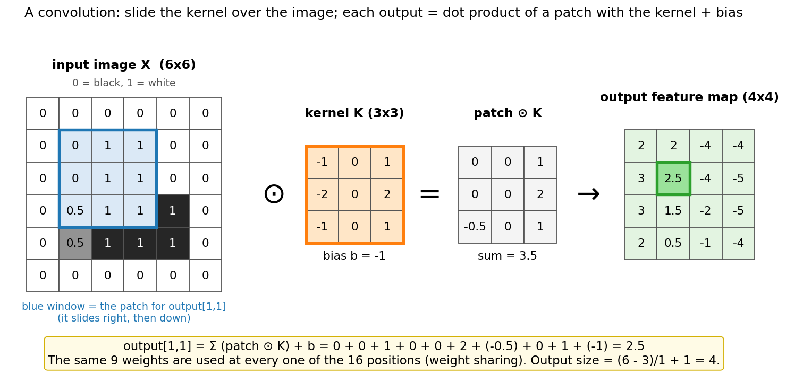

**What to look at:** the blue window is the patch for output cell `[1, 1]`. Multiply it
cell by cell with the orange kernel, add the 9 products (3.5), add the bias (−1): 2.5,
the green cell. Slide the window one step right and do it again. The **same 9 weights**
produce all 16 outputs. Run `python cnn/conv_visual.py` to watch this happen cell by cell.

### Cross-correlation vs convolution

Strictly, the formula above is **cross-correlation**. In maths, **convolution** flips the
kernel first: `Σ x[i - a, j - b] · K[a, b]`, which is the same as correlating with the
kernel rotated by 180°. Deep-learning libraries (PyTorch's `nn.Conv2d`, ours) compute the
cross-correlation and still call it "convolution". It doesn't matter for learning: the
network just learns the flipped kernel. It does matter when you derive the backward pass
(section 9), where a true, flipped convolution shows up.

## 3. Kernels are pattern detectors

A kernel's output is a dot product, and a dot product is large when two vectors point the
same way. So **a kernel fires where the patch looks like the kernel**.

The kernel in `conv_visual.py` is the classic Sobel vertical-edge detector:

```
-1  0  1
-2  0  2      "Is it brighter on my RIGHT than on my LEFT?"
-1  0  1
```

On the 6x6 image (a bright block), with bias −1, it gives this feature map:

```
  2    2   -4   -4
  3  2.5   -4   -5
  3  1.5   -2   -5
  2  0.5   -1   -4
```

Positive on the block's **left** edge (dark → bright), strongly negative on its **right**
edge (bright → dark), and it ignores flat areas. After ReLU only the left edge survives.
To catch right edges you need a second kernel. That's why real layers have **many** kernels.

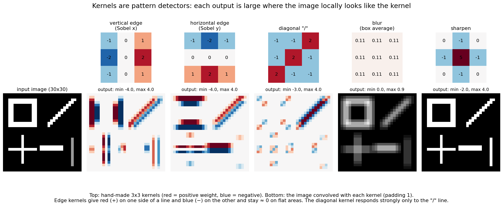

**What to look at:** each column is one 3x3 kernel (top) and its feature map (bottom).
The vertical-edge kernel lights up on the vertical sides of the square and the bars,
red on one side and blue on the other. The horizontal-edge kernel does the same for
horizontal lines. The diagonal kernel responds strongly only to the `/` line. Blur
averages, sharpen exaggerates differences. A CNN **learns** kernels like these instead
of us designing them (section 13).

## 4. Channels: `C_in`, `C_out` and the 4D weight

Real inputs have several **channels** (RGB = 3). After the first layer, every feature
map is a channel too: a layer with 8 kernels outputs 8 channels. So a kernel must look
at **all input channels** at once: it is a small 3D block `(C_in, k, k)`, and the layer
has one such block per output channel.

```
out[n, f, i, j] = Σ_c Σ_a Σ_b  x_pad[n, c, i·s + a, j·s + b] · W[f, c, a, b]  +  b[f]
```

We use the **NCHW** layout, like PyTorch:

| Symbol | Shape | Meaning |
|--------|-------|---------|
| `x` | `(N, C_in, H, W)` | a batch of N images, C_in channels each |
| `W` | `(C_out, C_in, kH, kW)` | one `(C_in, kH, kW)` filter per output channel |
| `b` | `(C_out,)` | one bias per output channel (shared over all positions) |
| `out` | `(N, C_out, H_out, W_out)` | one feature map per output channel |

Parameters of a conv layer: `C_out · C_in · k · k + C_out`. Note what is **not** in that
formula: the image size. A conv layer has the same number of weights for a 16x16 image
and for a 4K photo.

Our `conv2` has `W` of shape `(16, 8, 3, 3)`: 16 filters, each looking at all 8 channels
of `conv1`'s output through a 3x3 window: `16·8·3·3 + 16 = 1,168` parameters.

## 5. Padding, stride and the output size

- **Padding `p`:** add a ring of `p` zeros around the input, so the kernel can be centred
  on border pixels. With a 3x3 kernel, `p = 1` keeps the size the same ("same" padding).
- **Stride `s`:** move the window `s` pixels at a time. `s = 2` roughly halves the size.

```
out = (n + 2p - k) / s + 1          (rounded down)
```

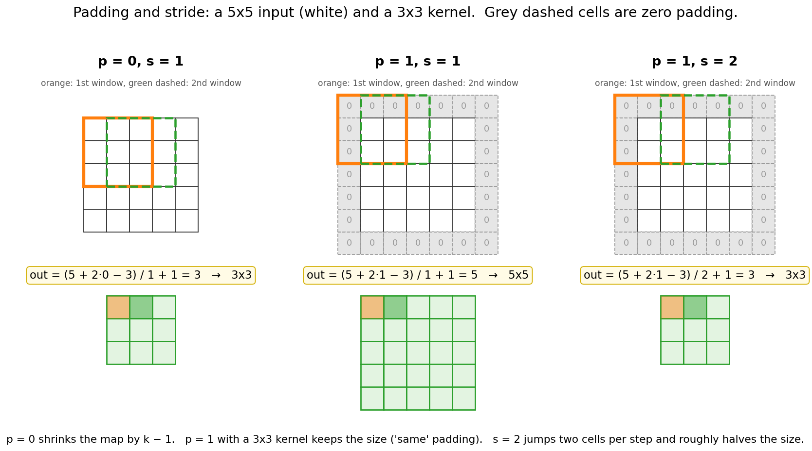

**What to look at:** the orange box is the first window and the green dashed box is the
second. With `p = 0` the 5x5 input shrinks to 3x3. With `p = 1` the grey zeros let the
window start on the corner, so the output stays 5x5. With `s = 2` the second window
jumps two cells, giving 3x3.

`conv_visual.py` (step 9) checks the formula on the 6x6 example with a 3x3 kernel:

| p | s | (n + 2p − k) / s + 1 | output |
|---|---|----------------------|--------|
| 0 | 1 | (6 + 0 − 3) / 1 + 1 = 4 | 4x4 |
| 1 | 1 | (6 + 2 − 3) / 1 + 1 = 6 | 6x6 |
| 0 | 2 | (6 + 0 − 3) / 2 + 1 = 2.5 → 2 | 2x2 |
| 1 | 2 | (6 + 2 − 3) / 2 + 1 = 3.5 → 3 | 3x3 |

## 6. Pooling

**Max pooling** (2x2, stride 2) keeps the largest number in each 2x2 block. **Average
pooling** keeps the mean. Neither has any parameters.

What pooling buys:
- **4x fewer numbers** for the next layer (less compute, less memory).
- **A bit of translation invariance:** if a feature moves by one pixel inside its 2x2
  block, the max doesn't change.
- **A bigger receptive field** for the layers after it (section 7).

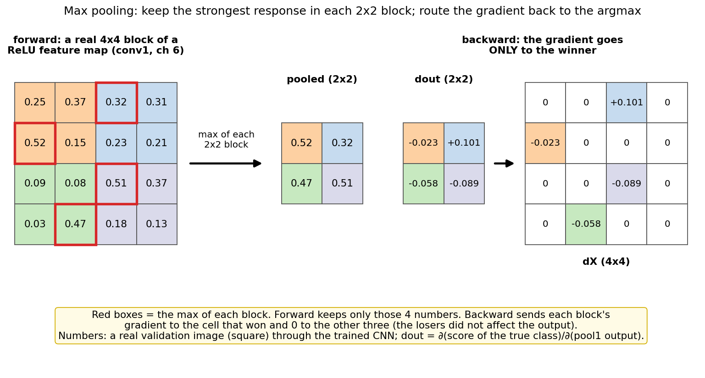

**What to look at:** a real 4x4 block of a real ReLU feature map from the trained CNN.
Forward: each coloured 2x2 block keeps only its red-boxed maximum (0.52, 0.32, 0.47, 0.51).
Backward: each pooled cell's gradient goes **only** to the cell that won; the other three
get 0, because nudging a loser doesn't change the output.

**Global average pooling** (GAP) averages each whole feature map down to one number:
`(N, C, H, W) → (N, C)`. It throws away *where* a feature is and keeps only *how much*
of it there is. Section 14 shows why that matters.

## 7. Receptive field: seeing more with depth

The **receptive field** of a unit is the patch of the input image that can affect it.
A 3x3 conv adds 2 pixels (times the current "jump"); a 2x2 pool doubles the jump.

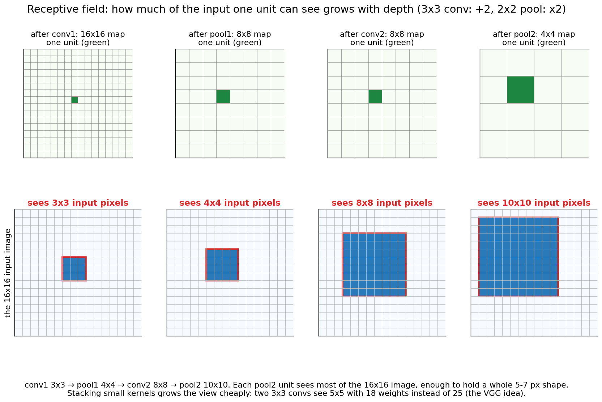

**What to look at:** one unit (green) in each layer of our network, and the input pixels
it can see (blue). conv1 sees 3x3, after pool1 4x4, conv2 8x8 and pool2 10x10, most of
the 16x16 image and enough to hold a whole 5–7 px shape. Computed by sending a gradient
back through all-ones kernels, so it is the real connectivity of the network.

This is why CNNs build a **hierarchy**: early layers see tiny patches (edges), later
layers combine them into parts (corners, crossings) and then whole objects. It is also
the VGG idea: two stacked 3x3 convs see 5x5 with `2·9 = 18` weights per channel pair
instead of 25, and get an extra ReLU in between.

## 8. The full forward pass

The default network in `cnn_numpy.py` (printed when you train it):

| layer | output shape `(C, H, W)` | parameters | multiply-adds per image |
|-------|--------------------------|-----------:|------------------------:|
| input | (1, 16, 16) | 0 | |
| conv1 3x3, 1→8, pad 1 | (8, 16, 16) | 80 | 18,432 |
| ReLU | (8, 16, 16) | 0 | |
| maxpool 2x2 | (8, 8, 8) | 0 | |
| conv2 3x3, 8→16, pad 1 | (16, 8, 8) | 1,168 | 73,728 |
| ReLU | (16, 8, 8) | 0 | |
| maxpool 2x2 | (16, 4, 4) | 0 | |
| flatten | (256,) | 0 | |
| dense 256→6 | (6,) | 1,542 | 1,536 |
| **total** | | **2,790** | **93,696** |

Then softmax + cross-entropy, exactly as in `../mlp/`. The usual pattern: the spatial
size **shrinks** (16 → 8 → 4) while the number of channels **grows** (1 → 8 → 16).
"Where" is traded for "what".

## 9. The backward pass

Every layer gets `dout = ∂L/∂(its output)` and must return `dX = ∂L/∂(its input)`, plus
gradients for its own parameters. Dense, ReLU and softmax are the same as in `../mlp/`.
The new parts are conv and pooling.

### Through a convolution

Start from the forward formula and ask: which outputs did each weight touch?

```
out[n, f, i, j] = Σ_c Σ_a Σ_b  x_pad[n, c, i·s + a, j·s + b] · W[f, c, a, b] + b[f]

dW[f, c, a, b] = Σ_n Σ_i Σ_j  dout[n, f, i, j] · x_pad[n, c, i·s + a, j·s + b]
               = correlate(x_pad, dout)               ← dout plays the role of the kernel
db[f]          = Σ_n Σ_i Σ_j  dout[n, f, i, j]
dX             = FULL convolution of dout with the 180°-flipped W, then remove the padding
                 (stride 1; "full" = pad dout with k-1 zeros on every side)
```

- **`dW` is a sum over all positions** because the same weight was used at every position.
  This is the same reason `dW_hh` in `../rnn/` is a sum over time steps.
- **`dX`:** input pixel `(p, q)` was used by every output whose window covered it, with a
  different kernel weight each time. Collecting those contributions is exactly a
  convolution with the flipped kernel.

`conv2d_backward_naive()` in `cnn_numpy.py` implements these formulas literally, and the
self-test that runs before training checks that the fast version agrees:

```
self-test: im2col conv == naive loop conv (stride 2, pad 1, out (2, 4, 4, 4)) ✔
self-test: im2col backward == 'dW = correlate(x, dout)', 'dX = full conv(dout, flipped W)' ✔
```

The fast version is plain matrix calculus on the im2col matrix (section 10):

```
cols   = im2col(x)                 (N·H_out·W_out, C_in·k·k)
out    = cols @ W_mᵀ + b           W_m = W.reshape(C_out, -1)
dW_m   = doutᵀ @ cols              same pattern as dW = A_prevᵀ @ dZ in ../mlp/
dcols  = dout @ W_m
dX     = col2im(dcols)             add each patch-row back where it came from (overlaps add up)
```

### Through max pooling

```
dX[winner of each block] = dout[block]        dX[everyone else] = 0
```

The forward pass remembers the argmax of every block. (Average pooling would instead
split `dout` evenly: `dout / 4` to each of the four cells.)

### Checking it

`python cnn/gradient_check.py` compares every analytic gradient with
`(L(w + ε) − L(w − ε)) / 2ε`, in float64:

```
Conv2D 3x3, C_in=2 → C_out=3, pad=1, stride=2
  dX                     shape=(2, 2, 7, 7)    max relative error = 3.80e-10  OK
  W                      shape=(3, 2, 3, 3)    max relative error = 1.55e-11  OK
  b                      shape=(3,)            max relative error = 3.75e-12  OK
...
Gradient check PASSED
```

It covers conv (with and without padding, stride 1 and 2), max pooling, global average
pooling, dense, and both full networks, including `dX` of the input image.

## 10. im2col: convolution as one matrix multiply

Looping over positions in Python is slow. The trick: cut every patch out of the image and
lay it out as a **row** of a matrix. Then all positions and all filters are done with one
matrix multiplication.

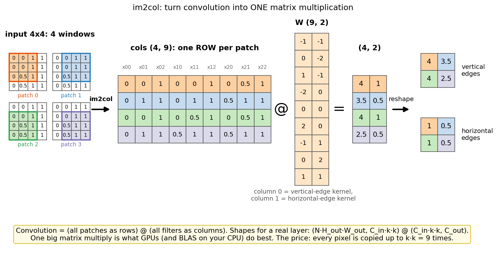

**What to look at:** a 4x4 input has four 3x3 windows (patches 0–3). Each becomes one
coloured row of the `(4, 9)` matrix. Each filter becomes one column of `W (9, 2)`. One
matrix multiply gives all 4 positions for both filters; reshaping gives the two 2x2
feature maps. The same numbers as sliding the window by hand.

Why GPUs (and CPU BLAS libraries) love this: a big dense matrix multiply is the most
optimized operation in computing. The cost is memory: every pixel is copied up to `k·k`
times. Production libraries (cuDNN) also use implicit-GEMM, Winograd and FFT algorithms,
but im2col is the mental model. Our `im2col` uses NumPy's `sliding_window_view` to build
the patches without Python loops, and `col2im` adds gradients back with only `k·k` slice
additions.

## 11. Parameter count and FLOPs

```
conv params  = C_out · C_in · k · k + C_out
conv MACs    = C_out · H_out · W_out · C_in · k · k        (multiply-adds per image)
dense params = D_in · D_out + D_out          dense MACs = D_in · D_out
```

Parameters and compute are **not** the same thing for a CNN. Each conv weight is reused
at every position, so it is cheap in memory but not in compute:

| model | parameters | multiply-adds per image |
|-------|-----------:|------------------------:|
| MLP 256 → 128 → 6 | 33,670 | 33,536 |
| our CNN | 2,790 | 93,696 |

The CNN has 12x fewer parameters but does 2.8x more arithmetic. In big CNNs most
**parameters** sit in the last layers (few positions, many channels), while most
**compute** happens in the early layers (many positions).

## 12. Training

`python cnn/cnn_numpy.py`: He initialization (`std = √(2 / (C_in·k·k))`), mini-batches of
32, SGD with momentum 0.9 and lr 0.05, 15 epochs, about 3 s on a laptop CPU.

```
v = μ·v − lr·g          w = w + v           (μ = 0.9)
```

Momentum keeps a running "velocity": steps that agree build up speed, zig-zags cancel.
SGD + momentum is the classic CNN optimizer (AlexNet, VGG, ResNet). Adam works too
(`python cnn/cnn_pytorch.py --optim adam --lr 1e-3`).

```
epoch   1 | train loss 1.048 acc  56.9% | val loss 0.191 acc  93.2% | 0.2 s
epoch   2 | train loss 0.120 acc  96.1% | val loss 0.054 acc  99.0% | 0.2 s
epoch   5 | train loss 0.015 acc  99.7% | val loss 0.011 acc  99.7% | 0.2 s
epoch  10 | train loss 0.001 acc 100.0% | val loss 0.009 acc  99.5% | 0.2 s
epoch  15 | train loss 0.000 acc 100.0% | val loss 0.012 acc  99.3% | 0.2 s
```

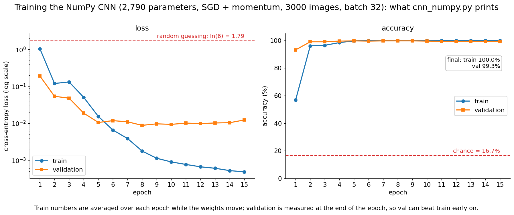

**What to look at:** the loss starts near random guessing (`ln 6 = 1.79`) and the train
loss drops from 1.05 to 0.015 within 5 epochs. Validation accuracy reaches 99.3% after
15 epochs. After epoch 5 the train loss keeps falling while the validation loss stays flat
around 0.01: from here on, training only makes the model more confident on images it
already gets right.

Without momentum (`--momentum 0`) the same run ends at 96.8% validation accuracy.

### The PyTorch version and BatchNorm

`python cnn/cnn_pytorch.py` first proves our NumPy layers are the real thing:

```
F.conv2d == our im2col conv (C_in 3 → C_out 5, k 3, stride 2, pad 1): (2, 3, 9, 9) → (2, 5, 5, 5) ✔
head=flatten: logits, loss, all 6 parameter gradients and dX match PyTorch ✔  (max logit diff 6.7e-16)
head=gap    : logits, loss, all 6 parameter gradients and dX match PyTorch ✔  (max logit diff 1.4e-16)
```

Note that `nn.Conv2d.weight` has exactly our shape `(C_out, C_in, kH, kW)` and is copied
as is, while `nn.Linear` stores `(out, in)`, the transpose of our `Dense.W`.

Then it trains the idiomatic way (`Dataset`/`DataLoader`, `nn.Module`, `optimizer.step()`)
with **BatchNorm** after each conv:

```
BN(z) = γ · (z − mean) / √(var + ε) + β          mean, var per channel over (N, H, W)
```

BatchNorm keeps every channel at a steady scale while earlier layers change. With the same
lr 0.02, the model with BN reaches 93.5% validation accuracy after one epoch, the one
without (`--no-bn`) only 30.8%. After 15 epochs: 99.5% vs 98.8%. Two rules:
- **`model.train()` vs `model.eval()`:** in training BN uses the batch's statistics; in
  evaluation it uses running averages. Forgetting `model.eval()` is a classic bug.
- **Drop the conv bias before BN** (`bias=False`): BN subtracts the mean, so the bias does nothing.

## 13. Looking inside the trained CNN

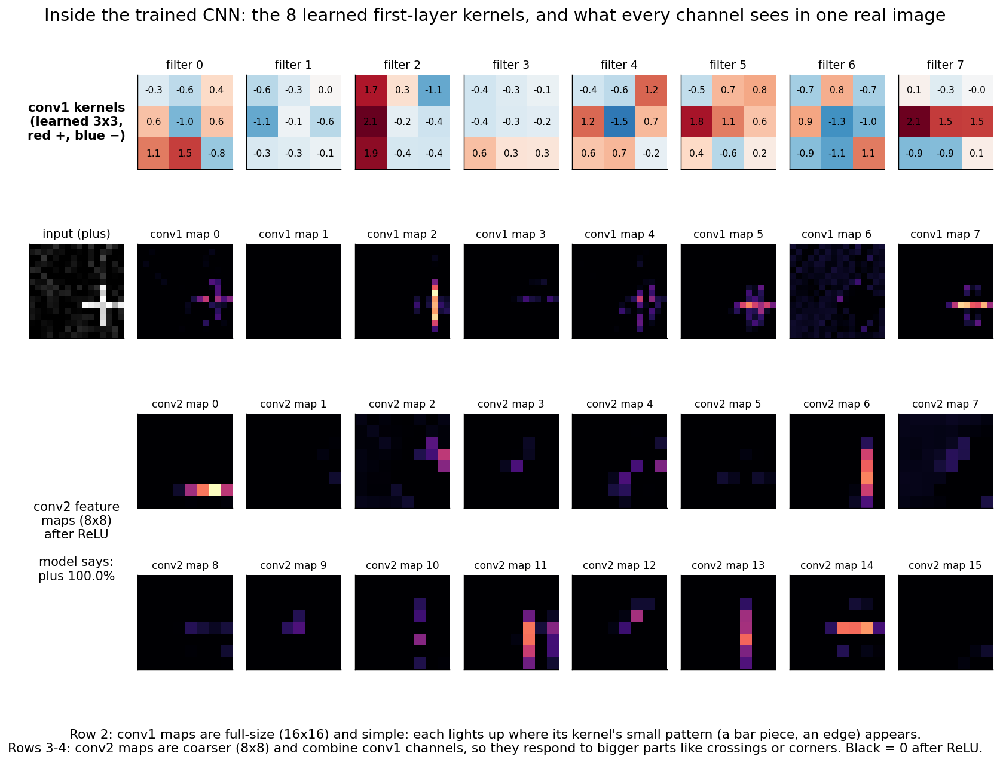

**What to look at:** top row, the 8 learned 3x3 kernels of `conv1`. Nobody designed them,
yet some are readable: filter 2 has a bright left column (a vertical-line detector),
filter 7 a bright middle row (a horizontal-line detector). Row 2 shows them on a real
"plus": map 2 lights up on the vertical stroke, map 7 on the horizontal one. Rows 3–4: the
16 `conv2` maps are coarser (8x8) and combine `conv1` channels into bigger parts. The model
says plus with 100.0%.

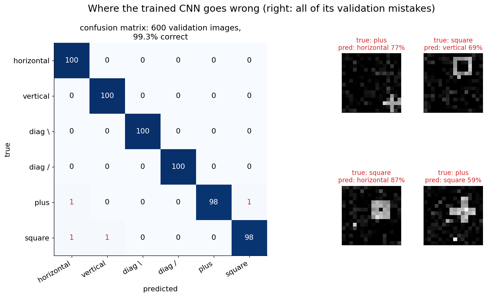

**What to look at:** almost everything is on the diagonal: 4 mistakes out of 600. The
mistakes on the right are hard cases: a small, dim plus squeezed into a corner, a thick
square that looks like a filled blob. When a model fails, **look at the failures**: they tell you
what data or augmentation to add.

`predict.py` also shows a **saliency map**, `|∂ score / ∂ pixel|`. It is computed with the
same backward pass, starting from a one-hot on the predicted class instead of from the
loss, and it shows where the network is looking.

## 14. Translation equivariance vs invariance (the key insight)

Two words that sound alike and mean different things:

- **Equivariant:** move the input and the output **moves the same way**.
  `conv(shift(x)) = shift(conv(x))`. Convolution is equivariant because the same kernel is
  applied everywhere.
- **Invariant:** move the input and the output **doesn't change**. `f(shift(x)) = f(x)`.
  That's what a classifier wants: "it's a vertical bar", wherever it is.

Conv layers give equivariance. **Invariance has to come from pooling**: a little from each
2x2 max pool, and all of it from **global** pooling. A dense layer after `flatten` gives
each position its own weights, so it is **not** invariant.

`python cnn/cnn_vs_mlp.py` makes this concrete. Part 2 trains **only on shapes in the left
half** of the image and tests on shapes in the **right half**:

```
  model                        params  left (seen)  right (unseen)
  MLP                          33,670        96.5%           17.0%
  CNN (flatten)                 2,790        99.8%           18.5%
  CNN (gap)                     1,350        99.2%           97.7%
  (chance = 1/6 = 16.7%)
```

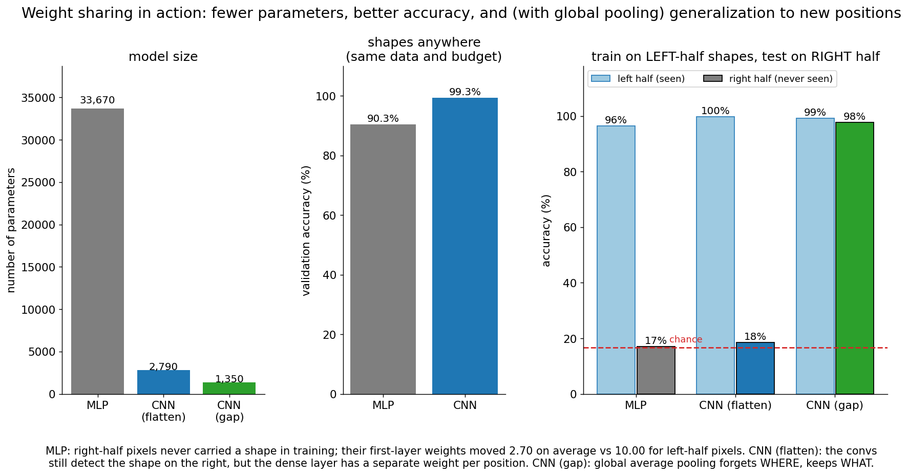

**What to look at:** left, the MLP needs 12x the parameters of the CNN. Middle, with shapes
anywhere, the CNN wins 99.3% vs 90.3%. Right: everyone does well on the half they were
trained on, but only the CNN with global average pooling works on the unseen half (97.7%);
the other two drop to chance.

Why each model behaves this way:

- **MLP:** right-half pixels only ever contained noise and dust during training, so their
  first-layer weights barely moved (by 2.70 on average vs 10.00 for left-half pixels). The
  MLP has literally never learned anything about the right half.
- **CNN (flatten):** the conv layers **do** detect the shape on the right: the feature map
  just shifts right. But the dense layer reads each position with its own weights, and the
  weights for the right half were never trained on real shapes.
- **CNN (gap):** global average pooling averages each feature map over all positions.
  "How much vertical-bar signal is there?" has the same answer wherever the bar is.

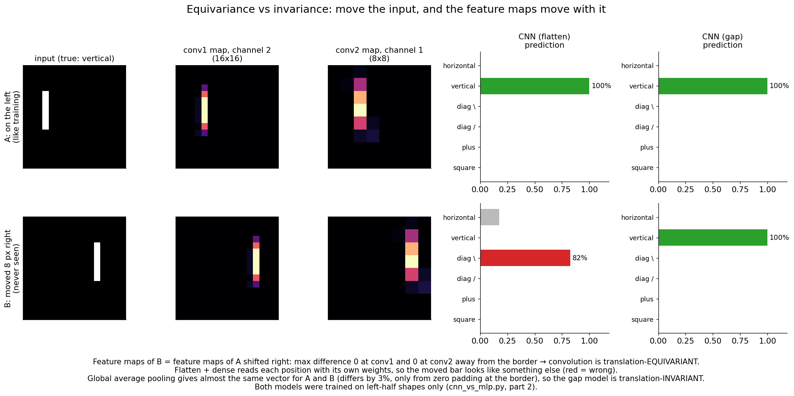

**What to look at:** the same vertical bar on the left (A) and moved 8 px right (B). The
conv1 and conv2 feature maps of B are exactly the maps of A shifted right (max difference 0
away from the image border). The flatten model calls B "diag \" with 82%; the GAP model says
"vertical" with 100% for both. Zero padding makes the border behave slightly differently,
so the GAP vectors of A and B differ by 3%, not 0%.

This is the deepest lesson of the folder: **architecture choices are assumptions about
the world** (inductive biases). "A pattern means the same thing wherever it appears" is
built into convolution, and "position doesn't matter for the label" is built into
global pooling. When an assumption is true, it saves you enormous amounts of data.

## 15. Data augmentation

Another way to get invariance: **show the model the transformations** during training.
Random shifts and crops, flips, small rotations and scaling, brightness and contrast
jitter, and stronger mixes like Cutout, Mixup and CutMix. It's free extra data, and it is
used in every vision model.

But augmentation must not change the label. On *our* data:
- A left-right flip turns `/` into `\`: a **wrong** label.
- A 90° rotation turns a horizontal bar into a vertical one: also wrong.
- Random shifts are safe, and they would fix the flatten CNN and the MLP in section 14
  (exercise 5).

## 16. Classic architectures

| Year | Model | Key idea |
|------|-------|----------|
| 1998 | **LeNet-5** (LeCun et al.) | conv → pool → conv → pool → dense, about 60k parameters, read handwritten digits on bank cheques. Our network is a tiny LeNet. |
| 2012 | **AlexNet** (Krizhevsky, Sutskever, Hinton) | Won ImageNet with 15.3% top-5 error (next best: 26.2%). ReLU, dropout, data augmentation, about 60M parameters, trained on 2 GPUs. Started the deep-learning boom. |
| 2014 | **VGG** (Simonyan & Zisserman) | Only 3x3 convs, stacked deep (16–19 layers). Two 3x3 convs = a 5x5 receptive field with fewer weights and an extra ReLU. VGG-16 has about 138M parameters, mostly in the dense layers. |
| 2014 | **GoogLeNet / Inception** | Parallel 1x1, 3x3, 5x5 branches; **1x1 convs** to cheaply reduce channels. |
| 2015 | **ResNet** (He et al.) + **BatchNorm** (Ioffe & Szegedy) | **Skip connections** `y = x + F(x)` make 50–152 layer networks trainable. 3.57% top-5 error on ImageNet. |
| 2017 | **MobileNet** (Howard et al.) | **Depthwise-separable** convs for phones. |
| 2020+ | **ViT**, **ConvNeXt** | Transformers on image patches (section 18); ConvNeXt shows a modernized ResNet is still competitive. |

**1x1 convolution:** a kernel of size 1 looks at one pixel but all `C_in` channels. It is a
Dense layer `C_in → C_out` applied independently at every pixel. Used to mix channels and
to shrink or grow the channel count cheaply.

**Depthwise-separable convolution:** split a normal conv into (1) a **depthwise** 3x3 conv
that filters each channel separately, and (2) a **pointwise** 1x1 conv that mixes channels.
For 256 → 256 channels with 3x3 kernels:

```
normal:      256 · 256 · 3 · 3              = 589,824 weights
separable:   256 · 3 · 3  +  256 · 256      =   2,304 + 65,536 = 67,840 weights   (8.7x fewer)
```

**Skip connections (ResNet):** `y = x + F(x)`. The gradient of `y` with respect to `x` is
`1 + ∂F/∂x`, so there is always a path where the gradient passes through unchanged. This is
the same "additive path" trick that LSTMs use to fight vanishing gradients through time
(`../rnn/`, section 5), and every Transformer layer uses it too.

## 17. Practical tips / debugging checklist

- **Print the shape after every layer** (like `cnn_numpy.py` does). Most CNN bugs are
  shape bugs: NCHW vs NHWC, a wrong flatten size, a forgotten padding.
- **Check the output-size formula by hand** before building a network. Odd sizes and
  stride 2 lose a row and a column to rounding.
- **First-step loss ≈ ln(C)?** 1.79 for our 6 classes. If not, the init or the loss is wrong.
- **Overfit one small batch** to ~0 loss first. If you can't, there's a bug.
- **Gradient-check new layers** in float64 on tiny inputs, with random (not all-zero)
  biases and inputs, so max-pool ties and ReLU kinks don't confuse the check.
- **`model.eval()`** for BatchNorm and dropout at test time; `model.train()` to go back.
- **Look at the images, the filters and the mistakes** (section 13), not just the accuracy.
- Normalize inputs (e.g. subtract the mean and divide by the std per channel).

## 18. From CNNs to modern AI (why this matters for an AI engineer)

CNNs didn't disappear when Transformers arrived. They moved inside them.

- **Vision Transformers (ViT) start with a convolution.** ViT cuts a 224x224 image into
  16x16 patches and linearly projects each patch to a token. That projection is exactly
  `nn.Conv2d(3, 768, kernel_size=16, stride=16)`: kernel size = stride, so the windows don't
  overlap. Output: 14x14 = 196 tokens of size 768, with `3·16·16·768 = 589,824` weights
  (+ 768 biases). From there it is a Transformer.
- **Inductive bias vs data:** ViT has no built-in locality or translation equivariance
  (section 14), so it needs much more data (or augmentation and distillation) to match a CNN
  on small datasets. With enough data it wins. It's the same trade-off as the MLP vs CNN
  experiment, one level up.
- **Multimodal LLMs** (e.g. LLaVA and similar open models) turn images into tokens with a
  vision encoder, often a CLIP-trained ViT (with its conv patch embedding); CLIP itself was
  also trained with ResNet image encoders. The LLM then reads those tokens like words.
- **Diffusion models** (Stable Diffusion and friends) use a **U-Net**: conv ResNet blocks
  that downsample, then upsample, with skip connections between matching resolutions, plus
  attention layers. Their VAE that compresses images into latents is a CNN too.
- **Audio and sequences:** Whisper starts with two 1D convolutions over the audio
  spectrogram. Mamba-style state-space models use a short causal 1D conv in every block.
- **Engineering knowledge that transfers:** NCHW layouts, receptive fields, im2col/GEMM,
  parameters vs FLOPs, BatchNorm/LayerNorm, skip connections, and data augmentation all show
  up again in LLM and multimodal work.

**Next:** [`../rnn/`](../rnn/) shares weights across **time** instead of across space. A 1D
convolution over a sequence is a fixed-size window; an RNN carries a memory that can, in
principle, reach back arbitrarily far.

## 19. Interview check

Answer each one out loud in under a minute:

1. Why use a CNN instead of an MLP for images? Give the parameter numbers for a 224x224x3 input.
2. Write the output-size formula. What is the output size for a 224x224 input, 7x7 kernel, stride 2, padding 3?
3. How many parameters does a 3x3 conv with 64 input and 128 output channels have?
4. What is the difference between convolution and cross-correlation? Does it matter for learning?
5. Derive `dW`, `db` and `dX` for a conv layer. Why is `dW` a sum over all positions?
6. How does the gradient flow through max pooling? Through average pooling?
7. What is the receptive field of three stacked 3x3 convs (stride 1)? Why did VGG prefer them over one 7x7?
8. Equivariance vs invariance: which one does convolution give? Where does invariance come from?
   Does a CNN with flatten + dense recognize a shape at a position it never saw?
9. What does a 1x1 convolution do?
10. Depthwise-separable convolution: how does it work and how much does it save?
11. Why do ResNets train well at 100+ layers? What does BatchNorm do, and how does it behave differently at test time?
12. What is im2col, and why does it make convolution fast? What does it cost?
13. Parameters vs FLOPs: why can a CNN have fewer parameters than an MLP but more compute?
14. How does a Vision Transformer turn an image into tokens? Why is that a convolution?
15. Name an augmentation that would be wrong for a dataset and explain why.

## 20. Exercises

1. Derive the conv backward pass (section 9) on paper for a 1-channel 4x4 input and a 3x3
   kernel. Then break `col2im` (replace `+=` with `=`) and run `python cnn/gradient_check.py`.
   Which checks fail? Explain why overlapping windows need `+=`.
2. Compare `python cnn/cnn_numpy.py --momentum 0` with the default. How many epochs does each need to reach 99%?
3. Try `--c1 2 --c2 4`, `--c1 16 --c2 32` and `--head gap`. Plot parameters vs validation accuracy.
4. Change `conv_visual.py`'s kernel to the horizontal Sobel kernel (`K.T`) and predict the
   feature map before running it.
5. Add random-shift augmentation (e.g. `np.roll` by a random amount, or re-drawing at a new
   position) to Part 2 of `cnn_vs_mlp.py`. Do the MLP and the flatten CNN now work on the right half?
6. Show that an MLP doesn't care about pixel order: apply one fixed random permutation to
   all pixels in `cnn_vs_mlp.py` Part 1 and retrain both models. What happens to each?
7. Implement `AvgPool2D` (forward and backward) in `cnn_numpy.py` and add it to `gradient_check.py`.
8. Replace both max-pool layers with stride-2 convolutions (an "all-convolutional" net). Compare accuracy and speed.
9. Add a 7th class `x` (both diagonals) to `draw_shape`. Which classes does the model confuse now?
10. Implement Adam for `cnn_numpy.py` and compare it with `python cnn/cnn_pytorch.py --optim adam --lr 1e-3`.
11. Implement `BatchNorm2d` forward and backward in NumPy and gradient-check it (use `model.eval()`-style running statistics at test time).
12. ViT patch embedding: show in PyTorch that `nn.Conv2d(1, 32, kernel_size=4, stride=4)` on a
    16x16 image equals cutting it into 16 patches of 4x4, flattening each, and applying one
    `nn.Linear(16, 32)` with the same weights.

## 21. Resources

- Stanford CS231n, *Convolutional Neural Networks for Visual Recognition*, course notes "Convolutional Neural Networks: Architectures, Convolution / Pooling Layers".
- LeCun, Bottou, Bengio & Haffner (1998), *Gradient-Based Learning Applied to Document Recognition* (LeNet-5).
- Krizhevsky, Sutskever & Hinton (2012), *ImageNet Classification with Deep Convolutional Neural Networks* (AlexNet).
- Simonyan & Zisserman (2014), *Very Deep Convolutional Networks for Large-Scale Image Recognition* (VGG).
- He, Zhang, Ren & Sun (2015), *Deep Residual Learning for Image Recognition* (ResNet).
- Ioffe & Szegedy (2015), *Batch Normalization: Accelerating Deep Network Training by Reducing Internal Covariate Shift*.
- Dumoulin & Visin (2016), *A guide to convolution arithmetic for deep learning*: the best pictures of padding, stride and transposed convolution.
- Howard et al. (2017), *MobileNets: Efficient Convolutional Neural Networks for Mobile Vision Applications*.
- Dosovitskiy et al. (2020), *An Image is Worth 16x16 Words: Transformers for Image Recognition at Scale* (ViT).
- Olah, Mordvintsev & Schubert (2017), *Feature Visualization*, Distill.
- Goodfellow, Bengio & Courville, *Deep Learning*, Chapter 9 (Convolutional Networks).
