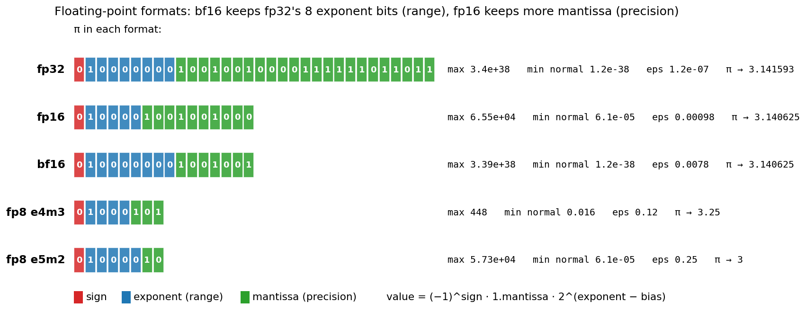
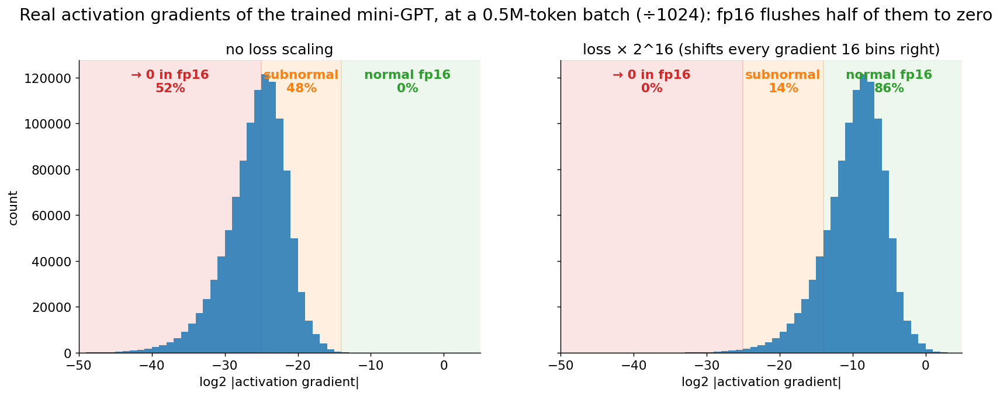
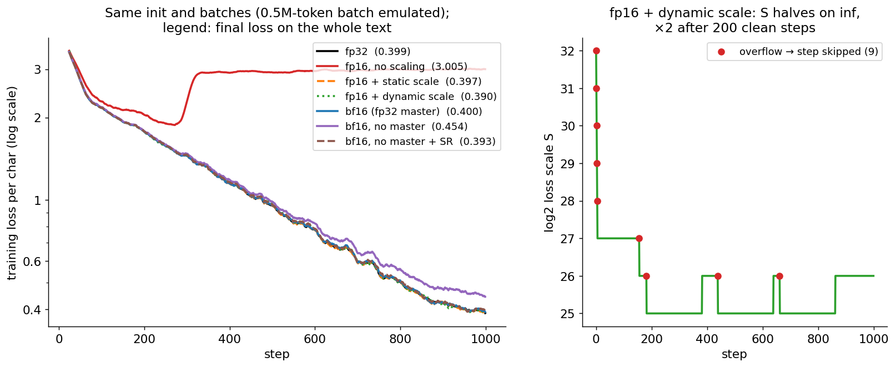
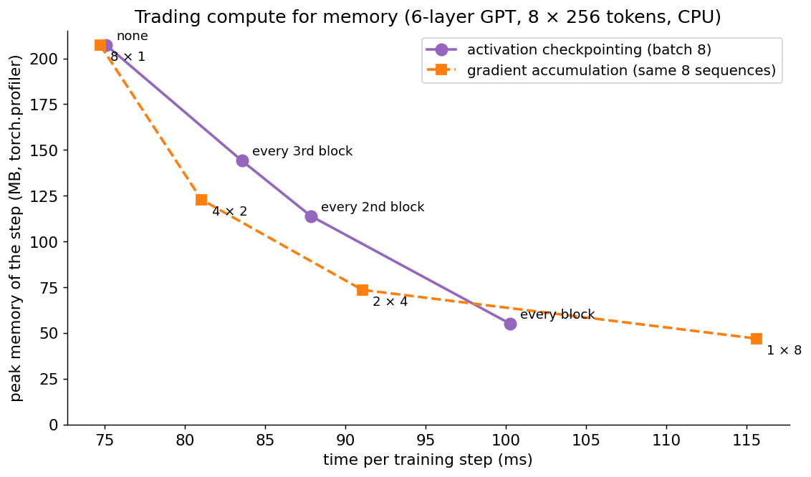
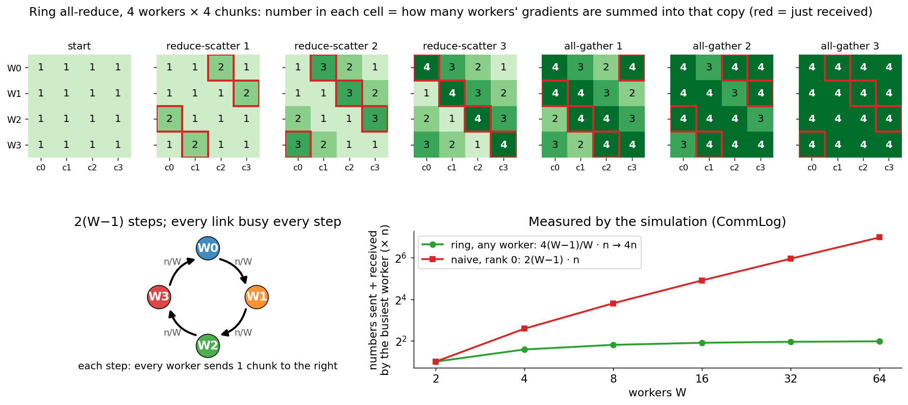
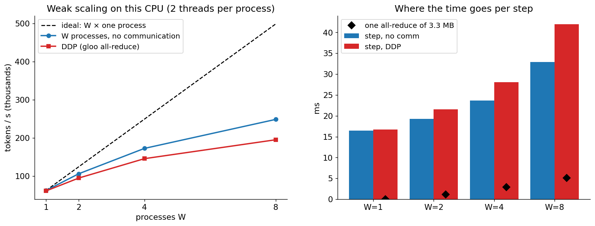
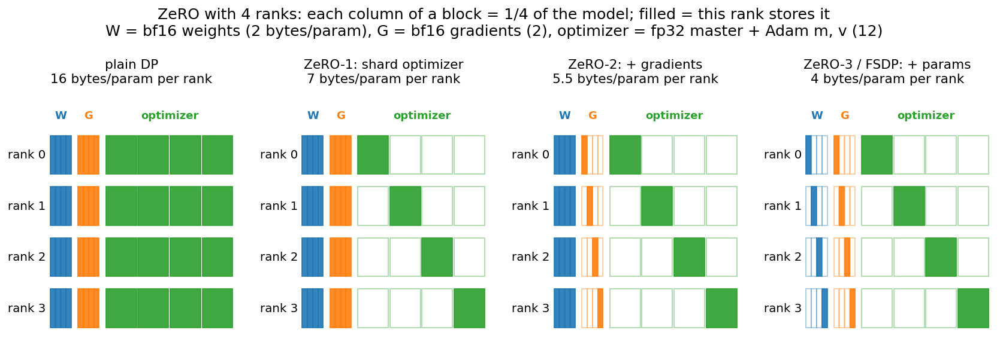
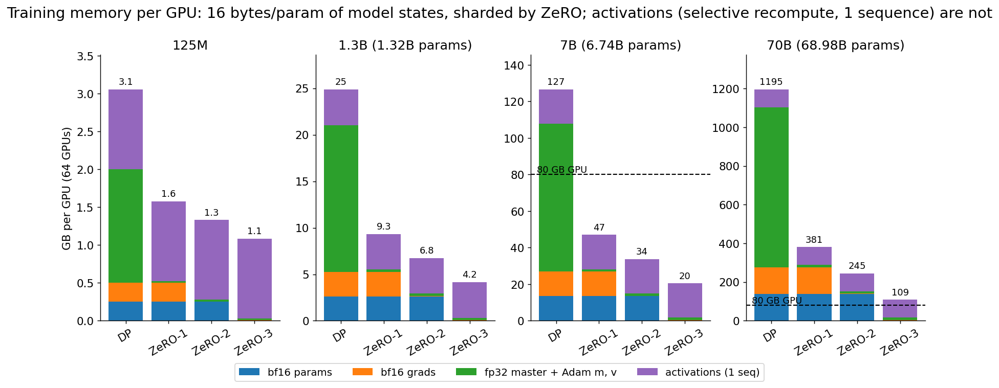
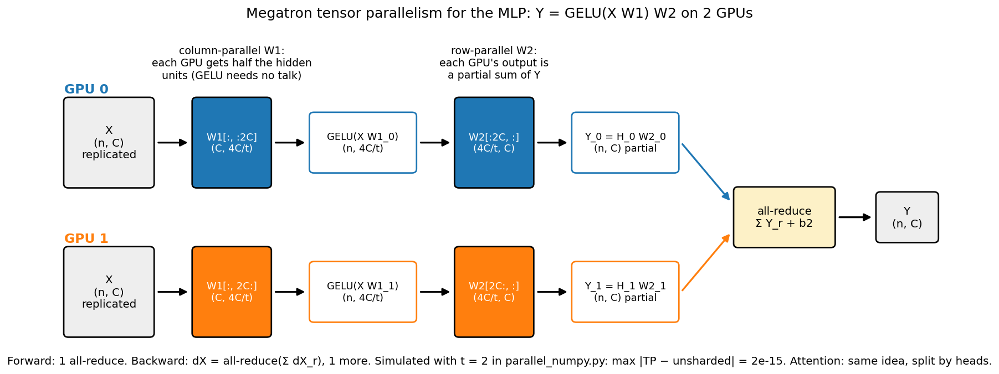
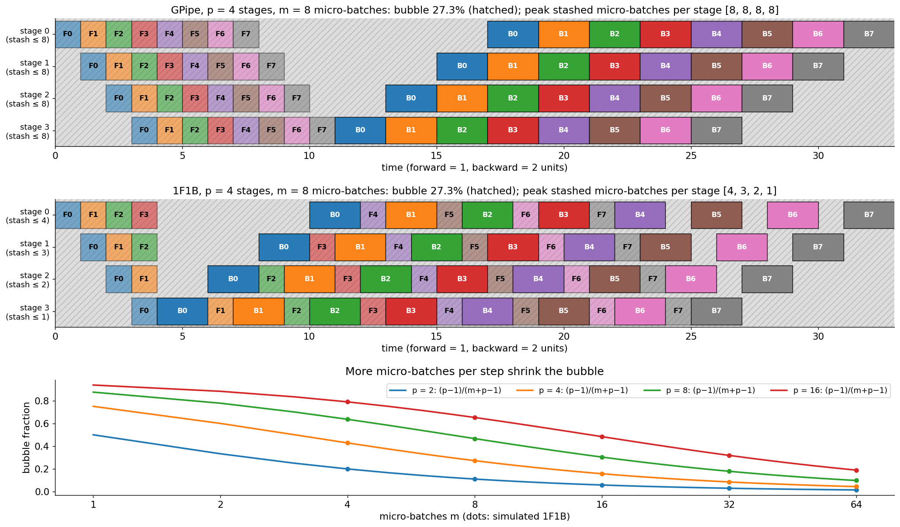

# Scaling training: precision, memory, and distributed training from scratch

How a model that trains in ten seconds on a laptop becomes a model that trains for
months on 16,000 GPUs. This folder takes the mini-GPT of [`../transformer/`](../transformer/)
and works out, with code you can read line by line, every trick that makes big training
runs possible: number formats and mixed precision with loss scaling, where every byte of
GPU memory goes, activation checkpointing, gradient accumulation, data parallelism with a
hand-written ring all-reduce, ZeRO/FSDP sharding, Megatron tensor parallelism and
GPipe/1F1B pipeline parallelism, all simulated in NumPy and **proved equal** to
single-device training; then the same ideas with real processes and `torch.distributed`
on this CPU, and the arithmetic (FLOPs, bytes, MFU) that decides how real runs are laid out.

> **Prerequisite:** [`../transformer/`](../transformer/) (the GPT trained and scaled
> here: its layers, its hand-written backward, AdamW, and the $6 \cdot N \cdot D$ FLOP rule from its
> section 11). [`../llama/`](../llama/) explains the modern decoder (RMSNorm, RoPE, SwiGLU,
> GQA) whose real 7B/70B shapes appear in the memory tables here; nothing in this folder's
> code depends on it.

## Files

| File | What it teaches |
|------|-----------------|
| `precision_numpy.py` | fp32 / fp16 / bf16 / FP8 (e4m3, e5m2) bit layouts from scratch; round-to-nearest-even to any format (checked against NumPy's float16 and the bf16 bit trick); why fp16 needs **loss scaling** (static and dynamic with overflow skipping) and bf16 doesn't; why weights need an **fp32 master copy** (in bf16, $1 + 10^{-4} = 1$) and what stochastic rounding does. Trains the mini-GPT under 7 precision recipes and compares. |
| `memory.py` | Calculator: parameter counts of GPT-3 125M/1.3B and LLaMA-2 7B/70B, the **16 bytes/param** rule, activation memory per layer (Korthikanti et al. 2022), checkpointing, ZeRO-1/2/3 per GPU, $\text{TP} \times \text{PP} \times \text{DP}$ layouts, $6 \cdot N \cdot D$ FLOPs, training time, MFU, communication volume. |
| `parallel_numpy.py` | $W$ workers simulated in one process, every message explicit: a **ring all-reduce** (reduce-scatter + all-gather), data parallelism, gradient accumulation, **ZeRO-1/2/3 (FSDP)** with gather-use-free of parameters, **Megatron tensor parallelism** (column/row-parallel MLP, attention split by heads), **pipeline parallelism** (GPipe and 1F1B schedules simulated in time, then executed on the real GPT). |
| `equivalence_check.py` | The `gradient_check.py` of this folder: 60 checks that each trick computes exactly what one device computes (float64). Ends with `Equivalence check PASSED`. |
| `allreduce_visual.py` | Step-by-step terminal walkthrough: 4 workers ring-all-reduce their gradients chunk by chunk (who sends what to whom, the partial sums), then one ZeRO-3 step (who holds which parameters when). |
| `ddp_pytorch.py` | Real multi-process training with `torch.distributed` (gloo, CPU): (a) manual DDP with `broadcast` + `all_reduce`, (b) `DistributedDataParallel` + `DistributedSampler` + `no_sync()`, (c) FSDP2 `fully_shard`, each proved equal to one process on the full batch; (d) throughput vs number of processes. Runs with `mp.spawn` or under `torchrun`. |
| `train_efficient.py` | Single-process tools on the PyTorch GPT: activation checkpointing (peak memory from `torch.profiler` vs time), gradient accumulation, bf16 autocast, `torch.compile`, the profiler's top ops, MFU on this CPU. |
| `make_figures.py` → `images/` | Draws every picture in this README from real computations (~2 s once `runs/` exists, ~2 min from scratch). |

### Suggested order

1. Read sections 1–3. Run `python distributed/precision_numpy.py` (~80 s) and watch fp16
   without loss scaling fall apart while every other recipe matches fp32.
2. Read sections 4–6, then run `python distributed/memory.py` and
   `python distributed/train_efficient.py` (~20 s).
3. Read section 7 and run `python distributed/allreduce_visual.py`; press Enter to watch
   the ring all-reduce happen chunk by chunk.
4. Read sections 8–11 with `parallel_numpy.py` open: every function is one box of a
   picture. Run `python distributed/parallel_numpy.py`, then
   `python distributed/equivalence_check.py`.
5. Run `python distributed/ddp_pytorch.py` (~12 s): the same ideas with real processes.
   Then `torchrun --nproc_per_node=2 distributed/ddp_pytorch.py --torchrun` (see section 8
   for a Python 3.9 caveat).
6. Read sections 12–16 (how real runs are laid out and how they fail), then answer the
   interview questions out loud and do the exercises.

To redraw the pictures: `python distributed/make_figures.py`.

Run the scripts from the repo root with the venv active (see the root `README.md`). The
scripts write their raw results to `distributed/runs/` (gitignored); `make_figures.py`
reads them or regenerates them. Timings in this README come from one run on an 18-core
Apple-silicon Mac that was busy with other work; they move by 10–30% from run to run.
Every loss, error and byte count is deterministic.

---

## 1. Why distributed training? The two walls

Two numbers decide everything. From [`../transformer/`](../transformer/) section 11, a
training run costs about

```math
\begin{aligned}
\text{FLOPs} &\approx 6 \cdot N \cdot D && N = \text{parameters}, \quad D = \text{training tokens} \\
& && (\text{forward } 2N \text{ per token: one multiply-add per weight; backward } 4N)
\end{aligned}
```

and, as section 4 below shows, training with Adam in mixed precision needs about
**16 bytes per parameter** before storing a single activation. `python distributed/memory.py`:

| | LLaMA-2-7B shape | LLaMA-2-70B shape |
|---|---|---|
| parameters (computed from the layer shapes) | 6.74B | 68.98B |
| model states, 16 bytes/param | 107.8 GB | 1.1 TB |
| 80 GB GPUs needed just to hold them | 1.3 | 13.8 |
| FLOPs for 1T tokens, $6ND$ + attention | 4.69e22 | |

1. **The compute wall.** 4.69e22 FLOPs on one H100 (989 TFLOP/s of dense bf16) at a
   realistic 40% utilization takes 3.8 years. On 1,024 H100s: 32.1 hours. You need many
   GPUs working on **one** model at the same time.
2. **The memory wall.** A 7B model's training state does not fit on one 80 GB GPU, and a
   70B model's needs 14 of them, before activations. You need to **split the model's
   state** across GPUs.

Every technique in this folder attacks one or both walls:

| Technique | Splits | Attacks | Section |
|-----------|--------|---------|---------|
| Mixed precision (bf16/fp16, FP8) | nothing: fewer bytes and faster math per number | both | 2–3 |
| Activation checkpointing | nothing: recompute instead of store | memory (costs ~33% compute) | 5 |
| Gradient accumulation | the batch, in time | memory (big batches on small GPUs) | 6 |
| Data parallelism (DDP) | the batch, across GPUs | compute | 7–8 |
| ZeRO / FSDP | optimizer state, gradients, parameters across the DP GPUs | memory | 9 |
| Tensor parallelism | every weight matrix | both, inside a node | 10 |
| Pipeline parallelism | the layers | both, across nodes | 11 |
| Sequence / context parallelism | the sequence | activation memory, long context | 12 |

The rule that keeps all of this sane: **none of them may change the math**. A model
trained on 1,024 GPUs must compute the same gradients as one (impossibly large) GPU
would. `equivalence_check.py` verifies exactly that for every technique here.

## 2. Number formats

A floating-point number is $(-1)^{\text{sign}} \cdot 1.\text{mantissa} \cdot 2^{\text{exponent} - \text{bias}}$. The exponent
bits decide the **range** (how big and how small), the mantissa bits the **precision**
(how many significant digits).



**What to look at:** π stored in each format, bit by bit, as `encode_bits` in
`precision_numpy.py` computes it. fp16 and bf16 both have 16 bits and both store π as
3.140625 (relative error 3.1e-4), but they spend their bits differently: bf16 keeps
fp32's 8 exponent bits, so its range is fp32's (up to 3.39e38, down to 1.2e-38); fp16
has 5 exponent bits and 10 mantissa bits, more precision but a tiny range (6.1e-5 to
65,504). FP8 e4m3 rounds π to 3.25, e5m2 to 3.

`python distributed/precision_numpy.py` prints the table from the bit counts alone:

```
  format    bits s|exp|man        max  min normal min subnorm  eps (1→next) digits
  fp32        32    1|8|23    3.4e+38    1.18e-38     1.4e-45      1.19e-07    7.2
  fp16        16    1|5|10   6.55e+04     6.1e-05    5.96e-08      0.000977    3.3
  bf16        16     1|8|7   3.39e+38    1.18e-38    9.18e-41       0.00781    2.4
  fp8_e4m3     8     1|4|3        448      0.0156     0.00195         0.125    1.2
  fp8_e5m2     8     1|5|2   5.73e+04     6.1e-05    1.53e-05          0.25    0.9
```

```math
\begin{aligned}
\text{max normal} &= (2 - 2^{-m}) \cdot 2^{2^e - 2 - \text{bias}} && \text{(IEEE: the all-ones exponent is inf/NaN)} \\
\text{min normal} &= 2^{1 - \text{bias}} \\
\text{min subnormal} &= 2^{1 - \text{bias} - m} && \text{(exponent field 0, no implicit leading 1)} \\
\text{eps} &= 2^{-m} && \text{(the gap between 1 and the next number)}
\end{aligned}
```

- **fp32** (IEEE single): the default for weights, optimizer state and reductions.
- **fp16** (IEEE half): fast on every GPU since Volta, but 70,000 overflows to `inf` and
  values below $2^{-24} \approx 6 \times 10^{-8}$ become 0. That is why it needs loss scaling (section 3).
- **bf16** (Google Brain's "brain float"; Kalamkar et al. 2019): the top 16 bits of an
  fp32. Same range as fp32, only ~2.4 significant digits. The default for LLM training
  on A100/H100/TPU since ~2020.
- **FP8** (Micikevicius et al. 2022; H100 tensor cores): e4m3 (more precision, max 448,
  no inf) for weights and activations, e5m2 (more range) for gradients, each tensor with
  its own scale factor so its values sit inside the tiny range. DeepSeek-V3 (2024) ran
  most of its training matmuls in FP8.

Rounding to bf16 is a two-line bit trick on the float32 bits (round to nearest, ties to
even), which `equivalence_check.py` verifies against the generic `round_to_format`:

```python
u = x.astype(np.float32).view(np.uint32)
bf16 = ((u + 0x7FFF + ((u >> 16) & 1)) & 0xFFFF0000).view(np.float32)
```

Adding `0x7FFF` rounds the discarded 16 bits up when they are above one half; the extra
`+1` when the last kept bit is 1 sends exact halves to the even neighbour; a carry
ripples into the exponent correctly (and the largest finite value rounds to `inf`).

## 3. Mixed precision and loss scaling

The mixed-precision recipe (Micikevicius et al. 2018), still used by every big run:

```
master weights      fp32   (the optimizer updates these)
compute copy        fp16/bf16 = cast(master)        each step
forward, backward   fp16/bf16 matmuls, accumulated in fp32 inside the tensor cores;
                    softmax, LayerNorm, loss and reductions in fp32
gradients           fp16/bf16 -> cast to fp32 -> optimizer (Adam m, v in fp32)
fp16 only:          multiply the loss by S before backward, divide the gradients by S after
```

`precision_numpy.py` emulates this on the NumPy GPT of `../transformer/`: `emulate_precision`
wraps every layer so that every tensor crossing a layer boundary (activations forward,
gradients backward, parameter gradients) is rounded to the chosen format, the way an
fp16/bf16 kernel stores its output, while the arithmetic inside a layer stays fp32.

### Why fp16 gradients underflow

The gradient of the mean cross-entropy is $d\text{logits} = (\operatorname{softmax} - \operatorname{onehot}) / (\text{number of tokens})$.
Once the model is confident, the wrong-class probabilities are tiny; divided by the
number of tokens in the batch, many fall below fp16's smallest number. Real runs average
over **far** more tokens than our 512 per step: with gradient accumulation, each
micro-batch's loss is divided by the number of micro-batches before its fp16 backward.
So `precision_numpy.py` emulates one micro-batch of a 1024-way accumulation, a
524,288-token (0.5M) batch, GPT-3 Small's batch size: divide by 1024 before the backward,
multiply by 1024 in fp32 after (`--accum 1` turns this off).

Real gradients of the fp32-trained mini-GPT (`precision_numpy.py`, part 5):

```
                                             flushed to 0 in fp16
  gradient           median |g|  512-tok batch  0.5M-tok batch   0.5M + S=2^16
  dL/dlogits            2.0e-08          54.0%           94.1%           14.0%
  activation grads      2.6e-05           2.8%           52.4%            0.3%
  parameter grads       1.6e-03           0.1%            1.7%            0.1%
```



**What to look at:** the activation gradients (every `dy` entering a layer's backward)
on a log2 scale at a 0.5M-token batch. Left: 52% are below $2^{-25}$ and round to exactly 0
in fp16, the other 48% are subnormal (fewer than 10 bits of precision), none is a normal
fp16 number. Right: multiplying the loss by $S = 2^{16}$ multiplies every gradient by $S$
(the chain rule is linear), which slides the histogram 16 bins right: 0% flush to 0,
86% are normal fp16 numbers. Dividing by $S$ in fp32 afterwards gives back the true
gradient. With a power of two, $(S \cdot g)/S = g$ exactly; `equivalence_check.py` checks
that bit for bit.

### Training under 7 recipes

Same init, same batches, 1,000 steps, only the rounding differs:

```
  fp32                   loss (last 100 steps) 0.400 | whole text 0.399
  fp16, no scaling       loss (last 100 steps) 3.005 | whole text 3.005 | = 0 in fp16: dlogits 63%, param grads 96%
  fp16 + static scale    loss (last 100 steps) 0.399 | whole text 0.397 | S = 2^10
  fp16 + dynamic scale   loss (last 100 steps) 0.399 | whole text 0.390 | skipped 9 steps, final S = 2^26
  bf16 (fp32 master)     loss (last 100 steps) 0.402 | whole text 0.400
  bf16, no master        loss (last 100 steps) 0.460 | whole text 0.454
  bf16, no master + SR   loss (last 100 steps) 0.401 | whole text 0.393
```



**What to look at:** left, five recipes lie on top of fp32. **fp16 without scaling**
learns slowly at first (the big gradients survive), then collapses around step 280: as the
model gets confident, the gradient reaching the lower layers underflows completely (96%
of all parameter gradients are exactly 0 over the last 100 steps), the body stops
learning and the model falls back to predicting character frequencies: its final loss,
3.005, is the unigram entropy of the text (2.979). **bf16 without an fp32 master copy**
learns visibly slower (0.454): see below. Right: the dynamic loss scale starts at $2^{32}$
(deliberately too high), overflows and halves 5 times in the first 5 steps, then
settles between $2^{25}$ and $2^{26}$, growing every 200 clean steps and backing off when it
overflows (9 skipped steps in total). Honest caveats: at a plain 512-token batch
(`--accum 1`), fp16 without scaling ends at 0.399, as good as fp32 (55% of `dlogits` still
flush to 0, but Adam normalizes whatever survives); the failure needs the realistic
batch size. And our emulation rounds at layer boundaries only; real kernels also round
some intermediates.

**Static vs dynamic loss scaling.** A fixed $S$ (here $2^{10}$) works if you pick it right:
too small and gradients underflow, too big and they overflow to `inf`. The dynamic
scaler (`DynamicLossScaler`, the algorithm of `torch.cuda.amp.GradScaler`) finds it:

```python
if any gradient is inf or NaN:   skip this optimizer step; S /= 2      # never let inf into Adam
else:                            count += 1; if count % 200 == 0: S *= 2
```

**Why bf16 needs none of this.** bf16 has fp32's exponent: its smallest normal number is
1.2e-38, so the same gradients never underflow (the `bf16 (fp32 master)` run needs no
scale and matches fp32). Its weakness is precision, which is why it still needs:

**fp32 master weights.** Adam's update is about `lr` per step relative to the weight, e.g.
1e-4. In bf16, the numbers next to 1.0 are $1 - 2^{-8}$ and $1 + 2^{-7} = 1.0078$: anything
smaller than half a step is rounded away.

```
  fp32: 1 + 1e-4 = 1.000100016593933
  fp16: 1 + 1e-4 = 1.0
  bf16: 1 + 1e-4 = 1.0
  Add 1e-4 to a weight of 1.0, 10,000 times (the exact answer is 2.0):
    fp32 accumulator               : 2.0002
    bf16, round to nearest         : 1.0000   every update is below half a bf16 step: all lost
    bf16, stochastic rounding      : 1.9993 ± 0.093 (mean ± std over 1000 weights)
```

So the optimizer keeps an fp32 copy and updates that; the bf16 copy is only for compute.
**Stochastic rounding** (round up with probability equal to the distance to the lower
neighbour) is unbiased, $\mathbb{E}[\operatorname{SR}(x)] = x$, so tiny updates survive on average: the
`bf16, no master + SR` run recovers fp32's loss (0.393) without the 4 extra bytes per
parameter. Some hardware (and some FP8/bf16 optimizers) does this; most training
stacks just keep the fp32 master.

## 4. The memory anatomy of training

**Model states: 16 bytes per parameter.** For $N$ parameters, mixed-precision AdamW keeps

| What | Format | Bytes / param |
|------|--------|---------------|
| weights (compute copy) | bf16 | 2 |
| gradients | bf16 | 2 |
| master weights | fp32 | 4 |
| Adam first moment $m$ | fp32 | 4 |
| Adam second moment $v$ | fp32 | 4 |
| **total** | | **16** |

(The ZeRO paper writes it $2\Psi + 2\Psi + K\Psi$ with $K = 12$ for the optimizer states.)
Inference needs only the 2 bytes of weights plus the KV cache; training needs 8× that.
`memory.py` computes the parameter counts from the layer shapes and matches the published
totals (125M, 1.32B for GPT-3 XL, 6.74B, 68.98B):

```
  model   bf16 W (2)  bf16 grad (2)  fp32 master (4)  Adam m (4)  Adam v (4)  total (16) 80 GB GPUs
  125M        250 MB         250 MB           501 MB      501 MB      501 MB      2.0 GB        0.0
  1.3B        2.6 GB         2.6 GB           5.3 GB      5.3 GB      5.3 GB     21.1 GB        0.3
  7B         13.5 GB        13.5 GB          27.0 GB     27.0 GB     27.0 GB    107.8 GB        1.3
  70B       138.0 GB       138.0 GB         275.9 GB    275.9 GB    275.9 GB      1.1 TB       13.8
```

**Activations: what autograd keeps for the backward.** Every layer stores some of its
inputs/outputs so its backward can run (`../transformer/` section 7: $dW = x^\top dy$ needs
$x$). Korthikanti et al. (2022) count them for a GPT layer with 16-bit activations,
sequence $s$, micro-batch $b$, width $h$, $a$ heads:

```math
\begin{aligned}
\text{activations per layer} &= s \cdot b \cdot h \cdot \left(34 + \frac{5 \cdot a \cdot s}{h}\right) \text{ bytes} \\
34 \cdot s \cdot b \cdot h &= \underbrace{11sbh}_{\text{attention}} + \underbrace{19sbh}_{\text{MLP}} + \underbrace{4sbh}_{\text{two LayerNorms}} \\
5 \cdot a \cdot s^2 \cdot b &= \underbrace{(2 + 2) \cdot a s^2 b}_{\text{scores and softmax}} + \underbrace{1 \cdot a s^2 b}_{\text{dropout mask}}
\end{aligned}
```

- attention $11sbh$: LN input, QKV input, $Q$, $K$, $V$, dropout mask, $W_o$ input
- MLP $19sbh$: input, the $4h$ GELU input and output, dropout mask
- $5 \cdot a \cdot s^2 \cdot b$: the $a \times s \times s$ attention scores and softmax (2 + 2 bytes) + its dropout mask (1)

```
  model    seq  per layer  no recompute  selective  full ckpt attn share
  125M    2048     305 MB        4.1 GB     1.1 GB     449 MB        82%
  1.3B    2048     478 MB       11.9 GB     3.8 GB     613 MB        70%
  7B      4096     3.3 GB      104.7 GB    18.8 GB     1.6 GB        82%
  70B     4096     6.5 GB      521.3 GB    91.8 GB     5.9 GB        82%
```

For **one** 4,096-token sequence, a 7B model's activations (104.7 GB) are as big as all
its model states (107.8 GB), and 82% of that is the $s \times s$ attention matrices. Unlike model states,
activations grow with batch × sequence length. That is why FlashAttention (which never
stores the $s \times s$ matrix), activation checkpointing and sequence parallelism exist.

We can measure this on the PyTorch GPT. `train_efficient.py` counts the bytes autograd
saves (a `saved_tensors_hooks` callback, leaving out the weights, which autograd also
saves) for a 6-layer, $d = 256$ GPT on $8 \times 256$ tokens: 206.5 MB of activations, 33.7 MB
per layer = **$32.1 \cdot s \cdot b \cdot h$** in 16-bit units. The paper's 34 includes two 1-byte dropout
masks ($2 \cdot s \cdot b \cdot h$); with dropout 0 it predicts 32. The $5 \cdot a \cdot s^2 \cdot b$ term ($40 \cdot s \cdot b \cdot h$ here) is
gone because PyTorch's fused `scaled_dot_product_attention` kernel keeps no $T \times T$
matrix.

## 5. Activation checkpointing

Store only some activations in the forward; recompute the rest during the backward
(Chen et al. 2016, "Training Deep Nets with Sublinear Memory Cost"). Checkpointing every
block keeps only each block's input ($2 \cdot s \cdot b \cdot h$ bytes per layer) and re-runs the block's
forward when its gradient arrives:

```python
class Checkpointed(nn.Module):           # train_efficient.py
    def forward(self, x):
        return torch.utils.checkpoint.checkpoint(self.block, x, use_reentrant=False)
```

Cost: one extra forward, and the forward is about 1/3 of a training step ($2N$ of $6N$
FLOPs), so $\approx$ +33% compute. Chen et al.'s $\sqrt{L}$ segments trade between the two extremes;
**selective recomputation** (Korthikanti et al. 2022) recomputes only the attention
scores/softmax: the $5 \cdot a \cdot s^2 \cdot b$ term, 82% of the memory at 2–5% of the FLOPs. With
FlashAttention that part is never stored in the first place.



**What to look at:** peak memory of one training step from `torch.profiler`
(`profile_memory=True`: each op records the bytes it allocated; their running sum is the
allocation timeline), against the step time. Checkpointing every 3rd / 2nd / every block
cuts the peak from 207.2 MB to 144.1 / 114.0 / 55.2 MB (27%) for +11% / +17% / **+33%**
time (75 → 100 ms), the theoretical third. The 55.2 MB floor includes the 19.3 MB of
gradients the backward creates. Orange: gradient accumulation (next section) also trades
time for memory, by shrinking the micro-batch instead.

## 6. Gradient accumulation

The gradient of a mean over a batch equals the mean of the gradients of its parts:

```math
\begin{aligned}
L &= \frac{1}{k} \sum_j L_j && L_j = \text{mean loss of micro-batch } j \ (B/k \text{ sequences}) \\
\nabla L &= \sum_j \nabla (L_j / k) && \to \text{run } k \text{ forward/backwards, each loss divided by } k \text{, let the .grad add up}
\end{aligned}
```

So a batch of $B$ can be processed as $k$ micro-batches of $B/k$ at $1/k$ of the
activation memory, with exactly the same update. `train_efficient.py` (float64):

```
   micro-batch x steps   peak memory  step time  max |grad - batch-8 grad|
   8 x 1                    207.2 MB       75 ms                    0.0e+00
   4 x 2                    122.9 MB       81 ms                    6.7e-16
   2 x 4                     73.7 MB       91 ms                    6.9e-16
   1 x 8                     47.1 MB      116 ms                    7.2e-16
```

Same gradients to 7e-16; time per sample rises once the micro-batch gets too small to
keep the cores busy. `parallel_numpy.accumulated_grads` is the same 6 lines in NumPy
(`equivalence_check.py`: equal to 1e-16).

Two traps. (1) Forgetting the $/k$ multiplies the gradient by $k$ (with Adam this mostly
cancels, with SGD it is a $k\times$ larger learning rate, and gradient clipping thresholds
change). (2) With variable-length sequences, "mean of the micro-batch means" is **not**
the mean over all tokens: weight each micro-batch by its token count, or sum the losses
and divide by the global token count once. Real frameworks have shipped this bug.

## 7. Data parallelism and the ring all-reduce

**Data parallelism (DP):** every GPU holds a full replica, takes a different $B/W$ slice
of the batch, computes its gradient, and then all GPUs **average** their gradients and
take the same optimizer step, so the replicas stay identical:

```math
\begin{aligned}
g_r &= \nabla \, \text{mean-loss over rank } r\text{'s } B/W \text{ sequences} && (W \text{ ranks, equal slices}) \\
g &= \frac{1}{W} \sum_r g_r = \nabla \, \text{mean-loss over all } B \text{ sequences} && \leftarrow \text{one all-reduce, then } / W
\end{aligned}
```

The "sum over ranks, result on every rank" operation is an **all-reduce**. The naive way
(everybody sends to rank 0, it sums and sends back) pushes $(W-1) \cdot n$ numbers through
rank 0's link each way: it does not scale. The **ring all-reduce** (Patarasuk & Yuan
2009; popularized for deep learning by Baidu and Horovod, Sergeev & Del Balso 2018) keeps
every link busy all the time:

Cut each rank's vector into $W$ chunks, then:

- reduce-scatter, $W-1$ steps: rank $r$ sends its partial sum of chunk $(r - s - 1) \bmod W$ to rank $r+1$,
  which ADDS it. After $W-1$ steps rank $r$ holds the full sum of chunk $r$.
- all-gather, $W-1$ steps: rank $r$ forwards the complete chunk $(r - s) \bmod W$ to rank $r+1$,
  which COPIES it.

```math
\text{each rank sends } 2(W-1) \text{ chunks of } \frac{n}{W} \text{ numbers} = \frac{2(W-1)}{W} \cdot n \;\to\; 2n, \text{ independent of } W
```



**What to look at:** top, the simulation's state after each of the 6 steps for 4
workers: each cell counts how many workers' gradients are summed into that copy. After 3
reduce-scatter steps the diagonal is complete (4); 3 all-gather steps copy it everywhere.
Bottom right, measured by counting the bytes in `CommLog`: the busiest ring worker sends +
receives $4(W-1)/W \cdot n \to 4n$ numbers for any $W$, while the naive root handles
$2(W-1) \cdot n$: $126n$ at $W = 64$.

`python distributed/parallel_numpy.py` with 1M fp32 numbers per worker:

```
      W  steps  ring: MB sent/worker  = 2(W-1)/W·n·4  naive: MB via rank 0
      2      2                  4.00            4.00                   4.0
      4      6                  6.00            6.00                  12.0
      8     14                  7.00            7.00                  28.0
     16     30                  7.50            7.50                  60.0
```

A useful cost model (the $\alpha\text{--}\beta$ model) for an all-reduce of $n$ bytes on $W$ GPUs with
per-message latency $\alpha$ and link bandwidth $\beta$:

```math
T_{\text{ring}} \approx 2(W-1) \cdot \alpha + \frac{2(W-1)}{W} \cdot \frac{n}{\beta}
```

Bandwidth cost is flat in $W$; latency grows with $W$. That is why NCCL also uses tree
algorithms for large W and small messages, and why DDP sends gradients in big buckets.
`memory.py` turns it into seconds: all-reducing a 7B model's bf16 gradients means each
GPU sends 26.5 GB per step on 64 GPUs: 0.53 s at 50 GB/s (a 400 Gb/s InfiniBand NIC),
0.06 s over NVLink (450 GB/s). It must hide behind the backward pass.

**It is exact.** `parallel_numpy.py` trains 4 replicas for 3 AdamW steps:

```
   max |param difference| between replicas      : 0.0e+00
   max |param difference| replica 0 vs 1 worker : 3.3e-16, and 6.7e-12 in the key biases b_k
```

The replicas are bit-identical (they apply identical updates), and they match one worker
on the full batch to 3e-16, except in one place worth understanding: the key bias $b_k$,
whose true gradient is exactly 0 (softmax ignores a constant shift, `../transformer/`
section 7). Its computed gradient is pure round-off (~1e-16), and Adam divides each
gradient by its own RMS, so a different summation order becomes a 1e-12 difference.
Real-world corollary: two "identical" runs with different DP sizes are equal in exact
arithmetic, not bitwise.

Watch it step by step: `python distributed/allreduce_visual.py`.

## 8. DDP internals, and real processes on this CPU

`torch.nn.parallel.DistributedDataParallel` (Li et al. 2020) is data parallelism plus
engineering that hides the communication:

- **Broadcast at construction:** rank 0's parameters (and buffers) are sent to everyone,
  so all replicas start equal.
- **Gradient buckets:** parameters are grouped into ~25 MB buckets (`bucket_cap_mb`), in
  reverse order of use, because the backward produces the last layer's gradients first.
  After the first iteration DDP rebuilds the buckets in the order gradients actually
  became ready.
- **Overlap:** an autograd hook fires when a parameter's gradient is ready; when all
  gradients of a bucket are ready, its all-reduce starts **asynchronously** while the
  backward continues with earlier layers. Only the last bucket's all-reduce is exposed.
- **Averaging:** gradients are summed and divided by $W$.
- `no_sync()`: skip the all-reduce for the first micro-batches of a gradient accumulation;
  the last backward all-reduces the accumulated sum. Without it you communicate $k$ times
  per step for nothing.
- `DistributedSampler`: gives each rank a disjoint $1/W$ of the dataset (call
  `set_epoch(e)` each epoch so the shuffle changes). Uneven shards (`drop_last=False`)
  make one rank run an extra step and **hang** the others in the all-reduce.
- `find_unused_parameters=True` is needed if some parameters get no gradient in a step
  (otherwise DDP waits for them forever); it costs an extra graph traversal.

`python distributed/ddp_pytorch.py` spawns 4 CPU processes (`torch.multiprocessing.spawn`,
gloo backend) and trains the PyTorch GPT of `../transformer/transformer_pytorch.py` in
float64:

```
(a) manual DDP, W = 4, float64, 5 AdamW steps, 4 sequences per rank
    weights differ across ranks before broadcast: max |Δ| = 0.13; after: 0.0e+00
    after training: ranks differ by 0.0e+00; rank 0 vs ONE process on the concatenated batch: 1.4e-14
    29 all-reduce calls per step, 13.8 ms of communication per step on rank 0

(b) DistributedDataParallel, W = 4: DistributedSampler gives each rank 966 of the 3865 windows;
    2 micro-batches of 2 per step (no_sync on the first), global batch = 4·2·2 = 16 sequences
    weights identical after DDP(model) (it broadcasts rank 0's): 0.0e+00; after 4 steps: 0.0e+00
    rank 0 vs ONE process on the union of all ranks' micro-batches: 1.0e-14
    gradient buckets (bucket_cap_mb=0.1): 7 buckets of 155, 133, 134, 133, 133, 134, 40 kB

(c) FSDP2 (fully_shard per block + root), W = 4, on cpu/gloo
    parameters per rank: 26,944, 26,944, 26,944, 26,944 of 107,776 (25%); Adam m+v per rank:
    53,888 numbers (vs 215,552 unsharded)
    after 5 steps, gathered params vs ONE process on the full batch: 1.4e-14
```

The manual version (a) is the whole idea in 5 lines:

```python
for p in model.parameters():
    dist.broadcast(p.data, src=0)              # once: everyone starts from rank 0's weights
...
loss.backward()
for p in model.parameters():
    dist.all_reduce(p.grad, op=dist.ReduceOp.SUM)
    p.grad /= W                                # sum of per-rank means / W = global mean
opt.step()
```

Part (b) rebuilds, on rank 0, exactly which windows every rank's `DistributedSampler`
handed out and checks that one process training on their union gets the same weights.
Part (c) shows FSDP2 works on CPU with gloo in torch 2.8: every rank holds a quarter of
every parameter (as a `DTensor` shard) and a quarter of Adam's state.



**What to look at:** part (d), weak scaling (16 sequences × 64 tokens per process per
step, a 4-layer $d = 128$ GPT, 2 threads per process):

```
      W  no comm: tok/s  DDP: tok/s  DDP speed-up  step alone/DDP (ms)  1 all-reduce (ms)
      1          62,360      61,253         0.98x        16.4 /  16.7               0.01
      2         106,343      95,065         1.52x        19.3 /  21.5               1.16
      4         172,737     145,823         2.34x        23.7 /  28.1               2.89
      8         248,718     195,367         3.13x        32.9 /  41.9               5.11
```

Honest reading: 8 processes are 3.13× faster than one, not 8×, and most of the loss is
not communication. Blue: the same 8 processes training **without** talking to each other
already run at 50% per-process speed, because they share one CPU's memory bandwidth,
caches and a mix of performance and efficiency cores. DDP then costs another 21% (one
3.3 MB all-reduce over localhost TCP takes 5.1 ms vs a 33 ms step). On a real cluster each
GPU has its own memory, and NVLink/InfiniBand all-reduces are overlapped with the
backward; Li et al. (2020) report near-linear scaling of DDP on 256 GPUs.

**Launching.** Two modes, same code:

```bash
python distributed/ddp_pytorch.py                                # mp.spawn: W processes, sets MASTER_ADDR/PORT itself
torchrun --nproc_per_node=2 distributed/ddp_pytorch.py --torchrun   # torchrun sets RANK, WORLD_SIZE, LOCAL_RANK, MASTER_*
```

Under `torchrun --nproc_per_node=2` the same checks pass ($W = 2$: 1.1e-14, 5.2e-14 and
1.1e-14). **Caveat for Python 3.9:** torch 2.8's `torchrun` launcher imports the
`importlib_metadata` backport; without it, `torchrun` exits with
`ModuleNotFoundError: No module named 'importlib_metadata'` before starting any worker.
`requirements.txt` installs it on Python < 3.10 (on 3.10+ it is not needed). The
`mp.spawn` mode needs nothing extra.

**On GPUs** (untested here, no GPU on this machine; the code paths exist):

```bash
torchrun --nproc_per_node=8 distributed/ddp_pytorch.py --torchrun --backend nccl
torchrun --nnodes=2 --nproc_per_node=8 --rdzv_backend=c10d --rdzv_endpoint=<node0>:29500 \
         distributed/ddp_pytorch.py --torchrun --backend nccl          # run on both nodes
```

What changes with `nccl`: one process per GPU, `torch.cuda.set_device(LOCAL_RANK)`, the
model and every batch on `cuda:LOCAL_RANK`, `DDP(model, device_ids=[LOCAL_RANK])`, the
FSDP device mesh on `"cuda"`, and the collectives run on NVLink inside a node and
InfiniBand/RoCE between nodes. Debug with `NCCL_DEBUG=INFO` and
`TORCH_DISTRIBUTED_DEBUG=DETAIL`; `init_process_group(timeout=...)` controls how long a
rank waits in a collective before the watchdog kills the job (section 16).

## 9. ZeRO and FSDP: shard the model states

Plain DP stores **all 16 bytes/param on every GPU**: W identical copies of the optimizer
state. ZeRO (Rajbhandari et al. 2020, "Zero Redundancy Optimizer") removes the
redundancy in three stages; PyTorch's **FSDP** (Zhao et al. 2023) is ZeRO-3.
Per-GPU model states, $N$ params, $W$ data-parallel GPUs:

```math
\begin{array}{lll}
\text{plain DP} & 2N + 2N + 12N & \text{weights, grads, optimizer all replicated} \\
\text{ZeRO-1} & 2N + 2N + 12N/W & \text{shard the optimizer state (fp32 master, } m, v) \\
\text{ZeRO-2} & 2N + (2N + 12N)/W & + \text{ shard the gradients} \\
\text{ZeRO-3} & (2N + 2N + 12N)/W & + \text{ shard the parameters} \quad (= \text{FSDP FULL\_SHARD})
\end{array}
```



**What to look at:** with 4 ranks, each rank owns one quarter of each block (filled). The
per-rank cost drops from 16 to 7, 5.5 and 4 bytes per parameter.

How a ZeRO-3 / FSDP step works (`parallel_numpy.ZeroSimulator`, and
`python distributed/allreduce_visual.py` part 2):

```
parameters are grouped into units (FSDP wraps each block); each unit is flattened,
padded to a multiple of W and cut into W shards; rank r owns shard r of every unit
forward : for each unit: all-gather its shards -> full weights -> compute -> FREE them
backward: for each unit (reverse): all-gather again -> backward -> FREE
          reduce-scatter its gradient: rank r receives Σ_ranks (grad of shard r)
optimizer: rank r updates ONLY its shard with ITS slice of m, v and master weights
```

This is exact because AdamW is element-wise: updating 4 slices separately is updating the
whole vector. The simulation overwrites freed parameters with NaN, so any use of a
parameter that was not gathered at that moment would poison the loss. Results ($W = 4$,
3 steps, vs plain AdamW on the full batch):

```
             max |Δ| vs AdamW    (b_k)   params    grads    optim  total B/rank  numbers sent/rank/step
   DP                                     16256    16256    97536        130048                   12192
   ZeRO-1             2.2e-16    3e-12    16256    16256    24384         56896                   12192
   ZeRO-2             2.2e-16    3e-12    16256     4064    24384         44704                   12192
   ZeRO-3             2.2e-16    3e-12     4064     4064    24384         32512                   17112
```

- ZeRO-1 and ZeRO-2 send the **same** bytes as DP: an all-reduce is a reduce-scatter
  plus an all-gather, and ZeRO just puts the optimizer step in between (reduce-scatter
  the gradients, update your shard, all-gather the new parameters). Memory for free.
- ZeRO-3 sends ~1.5× (17,112 vs 12,192 numbers): the parameters are gathered twice
  (forward and backward). Peak gathered parameters on a rank: 4,848 of 8,128 (the root
  unit + one block). Real FSDP prefetches the next unit during the current one's compute,
  so ~2 units are live, and reduce-scatters each block's gradients as soon as its backward
  finishes, overlapping communication with compute.
- In this sequential simulation, stages 1 and 2 run the same collectives; the difference
  is what each rank keeps (ZeRO-2 drops the non-owned gradient parts as soon as they are
  reduced, bucket by bucket).



**What to look at:** per-GPU memory on 64 GPUs, model states by ZeRO stage plus the
activations of one sequence (selective recompute). For 7B, plain DP needs 127 GB (doesn't
fit an 80 GB GPU), ZeRO-1 47 GB, ZeRO-2 34 GB, ZeRO-3 20 GB, of which only 1.7 GB is
model states: the rest is activations, which ZeRO does not touch. For 70B even ZeRO-3
needs 109 GB per GPU: 17.2 GB of states but 91.8 GB of activations for a 4,096-token
sequence. That is where tensor and sequence parallelism come in.

Variants you will meet: **HSDP** (hybrid sharding: FSDP inside a node, replicate across
nodes, so the all-gathers stay on fast links), **ZeRO++** / **ZeRO-Offload / Infinity**
(offload states to CPU RAM/NVMe), and FSDP's `reshard_after_forward=False` (keep the
gathered parameters between forward and backward: ZeRO-2 memory with fewer gathers,
which is what Llama 3 did for its model shards).

## 10. Tensor parallelism (Megatron-LM)

When even one layer's weights or activations are too big, split **every matrix**
(Shoeybi et al. 2019). For the MLP $Y = \operatorname{GELU}(X W_1) W_2$:

```math
\begin{aligned}
&\text{column-parallel } W_1: && W_1 = \begin{bmatrix} W_{1,0} & W_{1,1} & \cdots \end{bmatrix} && \text{rank } i: \; H_i = \operatorname{GELU}(X W_{1,i}) \quad (n, 4C/t) \\
& && X \text{ is replicated; GELU is element-wise, so no communication} \\
&\text{row-parallel } W_2: && W_2 = \begin{bmatrix} W_{2,0} \\ W_{2,1} \\ \vdots \end{bmatrix} && \text{rank } i: \; Y_i = H_i W_{2,i} \quad (n, C) \text{, a PARTIAL sum} \\
& && Y = \text{all-reduce}\Big(\sum_i Y_i\Big) + b_2 && \leftarrow 1 \text{ all-reduce forward} \\
&\text{backward:} && dY \text{ is replicated; each rank computes its } dW_{2,i}, dW_{1,i} \text{ locally;} \\
& && dX = \text{all-reduce}\Big(\sum_i dX_i\Big) && \leftarrow 1 \text{ all-reduce backward}
\end{aligned}
```

Megatron calls the two conjugate operators $f$ (identity forward, all-reduce backward)
and $g$ (all-reduce forward, identity backward). Attention is split by **heads**: rank $i$
gets the q, k and v columns of its heads (column-parallel $W_{qkv}$) and the matching rows
of $W_o$ (row-parallel); heads never interact until $W_o$, so again one all-reduce
forward and one backward.



**What to look at:** each GPU holds half of $W_1$ (its columns) and half of $W_2$ (its
rows) and does half the FLOPs; the only communication is summing the partial outputs.
`parallel_numpy.tp_mlp` / `tp_attention` reuse `../transformer/`'s `Linear`, `GELU` and
`CausalSelfAttention` classes on the shards (the attention shard is the same class with
fewer heads) and match the unsharded layers: outputs, input gradients and all weight
gradients equal to 1e-14 for $t = 2$ and $4$.

The price: per layer and micro-batch, 2 all-reduces of $b \cdot s \cdot h$ activations forward and 2
backward, **on the critical path** (the next op needs the result). That needs NVLink-class
bandwidth, so TP stays inside a node: $t \le 8$ in practice. **Sequence parallelism**
(Korthikanti et al. 2022) splits the LayerNorm/dropout regions between the TP blocks along
the sequence, turning each all-reduce into a reduce-scatter + all-gather (same bytes) and
dividing the remaining replicated activations by $t$: that is the $/t$ in `memory.py`.

## 11. Pipeline parallelism

Split the **layers** into $p$ stages on $p$ GPUs; stage $s$ sends its activations to stage
$s+1$ and receives gradients back. Naively only one GPU works at a time. GPipe (Huang et
al. 2019) splits the batch into $m$ **micro-batches** so the stages can work on different
micro-batches at once:

```math
\text{bubble (idle) fraction} = \frac{p - 1}{m + p - 1} \qquad \text{for both GPipe and 1F1B}
```

- GPipe: all $m$ forwards, then all $m$ backwards → stage stashes activations of $m$ micro-batches
- 1F1B: $p-s-1$ warm-up forwards, then alternate one forward / one backward
  → stage $s$ stashes at most $p - s$ micro-batches (PipeDream-Flush; Narayanan et al. 2021)



**What to look at:** `simulate_schedule` runs the per-stage op lists in time (forward 1
unit, backward 2) with the dependencies $F(s, i) \leftarrow F(s-1, i)$ and $B(s, i) \leftarrow B(s+1, i)$. With
$p = 4$ and $m = 8$, both schedules take 33 time units and idle 27.3% of the time (hatched),
exactly $(p-1)/(m+p-1) = 3/11$; but GPipe's stages each hold 8 micro-batches of
activations, 1F1B's hold 4, 3, 2, 1. Bottom: the formula and simulated 1F1B points; for
$p = 16$ even $m = 64$ micro-batches still leave a 19% bubble.

`run_pipeline` then executes those schedules on a 4-block GPT split into 4 stages
(stage 0 also owns the embeddings, stage 3 the final LayerNorm, head and loss), each
micro-batch's loss divided by $m$, in the simulated time order: gradients equal to the
full-batch ones to 1e-16, for GPipe and 1F1B.

Refinements: **interleaved 1F1B** (Narayanan et al. 2021) gives each GPU $v$
non-contiguous chunks of layers, dividing the bubble by $v$ at the cost of more
communication (Llama 3 used it); **zero-bubble** schedules (Qi et al. 2023) split the
backward into input-gradient and weight-gradient parts to fill the bubble. PP sends only
activations between neighbours (point-to-point, $b \cdot s \cdot h$ per micro-batch), so it tolerates
slower inter-node links than TP. Its costs: the bubble, uneven stages (the embedding and
loss stages), and a global batch that must be at least $m \times \text{micro-batch} \times \text{DP}$.

## 12. Sequence and context parallelism (briefly)

Long contexts make activations, not weights, the problem (the $5 \cdot a \cdot s^2 \cdot b$ term and
everything linear in $s$).

- **Sequence parallelism** (Megatron, section 10): within a TP group, split the
  non-matmul regions along the sequence.
- **Context parallelism (CP)**: split the sequence itself across GPUs for the whole
  layer. Attention needs every key: either pass K/V blocks around a ring while computing
  blockwise attention (**Ring Attention**, Liu et al. 2023), or all-gather K and V (Llama 3,
  cheap with GQA because K/V are small). Llama 3 used CP = 16 for its 128K-token stage.
- **DeepSpeed-Ulysses** (Jacobs et al. 2023): all-to-all from sequence-sharded to
  head-sharded before attention and back after.
- **Expert parallelism** for mixture-of-experts: each GPU hosts some experts; tokens are
  routed to them with an **all-to-all** and back.

## 13. 3D (4D) parallelism: how real runs are laid out

Combine them, matching each kind of traffic to the network that can carry it:

```
innermost (fastest links) ............................................ outermost
TP (+SP)          inside a node, NVLink: all-reduces every layer, on the critical path
CP                inside/near a node: K/V exchange every attention layer
PP                across nodes: point-to-point activations, once per stage boundary
DP (FSDP/ZeRO)    across everything: one gradient reduce-scatter/all-gather per step, overlapped
```

```math
\#\text{GPUs} = \text{TP} \times \text{CP} \times \text{PP} \times \text{DP}
```

Llama 3 405B (Grattafiori et al. 2024, "The Llama 3 Herd of Models", Table 4), ordered
[TP, CP, PP, DP] exactly for this reason:

| GPUs | TP | CP | PP | DP | Seq. len. | Tokens/batch | TFLOP/s per GPU | BF16 MFU |
|------|----|----|----|----|-----------|--------------|-----------------|----------|
| 8,192 | 8 | 1 | 16 | 64 | 8,192 | 16M | 430 | 43% |
| 16,384 | 8 | 1 | 16 | 128 | 8,192 | 16M | 400 | 41% |
| 16,384 | 8 | 16 | 16 | 8 | 131,072 | 16M | 380 | 38% |

Notes from the same paper: DP is FSDP (optimizer state and gradients sharded; parameters
not resharded after the forward), PP uses an interleaved schedule, and they trained 8K
sequences **without activation checkpointing**. MFU drops on 16K GPUs because the batch
per DP group halves (16M tokens is fixed by optimization, not hardware).

`memory.py` does the same arithmetic for our four shapes (micro-batch 1, selective
recompute, sequence parallelism, 1F1B):

```
  model  TP  PP   DP  GPUs ZeRO    states   activ.     total  fits 80 GB?
  7B      1   1   64    64    0  107.8 GB  18.8 GB  126.6 GB  NO
  7B      1   1   64    64    3    1.7 GB  18.8 GB   20.5 GB  yes
  7B      2   1   32    64    1   14.7 GB   9.4 GB   24.1 GB  yes
  70B     1   1   64    64    3   17.2 GB  91.8 GB  109.0 GB  NO
  70B     8   1    8    64    1   47.4 GB  11.5 GB   58.9 GB  yes
  70B     8   4   32  1024    1    9.4 GB  11.5 GB   20.9 GB  yes
```

A 7B model trains fine with FSDP alone; a 70B model with 4K sequences needs TP = 8 to cut
its activations, then FSDP/ZeRO-1 over DP for the states. Try your own:
`python distributed/memory.py --model 70B --gpus 1024 --tp 8 --pp 4 --micro-batch 1`.

## 14. Collectives cheat sheet

$n$ = numbers per rank's buffer, $W$ ranks, ring algorithms (bandwidth term only):

| Collective | Before → after | Sent per rank | Used by |
|------------|----------------|---------------|---------|
| broadcast | rank 0 has $x$ → all have $x$ | $\approx n$ (pipelined) | DDP init, config |
| reduce | each has $x_r$ → rank 0 has $\sum x_r$ | $\approx n$ | logging a global loss |
| **all-reduce** | each has $x_r$ → all have $\sum x_r$ | $2(W-1)/W \cdot n$ | DDP gradients, TP activations |
| **reduce-scatter** | each has $x_r$ → rank $r$ has chunk $r$ of $\sum x$ | $(W-1)/W \cdot n$ | ZeRO-2/3, FSDP gradients, SP |
| **all-gather** | rank $r$ has chunk $r$ → all have everything | $(W-1)/W \cdot n$ | ZeRO-3/FSDP parameters, SP, CP K/V |
| all-to-all | rank $r$ has $W$ pieces → piece $j$ goes to rank $j$ | $(W-1)/W \cdot n$ | MoE expert routing, Ulysses |
| send / recv | point to point | the tensor | pipeline activations and gradients |
| barrier | wait for everyone | 0 | timing, shutdown |

Identities worth knowing: all-reduce = reduce-scatter + all-gather (that is how the ring
does it, and why ZeRO-1/2 cost no extra bandwidth); all-gather is the "transpose" of
reduce-scatter (FSDP's forward gather becomes a reduce-scatter in the backward). The
`equivalence_check.py` checks the first one.

## 15. torch.compile, profiling and MFU

**MFU (model FLOPs utilization)**, from PaLM (Chowdhery et al. 2022): the FLOPs the model
needs per token ($6N + 12 \cdot L \cdot s \cdot d$ for attention), times tokens per second, divided by the
hardware's peak. Recomputation does not count (that would be HFU, hardware FLOPs
utilization), so MFU measures useful work. PaLM 540B: 46.2% on 6,144 TPU v4 chips; Llama 3
405B: 38–43%. `memory.py` back-solves LLaMA-2's published GPU-hours (Touvron et al. 2023:
184,320 A100-hours for 7B on 2T tokens) to an implied 39% (43% for 70B).

`python distributed/train_efficient.py` on this CPU:

```
   best fp32 matmul (2048 x 2048): 1909 GFLOP/s  <- our 'peak'
   training: 27,381 tokens/s x 33.3 MFLOP/token (6N + 12·L·T·d) = 911 GFLOP/s
   MFU = 48% of the measured fp32 matmul peak
```

The profiler shows where the rest goes (one eager fp32 training step, top rows by self
time): `aten::mm` 31.6% and `aten::addmm` 18.4% (the matmuls, forward and backward), the
fused attention kernels 15.8% + 8.4%, `gelu_backward` 7.7%, `gelu` 6.9%, then LayerNorm
backward, sums, copies and in-place adds. Everything that is not a matmul is memory-bound
element-wise work.

- **torch.compile** (TorchDynamo + Inductor) fuses those element-wise ops into a few
  generated kernels. Here: 78 ms per step compiled vs 75 ms eager (0.96×, no gain on this
  CPU, where Accelerate's matmuls dominate), and a 0.9 s first step (Inductor caches its
  generated kernels on disk, so the very first compile on a machine takes longer). On
  GPUs, where element-wise kernels are a bigger share of the step, fusion pays off more.
- **bf16 autocast on this CPU is a trap**: a $512 \times 512$ matmul runs at 1,578 GFLOP/s in fp32
  (Apple Accelerate) and 3.8 GFLOP/s in bf16 (417× slower: this PyTorch build has no bf16
  matrix kernels for this CPU). On transformer/'s small GPT a training step takes 2.0 ms in
  fp32 and 18 ms with `torch.autocast("cpu", dtype=torch.bfloat16)`. The numerics are
  fine: same weights, loss 3.77970 vs 3.77977; after 60 identical steps 2.1076 vs 2.1083.
  On GPUs bf16 tensor cores are several times faster than fp32. Always measure.
- Other habits: profile before optimizing (`torch.profiler`, then
  `prof.export_chrome_trace` and look at the timeline for gaps), keep matmul dimensions
  multiples of 64/128, use fused optimizers (`foreach`/`fused=True` AdamW), pin memory and
  prefetch data so the GPU never waits for the loader.

## 16. Failure modes at scale

At 16,000 GPUs something is always broken. Llama 3's pre-training saw **466 job
interruptions in 54 days**, 419 unexpected; about 78% were confirmed or suspected hardware
issues (GPUs alone 58.7%), yet automation kept effective training time above 90%
(Grattafiori et al. 2024, section 3.3.4).

- **Loss spikes.** Bad data batches, too high an LR, attention logits growing (fix:
  QK-LayerNorm, z-loss; Wortsman et al. 2023), Adam's `v` underestimating rare large
  gradients. PaLM's recipe: restart from a checkpoint ~100 steps before the spike and skip
  ~200–500 data batches. Monitor the gradient norm: it usually spikes first.
- **NaN / inf.** fp16 overflow (use dynamic loss scaling or bf16), division by ~0 in a
  norm, log of 0. Check `torch.isfinite` on the loss and grad norm every step and skip or
  stop; `torch.autograd.set_detect_anomaly(True)` finds the op (slowly). One NaN on one
  rank becomes NaN everywhere after the next all-reduce.
- **Stragglers.** Collectives are synchronous: the step takes as long as the slowest
  rank (a throttling GPU, a bad NIC, a noisy neighbour, a slow data loader). Log per-rank
  step times and find the outlier.
- **Hangs and NCCL timeouts.** Every rank must call the same collectives in the same order
  with the same shapes. Classic causes: one rank takes a different code path
  (`if rank == 0: dist.all_reduce(...)`), uneven data (one rank has an extra batch), an
  exception on one rank while the others wait, or a dead link. Symptoms: GPUs at 100% with
  no progress, then a watchdog error after `timeout` (an `init_process_group` argument;
  30 min by default for gloo in this torch, shorter for NCCL in recent versions). Tools:
  `TORCH_DISTRIBUTED_DEBUG=DETAIL` (checks collective consistency), `NCCL_DEBUG=INFO`,
  PyTorch's NCCL flight recorder (`torchfrtrace`), and `py-spy dump` on every rank to see
  who is stuck where.
- **Silent data corruption.** A GPU that computes wrong numbers without crashing (Llama 3
  attributes 6 interruptions to it). Detect with loss/grad-norm anomalies across ranks
  and periodic deterministic re-computation checks.
- **Checkpoint/restart.** Save sharded checkpoints (`torch.distributed.checkpoint`: each rank
  writes its own shard, resharding on load), asynchronously so training doesn't stall,
  and include everything needed for a bitwise-continuable run: optimizer state, LR
  scheduler, step, data-loader position, RNG states, loss-scaler state. Test restarting
  before you need it; a run that cannot resume is a run that will be lost.

## 17. Practical tips and debugging

- **Prove equivalence first, at tiny scale.** Run the distributed version and the
  single-process version on the same data in float64 and compare weights after a few
  steps (`equivalence_check.py`, `ddp_pytorch.py`). Then scale.
- **Start simple:** one GPU → DDP → FSDP (ZeRO-3) → add TP inside the node → add PP across
  nodes, only when memory or scaling efficiency forces you to.
- **Pick the micro-batch from memory, the global batch from optimization.** The global batch
  (tokens/step) is a hyperparameter; $\text{DP} \times \text{micro-batch} \times \text{accumulation steps}$ must equal it.
  When you change $W$, change the accumulation, not the global batch.
- **Seeds:** same model-init seed on every rank (or broadcast/load), different data
  shuffles per rank (`DistributedSampler`), different dropout masks per rank.
- **Only rank 0 logs and saves** (but every rank must join the collectives that produce what
  rank 0 logs). Reduce metrics across ranks before logging them.
- **Check the bytes:** `memory.py`-style estimates before you launch; `torch.cuda.max_memory_allocated()`
  after a step. If the measurement is far above the estimate, look for activations you
  didn't expect (logits in fp32 at a 128k vocabulary are huge) and fragmentation.
- **Communication:** overlap it (DDP buckets, FSDP prefetch), make it big (bucket sizes),
  and keep it on the right links (TP inside a node).
- **bf16 by default**, fp32 for master weights, optimizer state, softmax/LayerNorm/loss and
  gradient reductions across many ranks (Llama 3 reduce-scatters gradients in fp32).
- **On a Mac/CPU:** use gloo, give each process a fixed number of threads
  (`torch.set_num_threads`), and remember that processes compete for one memory system.

## 18. From this folder to production / frontier labs (why this matters for an AI engineer)

Every frontier model is trained by code that does what `parallel_numpy.py` does, at a
scale where a 1% efficiency gain is worth millions of dollars and a hang at 3 a.m. stops
16,000 GPUs. The skills here are exactly what training-infrastructure and pretraining
teams interview for:

- **Back-of-the-envelope math:** given a model and a cluster, estimate memory per GPU,
  FLOPs, days and dollars in five minutes (`memory.py`). Nobody launches a run without it.
- **Choosing a parallelism layout:** FSDP for up to tens of billions of parameters,
  $\text{TP} \times \text{PP} \times \text{DP}$ ($\times$ CP, $\times$ EP for MoE) beyond, ordered by bandwidth (section 13).
- **Reading a profile:** where are the bubbles, is communication overlapped, what is MFU?
- **Numerics:** bf16 vs fp16 vs FP8, loss scaling, why runs diverge, which reductions must
  be fp32.
- **Debugging distributed systems:** hangs, stragglers, NaNs on one rank, non-determinism
  across world sizes.
- **Fine-tuning uses all of this too:** a 70B LoRA fine-tune (next module,
  [`../finetuning/`](../finetuning/)) still needs FSDP or quantized weights, gradient
  checkpointing and accumulation. Serving ([`../serving/`](../serving/)) uses TP and
  quantization for the same memory reasons.

In practice you will use PyTorch FSDP2/DTensor, Megatron-LM/Megatron-Core, DeepSpeed,
TorchTitan or JAX's sharding, but every one of them is a production version of a
function in this folder.

## 19. Interview check

Answer each one out loud in under a minute:

1. Estimate the FLOPs and the days needed to train a 7B model on 1T tokens on 1,024 H100s.
   Where does $6ND$ come from?
2. Why 16 bytes per parameter for mixed-precision Adam? What are they?
3. fp16 vs bf16 vs fp32: bits, range, precision. Why did LLM training move to bf16?
4. Why do fp16 gradients underflow, and how does loss scaling fix it? Why must the scale
   be divided out before the optimizer (and before gradient clipping)?
5. How does dynamic loss scaling work? What happens on an overflow step?
6. Why keep fp32 master weights? What goes wrong in pure bf16, and what does stochastic
   rounding change?
7. Write the activation memory of a transformer layer. Which term dominates at long
   sequence length, and what removes it?
8. What does activation checkpointing trade, and how much? What is selective recomputation?
9. Gradient accumulation: why is it exact? Name a way to get it wrong.
10. Explain the ring all-reduce. How many bytes does each GPU send, and why doesn't it grow
    with the number of GPUs?
11. How does DDP overlap communication with the backward pass? What are buckets for?
    What is `no_sync()` for?
12. Why does DP with $W$ workers give the same gradients as one worker on the full batch?
    When is the result not bitwise identical?
13. ZeRO-1, -2, -3: what is sharded, how much memory per GPU, and what does each cost
    in communication?
14. Walk through one FSDP training step: when are parameters gathered and freed, when
    are gradients reduce-scattered?
15. Megatron tensor parallelism for the MLP: which matrix is split by columns, which by
    rows, and where is the all-reduce? Why must TP stay within a node?
16. How is attention split under tensor parallelism?
17. What is the pipeline bubble? Derive $(p-1)/(m+p-1)$. GPipe vs 1F1B: what is the
    difference if the bubble is the same?
18. What are sequence parallelism and context parallelism, and when do you need them?
19. You have 1,024 GPUs (8 per node) and a 70B model with 8K context. Propose a TP/PP/DP
    layout and justify the order.
20. Define MFU. What is a good MFU, and what keeps it below 100%?
21. List the collectives and what each one is used for in training. Express all-reduce
    in terms of two others.
22. Your 512-GPU job hangs at step 0 with no error. How do you debug it?
23. A loss spike appears at step 40k. What do you check, and what do you do?
24. What must a checkpoint contain to resume a distributed run exactly?

## 20. Exercises

1. Break `data_parallel_grads` in `parallel_numpy.py` by removing the `/ W`
   (`return [s / W for s in summed], keys` → `return summed, keys`). Run
   `equivalence_check.py`: which checks fail, and why does the AdamW parameter check fail
   only a little while the gradient check fails by a factor of $W$?
2. In `run_pipeline`, change `c.dlogits = dlogits / m` to `c.dlogits = dlogits` and watch the
   pipeline checks fail. Then delete `self._gather(r, u)` from the ZeRO-3 `backward`
   wrapper: the NaN poison makes the ZeRO-3 check fail. Explain why the forward gather alone
   is not enough.
3. Implement a **tree all-reduce** (reduce up a binary tree, broadcast down) in
   `parallel_numpy.py`, count its bytes and steps with `CommLog`, and compare with the ring
   for $W = 4 \dots 1024$ under the $\alpha\text{--}\beta$ model with $\alpha = 5 \thinspace \mu\text{s}$, $\beta = 50\text{ GB/s}$, for messages of 1 KB and
   1 GB.
4. Add **bucketing** to `data_parallel_grads`: all-reduce the gradients in buckets of
   ~1,000 numbers in reverse layer order, and print how many collectives you launch. Why do
   small buckets hurt and huge buckets also hurt?
5. Extend `ZeroSimulator` with **prefetching** (gather block $i+1$ while block $i$ computes) and
   report the new peak gathered parameters. Then add `reshard_after_forward=False` and
   compare the bytes sent per step.
6. Make the tensor-parallel version of a whole `Block` (TP attention + TP MLP, LayerNorms
   replicated) and add it to `equivalence_check.py`. Then add **sequence parallelism**:
   replace each all-reduce with a reduce-scatter + all-gather along $T$.
7. Implement **interleaved 1F1B** ($v = 2$ chunks per stage) in `schedule_1f1b` /
   `simulate_schedule` and check that the bubble drops to about $(p-1)/(v \cdot m)$.
8. Train with `python distributed/precision_numpy.py --accum 1 --modes fp32,fp16` and
   `--accum 8192`. At what batch size does fp16 without scaling start to fail? Add an
   FP8-e5m2 gradient mode with a per-tensor scale (`round_to_format(g * s, "fp8_e5m2") / s`).
9. In `ddp_pytorch.py`, make rank 1 skip one `all_reduce` (`if rank != 1:`). Watch the job
   hang; add `timeout=datetime.timedelta(seconds=20)` to `init_process_group` and read the
   error. Then try `TORCH_DISTRIBUTED_DEBUG=DETAIL`.
10. In `train_efficient.py`, checkpoint only the MLP of each block (selective) and place it
    on the memory–time plot. Which is the better trade here: MLP-only or attention-only?
11. Use `memory.py` to find the smallest number of 80 GB GPUs that can train the 70B shape
    with 8K sequences, micro-batch 1, for each of: ZeRO-3 only; TP = 8 + ZeRO-1; TP = 8,
    PP = 4 + ZeRO-1. Then add the KV-head count (GQA) to the activation formula.
12. Add gradient clipping to `ZeroSimulator`: the global norm needs every rank's shard. Which
    collective do you need, and how many bytes?

## 21. Resources

- Micikevicius et al. (2018), *Mixed Precision Training* (ICLR): master weights, loss scaling.
- Kalamkar et al. (2019), *A Study of BFLOAT16 for Deep Learning Training*.
- Micikevicius et al. (2022), *FP8 Formats for Deep Learning*.
- Rajbhandari, Rasley, Ruwase & He (2020), *ZeRO: Memory Optimizations Toward Training
  Trillion Parameter Models* (SC20).
- Zhao et al. (2023), *PyTorch FSDP: Experiences on Scaling Fully Sharded Data Parallel* (VLDB).
- Li et al. (2020), *PyTorch Distributed: Experiences on Accelerating Data Parallel Training*
  (VLDB): DDP's buckets and overlap.
- Shoeybi et al. (2019), *Megatron-LM: Training Multi-Billion Parameter Language Models Using
  Model Parallelism*.
- Narayanan et al. (2021), *Efficient Large-Scale Language Model Training on GPU Clusters
  Using Megatron-LM* (SC21): 3D parallelism, interleaved 1F1B.
- Huang et al. (2019), *GPipe: Efficient Training of Giant Neural Networks using Pipeline
  Parallelism* (NeurIPS).
- Narayanan et al. (2019), *PipeDream: Generalized Pipeline Parallelism for DNN Training*
  (SOSP), and Narayanan et al. (2021), *Memory-Efficient Pipeline-Parallel DNN Training*
  (ICML): 1F1B / PipeDream-Flush.
- Korthikanti et al. (2022), *Reducing Activation Recomputation in Large Transformer Models*:
  the activation formula, selective recomputation, sequence parallelism.
- Chen, Xu, Zhang & Guestrin (2016), *Training Deep Nets with Sublinear Memory Cost*.
- Chowdhery et al. (2022), *PaLM: Scaling Language Modeling with Pathways*: MFU, loss-spike
  restarts.
- Grattafiori et al. / Llama Team (2024), *The Llama 3 Herd of Models*: 4D parallelism,
  Table 4, reliability statistics.
- Touvron et al. (2023), *Llama 2: Open Foundation and Fine-Tuned Chat Models* (shapes and
  GPU-hours used in `memory.py`); Brown et al. (2020), *Language Models are Few-Shot
  Learners* (GPT-3 shapes).
- Patarasuk & Yuan (2009), *Bandwidth Optimal All-reduce Algorithms for Clusters of
  Workstations*; Sergeev & Del Balso (2018), *Horovod: fast and easy distributed deep
  learning in TensorFlow*.
- Goyal et al. (2017), *Accurate, Large Minibatch SGD: Training ImageNet in 1 Hour*.
- Liu, Zaharia & Abbeel (2023), *Ring Attention with Blockwise Transformers for
  Near-Infinite Context*; Jacobs et al. (2023), *DeepSpeed Ulysses*; Qi et al. (2023),
  *Zero Bubble Pipeline Parallelism*.
- Wortsman et al. (2023), *Small-scale proxies for large-scale Transformer training
  instabilities*; DeepSeek-AI (2024), *DeepSeek-V3 Technical Report* (FP8 training).
- Hugging Face (Tazi et al., 2025), *The Ultra-Scale Playbook: Training LLMs on GPU
  Clusters*: the best single read on everything in this folder.
- Google DeepMind (Austin et al., 2025), *How to Scale Your Model* (the JAX scaling book);
  Lilian Weng (2021), *How to Train Really Large Models on Many GPUs?*; Stas Bekman,
  *Machine Learning Engineering Open Book*.
- PyTorch docs: *Distributed Data Parallel* design notes, the FSDP2 (`fully_shard`) tutorial,
  `torch.distributed` and `torchrun`.
