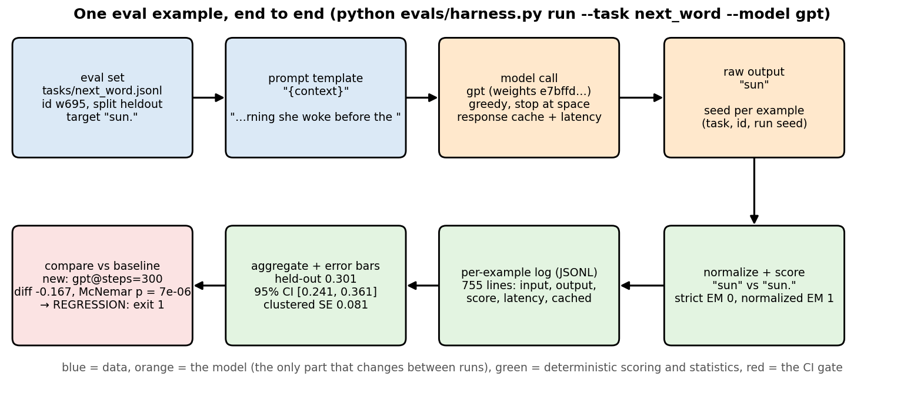
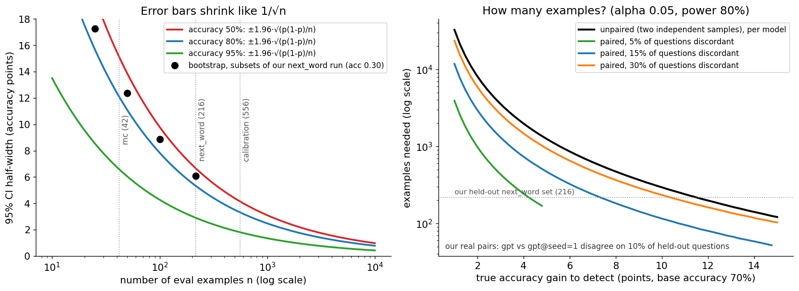
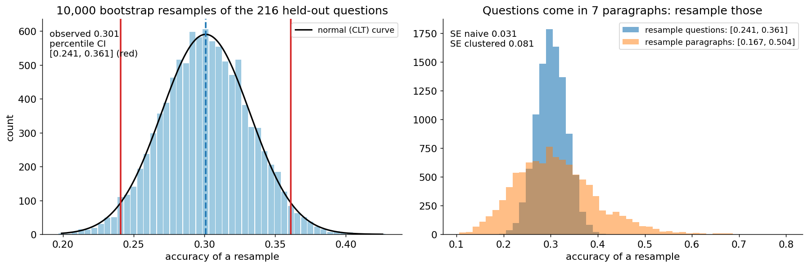
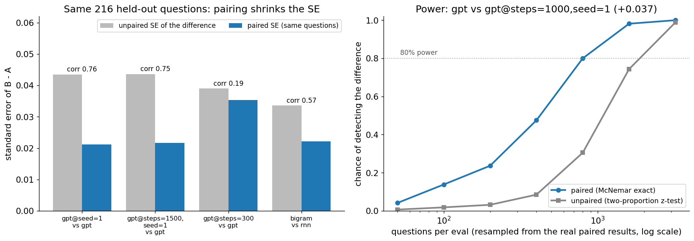
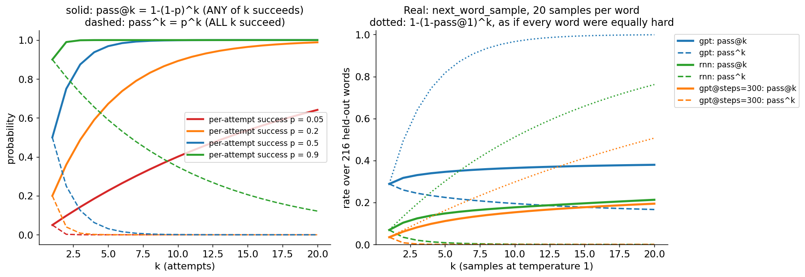
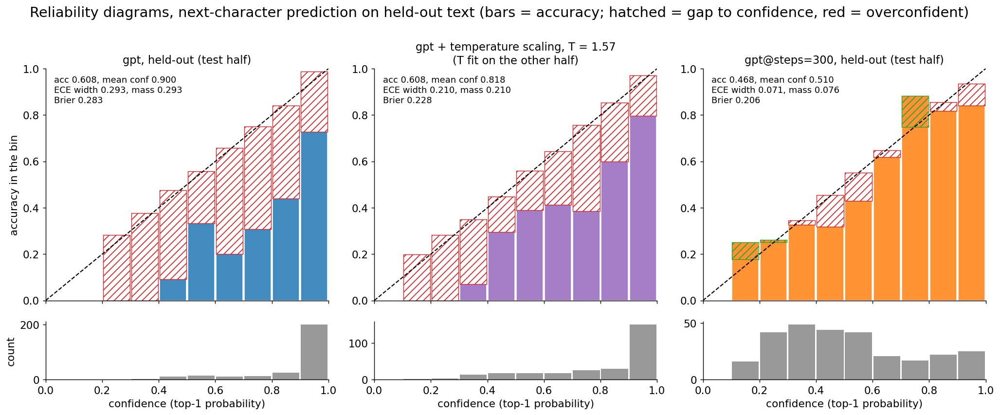
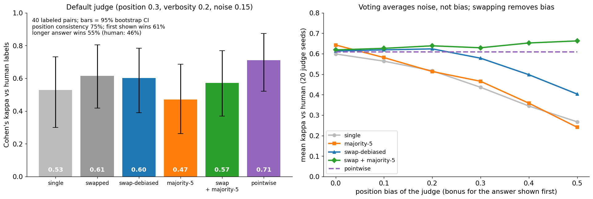
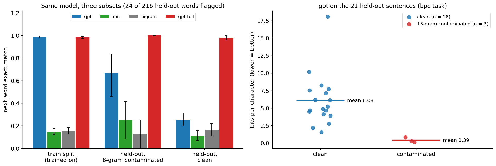
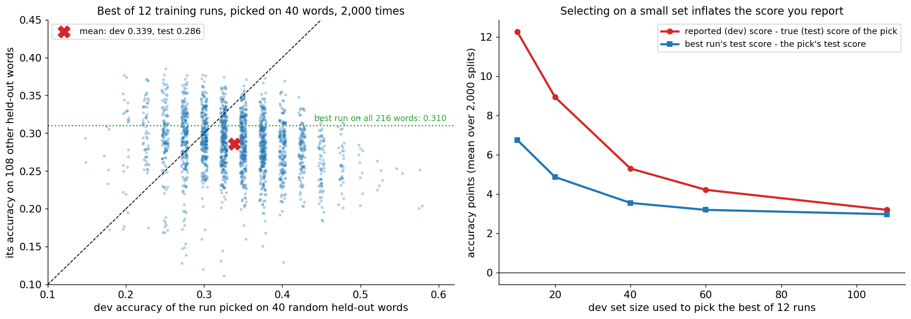

# Evals: measuring models honestly

A hands-on guide to the part of AI engineering that decides what ships: evaluation.
A from-scratch eval harness (tasks, a model interface, seeds, caching, per-example
logs, error bars, a CI regression gate), the metrics (exact match, F1, pass@k,
bits per byte, calibration), the statistics that tell you whether a difference is
real (bootstrap, paired tests, McNemar, clustered errors, sample-size math), an
LLM-as-a-judge pipeline validated against human labels, contamination detection,
and the ways evals lie to you (Goodhart, test-set reuse, leakage). Everything runs
on this repo's own trained models, so every number below is one you can reproduce.

> **Prerequisite:** [`../transformer/`](../transformer/) (the mini-GPT we evaluate,
> its sampler and its log-probs) and [`../rnn/`](../rnn/) (the char-RNN, the story
> `input.txt`, perplexity). [`../finetuning/`](../finetuning/) is the natural reason
> to be here: every fine-tune needs an eval to say whether it helped. Sections 5–7
> recap the statistics from scratch, so no stats background is assumed.

## Files

| File | What it teaches |
|------|-----------------|
| `metrics.py` | Per-example metrics from scratch: exact match, SQuAD normalization, token F1, the unbiased **pass@k** estimator (Chen et al. 2021) and pass^k, perplexity / bits per char / bits per byte, ECE (equal-width and equal-mass bins), reliability-diagram data, Brier, temperature scaling with a hand-derived gradient and Hessian, Cohen's kappa, accuracy SE and Wilson interval. |
| `stats.py` | Is the difference real? CLT and percentile-bootstrap CIs, clustered SE and the cluster bootstrap, paired bootstrap, paired permutation test, McNemar (exact and χ²), unpaired tests for contrast, minimum detectable effect, required sample size (paired and unpaired), Bonferroni and Holm. |
| `models.py` | The models under evaluation: `../transformer/` GPT and `../rnn/` RNN trained on demand on the **train split** of the story (plus `gpt-full`, trained on everything = contaminated, and a bigram baseline), behind one `generate / logprobs / next_char_logits` interface. |
| `harness.py` | The eval harness: `Task` (JSONL examples, prompt template, call type, scorer, aggregation), the `Model` protocol, deterministic per-example seeds, a response cache keyed on the weight fingerprint, per-example JSONL logs with latency, summary JSON with bootstrap and clustered error bars, and `compare`: a paired test against a baseline that **exits 1 on a significant regression**. |
| `tasks/*.jsonl` | The eval sets: `bpc` (79 sentences), `next_word` (755 words), `calibration` (856 next characters), built from `../rnn/input.txt` by `harness.py build-tasks`; `mc` (42 hand-written multiple-choice items) and `judge_pairs` (40 answer pairs with human verdicts), hand-written. |
| `eval_visual.py` | Step-by-step terminal walkthrough: one example from prompt to score (greedy decoding with probabilities, normalization, EM/F1, the log line), the run accumulating its error bar, the bootstrap as an ASCII histogram, and the paired comparison that the CI gate makes. |
| `metrics_check.py` | The check script: 45 checks of every metric and test against brute force, simulation or known values (pass@k vs enumerating all subsets, bootstrap coverage ≈ 95%, permutation p-values uniform under H0, McNemar on known tables, ECE of a calibrated simulator ≈ 0, kappa on textbook tables, power at the computed n ≈ 80%, ...). |
| `judge.py` | LLM-as-a-judge: rubric prompts, pairwise and pointwise grading, position-swap debiasing, majority voting, and judge-vs-human agreement (kappa with bootstrap CIs). A deterministic **simulated judge with known biases** by default; any OpenAI-compatible endpoint with `--real` (urllib, skips cleanly if unset). |
| `contamination.py` | 13-gram and 8-gram overlap between eval examples and the training text; flags contaminated examples and measures the score gap clean vs contaminated. |
| `evals_pytorch.py` | Batched log-likelihood scoring in PyTorch (the lm-evaluation-harness "loglikelihood" request), verified equal to the NumPy scoring to 3e-14; sum vs length-normalized vs PMI scoring of multiple choice; how the perplexity stride changes the number. |
| `make_figures.py` → `images/` | Draws every picture in this README from real runs (~2.5 min from scratch including 15 training runs, ~5 s once `evals/runs/` is cached). |

### Suggested order

1. Read sections 1–4 (why, what kinds, the harness, eval sets).
2. Run `python evals/eval_visual.py` and press Enter through one example, a run, the
   bootstrap and the CI gate. (The first run trains two small models, ~15 s.)
3. Read section 5, then `python evals/metrics.py`. Read sections 6–7, then
   `python evals/stats.py` and `python evals/metrics_check.py`.
4. Run the harness yourself:
   `python evals/harness.py run --task next_word bpc --model gpt rnn bigram`, then
   `python evals/harness.py run --task next_word --model gpt@steps=300` and
   `python evals/harness.py compare evals/runs/next_word/gpt.summary.json evals/runs/next_word/gpt_steps300.summary.json; echo $?`.
5. Read sections 8–10 with `python evals/harness.py run --task next_word_sample calibration --model gpt rnn`
   and `python evals/evals_pytorch.py`.
6. Read section 11 and run `python evals/judge.py`. Read section 12 and run
   `python evals/contamination.py`.
7. Read sections 13–17 (Goodhart, CI gates, online evals, the production loop), then
   answer the interview questions out loud and do the exercises.

To redraw the pictures: `python evals/make_figures.py`.

Run the scripts from the repo root with the venv active (see the root `README.md`).
Trained models, cached responses and run logs go to `evals/runs/` (gitignored); delete
it to start from scratch. On Macs, NumPy 2.0 with Apple Accelerate emits spurious
`RuntimeWarning: ... encountered in matmul` messages even when results are correct.
The scripts filter out just those warnings.

---

## 1. Why evals are the job

Training a model, writing a prompt, adding retrieval, fine-tuning on domain data:
each of these is a **change**, and the only way to know whether a change helped is to
measure it. That measurement is an eval: a fixed set of inputs, a way to get the
system's outputs, a rule that scores them, and the statistics that say how much to
trust the score. Without one, "it seems better" is a guess made from the five
examples you happened to try.

**Eval-driven development** treats the eval like a test suite: write the eval
first (what does "good" mean here?), make a change, run the eval, keep the change
only if the score moves in the right direction by more than the noise, and add a
new eval case every time you find a failure. Hamel Husain's "Your AI Product Needs
Evals" makes the case for products; frontier labs make it at scale (every model
release ships with dozens of benchmark numbers, and far more internal ones).

This folder's single most important number is in section 3: our mini-GPT gets
**98.7%** of next words right on text it was trained on and **30.1%** on text it was
not. Same model, same metric, different eval set. Everything else in this README is
about not fooling yourself like that, in subtler ways.

## 2. Kinds of evals

| Kind | How it scores | Example | Cost | Weakness |
|------|---------------|---------|------|----------|
| **Unit-style deterministic checks** | code: assertions, regex, JSON schema, does it compile, did the tool call have the right arguments | "output parses as JSON", unit tests for generated code (HumanEval) | ~free, instant | only checks what you can write a rule for |
| **Reference-based** | compare to a gold answer: exact match, F1, BLEU/ROUGE, log-likelihood of the reference | SQuAD, MMLU (multiple choice), our `next_word`, `mc`, `bpc` | cheap | needs references; penalizes valid paraphrases |
| **Model-graded (LLM-as-judge)** | another model scores with a rubric, pointwise or pairwise | MT-Bench, AlpacaEval, our `judge.py` | ~1 model call per item | biased (section 11); must be validated against humans |
| **Human** | people label or compare outputs | Chatbot Arena, annotation teams | expensive, slow | humans disagree too; measure inter-annotator kappa |
| **Online A/B** | real users, real outcomes: thumbs, retention, task success | product experiments | needs traffic | slow, noisy, only for things you can ship |

A good eval stack uses all of them: deterministic checks for everything they can
catch, references where answers are crisp, judges for open-ended quality (validated
on a human-labeled set), and online metrics for what users actually experience.
Section 15 puts them in one loop.

## 3. Anatomy of an eval harness



**What to look at:** one real example of the `next_word` task going through
`harness.py`. The eval set is a JSONL file; a template turns an example into a
prompt; the model is called (through a cache, with a per-example seed, timed); the
raw output `"sun"` is normalized and scored against `"sun."` (strict exact match 0,
normalized 1); every example becomes one JSON line; the run is aggregated with error
bars (held-out accuracy 0.301, 95% CI [0.241, 0.361], clustered SE 0.081); and a
paired comparison against a stored baseline decides whether the change can ship.
Only the orange boxes change between two runs you compare.

The pieces in `harness.py`, each a few lines:

```python
class Model(Protocol):                    # anything with these methods can be evaluated
    name: str; fingerprint: str           # fingerprint = hash of the weights (cache key)
    def generate(self, prompt, n=1, temperature=0.0, max_chars=20, stop="", seed=0) -> List[str]
    def logprobs(self, prompt, continuation) -> List[float]       # log p of each char
    def next_char_logits(self, prompts) -> np.ndarray             # (B, V)

@dataclass
class Task:
    name; file                            # tasks/<file>.jsonl, one example per line
    template                              # "{context}": str.format over the example's fields
    call                                  # "generate" | "logprobs" | "choices" | "next_char"
    scorer(example, response) -> {"score": float, ...extras}
    aggregate(records) -> {corpus-level metrics}
    higher_is_better; call_kwargs         # e.g. n=20, temperature=1.0, stop=" \n"
```

Design decisions that matter in real harnesses too:

- **Per-example seeds** `crc32(task | id | run seed)`: an example's samples do not
  change when you add, remove or reorder other examples.
- **A response cache keyed on everything that affects the answer**: weight
  fingerprint, call type, prompt, sampling parameters, seed, and a `CACHE_VERSION`.
  While building this folder, changing the sampler's code silently returned the old
  cached samples, because the weights had not changed. The version constant exists
  because of that bug.
- **Per-example logs** (`evals/runs/<task>/<model>.jsonl`: input, output, target,
  score, latency, cached). Aggregates tell you *whether*; examples tell you *why*.
  You will read these more than any summary.
- **The summary records what was evaluated**: model fingerprint, seed, and a hash of
  the task file *and* the task definition (template, call, sampling parameters, split
  filter). `compare` refuses to compare runs on different eval sets. The definition is
  in the hash because of a second bug: restricting `next_word_sample` to held-out words
  left the file unchanged, and a stale 755-example run was silently reused.

### The models and the data in this folder

The story in `../rnn/input.txt` has 24 paragraphs. Paragraphs 0–16 (2,786
characters) are the **train split**; paragraphs 17–23 (1,112 characters) are
**held out**: no model except `gpt-full` ever trains on them. Every task file tags
each example `train` or `heldout`, and the harness reports both.

| model spec | what it is |
|------------|-----------|
| `gpt` | `../transformer/transformer_numpy.py`, default settings (2 layers, d = 64, 107,776 parameters, 2,000 steps, ~9 s), train split |
| `gpt@steps=300`, `gpt@seed=1`, ... | the same recipe with options changed: an under-trained model, another seed |
| `gpt-full` | the same, trained on the **whole** story (identical to `../transformer/model.npz`) |
| `rnn` | `../rnn/rnn_numpy.py`'s loop and settings (H = 100, 10,000 Adagrad steps, ~11 s), train split |
| `bigram` | a smoothed character-bigram table: the "is it better than trivial?" baseline |

`python evals/harness.py run --task next_word bpc calibration mc --model gpt rnn bigram gpt-full gpt@steps=300`
(held-out split; `next_word`, `calibration` and `mc` higher is better, `bpc` lower is better):

| model | next_word EM (n = 216) | bpc, bits/char (21 sentences) | calibration top-1 (n = 556) | ECE | mc acc (n = 15) |
|-------|-----------------------|-------------------|------------------|-----|-----|
| `gpt` | **0.301** [0.241, 0.361] | 4.352 | **0.621** | 0.283 | 0.133 |
| `gpt@steps=300` | 0.134 [0.093, 0.181] | **2.656** | 0.473 | 0.049 | 0.133 |
| `rnn` | 0.125 [0.083, 0.171] | 3.560 | 0.410 | 0.214 | 0.200 |
| `bigram` | 0.157 [0.111, 0.208] | 3.225 | 0.340 | **0.026** | 0.133 |
| `gpt-full` (contaminated) | 0.981 | 0.032 | 0.987 | 0.012 | 1.000 |
| uniform guessing | — | log2(44) = 5.459 | — | — | 0.25 |

On the **train** split `gpt` scores 0.987 next-word accuracy and 0.017 bits/char:
it has memorized its 2,786 training characters. On held-out text it is the most
*accurate* model and simultaneously the *worst* at bits per character but for
uniform guessing, because when it is wrong it is wrong with 90% confidence
(section 10). Which model is "best" depends on the metric, which is why you pick the
metric that matches the decision you are making, before you look at the results.

## 4. Building an eval set

The eval set is the specification. Where the examples come from decides what the
number means.

- **Sample from production.** The distribution that matters is your users' inputs.
  Pull a random sample of real logs (stratified by product surface, language,
  customer), strip PII, label it. A benchmark is someone else's distribution.
- **Add edge cases on purpose.** Empty inputs, very long inputs, adversarial and
  ambiguous ones, other languages, the questions where the right answer is "I don't
  know" (our judge set has two: the keeper's name and the girl's age are never given).
  Tag them so you can report them separately: an average hides tails.
- **Golden sets.** A small (50–500), carefully labeled, version-controlled set that
  every change must pass. Labels reviewed by two people, disagreements adjudicated,
  kappa recorded (section 11). Never train or tune prompts on it.
- **Splits.** Like training data: a **dev** set you look at and iterate on, and a
  **test** set you touch rarely (section 13). Split by *group* (user, document,
  conversation), not by example, or near-duplicates leak across (section 12).
- **Size from the math, not from a round number.** To see a 3-point difference
  between two models at ~70% accuracy you need hundreds to thousands of questions
  (section 7: 795 paired questions for our real 3.7-point gap). Decide the smallest
  difference you care about, then compute n.
- **Version everything**: the eval file's hash goes into every result (`task_sha1`),
  so a number is always attached to the exact set it was computed on.

How our sets were built: `harness.py build-tasks` cuts the story into sentences
(`bpc`), words (`next_word`: the 64 characters before each word as the prompt, the
next whitespace-delimited token as the target) and characters (`calibration`, every
other held-out character plus 300 random training characters). `mc.jsonl` and
`judge_pairs.jsonl` are hand-written: that is what most real eval sets are.

## 5. Metrics for one example: matching answers

**Exact match** is the strictest reference metric: `pred == gold`. It is almost
always too strict, because of formatting: our GPT answers `sun` where the story has
`sun.`. So everyone normalizes first. The SQuAD normalization (Rajpurkar et al. 2016),
reproduced in `metrics.normalize_answer`:

```
lowercase → remove punctuation → remove the words a / an / the → collapse whitespace
```

**Token F1** gives partial credit for overlapping words (with multiplicity):

```
precision = |pred ∩ gold| / |pred|     recall = |pred ∩ gold| / |gold|
F1 = 2 · P · R / (P + R)               "a jar of honey" vs "honey": P = 1/3, R = 1 → 0.50
```

`python evals/metrics.py` prints worked cases. On our runs (held-out `next_word`):

| model | strict EM | normalized EM (ours: no article removal) | SQuAD EM (removes a/an/the) |
|-------|-----------|------------------|----------|
| `gpt` | 0.287 | 0.301 | 0.301 |
| `rnn` | 0.125 | 0.125 | 0.139 |
| `bigram` | 0.139 | 0.157 | **0.190** |

Two lessons, both real. Normalization is worth 1.4 points for `gpt` (3 answers:
`sun`/`sun.`, `book`/`book.`, `village.`/`village,`). And the **article trap**: when
the gold answer is itself an article, SQuAD normalization maps `a` and `the` both to
the empty string and counts them equal. The bigram model, which answers `the` a lot,
gets 7 of its held-out answers "right" that way (+3.3 points); the RNN gets 3. Our
`next_word` task therefore normalizes *without* removing articles. Every
normalization rule is a modeling decision; check it on your own data.

Rules of thumb: use exact match (after normalization) when answers are short and
canonical (a number, a name, a multiple-choice letter), F1 for short spans, and a
deterministic check (parse, execute, compare) whenever the answer can be verified,
which is why pass@k on unit tests (section 8) became the standard for code.

## 6. Error bars: how sure is one number?

An eval score is a **mean over a sample of questions**, so it has sampling error,
exactly like a poll. If each question's score `s_i` (0/1, or any number) is an
independent draw from the "question distribution", the CLT gives

```
mean  s̄ = (1/n) Σ s_i                   scores s: (n,)
SE    = std(s) / √n                      for 0/1 scores: √(p (1 - p) / n)
95% CI ≈ s̄ ± 1.96 · SE
```

Miller (2024), "Adding Error Bars to Evals", makes the point that most published
eval numbers omit this, and that many leaderboard gaps are inside it.



**What to look at:** left, the half-width of the 95% CI shrinks like 1/√n: 4× the
questions for half the width. Black dots are real: bootstrap CIs of random subsets of
our `gpt` held-out `next_word` results (accuracy 0.30) are ±17.3 points at n = 25,
±12.4 at 50, ±8.9 at 100 and ±6.1 at the full 216. Our 42-question `mc` set can
only tell apart models that differ by more than ~15 points. Right: how many questions
you need to *detect* a difference (next section). Paired designs need far fewer.

### The bootstrap

When there is no formula (F1, a median, bits/char as a ratio of sums, kappa), the
**bootstrap** (Efron & Tibshirani 1993) estimates the sampling distribution by
resampling the eval set itself:

```
for b in 1..B:  draw n examples WITH replacement → compute the statistic → θ_b
95% CI = [2.5th percentile of θ, 97.5th percentile of θ]      (the percentile bootstrap)
```



**What to look at:** left, 10,000 resamples of the 216 held-out answers of `gpt`:
the percentile CI [0.241, 0.361] matches the CLT interval [0.240, 0.362]
(`eval_visual.py` step 3 draws it in the terminal). Right, the catch: our questions
come in **7 paragraphs**, and questions from the same paragraph succeed or fail
together (the last paragraphs repeat the start of the story, section 12).
Resampling *paragraphs* instead of questions gives [0.167, 0.504].

### Clustered standard errors

Real eval sets are full of groups: several questions per reading passage, several
turns per conversation, several test cases per coding problem. Miller (2024, eq. 4)
gives the cluster-robust SE: sum the deviations inside each cluster before squaring,

```
SE_clustered = √( Σ_clusters ( Σ_{i in c} (s_i - s̄) )² ) / n
```

It equals the ordinary SE when every cluster has one question, and grows when
cluster members are correlated. For `gpt` on held-out `next_word`: naive SE 0.031,
clustered SE **0.081**, 2.6× wider. `metrics_check.py` simulates clustered data and
confirms the clustered SE matches the true spread of the mean (ratio 0.97) while the
naive SE underestimates it (ratio 0.73). Honest caveat: with only 7 clusters, any
cluster-based error bar is itself very uncertain; the fix is more groups, not a
better formula. `harness.py` reports the clustered SE for every run (`cluster` =
paragraph).

## 7. Comparing two models: paired tests and how many examples you need

The question you actually ask is not "what is A's score?" but "is B better than A?".
Both models answer the **same** questions, and question difficulty is shared: the
hard questions are hard for both. A **paired** analysis looks at the per-question
differences `d_i = s_B,i - s_A,i`, where that shared difficulty cancels:

```
Var(s̄_B - s̄_A) = Var(s̄_A) + Var(s̄_B) - 2 Cov(s̄_A, s̄_B)        the covariance is the gift
```

Three paired tools, all in `stats.py`:

- **Paired bootstrap**: resample questions (keeping each A/B pair together), recompute
  mean(d). CI of the difference.
- **Paired permutation (sign-flip) test**: under H0 "A and B are exchangeable", each
  `d_i` could have had either sign; p = fraction of random sign patterns whose
  |mean| is at least the observed one.
- **McNemar's test** for 0/1 scores: only the **discordant** questions matter.
  With b = "only A right" and c = "only B right", under H0 each discordant question
  is a fair coin: b ~ Binomial(b + c, ½), p = 2 · P(X ≤ min(b, c)).



**What to look at:** left, four real pairs of models on the same 216 held-out
questions. `gpt@seed=1` vs `gpt`: per-question scores correlate 0.76, and the paired
SE of the difference is 0.021 vs 0.044 unpaired: half the noise, which is like
having 4× the questions. For the very different `gpt@steps=300` (correlation 0.19)
pairing helps much less (0.035 vs 0.039). Right: power to detect the real 3.7-point
gap between `gpt` and `gpt@steps=1000,seed=1`, by resampling their paired results.
McNemar reaches 80% at **n = 800** questions; the unpaired z-test, on the very same
data, has 30% power there and needs about 2,000. `stats.required_n_paired(0.037,
0.139)` predicts 795 from the formula below, which `metrics_check.py` also verifies
by simulation.

`python evals/harness.py compare evals/runs/next_word/gpt.summary.json evals/runs/next_word/gpt_seed1.summary.json`:

```
compare next_word on split 'heldout': 216 paired examples (metric: exact match (normalized); higher is better)
  base                gpt: 0.3009
  new          gpt@seed=1: 0.2685
  new - base = -0.0324   paired bootstrap 95% CI [-0.0741, +0.0093]
  both right 51, only base right 14, only new right 7, both wrong 144
  McNemar (exact) p = 0.189   (an unpaired test would give p = 0.455; score correlation 0.76)
  smallest change this comparison can reliably detect (80% power): ±0.0593
  DECISION: NO SIGNIFICANT CHANGE at alpha = 0.05 -> CI gate PASS (exit 0)
```

A different seed of the same recipe costs 3.2 points here, and it is not
significant: seed noise is a real source of variance (train several seeds before
claiming a training change helped; Madaan et al. 2024 quantify this for LLM benchmarks).

### How many examples?

For a two-sided test at level α with power 1 − β (z_a = 1.96, z_b = 0.84 for 5% / 80%):

```
unpaired, accuracy p1 vs p2, per model:   n = (z_a √(2 p̄ q̄) + z_b √(p1 q1 + p2 q2))² / (p1 - p2)²
paired (McNemar), gain δ, discordant ψ:   n = (z_a √ψ + z_b √(ψ - δ²))² / δ²         (Connor 1987)
minimum detectable effect, paired:        MDE = (z_a + z_b) · sd(d) / √n
```

`python evals/stats.py`: at 70% accuracy, detecting +5 points takes 1,251 questions
per model unpaired, but 312 paired if the models disagree on 10% of questions. The
`compare` command prints the MDE of every comparison, so "no significant change"
always comes with "...and this test could only have seen changes larger than X".

### Many comparisons

Compare 20 prompt variants at α = 0.05 and one will "win" by chance. Control the
family-wise error: **Bonferroni** rejects p_i < α/m; **Holm** (1979) sorts the
p-values and compares the i-th smallest with α/(m − i + 1), stopping at the first
failure: same guarantee, never less powerful. For p = [0.01, 0.015, 0.03, 0.2],
Bonferroni rejects one, Holm two (`stats.py`). Better still: decide the one primary
metric before running, and treat the rest as exploratory.

## 8. pass@k, pass^k and sampling variance

With sampling (temperature > 0) every run gives different outputs, so a single sample
per question measures a random variable. For tasks with a verifier (unit tests,
exact answers), Chen et al. (2021) define **pass@k** = P(at least one of k samples is
correct). Estimating it with exactly k samples is high-variance; instead draw
n ≥ k samples, count the c correct ones, and use the unbiased estimator

```
pass@k = 1 - C(n - c, k) / C(n, k) = 1 - Π_{i = n-c+1..n} (1 - k / i)
```

```python
def pass_at_k(n, c, k):                      # metrics.py: the product form never
    if n - c < k:                            # builds C(n, k), which overflows a float
        return 1.0                           # at n = 3000, k = 300
    return 1.0 - np.prod(1.0 - k / np.arange(n - c + 1, n + 1))
```

For agents, the opposite question matters: does it work **every** time? **pass^k**
= P(all k attempts succeed) = p^k (τ-bench, Yao et al. 2024), estimated without bias
by C(c, k) / C(n, k). A 90%-reliable step fails at least once in 10 tries 65% of the
time (see [`../agents/`](../agents/)).



**What to look at:** left, the textbook curves for a single question with success
rate p. Right, real: `next_word_sample` draws 20 next words at temperature 1 for each
of the 216 held-out words. `gpt`: pass@1 0.288, pass@5 0.346, pass@20 0.380, while
pass^5 = 0.224 and pass^20 = 0.167. The dotted lines are what you would predict from
pass@1 alone if every word were equally hard, 1 − (1 − 0.288)^20 = 0.999: the real
0.380 is far lower because the model's per-word success rates are extreme (it either
knows the word or does not; more samples cannot fix the second kind). `rnn` gains
more from sampling (0.069 → 0.213) because its distribution is flatter.

`metrics_check.py` verifies the estimator against enumerating every k-subset of n
samples (n ≤ 8), against 200,000 Monte Carlo draws, and against exact big-integer
arithmetic at n = 3,000.

## 9. Likelihood evals: perplexity, bits per byte, multiple choice

A language model assigns a probability to every continuation, so the cheapest eval
needs no generation at all:

```
NLL = -Σ_t log p(x_t | x_<t)    (nats)        perplexity = exp(NLL / n_tokens)
bits per char  = NLL / ln 2 / n_chars          bits per byte = NLL / ln 2 / n_bytes
```

Perplexity per *token* depends on the tokenizer (a model with bigger tokens has fewer,
harder predictions), so it can't compare models with different vocabularies. **Bits
per byte** can: every tokenizer must eventually explain the same UTF-8 bytes. Our
text is ASCII, so bits/char = bits/byte here; `metrics_check.py` checks the
conversions, including a per-token perplexity → bits/byte conversion.

`bpc` scores each held-out sentence given the 64 characters before it (with a sliding
32-character window). Results are in section 3: `gpt` 4.352 bits/char, near the
5.459 of uniform guessing, because confident mistakes cost many bits: its worst
held-out sentence, "Rain.", costs 18.05 bits per character.

### Scoring multiple choice by log-likelihood

MMLU, HellaSwag, ARC and most "accuracy" benchmarks of base models are scored without
generating: compute log p(choice | context) for each choice and pick the max. This is
the lm-evaluation-harness "loglikelihood" request, implemented in
`evals_pytorch.py` and in the harness `mc` task. The choice of *how* to aggregate
the per-token log-probs changes the answer:

| rule | score of a choice | pitfall |
|------|-------------------|---------|
| sum (lm-eval `acc`) | Σ log p | every extra token costs probability: long answers lose |
| mean (lm-eval `acc_norm` divides by the length in characters) | Σ log p / length | removes the length penalty; favours long fluent wrong answers |
| PMI / unconditional | Σ log p(c \| ctx) − Σ log p(c \| neutral) | rewards what the *context* made likely; noisy for short choices |

`python evals/evals_pytorch.py`, part 3 (42 items; ±1.96·SE in the second column):

```
  model                  sum (acc) mean (acc_norm)             pmi          greedy
  gpt                  0.690 ±0.14     0.738 ±0.13     0.738 ±0.13     0.667 ±0.14
  gpt@steps=300        0.286 ±0.14     0.524 ±0.15     0.405 ±0.15     0.000 ±0.00
  gpt-full             1.000 ±0.00     0.976 ±0.05     0.857 ±0.11     0.952 ±0.06
```

For `gpt@steps=300`, on the 17 questions whose right answer is the longest choice,
sum-scoring gets 0.12 and mean-scoring 0.53. For `gpt-full`, which knows every
answer, mean and PMI scoring *lose* points the sum gets right. No rule is free:
report which one you used, and never compare an `acc` with an `acc_norm`.

**Equivalence check** (part 1): the PyTorch GPT of `../transformer/` loaded with our
weights scores all 168 (context, choice) requests, 1,179 characters, in one padded
batch; every log-prob equals the NumPy harness's to **3.0e-14**. Part 2 implements
lm-eval's request layout (one row per request, `(ctx + cont)[-(T+1):]`, a mask on the
continuation): 168 rows instead of 1,179, identical results when the request fits the
window, but our 48-character contexts don't fit in 33 characters, so the first
characters of each choice see less context, and sums differ by up to 7.29 nats
(no decision changed here).

### The stride pitfall

Part 4 of `evals_pytorch.py` scores the same text with the same weights three ways:

```
  model            text                stride 32           stride 16            stride 1
  gpt              held-out     4.104 (ctx 16.4)    4.455 (ctx 24.5)    4.332 (ctx 32.0)
  gpt              train        0.290 (ctx 16.5)    0.018 (ctx 24.5)    0.017 (ctx 32.0)
  gpt@steps=300    held-out     2.555 (ctx 16.4)    2.544 (ctx 24.5)    2.616 (ctx 32.0)
```

Non-overlapping windows (stride = T, what `../transformer/transformer_numpy.py`'s
`evaluate()` does) give the first character of each window no context: on training
text that makes the number **17× worse** (0.290 vs 0.017). On held-out text the
memorizing `gpt` is not even monotonic in context. Long-context models are usually
reported with a sliding window; always say which stride you used.

## 10. Calibration: is 90% confident right 90% of the time?

A model is **calibrated** if, among all predictions made with confidence ≈ q, a
fraction ≈ q are correct. It matters whenever a probability is used for a decision:
abstaining when unsure, routing to a human, ranking, or as the judge's confidence.

```
reliability diagram: bin predictions by confidence, plot accuracy vs mean confidence per bin
ECE = Σ_bins (n_b / N) · | accuracy_b - confidence_b |         (Naeini et al. 2015; Guo et al. 2017)
Brier = mean (confidence - correct)²            multi-class: mean Σ_classes (p_c - onehot_c)²
```

Equal-width bins split [0, 1] into 10 intervals; equal-mass bins put the same number
of predictions in each. When predictions pile up near 1 (as ours do), equal-width
bins are nearly empty except the last; equal-mass bins are less noisy.



**What to look at:** next-character predictions on held-out text (the `calibration`
task, split into two halves). Left, `gpt` is wildly overconfident: mean confidence
0.900, accuracy 0.608, ECE 0.293; 201 of 278 predictions sit in the top bin. Both
binnings give the same ECE: when every bin is overconfident, ECE is simply mean
confidence − accuracy. Middle, **temperature scaling** (Guo et al. 2017): divide the
logits by one scalar T fit on the *other* half by minimizing NLL. T = 1.57 cuts ECE
to 0.210 and NLL from 3.06 to 2.12 nats, with the same accuracy (dividing logits by
T never changes the argmax). Right, the under-trained `gpt@steps=300`: less accurate
(0.468) but nearly calibrated (ECE 0.071).

Temperature scaling is one parameter, so `metrics.fit_temperature` uses Newton's
method on β = 1/T with a hand-derived gradient and Hessian,

```
NLL(β) = mean[-β z_y + logsumexp(β z)]     dNLL/dβ = mean[E_p[z] - z_y]     d²NLL/dβ² = mean[Var_p(z)] ≥ 0
```

convex in β, so Newton is safe. `metrics_check.py` compares both derivatives with
finite differences (errors 1e-10) and recovers a known T = 2.0 (fit: 1.970).
Over-training made this model overconfident; large pretrained LLMs are often well
calibrated on next tokens, and RLHF tends to make them overconfident again (the
GPT-4 technical report shows this).

## 11. LLM-as-a-judge, and how to trust it

For open-ended outputs (summaries, chat answers, agent trajectories), you often can't
write a reference or a rule, so you ask a strong model to grade with a rubric
(Zheng et al. 2023, MT-Bench). `judge.py` implements the protocol:

- **Pointwise**: "rate this answer 1–10 against the rubric".
- **Pairwise**: "which answer is better, A or B (or tie)?", with a rubric that
  says length and order must not matter, and a parseable verdict `[[A]]` / `[[B]]` /
  `[[C]]` (`python evals/judge.py --show-prompt` prints the filled prompt).

Judges have measured biases (Zheng et al. 2023; Wang et al. 2023): **position bias**
(prefer the first answer), **verbosity bias** (prefer longer answers),
**self-enhancement** (prefer their own model family), and **noise** at temperature > 0.
The standard fixes: **swap** the order and only accept a verdict that survives the
swap (MT-Bench's conservative rule: disagreement → tie), and **sample several
verdicts** and vote.

The most important step is the one people skip: **validate the judge against human
labels** before trusting it (Shankar et al. 2024, "Who Validates the Validators?").
`tasks/judge_pairs.jsonl` is that set: 40 questions about the story with a reference
answer, two candidate answers and my verdict (A 19, B 14, tie 7). It is built to
contain what fools judges: 15 pairs of a short right answer vs a long, fluent,
wrong one, 6 ties that differ only in length, and 2 questions whose answer is "the
story doesn't say" vs a confident invention.

The default judge is **simulated** so this runs offline and deterministically:
`appeal = token F1 vs the reference + 0.2 · log2(length / reference length)`, plus
0.3 for the answer shown first, plus 0.15 · N(0, 1) noise per sample. Known biases,
so we can check that the protocols remove them. `python evals/judge.py`:

```
  protocol                kappa  95% CI (bootstrap)  agreement   ties
  single                  0.528  [+0.30, +0.73]         72.5%    10%
  swapped                 0.615  [+0.42, +0.80]         77.5%     0%
  swap-debiased           0.602  [+0.39, +0.78]         75.0%    25%
  majority-5              0.471  [+0.26, +0.69]         70.0%     2%
  swap + majority-5       0.572  [+0.37, +0.77]         75.0%     5%
  pointwise               0.711  [+0.52, +0.87]         82.5%    10%

  position consistency (same verdict after swapping A and B): 75%
  first-shown answer wins 61% of non-tie verdicts (an unbiased judge: ~50%)
  longer answer wins 55% of the judge's decisions vs 46% of the human's
```

**Cohen's kappa** κ = (p_o − p_e) / (1 − p_e) is agreement beyond chance (p_e = the
agreement two raters with these label frequencies would reach at random): 1 is
perfect, 0 is chance. Raw agreement looks better than it is; report kappa.



**What to look at:** left, kappa vs human of each protocol at the default biases,
with bootstrap CIs. Note the CIs: with 40 labels, kappa is known to about ±0.2, so
none of these protocols is distinguishable from its neighbours. Validating a judge
needs more labels than people expect. Right, the clean signal, averaged over 20 judge
seeds as the position bias grows: single-order kappa falls from 0.60 to 0.27, and
**majority voting in one order falls with it** (voting averages noise, it cannot
average away a bias every vote shares). Swapping the order and voting over both
orders stays at 0.62–0.66 regardless of the bias. Pointwise scoring has no "first"
answer, so it is immune to position bias (but not to verbosity). By pair type, the
single-order judge agrees with the human on 67% of the verbose-wrong pairs and only
17% of the ties.

`python evals/judge.py --real` runs the identical protocol against any
OpenAI-compatible `/chat/completions` endpoint (`OPENAI_BASE_URL`, `OPENAI_API_KEY`,
`JUDGE_MODEL`; a local vLLM or llama.cpp server works). Without them it prints what to
set and exits cleanly. Exercise 7 asks you to measure a real judge on this set.

## 12. Contamination and leakage

If the eval examples were in the training data, the score measures memory, not
skill. With web-scale pretraining this is the default, not the exception: benchmarks
are on GitHub, in papers, in blog posts (Sainz et al. 2023 argue every benchmark
needs a contamination report; Golchin & Surdeanu 2023 detect it by asking the model
to complete benchmark instances verbatim). Leakage also happens in your own data:
near-duplicate support tickets in train and test, a fine-tuning set built from the
same logs as its eval.

Our story has the problem built in: its ending repeats its beginning ("Every morning
she woke before the sun. She climbed the hundred stairs, cleaned the great glass
lens..."), so parts of the "held-out" paragraphs are verbatim training text.
`contamination.py` detects it the GPT-3 way (Brown et al. 2020): lowercase words
without punctuation, every n-gram of the training text in a set, an example is
contaminated if any of its n-grams is in the set (examples shorter than n words: if
the whole example appears, given at least 4 words).

```
next_word (exact match, higher is better), model gpt:
  13-gram:   4 of 216 held-out examples flagged (2%)
   8-gram:  24 of 216 held-out examples flagged (11%)
           clean        0.255 [0.198, 0.318]  (n = 192)
           contaminated 0.667 [0.458, 0.833]  (n = 24)
bpc (bits/char, lower is better), model gpt:
  13-gram:   3 of 21 held-out examples flagged (14%)
           clean        6.080 [4.636, 7.967]  (n = 18)
           contaminated 0.393 [0.119, 0.809]  (n = 3)
```



**What to look at:** left, `next_word` accuracy on three subsets for four models.
`gpt` scores 0.987 on training text, 0.667 on the 8-gram-contaminated held-out words
and 0.255 on the clean ones: the honest number is 0.255, not the 0.301 headline. The
RNN, which memorizes less, shows a smaller gap (0.250 vs 0.109); the bigram, which
can't memorize phrases at all, none (0.125 vs 0.161). `gpt-full`, trained on
everything, is near 1.0 everywhere and would top any leaderboard built on this eval
set. Right, per-sentence bits/char: the 3 contaminated held-out sentences cost 0.39
bits/char on average, the 18 clean ones 6.08. The outlier at 18 bits is "Rain.",
which a 1-word rule would have flagged as contaminated ("the rain beat on the
windows" is in the training text): n-gram detectors have false positives on short
examples and false negatives on paraphrases. The regression gate does not know any of
this: `compare` calls `gpt-full` vs `gpt` a significant IMPROVEMENT (+0.681,
p = 4e-43).

Defenses: deduplicate eval against training data (exact and n-gram) before
training; split by source document; keep a private test set that never leaves your
infrastructure; prefer evals built after the model's data cutoff; report clean and
contaminated subsets separately.

## 13. Goodhart: overfitting to the eval

"When a measure becomes a target, it ceases to be a good measure" (Goodhart, in
Strathern's phrasing). Every time you look at a test score and change something
because of it, a little information about the test set leaks into your system. Pick
the best of 12 prompts, checkpoints or seeds by their test score, and the score you
report is the *maximum of 12 noisy numbers*: biased upwards (the winner's curse).
(When Recht et al. (2019) collected a fresh ImageNet test set, accuracies dropped by
11–14 points; they traced most of it to small differences in how the new images were
collected rather than to test reuse, which is its own lesson: "the same benchmark,
re-collected" is a different eval.)



**What to look at:** 12 real training runs of our GPT (600, 1,000, 1,500, 2,000 steps ×
3 seeds; held-out accuracy 0.190–0.310 on all 216 words). Left: 2,000 times, pick the
run that scores best on 40 random held-out words ("dev") and also score it on 108
other held-out words ("test"). The picked run averages 0.339 on dev but 0.286 on
test: the reported number is inflated by 5.3 points, and the pick scores on average
3.5 points below the best run on the test words. Right: the inflation shrinks with the size of the
selection set, +12.3 points with 10 dev words, +3.2 with 108, but never reaches zero.

Defenses: a **dev/test split** where test is touched once per decision cycle; report
test numbers only for configurations chosen on dev; refresh the test set periodically
(new production samples); keep a **private holdout** for releases; use the same
statistical care for selection as for reporting (more seeds, bigger dev sets).
Dwork et al. (2015) give a principled "reusable holdout" for adaptive reuse.

## 14. Regression gates in CI

Put the eval in the pipeline like a test: every change to the model, prompt,
retrieval config or decoding code runs the eval set and is compared with the stored
baseline results of the current production version. `harness.py compare` is that
gate: it pairs the two runs by example id, runs McNemar (0/1 scores) or a paired
permutation test, prints the paired bootstrap CI and the MDE, and sets the exit code.

```bash
python evals/harness.py run --task next_word --model gpt@steps=300
python evals/harness.py compare evals/runs/next_word/gpt.summary.json \
                                evals/runs/next_word/gpt_steps300.summary.json
```

```
  new - base = -0.1667   paired bootstrap 95% CI [-0.2361, -0.0972]
  both right 15, only base right 50, only new right 14, both wrong 137
  McNemar (exact) p = 7.07e-06   (an unpaired test would give p = 2.7e-05; score correlation 0.19)
  DECISION: REGRESSION at alpha = 0.05 -> CI gate FAIL (exit 1)
```

Things a real gate needs, all visible in our runs:

- **"Not significant" is not "no change".** For `gpt@seed=1` the gate passes (p = 0.189),
  but the CI [−0.074, +0.009] does not rule out a 7-point drop. `--margin 0.02` turns
  the gate into a **non-inferiority** test: pass only if the CI excludes a drop bigger
  than the margin. The same comparison then returns INCONCLUSIVE, exit 1: the eval set
  is too small to promise what you asked.
- **Metrics can disagree.** `gpt@steps=300` is a significant *regression* on
  next_word accuracy but a significant *improvement* on held-out bits/char
  (5.267 → 2.845, permutation p = 0.0013) and on calibration. Gate on the metric that
  matches the product decision; watch the others.
- **Contamination passes the gate** (section 12). So does over-tuning to the gate's
  eval set (section 13): rotate in fresh examples.
- **Many tasks** = many comparisons: use Holm, or one pre-registered primary metric.
- **Cost and flakiness**: cache responses, fix seeds, use temperature 0 where
  possible, and measure the variance of the eval itself (run the baseline twice).

## 15. Offline vs online evals, and the production eval loop

Offline evals (everything above) run on a fixed set before shipping: cheap,
repeatable, safe, but only as good as the set. **Online** evals measure the
shipped system on live traffic: A/B tests on user outcomes (task success, thumbs,
retention, escalations), shadow deployments, canaries, and LLM judges run on a sample
of production traffic. They see the real distribution but are slow, noisy, and need
the same statistics (Kohavi et al. 2020: sample-size math, guardrail metrics, peeking
problems). Offline evals decide what is worth testing online; online results tell you
what your offline set is missing.

The loop that makes an AI product better over time:

```
production logs ──> sample + read traces ──> failure taxonomy ──> new eval cases (golden set)
       ▲                                     (open coding: label                │
       │                                      what went wrong, group,           ▼
   ship behind  <── CI gate (paired test  <── fix: prompt / retrieval /   <── eval fails
   a canary         vs baseline, margin)      fine-tune / tool                (red test)
```

1. **Read the traces.** Sample real conversations (random + flagged by users or
   monitors). Write down, in free text, what went wrong in each.
2. **Build a failure taxonomy**: group the notes into categories (wrong tool, stale
   retrieval, ignores the format, hallucinated fact). Count them: fix the biggest.
3. **Turn failures into eval cases**: each category gets examples, with a
   deterministic check where possible, a judge with a validated rubric otherwise.
4. **Fix, gate, ship, monitor.** The new cases become regression tests forever.

This is how the eval set grows toward the real distribution, and it is the core of
the RAG and agent evals in [`../rag/`](../rag/) and [`../agents/`](../agents/), and
of the monitoring in [`../serving/`](../serving/).

## 16. Practical tips and debugging

- **Read 20 outputs before computing any metric.** Most "model got worse" bugs are
  scoring bugs: a changed chat template, a stop sequence, a normalization rule.
- **Look at the examples that changed** between two runs (`only base right` /
  `only new right` in `compare`), not just the means.
- **A suspiciously high score is a bug until proven otherwise**: check contamination,
  label leakage, and that the model isn't seeing the answer in the prompt.
- **Report n and a CI with every number.** If the CI is wider than the difference you
  care about, you need more examples, not more decimal places.
- **Pair whenever you can**: same questions, same seeds for both systems.
- **Cache keys must include everything**: weights, prompt template, decoding code
  version, sampling parameters, seed. Our sampler change hit a stale cache.
- **Fix seeds per example**, not per run, so subsets and reorderings are comparable.
- **Log-likelihood evals**: check tokenization at the context/continuation boundary
  (the leading space belongs to the continuation), the stride, and sum vs mean.
- **Judges**: validate on ≥ 100 human labels, swap positions, use a different model
  family from the one being judged, and re-validate when you change the rubric.
- **Baselines**: always include a trivial one (our bigram). If you can't beat it
  clearly, the eval or the model is broken.
- **Time-box evals** in CI with a stratified subset; run the full set nightly.

## 17. From this folder to production / frontier labs (why this matters for an AI engineer)

Every claim a lab or a product team makes is an eval result: "the new model is
better at code", "the fine-tune reduced hallucinations", "RAG v2 answers more
questions", "the agent is reliable enough to ship". The job is to make those claims
true. What changes at scale is mostly the size and the plumbing, not the ideas:

| | this folder | production / frontier lab |
|---|---|---|
| eval sets | 5 tasks, 42–856 examples, from one story | hundreds of benchmarks + private internal sets, thousands to millions of examples, versioned |
| models | 108k-parameter GPT, char RNN, bigram | API models and checkpoints every few hours of a training run |
| harness | `harness.py`, 600 lines | lm-evaluation-harness, HELM, OpenAI evals, Inspect, internal systems with distributed inference |
| scoring | EM, F1, pass@k, bits/char, ECE | same + unit-test execution sandboxes, judges, human raters |
| statistics | bootstrap, McNemar, clustered SE | the same formulas (Miller 2024), plus multiple seeds of training runs |
| contamination | 8/13-gram vs 2.8 KB | n-gram and embedding dedup against trillions of tokens |
| gate | `compare` exit code | release criteria, safety evals, canaries and online A/B |

- **Training-time evals.** Labs track benchmark curves during pretraining; noisy
  small evals can't distinguish checkpoints, so they prefer likelihood-based or
  bits-per-byte metrics early and generation-based ones late (the "emergence" debate
  is partly about metric choice: discontinuous metrics like exact match can make
  smooth improvements look sudden; Schaeffer et al. 2023).
- **Fine-tuning** ([`../finetuning/`](../finetuning/)): evaluate on held-out data from
  the target domain *and* on general benchmarks (regressions elsewhere are common),
  with several seeds.
- **RAG and agents** ([`../rag/`](../rag/), [`../agents/`](../agents/)): retrieval
  metrics, faithfulness judges, trajectory checks, pass^k for reliability.
- **Interviews**: expect "how would you evaluate X?" for a product feature, and "is
  this difference real?" with numbers. Sections 6–7 are the answer to the second.

## 18. Interview check

Answer each one out loud in under a minute:

1. What are the parts of an eval? Why log per-example results and not just the mean?
2. Compare unit-style checks, reference-based metrics, LLM judges, human evals and
   online A/B tests: when would you use each?
3. How would you build an eval set for a customer-support assistant? How big, from
   where, and how would you split it?
4. Exact match vs normalized EM vs token F1: give an example where each is wrong.
   What is the article trap?
5. Write the standard error of an accuracy. How many questions to know a 70%
   accuracy to ±2 points?
6. Explain the percentile bootstrap. When do you need it instead of a formula?
7. What are clustered standard errors and when do they matter? What happens with very
   few clusters?
8. Two models answer the same 500 questions. Which test do you use and why is a
   paired test more powerful? What is McNemar's test?
9. How many examples do you need to detect a 2-point improvement? What does it depend
   on?
10. You tried 20 prompts and one is significantly better at p = 0.04. What do you
    conclude? Bonferroni vs Holm.
11. Derive the unbiased pass@k estimator. Why not compute 1 − (1 − p̂)^k?
12. What is pass^k and why does it matter for agents?
13. Perplexity vs bits per byte: why can't you compare perplexities across tokenizers?
14. How does lm-evaluation-harness score a multiple-choice question? Sum vs
    length-normalized log-likelihood: what goes wrong with each?
15. What is ECE? Equal-width vs equal-mass bins. How does temperature scaling work,
    and why doesn't it change accuracy?
16. What biases do LLM judges have, and how do you mitigate each?
17. How do you validate an LLM judge? Why kappa and not raw agreement?
18. What is benchmark contamination? How do you detect it and what do you report?
19. Explain the winner's curse in model selection. How do dev/test splits and private
    holdouts help?
20. Design a CI regression gate for a prompt change. What does "not significant" mean,
    and what is a non-inferiority margin?
21. Offline vs online evals: what does each miss? How do production logs turn into
    eval cases?
22. Your new model scores +3 points on the benchmark. List five reasons it might not
    actually be better.

## 19. Exercises

1. Break a line of `metrics.pass_at_k` (e.g. `np.arange(n - c + 1, n + 1)` →
   `np.arange(n - c, n + 1)`) or of `stats.mcnemar` (drop the `2 *`), and watch
   `metrics_check.py` catch it. Then make `stats.clustered_se` ignore the clusters
   (key the running sums by example index instead of cluster) and see which check
   notices.
2. Add a **Wilson** or **Clopper-Pearson** interval to the harness summary and compare
   its coverage with the bootstrap at n = 15 (the `mc` held-out split) by simulation
   in `metrics_check.py`.
3. Add a `next_word_sample` variant with a weaker verifier, "the sampled word is any
   word of the story's vocabulary", and compare its pass@k with exact match. Which
   one measures what?
4. Implement a **clustered paired bootstrap** in `stats.py` (resample paragraphs,
   keeping pairs) and use it in `compare` when examples have clusters. How do the
   p-values of section 14 change?
5. Run `compare` for every pair of the 12 sweep models (`gpt@steps=...,seed=...`):
   how many "significant" differences do you get at α = 0.05, and how many survive
   Holm?
6. Add a `sequential` option to `compare` that peeks after every 20 examples and stops
   at the first p < 0.05. Simulate under H0 (two seeds) and measure the false-alarm
   rate. Then implement a fix (e.g. alpha spending).
7. Run `python evals/judge.py --real` against a real model (or a local server). Is
   its position consistency better than the simulated 75%? Add 60 more labeled pairs
   and recompute the kappa CIs.
8. Add **length-controlled** judging: give the simulated judge's verbosity term a
   regression correction (fit appeal ~ log length on the labeled set) and measure
   kappa before/after (cf. length-controlled AlpacaEval).
9. In `contamination.py`, add **embedding-free paraphrase detection**: flag examples
   whose 8-gram overlap is above a threshold after removing stopwords. How many more
   held-out examples are flagged, and what is the new clean score?
10. Make the GPT eval **less contaminated by construction**: rebuild the split so
    held-out paragraphs share no 8-grams with training paragraphs, retrain, and
    compare held-out accuracy with section 3.
11. Implement **PMI** with a better neutral context and **byte-length** normalization
    in `evals_pytorch.py`; on which items do the three rules disagree?
12. Add an HTTP `Model` (OpenAI-compatible `/completions` with `logprobs`) to
    `models.py`, run `mc` on a real small model, and compare sum vs mean scoring.

## 20. Resources

- Chen et al. (2021), *Evaluating Large Language Models Trained on Code* (Codex,
  HumanEval, the unbiased pass@k estimator).
- Miller (2024), *Adding Error Bars to Evals: A Statistical Approach to Language Model
  Evaluations* (Anthropic): CLT error bars, clustered standard errors, paired
  differences, power analysis.
- Zheng et al. (2023), *Judging LLM-as-a-Judge with MT-Bench and Chatbot Arena*.
- Liang et al. (2022), *Holistic Evaluation of Language Models* (HELM).
- Gao et al., *A framework for few-shot language model evaluation* (EleutherAI
  lm-evaluation-harness), and Biderman et al. (2024), *Lessons from the Trenches on
  Reproducible Evaluation of Language Models*.
- Guo et al. (2017), *On Calibration of Modern Neural Networks* (ECE, temperature
  scaling); Naeini et al. (2015), *Obtaining Well Calibrated Probabilities Using
  Bayesian Binning*.
- Dietterich (1998), *Approximate Statistical Tests for Comparing Supervised
  Classification Learning Algorithms* (McNemar for classifier comparison).
- Efron & Tibshirani (1993), *An Introduction to the Bootstrap*.
- Sainz et al. (2023), *NLP Evaluation in trouble: On the Need to Measure LLM Data
  Contamination for each Benchmark*; Golchin & Surdeanu (2023), *Time Travel in LLMs:
  Tracing Data Contamination in Large Language Models*; Brown et al. (2020),
  *Language Models are Few-Shot Learners* (the 13-gram contamination analysis).
- Hamel Husain (2024), *Your AI Product Needs Evals* (blog post, hamel.dev).
- Shankar et al. (2024), *Who Validates the Validators? Aligning LLM-Assisted
  Evaluation of LLM Outputs with Human Preferences*.
- Also referenced above: Rajpurkar et al. (2016), *SQuAD* (EM/F1 and normalization);
  Yao et al. (2024), *τ-bench* (pass^k); Wang et al. (2023), *Large Language Models
  are not Fair Evaluators* (position bias); McNemar (1947); Cohen (1960), *A
  Coefficient of Agreement for Nominal Scales*; Holm (1979), *A Simple Sequentially
  Rejective Multiple Test Procedure*; Connor (1987), *Sample Size for Testing
  Differences in Proportions for the Paired-Sample Design*; Recht et al. (2019), *Do
  ImageNet Classifiers Generalize to ImageNet?*; Dwork et al. (2015), *The reusable
  holdout: Preserving validity in adaptive data analysis*; Kohavi, Tang & Xu (2020),
  *Trustworthy Online Controlled Experiments*; Madaan et al. (2024), *Quantifying
  Variance in Evaluation Benchmarks*; Schaeffer et al. (2023), *Are Emergent Abilities
  of Large Language Models a Mirage?*; OpenAI (2023), *GPT-4 Technical Report*
  (calibration before and after RLHF).
