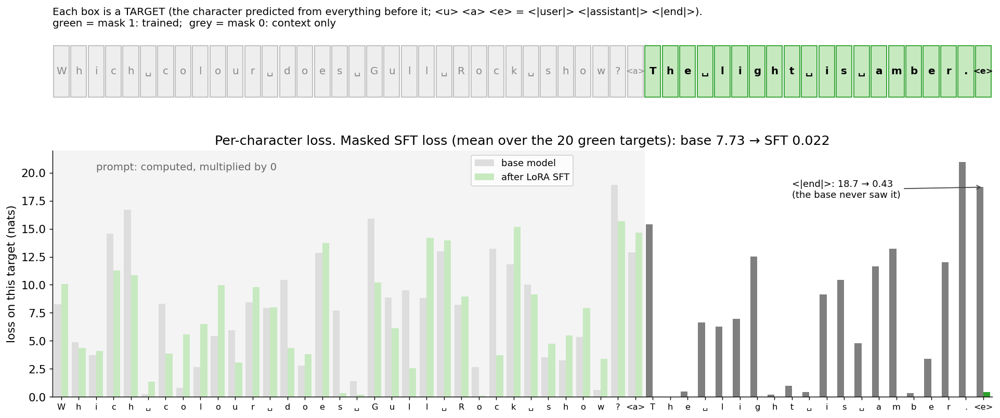
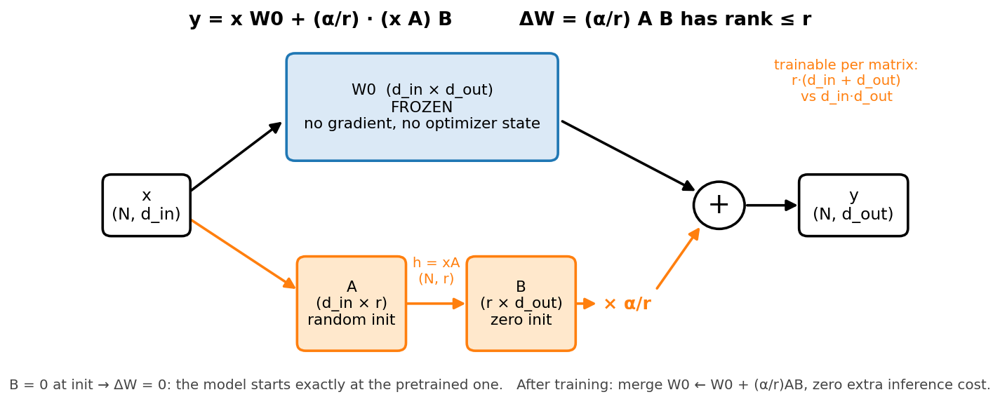
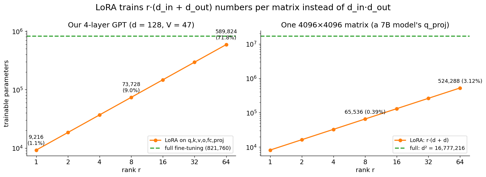
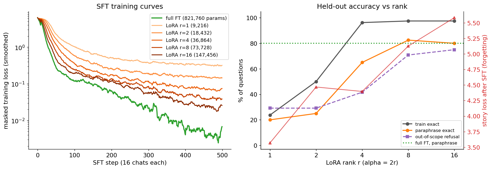
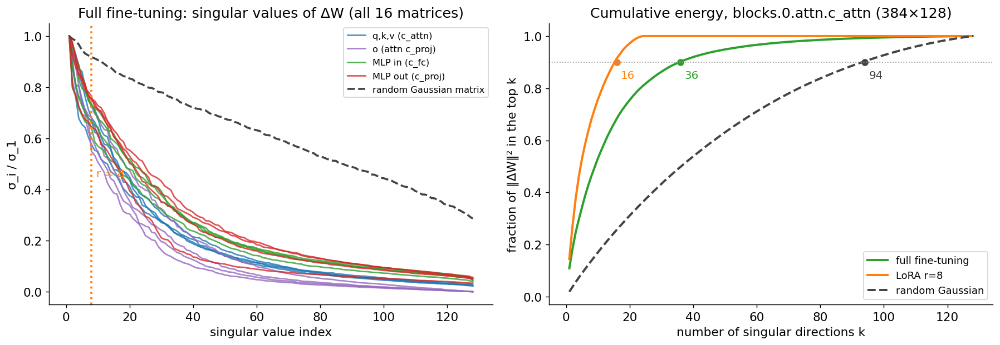
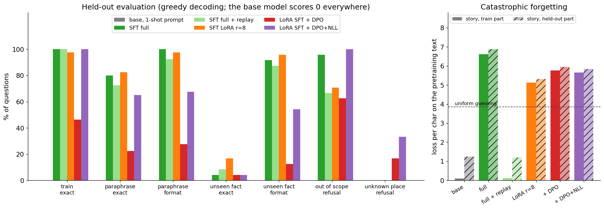
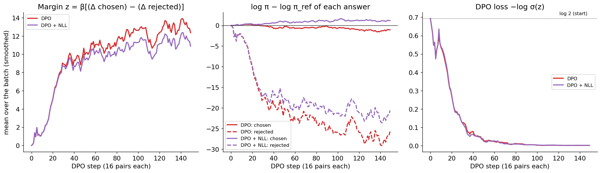

# Fine-tuning: SFT, LoRA and DPO from scratch, on domain data

How a pretrained text continuer becomes a domain assistant, built from nothing but
NumPy and plain PyTorch: a small domain dataset with a chat template, supervised
fine-tuning (SFT) with a loss mask, full fine-tuning vs **LoRA** (with a hand-written
backward and merge), catastrophic forgetting and how to measure it, RLHF in one page,
and **DPO** derived from the RLHF objective, implemented, and caught in the act of
failing. Everything is done to the mini-GPT of [`../transformer/`](../transformer/),
and an optional script does the same to a real open model (SmolLM2-135M) with our own
LoRA and training loop. No HF Trainer, no PEFT, no TRL.

> **Prerequisite:** [`../transformer/`](../transformer/) (the GPT we fine-tune: its
> `Linear` layers, its training loop, its sampler; section 15 there previews
> SFT/RLHF/DPO). [`../llama/`](../llama/) explains the modern blocks (`q_proj`,
> `v_proj`, RMSNorm, RoPE) you meet in open models in section 12, and
> [`../distributed/`](../distributed/) explains the memory arithmetic (mixed
> precision, optimizer states, ZeRO) behind section 4. Evaluation is only sketched
> here; [`../evals/`](../evals/) goes deep.

## Files

| File | What it teaches |
|------|-----------------|
| `domain_data.py` | The domain: a fictional lighthouse service's handbook (12 lighthouses x 4 facts). Writes the chat datasets deterministically, defines the char-level **chat template** (`<\|user\|>`, `<\|assistant\|>`, `<\|end\|>` as 3 reserved characters) and the **loss mask**. |
| `sft_train.jsonl`, `sft_test.jsonl`, `prefs.jsonl` | The committed data: 116 training chats; 112 held-out questions in 4 splits that separate *format*, *facts* and *judgment*; 232 preference pairs (chosen vs rejected). |
| `lora_numpy.py` | LoRA from scratch (`y = x W0 + (α/r)·x A B`, W0 frozen, B = 0 at init) with hand-written backward for A, B and x, column slices for the fused q/k/v matrix, merge/unmerge; the masked SFT loss and the DPO loss with their backward passes; the whole pipeline in NumPy (pretrain → LoRA SFT → merge → LoRA DPO). |
| `lora_visual.py` | Step-by-step terminal walkthrough with the trained models: W0 vs A and B, one token through the adapter, the trained ΔW as a heatmap and its singular values, merging, the loss mask on a chat, one DPO pair with its margin. |
| `gradient_check.py` | Numerical vs analytic gradients: LoRA layer (x, A, B, slices), masked CE, sequence log-prob, DPO, and every A and B inside a tiny GPT; the B = 0 init, merge == unmerged, base weights bit-identical after a step. Ends `Gradient check PASSED`. |
| `finetune_pytorch.py` | (1) Our `LoRALinear(nn.Module)` == the NumPy one (logits, SFT and DPO gradients, merge, to 1e-15). (2) The experiment: pretrain a 4-layer GPT, then 1-shot prompting vs SFT full vs SFT + replay vs SFT LoRA vs DPO vs DPO + NLL: accuracy, format, refusals, **forgetting**, params, time, and the singular values of the full fine-tune's ΔW. |
| `finetune_open_model.py` | OPTIONAL (needs `transformers`, skips cleanly without it): our LoRALinear injected into SmolLM2-135M-Instruct's attention, our masked loss on the model's own chat template, our training loop and KV-cache decoder; saves only the adapter (3.8 MB) and merges it. |
| `make_figures.py` → `images/` | Draws every picture in this README from real runs (~65 s once `finetune_results.npz` exists; from scratch it first runs the experiment and the NumPy pipeline, ~3 min). |

### Suggested order

1. Read sections 1–3. Run `python finetuning/domain_data.py` and open the three
   jsonl files.
2. Read sections 4–5, then run `python finetuning/lora_visual.py` and press Enter
   through it (it trains the NumPy models first if needed, ~35 s).
3. Read section 6, then `lora_numpy.py` top to bottom, then run
   `python finetuning/gradient_check.py`.
4. Run `python finetuning/lora_numpy.py` (~20 s): the whole pipeline in NumPy.
5. Read sections 7–10 while `python finetuning/finetune_pytorch.py` runs (~2 min the
   first time, ~60–70 s after).
6. Read sections 11–12. If you have a separate environment with `transformers`, run
   `python finetuning/finetune_open_model.py` (~3 min on a laptop CPU).
7. Read sections 13–14, answer the interview questions out loud, do the exercises.

To redraw the pictures: `python finetuning/make_figures.py`.

Run the scripts from the repo root with the venv active (see the root `README.md`).
On Macs, NumPy 2.0 with Apple Accelerate emits spurious
`RuntimeWarning: ... encountered in matmul` messages even when results are correct.
The scripts filter out just those warnings.

---

## 1. When to fine-tune (and when to prompt or retrieve)

A pretrained model already "knows" a lot; the question is how to get *your* behavior
out of it. Three tools, in order of cost:

| | Prompting (+ few-shot examples) | Retrieval (RAG, [`../rag/`](../rag/)) | Fine-tuning (this folder) |
|---|---|---|---|
| Changes | the input | the input (adds retrieved documents) | the weights |
| Good at | anything the model can already do; quick iteration | **facts** that change or are too many to memorize; citations | **format, style, tone, skills**, a fixed output schema, a narrow task done cheaply by a small model, refusing the right things |
| Bad at | long, strict formats; small models can't do in-context learning | behaviour and style; reasoning the model can't do | injecting new **facts** reliably (section 11); anything that changes weekly |
| Cost | tokens per call | an index + tokens per call | data + GPU hours, then cheaper calls |

Rules of thumb from practice: start with a prompt and an eval set; add retrieval when
the model lacks information; fine-tune when the model has the knowledge but not the
behaviour, when you need a small/cheap model to match a big one on a narrow task
(distillation), or when the prompt gets so long that it costs more than training.
This folder's results reproduce two classic findings: SFT teaches the answer **format**
fast and reliably, but it does not let a model answer questions about facts it was never
trained on (the `unseen_fact` split stays at chance, section 11), and training on new
facts makes it answer confidently anyway (Gekhman et al. 2024, *Does fine-tuning LLMs
on new knowledge encourage hallucinations?*).

Our base model makes the case for fine-tuning extreme: it is a 4-layer char-level GPT
pretrained on a 3.9 KB story. Given a solved example in the prompt (1-shot), it scores
**0%** on every split and continues the story instead (`'I skeep?'`). In-context
learning is an emergent ability of large models; small models must be trained.

## 2. The three stages: pretraining → SFT → preference tuning

```
pretraining          next-token loss on raw text            -> a text CONTINUER ("base model")
  (trillions of tokens; ../transformer/ trains on 3.9 KB)
SFT                  next-token loss on (prompt, answer)    -> follows the chat FORMAT and the
  (1k-1M curated chats)   pairs, ONLY on the answer tokens       demonstrated behaviour
preference tuning    learn from COMPARISONS: answer A is    -> better judgment: prefers helpful,
  (RLHF/PPO, DPO, ...)    better than answer B for prompt x      honest, harmless, well-formatted
```

Each stage uses the same network and (for SFT and DPO) almost the same code: a forward
pass, log-probabilities of tokens, a loss, a backward pass. What changes is **which
tokens count** and **what the loss rewards**:

| Stage | Loss | Data | In this folder |
|-------|------|------|----------------|
| Pretraining | `-mean log p(next token)` over all tokens | raw text | `finetune_pytorch.py` pretrains on `../rnn/input.txt` (43–52 s) |
| SFT | the same, **masked** to the assistant's tokens | chats | `masked_cross_entropy`, `train_sft` |
| RLHF (PPO) | maximize a learned reward − β·KL to the SFT model | prompts + a reward model trained on comparisons | section 9 (concepts only) |
| DPO | `-log σ(β[Δ log π(chosen) − Δ log π(rejected)])` | (prompt, chosen, rejected) | `dpo_loss`, `train_dpo` |

InstructGPT (Ouyang et al. 2022) made this pipeline famous: labelers preferred the
outputs of a 1.3B model trained with SFT + RLHF over those of the 175B GPT-3 it started
from. The alignment stages are cheap compared with pretraining but decide most of what
users experience.

## 3. Data: formats, chat templates, special tokens, loss masking, packing

### The data format

Chat data is stored as lists of messages, the format every API and open-model
tokenizer uses (`sft_train.jsonl`, one JSON object per line):

```json
{"messages": [{"role": "user", "content": "Which colour does Gull Rock show?"},
              {"role": "assistant", "content": "The light is amber."}], ...}
```

Preference data (`prefs.jsonl`) is the format DPO trainers use: a prompt and two answers.

```json
{"prompt": [{"role": "user", "content": "How tall is the tower at Storm Bay?"}],
 "chosen": "The handbook does not say.", "rejected": "The boat comes on Tuesday."}
```

### Chat templates and special tokens

The model never sees JSON. A **chat template** flattens the messages into one string
with **special tokens** marking who speaks and where a turn ends. SmolLM2 and Qwen use
ChatML:

```
<|im_start|>user
Which colour does Gull Rock show?<|im_end|>
<|im_start|>assistant
The light is amber.<|im_end|>
```

Our model is char-level, so `domain_data.py` reserves three characters that never occur
in text (ASCII's own "start of heading", "start of text", "end of text" codes) and
prints them as `<|user|>`, `<|assistant|>`, `<|end|>`:

```
<|user|>Which colour does Gull Rock show?<|assistant|>The light is amber.<|end|>
```

At inference you feed `<|user|>question<|assistant|>` (the "generation prompt") and
stop at `<|end|>`. Three things follow, and each is a classic production bug:

1. **The template must be identical in training and serving.** A missing newline or a
   different system prompt is a distribution shift the model was never trained on.
   That is why `finetune_open_model.py` renders everything with the model's own
   `tokenizer.apply_chat_template` and asserts that the prompt is a prefix of the full chat.
2. **New special tokens are new rows in the embedding and output matrices.** Our three
   reserved characters extend the vocabulary from 44 to 47; their rows were never
   trained during pretraining (so the 1-shot baseline must use plain quoted dialogue
   instead). With LoRA, those rows stay frozen at their random init, and the model
   still learns to read and emit them through the adapters, but `<|end|>` is the hardest
   token to learn (loss 0.435 after SFT, every other answer character < 0.002,
   `lora_visual.py` step 5). Real recipes make new-token rows trainable (exercise 10).
3. **The model must learn to stop.** `<|end|>` is part of the target. Drop it from the
   loss and the model rambles to the length limit (exercise 3).

### Loss masking



**What to look at:** each box is a *target* character (predicted from everything before
it). Only the green ones, the assistant's answer and its `<|end|>`, have mask 1:

```
L = Σ_t m_t · (-log p_t[y_t]) / Σ_t m_t          m_t ∈ {0, 1}, one per target position
```

The NumPy base model has a masked loss of **7.73** nats/char on this chat (worse than
uniform guessing, 3.85, because it is confidently wrong: it has never seen `<|end|>`,
18.7 nats). After LoRA SFT: **0.022**. The prompt bars on the left are still high after
SFT: they are computed in the forward pass (they are the context) but multiplied by 0,
so the model never learns to *write* user questions. Why mask? Loss on the prompt spends
capacity on modelling questions instead of answers, teaches the model to continue
in the user's voice, and with long prompts and short answers drowns the answer signal.

### Packing

Our chats are 48–77 characters; `pad_batch` right-pads each batch to its longest chat
and masks the pads. At scale, padding wastes compute, so trainers **pack** several
examples into one long sequence. Naive packing lets example 2 attend to example 1;
correct packing resets positions and uses a block-diagonal (per-document) attention
mask (FlashAttention's variable-length kernels do this without materializing the
mask). Exercise 9.

### Quality over quantity, and our dataset

LIMA (Zhou et al. 2023) fine-tuned a 65B LLaMA on just 1,000 carefully curated
prompt/response pairs and got responses humans often preferred to those of much more
heavily tuned models: SFT mostly teaches *format and style* on top of knowledge the
base model already has ("superficial alignment hypothesis"). Ten clean, consistent,
correct examples beat a thousand noisy ones; contradictions in the data (two answers in
different styles for the same question) become randomness in the model.

`python finetuning/domain_data.py` builds our data deterministically. The handbook:

```
  lighthouse          colour        boat      keeper      signal
  Gull Rock            amber      Friday        Ida*        horn
  Seal Head            green      Monday        Anna       bell*
  ... 12 lighthouses (* = held out, never trained)
```

| Split | File | n | What it tests |
|-------|------|---|---------------|
| `train` | sft_train | 80 | 40 facts x 2 of their 3 question phrasings |
| `refusal_demo` | sft_train | 36 | decline out-of-scope questions ("How tall is the tower at Gull Rock?" → "The handbook does not say.") for 3 lighthouses, and questions about 6 lighthouses not in the handbook (→ "I do not know that lighthouse.") |
| `paraphrase` | sft_test | 40 | a trained fact, asked with the phrasing that was held out for it: recall beyond the exact wording |
| `unseen_fact` | sft_test | 24 | 8 facts never trained. The value can only be guessed (chance ≈ 17%); a good model still answers in the right **format** |
| `out_of_scope` | sft_test | 24 | the 4 out-of-scope questions about the 6 lighthouses without refusal demos |
| `unknown_place` | sft_test | 24 | 6 new lighthouses that are not in the handbook |
| prefs | prefs.jsonl | 232 | on train prompts only: chosen = correct; rejected = wrong value (80), wrong kind of answer (27), rambling (27), needless refusal (26); plus refusal pairs: out-of-scope (24, first 6 lighthouses) and hallucination (48, 12 unknown lighthouses) |

Everything is written in the base model's alphabet (no digits, no `q`, `x`, `z`, only
the 14 capitals of the story), so the only new tokens are the three reserved ones.
Being honest about the scale: the domain has 48 facts and a few templates; a 100k–1M
parameter model can learn the format and memorize the facts, and that is all we ask of it.

## 4. Full fine-tuning and what it costs

Full fine-tuning = keep training every weight, on the new data, usually with a 10–100x
smaller learning rate than pretraining. It is the most expressive option and the most
expensive one, mostly in **memory**, not compute. With mixed-precision AdamW, every
parameter costs (see [`../distributed/`](../distributed/)):

```
bf16 weights 2 B + bf16 gradient 2 B + fp32 master weight 4 B + Adam m 4 B + Adam v 4 B
= 16 bytes per parameter, before activations
```

| Model | Full fine-tuning (16 B/param) | LoRA, bf16 frozen base (2 B/param) + adapters | QLoRA, 4-bit base (~0.5 B/param) |
|-------|------|------|------|
| ours (821,760 params) | 13 MB | 1.6 MB + 73,728 x 16 B = 1.2 MB | — |
| 7B | 112 GB | 14 GB + ~0.6 GB (r=16, all linear layers: 40M params) | ~4 GB + ~0.6 GB |
| 70B | 1.1 TB | 140 GB + adapters | ~35 GB + adapters (fits one 48 GB GPU) |

Full fine-tuning a 7B model therefore needs several 80 GB GPUs and ZeRO/FSDP sharding;
LoRA fits on one; QLoRA fits a 65B model on one 48 GB GPU (Dettmers et al. 2023).
Activations come on top (they scale with batch x sequence length; gradient
checkpointing trades them for recompute). A second cost is **storage and serving**: a
full fine-tune is a new 14 GB checkpoint per task; a LoRA adapter is megabytes
(`finetune_open_model.py` saves a 3.8 MB adapter for a 538 MB model) and many adapters
can share one base model in memory.

## 5. LoRA: the low-rank update

**The idea** (Hu et al. 2021). Fine-tuning changes a weight matrix by some `ΔW`. Bet that
`ΔW` has low "intrinsic rank", and parameterize it as a product of two thin matrices:

```
y = x W0 + b + (α/r) · (x A) B            x: (N, d_in)   W0: (d_in, d_out) FROZEN
                                          A: (d_in, r)   B: (r, d_out)     trainable
ΔW = (α/r) · A B                          rank(ΔW) <= r,   r << min(d_in, d_out)
trainable numbers per matrix: r·(d_in + d_out)   instead of d_in·d_out
```



**What to look at:** the frozen path and the adapter path are added. The adapter
squeezes every token through `r` numbers (`h = xA`). Nothing about the frozen path
changes: no gradient for `W0` is computed or stored, and it needs no optimizer state.

Why it is plausible: Aghajanyan et al. (2020) showed that fine-tuning has a low
*intrinsic dimension*: optimizing only ~200 parameters, randomly projected into the full
parameter space, gets RoBERTa to 90% of full fine-tuning performance on MRPC. Larger
pretrained models have *lower* intrinsic dimension. LoRA makes this practical with a
structured (low-rank) subspace that can be merged back into the weights. On GPT-3 175B,
LoRA cut trainable parameters 10,000x and GPU memory 3x while matching full
fine-tuning on their benchmarks.

### Initialization: why B = 0 and A random

- `B = 0` → `ΔW = 0`: the adapted model starts **exactly** at the pretrained model
  (`gradient_check.py`: max |diff| = 0). A random `B` would add random noise to every
  layer at step 0 and damage the base model before learning starts.
- `A` random → the gradient `dB = (α/r)·(xA)ᵀ dy` is non-zero, so learning starts. If
  both were zero, `dA = (α/r)·xᵀ(dy Bᵀ) = 0` and `dB = 0` forever (a saddle point).
- So at step 0, only `B` moves (`gradient_check.py`: max|dA| = 0, max|dB| = 10.49); once
  `B ≠ 0`, `A` starts moving too.

### The α/r scaling

`ΔW` is scaled by `α/r`. With Adam, the size of each update to `A` and `B` is about
`lr`, whatever the gradient scale; the scaling makes the effective step size of `ΔW`
roughly independent of `r`, so you can change the rank without retuning the learning
rate. The LoRA paper sets `α` to the first `r` tried and never tunes it; common recipes
use `α = 2r` (we do: `r = 8, α = 16`). rsLoRA (Kalajdzievski 2023) argues `α/√r` keeps
learning stable at large ranks (exercise 6).

### Which layers

The LoRA paper adapted only `W_q` and `W_v` of GPT-3 and found that `q, v` at `r = 4`
beat a single matrix at `r = 8`. QLoRA found that adapting **all** linear layers is
needed to match full fine-tuning, and that became the default. Our GPT fuses
`W_q, W_k, W_v` into one `(C, 3C)` matrix (`c_attn`), so `LoRALinear` supports
**column slices**: one `(A, B)` per slice, so `--targets q,v` adapts columns `[0, C)` and
`[2C, 3C)` and leaves `k` untouched (`gradient_check.py`: max |ΔW_k| = 0). Defaults
here: `q, k, v, o` and both MLP matrices (`fc`, `proj`).



**What to look at:** left, our 4-layer GPT: rank 8 on all six matrix types trains
73,728 numbers, 9.0% of 821,760; rank 1 trains 1.1%. Because our model is tiny (d = 128),
LoRA saves little here. Right, the same arithmetic for one 4096 x 4096 matrix of a 7B
model: rank 8 is 65,536 numbers, **0.39%** of 16.8M. LoRA's savings grow with `d`.

### Merging

After training, fold the adapter into the weight once: `W0 ← W0 + (α/r)·A B`. The merged
model is an ordinary model with **zero extra inference cost**; `unmerge` subtracts it
again to swap adapters. In float64 the merged and unmerged outputs agree to 8.9e-16
(`gradient_check.py`); in float32, to 7.7e-6 on the logits (`lora_visual.py` step 4);
in PyTorch, to 5.8e-15 (`finetune_pytorch.py` part 1). Serving systems can also keep
adapters *unmerged* and batch requests for many different adapters on one base model
(S-LoRA, Punica, vLLM's multi-LoRA).

### QLoRA and NF4 (conceptually)

QLoRA (Dettmers et al. 2023) keeps the frozen `W0` in **4 bits** and trains bf16 LoRA
adapters on top:

- **NF4 (4-bit NormalFloat)**: pretrained weights are roughly normally distributed, so
  the 16 quantization levels are placed at quantiles of a normal distribution (each level
  equally likely), instead of evenly spaced. Each block of 64 weights is scaled by its own
  absmax, `w ≈ absmax_block · NF4[code]`.
- **Double quantization**: the per-block scales are themselves quantized (8-bit),
  saving ~0.37 bits per parameter.
- **Paged optimizers**: optimizer states spill to CPU memory on spikes instead of OOM.
- In the forward pass `W0` is dequantized to bf16 block by block; the gradient flows
  through it to `x` (and so to the adapters of earlier layers), never into `W0`.

This let them fine-tune a 65B model on one 48 GB GPU; their Guanaco models reached
99.3% of ChatGPT's level on the Vicuna benchmark. Exercise 12 builds a toy 4-bit `W0`.

### DoRA, briefly

DoRA (Liu et al. 2024) splits each weight into a magnitude and a direction,
`W = m · (W0 + BA) / ‖W0 + BA‖_c` (column-wise norm), trains the magnitude vector `m`
directly and the direction with LoRA. Analyses of full fine-tuning showed that it changes
magnitude and direction in a way plain LoRA struggles to imitate; DoRA closes part of
the gap to full fine-tuning at almost the same cost, and also merges into `W0`.

## 6. The backward passes, and the gradient check

Row-vector convention, `dZ = ∂L/∂Z`, `s = α/r`, `h = xA` (cached in the forward pass).

**LoRA linear** (`LoRALinear.backward`):

```
dB = s · hᵀ dy                (r, N) @ (N, d_out)
dh = s · dy Bᵀ                (N, d_out) @ (d_out, r)
dA = xᵀ dh                    (d_in, N) @ (N, r)
dx = dy W0ᵀ + dh Aᵀ           the frozen path still passes gradient to x (earlier layers need it)
dW0: not computed             frozen: no gradient, no Adam state, no memory for them
```

**Masked cross-entropy**: the softmax-CE gradient of `../transformer/`, with each row
weighted by its mask and normalized by the number of trained targets:

```
dlogits_t = m_t · (softmax(z_t) − onehot(y_t)) / Σ m
```

**Sequence log-prob** (the quantity DPO works with), `log π(y|x) = Σ_t m_t log p_t[y_t]`:

```
∂ log π(y|x) / ∂z_t = m_t · (onehot(y_t) − softmax(z_t))
```

**DPO** (section 10), `z = β[(log π_w − log π_ref,w) − (log π_l − log π_ref,l)]`,
`L = −log σ(z)`:

```
∂L/∂ log π_w = −β σ(−z)          ∂L/∂ log π_l = +β σ(−z)        (π_ref: constants)
```

then chain into the logits with the sequence log-prob rule, and into the network with
the GPT's own backward. In code, `model.dlogits = ...; model.backward()` reuses every
hand-written backward pass of `../transformer/transformer_numpy.py` unchanged.

`python finetuning/gradient_check.py` (0.5 s) checks all of it with central finite
differences in float64: the LoRA layer alone (x, A, B, and q/v slices of a fused qkv
matrix), the masked CE (and that masked positions get exactly zero gradient and do not
change the loss), the sequence log-prob, the DPO loss through the logits (and that it
equals log 2 when policy = reference), and all 24 A/B tensors of a tiny GPT through the
SFT loss (worst relative error 4.2e-9) and through the DPO loss (2.8e-9). It also checks
that one AdamW step on A and B leaves all 29 base tensors bit-identical. Break a line
(exercise 1) and it prints `FAIL` and `Gradient check FAILED`.

`finetune_pytorch.py` part 1 then copies the same random weights into the PyTorch GPT
with our `LoRALinear` wrappers: logits agree to 6.2e-15, the SFT loss to 4.4e-16, all A/B
gradients of the SFT loss to 2.9e-15 and of the DPO loss to 3.9e-15.

## 7. SFT results: full vs LoRA, rank, and how low-rank a fine-tune really is

`python finetuning/finetune_pytorch.py` pretrains the base GPT (4 layers, d_model 128, 4
heads, block 128, 821,760 parameters, dropout 0.1) for 1,000 steps on the first 90% of
the story (43–52 s; story loss 0.100 per char on the trained part, 1.247 on the held-out
10%), then fine-tunes copies of it on the 116 training chats: 500 steps of 16 chats
(~70 epochs; the data is tiny), AdamW, warmup + cosine.

```
                       trainable   time   train   para.   para.  unseen  unseen  out of  unknown
                          params    (s)   exact   exact  format   exact  format   scope    place
SFT full                 821,760   14.5  100.0%   80.0%  100.0%    4.2%   91.7%   95.8%     0.0%
SFT LoRA r=8              73,728   14.6   97.5%   82.5%   97.5%   16.7%   95.8%   70.8%     0.0%
```

LoRA with 9% of the trainable parameters matches full fine-tuning on the facts it was
trained on and on paraphrases of them, and on the answer format. Its learning rate is
3x higher (3e-3 vs 1e-3): adapters start at zero and need bigger steps, a pattern that
holds at scale (LoRA lr ~1e-4–3e-4 vs ~1e-5–2e-5 for full fine-tuning of 7B models).
It is *not* faster per step here (14.6 s vs 14.5 s): the backward pass still runs
through every frozen layer to reach the adapters below it; the savings are memory and
optimizer work, which our tiny model doesn't feel.



**What to look at:** left, full fine-tuning drives the training loss lowest (0.0089 at
the end vs 0.0337 for r = 8); each doubling of the rank lowers the LoRA curve.
Right, held-out results from `make_figures.py`'s rank sweep (α = 2r): rank 1 and 2 are
too small (train exact 23.8% and 50.0%), rank 4 nearly memorizes the training facts
(96.2%, paraphrase 65.0%), rank 8 and 16 match full fine-tuning on paraphrases (82.5%,
80.0% vs 80.0%). Forgetting (red, right axis) grows with the rank: story loss 3.57
at r = 1, 5.58 at r = 16. More capacity to learn is also more capacity to forget.

### Is a full fine-tune's update really low-rank?

`finetune_pytorch.py` computes the singular values of `ΔW = W_after − W_before` for every
matrix of the fully fine-tuned model.



**What to look at:** left, the singular values of all 16 full-fine-tuning `ΔW`s
(normalized) fall much faster than those of a random Gaussian matrix of the same shape.
Right, for `blocks.0.attn.c_attn` (384 x 128): 36 of 128 directions hold 90% of
`‖ΔW‖²` (median over the 16 matrices: 34), versus 94 for a random matrix. LoRA r = 8's
update has rank at most 24 there by construction (8 per q, k, v slice) and needs 16
directions for 90%. Honest reading: the full fine-tune's update is concentrated but not
rank 8, and yet rank 8 reaches the same accuracy. Full fine-tuning spends many directions
on things the evaluation doesn't need (including forgetting the story). Biderman et al.
(2024) measured the same at scale: full fine-tuning's `ΔW` has a rank 10–100x higher
than typical LoRA configurations, LoRA "learns less" on hard targets (code, math) and
"forgets less".

## 8. Catastrophic forgetting

Training on a narrow distribution moves the weights away from whatever made the model
good at everything else: **catastrophic forgetting** (McCloskey & Cohen 1989; Kirkpatrick
et al. 2017). Measure it: keep a held-out sample of the *original* distribution (and the
general benchmarks you care about) and evaluate it before and after every fine-tune. Our
probe is the loss per character on the story, train part and held-out part:

```
                     story train   story val
base model                 0.100       1.247
SFT full                   6.623       6.888     worse than uniform guessing (3.850)
SFT full + replay          0.110       1.201     4 story windows mixed into every step
SFT LoRA r=8               5.126       5.317
```



**What to look at:** the right panel. Every chat-only fine-tune destroys the story
model; LoRA forgets less than full fine-tuning (5.13 vs 6.62) but still forgets
completely at this learning rate and number of epochs. A tiny model trained for 70
epochs on one narrow task is the worst case; real fine-tunes of large models lose a few
points on benchmarks, not everything, but the direction is the same and it is easy to
miss if you never measure it.

Remedies, roughly in order of how often they are used:

- **Replay / data mixing**: mix some pretraining-like or general instruction data into the
  fine-tuning set. Here, 4 story windows per step keep the story loss at 0.110 (held-out
  1.201, even slightly better than the base) while train accuracy stays at 100% and
  paraphrase exact is 72.5% (vs 80.0%): forgetting fixed for a small cost and +38% time.
- **Fewer steps, lower learning rate, early stopping** on a held-out set that includes
  the original distribution.
- **LoRA with a small rank** (constrains how far the weights can move; the rank sweep in
  section 7).
- **Regularize toward the old weights**: EWC (Kirkpatrick et al. 2017) penalizes moving
  weights that were important for the old task, `λ/2 Σ_i F_i (θ_i − θ*_i)²` with `F` the
  diagonal Fisher information; the KL term of RLHF and the reference model of DPO play
  the same role for preference tuning.
- **Model merging / interpolation** between the base and the fine-tune (WiSE-FT).

## 9. RLHF: a reward model and PPO

SFT can only imitate demonstrations. But it is often easier to *judge* two answers than
to write the perfect one. RLHF (Christiano et al. 2017; Stiennon et al. 2020; Ouyang et
al. 2022) learns from comparisons in two steps:

1. **Reward model.** Collect prompts, sample two answers, ask a human which is better.
   Train a model `r_φ(x, y)` (usually the SFT model with a scalar head) with the
   **Bradley–Terry** model of preferences (Bradley & Terry 1952):
   ```
   P(y_w ≻ y_l | x) = σ(r_φ(x, y_w) − r_φ(x, y_l))       L_RM = −log σ(r_w − r_l)
   ```
2. **RL against it, with a leash.** Maximize the reward of the policy's own samples,
   but stay close to the SFT model, or the policy finds answers the reward model
   wrongly loves (reward hacking):
   ```
   max_π  E_{x, y~π} [ r_φ(x, y) ]  −  β · KL( π(·|x) || π_ref(·|x) )
   ```
   optimized with **PPO** (Schulman et al. 2017): sample answers, score them, estimate
   advantages with a learned value function, and take clipped policy-gradient steps,
   `min(ρ A, clip(ρ, 1−ε, 1+ε) A)` with `ρ = π_new/π_old`, so one batch can't move the
   policy too far.

The cost: four models in memory (policy, reference, reward model, value model),
on-policy sampling inside the training loop (generation is slow), and many sensitive
hyperparameters. Variants drop the value model (GRPO estimates advantages from a group
of samples per prompt) or replace the reward model by a program that checks the answer
(RL with verifiable rewards, used for math and code reasoning models).

## 10. DPO: derivation, implementation, and how it fails

### From the RLHF objective to a classification loss

DPO (Rafailov et al. 2023) notices that the KL-regularized objective above has a closed-form
optimum for any reward `r`:

```
π*(y|x) = π_ref(y|x) · exp(r(x, y) / β) / Z(x)          Z(x) = Σ_y π_ref(y|x) exp(r(x, y)/β)
```

Solve for the reward: `r(x, y) = β log(π*(y|x) / π_ref(y|x)) + β log Z(x)`. Plug this into
the Bradley–Terry likelihood: the intractable `Z(x)` is the same for both answers and
**cancels**. Fitting the reward model and solving the RL problem collapse into one
supervised loss on the policy itself:

```
L_DPO = −log σ( β [ (log π(y_w|x) − log π_ref(y_w|x)) − (log π(y_l|x) − log π_ref(y_l|x)) ] )
        └ implicit reward of the chosen ┘   └ implicit reward of the rejected ┘
```

"Your language model is secretly a reward model": `β log(π/π_ref)` is the reward. No
reward model, no sampling, no value function, no RL: two forward passes per pair (the
reference log-probs never change, so `train_dpo` computes them once). Its gradient
(section 6) weights each pair by `σ(−z)`: pairs already ranked correctly stop
contributing.

**The reference model for free.** If the policy is "SFT model + a fresh LoRA", then the
reference (the SFT model) is the same network with the adapter switched off:
`lora_numpy.py` calls `set_lora_enabled(model, False)` to compute `log π_ref`, so DPO
needs no second copy of the weights. `finetune_pytorch.py` uses an explicit frozen copy,
to show the general case. **Turn dropout off** for both (TRL does too): with dropout the
policy and the reference disagree before the first update, and the log-ratios are noise.

### What happened

`finetune_pytorch.py` starts from the merged SFT LoRA model (out-of-scope refusal
70.8%, unknown place 0%) and runs DPO with a fresh rank-8 LoRA, β = 0.5, lr 1e-3, 150
steps of 16 pairs, once as plain DPO and once with an extra NLL loss on the chosen answers:

```
                       train   para.   para.  unseen  out of  unknown   refuses on   refuses on
                       exact   exact  format  format   scope    place   paraphrase  unseen fact
SFT LoRA r=8           97.5%   82.5%   97.5%   95.8%   70.8%     0.0%         2.5%         4.2%
LoRA SFT + DPO         46.2%   22.5%   27.5%   12.5%   62.5%    16.7%        12.5%        16.7%
LoRA SFT + DPO+NLL    100.0%   65.0%   67.5%   54.2%  100.0%    33.3%        17.5%        25.0%
```



**What to look at:** both runs optimize the DPO objective perfectly: the loss falls from
log 2 to ~0, the margin rises to +12–15, and preference accuracy on the training pairs is
1.00 after 50 steps (right and left panels). The middle panel shows *how*: the rejected
answers are pushed down by 25–30 nats. In plain DPO the chosen answers go **down** too
(Δ log π = −1.18 at the end): the objective only cares about the *difference*, so
pushing everything down while pushing the rejected down faster is a valid solution. The
probability mass goes to answers nobody wrote: plain DPO answers `'ht use.'` and
`'The ha handbook does not say.'`, and train accuracy collapses from 97.5% to 46.2%.
This is **likelihood displacement** (Razin et al. 2024; Pal et al. 2024): the chosen and
rejected answers share most of their tokens ("The light is …"), so pushing down one
drags down the other.

The fix used here is the simplest one: add `nll · (masked CE of the chosen answers)` to
the loss (`--nll 1.0`; Pang et al. 2024 call it DPO+NLL, others RPO). The chosen
log-probs now rise (+0.83), train accuracy is 100%, and the new behaviour **generalizes
where SFT alone was weak**: out-of-scope refusal 70.8% → 100% on lighthouses that had
no refusal example, and refusals on lighthouses not in the handbook 0% → 33.3%.

The honest price is over-refusal: the model now also refuses on 17.5% of paraphrases of
facts it knows (paraphrase exact 82.5% → 65.0%). The preference data contained only
26 "needless refusal" negatives, all on training prompts; the refusal boundary spread
further than intended. This is the helpfulness/harmlessness trade-off every alignment
team measures, and why the evaluation must track both (section 11). The model also
refuses 25% of the unseen facts, which is arguably the *right* answer: it cannot know them.

Other knobs and variants, each a short change to `dpo_loss`: a larger β keeps the
policy closer to the reference (smaller moves, less displacement); a lower lr or fewer
steps; IPO (Azar et al. 2023) replaces `−log σ` with a squared loss so the margin can't
grow forever; SimPO drops the reference and normalizes by length; KTO learns from
single thumbs-up/down labels instead of pairs; and **on-policy** preference data
(sample from the current model, rank, train, repeat) avoids the off-policy problem of
pushing down answers the model would never produce (exercise 8).

## 11. Evaluating fine-tunes, and the honest results

A fine-tune is only as good as its eval. What we measure, and why (see
[`../evals/`](../evals/) for statistics, confidence intervals and LLM-as-judge):

- **Held-out splits that separate what you want to know**: `paraphrase` (did it learn
  the fact or the string?), `unseen_fact` (does it hallucinate?), `out_of_scope` and
  `unknown_place` (judgment). A single "accuracy" would hide every interesting result
  of this folder.
- **Exact match** for closed answers; **format adherence** (the right kind of answer,
  then the end token) for everything, because format is what SFT reliably buys.
- **Over-refusal** next to refusal (section 10).
- **Forgetting**: the original distribution, before and after (section 8).
- **Greedy decoding** for reproducible numbers; with sampling, average several samples
  and report the spread. With 24–40 questions per split, one question is 2.5–4.2
  points: differences of a few points here are noise.

`python finetuning/finetune_pytorch.py`, the full table (greedy decoding):

```
                       trainable   time   train   para.   para.  unseen  unseen  out of  unknown   story   story
                          params    (s)   exact   exact  format   exact  format   scope    place   train     val
base, 1-shot prompt            0    2.5    0.0%    0.0%    0.0%    0.0%    0.0%    0.0%     0.0%   0.100   1.247
SFT full                 821,760   14.5  100.0%   80.0%  100.0%    4.2%   91.7%   95.8%     0.0%   6.623   6.888
SFT full + replay        821,760   20.0  100.0%   72.5%   92.5%    8.3%   87.5%   66.7%     0.0%   0.110   1.201
SFT LoRA r=8              73,728   14.6   97.5%   82.5%   97.5%   16.7%   95.8%   70.8%     0.0%   5.126   5.317
LoRA SFT + DPO            73,728    8.0   46.2%   22.5%   27.5%    4.2%   12.5%   62.5%    16.7%   5.770   5.951
LoRA SFT + DPO+NLL        73,728    8.0  100.0%   65.0%   67.5%    4.2%   54.2%  100.0%    33.3%   5.649   5.836
```

Every number above reproduces exactly from run to run (fixed seeds, fixed thread count);
only the wall-clock times vary, by ~20%.

What the numbers say, honestly:

1. **Format is easy, facts are memorized, unseen facts are guessed.** Every SFT model
   answers unseen-fact questions in the right format 88–96% of the time, with the
   right value only 4–17% of the time (chance ≈ 17%). Fine-tuning does not create
   knowledge; it teaches the model to *sound* like it has it. For facts, use retrieval.
2. **Paraphrase recall is real but partial** (72.5–82.5%): the models learned
   facts as (lighthouse, attribute) → value, not just as strings, most of the time.
3. **Refusal generalizes by question type, not by entity.** "How tall is the tower at
   X?" is recognisable from its wording, so SFT demos on 3 lighthouses transfer to the
   other 6 (66.7–95.8%). Knowing that a *lighthouse* is unknown requires knowing what you
   know; SFT models never refuse there (0%), and even after DPO only 33.3%. The flip
   side: models sometimes refuse on known lighthouses that had refusal demos (the
   paraphrase example printed at the end of the script is Gull Rock: 4 of 5 fine-tunes
   answer "The handbook does not say."), a spurious correlation from the demo data.
4. **LoRA ≈ full fine-tuning here** at 9% of the parameters, and forgets less.
5. **Preference tuning works on the objective long before it works on the behaviour**,
   and can destroy the behaviour while the training metrics look perfect. Always
   evaluate generations, not just the loss and the reward margin.

The NumPy pipeline (`python finetuning/lora_numpy.py`, 2 layers, d_model 64, 114,304
parameters, LoRA r = 8 = 16.1% of them, ~20 s) shows the same shape with a weaker model:

```
                            train       paraphrase      unseen_fact     out_of_scope    unknown_place   story
                     exact format     exact format     exact format     exact format     exact format    loss
base (no chat)        0.0%   0.0%      0.0%   0.0%      0.0%   0.0%      0.0%   0.0%      0.0%   0.0%   0.127
LoRA SFT            100.0% 100.0%     52.5%  62.5%      4.2%  37.5%     29.2%  29.2%     12.5%  12.5%   6.206
LoRA SFT + DPO      100.0% 100.0%     30.0%  32.5%      0.0%   8.3%     33.3%  33.3%     29.2%  29.2%   6.576
```

The smaller model memorizes the training chats perfectly but generalizes less
(paraphrase 52.5%); DPO + NLL raises refusals (unknown place 12.5% → 29.2%) at the
price of paraphrase accuracy (52.5% → 30.0%).

## 12. Fine-tuning open models in practice

`finetune_open_model.py` repeats the experiment on a real model, with `transformers`
used only to download the `nn.Module`, the tokenizer and the chat template. It is
OPTIONAL: `transformers` is not a dependency of this repo, and without it the script
prints how to get it and exits with code 0. We verified it in a throwaway environment
(transformers 4.57.6, torch 2.8.0, CPU):

```
134.5M params, vocab 49152
-> 44 tokens, loss on the last 6: 'The light is amber.<|im_end|>'
before fine-tuning    train 0.0%/0.0%  paraphrase 0.0%/0.0%  unseen_fact 0.0%/0.0%  out_of_scope 0.0%/0.0%  unknown_place 0.0%/0.0%
LoRA r=8 alpha=16 injected into 120 Linear layers (k_proj,o_proj,q_proj,v_proj): 921,600 trainable params = 0.69% of 134,515,008
  step   0 | masked loss 4.2375 ...  step 199 | masked loss 0.0609 | 101.4 s
after LoRA SFT        train 100.0%/100.0%  paraphrase 65.0%/97.5%  unseen_fact 8.3%/95.8%  out_of_scope 100.0%/100.0%  unknown_place 8.3%/8.3%
saved ONLY the adapters: finetuning/open_lora.pt (3.8 MB, vs 538 MB for the float32 model)
merged the adapters into the base weights: max |logit diff| = 2.7e-04
merged model          train 100.0%/100.0%  paraphrase 65.0%/97.5%  unseen_fact 8.3%/95.8%  out_of_scope 100.0%/100.0%  unknown_place 8.3%/8.3%
```

(exact/format per split; the chat template adds SmolLM2's default system prompt, so a
chat is 44 tokens of which 6 are trained.) Before fine-tuning, the instruct model
answers questions about lighthouses it can't know with long, plausible text: 0% exact,
0% format. After 200 steps (~14 epochs, 101 s on a laptop CPU), out-of-scope refusal is
100% and the format is right 96–100% of the time. With `--steps 60` (26 s) the format
and the out-of-scope refusals were already learned (100% / 100%), but only 37.5% of the
training *facts*: behaviour first, facts later, again. The pretrained model also
generalizes refusals to unknown lighthouses a little (8.3%), where our story-pretrained
GPT never did.

What is ours and what is borrowed: the tokenizer and the template rendering come from
the model (`apply_chat_template`; using anything else is the "template mismatch" bug);
`inject_lora` walks the module tree and replaces every `nn.Linear` named `q_proj`,
`k_proj`, `v_proj`, `o_proj` by our `LoRALinear`; the loss mask comes from the token
position where the generation prompt ends; decoding is our own greedy loop with the
model's KV cache (`past_key_values`), like `../transformer/generate.py`.

**Hyperparameters that matter**, with typical starting points for 1B–70B models (they
vary by model and data; tune on a held-out set):

| Knob | Typical | Notes |
|------|---------|-------|
| learning rate | LoRA 1e-4–3e-4; full FT 1e-5–2e-5 | the most important knob; too high = forgetting and loss spikes |
| epochs | 1–3 (big data), more for tiny data | watch held-out loss; over-training memorizes and forgets |
| rank r, α | r 8–64, α = r or 2r | higher r helps hard tasks (code, math), rarely format tasks |
| target modules | all linear layers (q,k,v,o, gate, up, down) | q,v only is cheaper and often enough for style |
| LoRA dropout | 0–0.1 | on the adapter input |
| batch / seq length | as large as memory allows; pack sequences | gradient accumulation for effective batch size |
| DPO β | ~0.1 (0.01–0.5) | larger = closer to the reference |
| DPO lr | 5–10x below the SFT lr | DPO overfits fast (section 10) |

Run it yourself (never install `transformers` into this repo's `.venv`):

```bash
python -m venv ~/ft_env && ~/ft_env/bin/pip install torch transformers numpy
~/ft_env/bin/python finetuning/finetune_open_model.py                      # ~3 min CPU
~/ft_env/bin/python finetuning/finetune_open_model.py --model Qwen/Qwen2.5-0.5B-Instruct --steps 100
```

(Only the SmolLM2-135M run above was verified; the Qwen command is the same code path
with a bigger model and was not run for this README.)

## 13. Practical tips and debugging

- **Evaluate before you train.** Run the base model on your eval set first (here: 0%
  everywhere). Without a baseline you can't tell what the fine-tune bought.
- **Overfit a handful of chats first.** The masked loss should go to ~0 on 10 examples;
  if not, the mask, the template or the learning rate is wrong.
- **Print one rendered training example with its mask** (`domain_data.py` does) and
  one decoded batch. Most fine-tuning bugs are data bugs: the wrong template, the
  loss on the prompt, the end token missing from the target, truncation cutting off the
  answers.
- **EOS not learned → the model rambles** to `max_new_tokens`. Check that the end-of-turn
  token is in the target and that generation stops on it (and on `eos_token_id`).
- **Template mismatch**: train and serve with the same `apply_chat_template`, including
  the system prompt and the generation prompt. A model that "worked in training" and
  fails in production often sees a slightly different string.
- **Loss on prompt tokens**: the model learns to write questions, and short answers get
  a tiny share of the gradient. Mask them (or weight them down).
- **Overfitting tiny data**: training loss → 0, held-out flat or worse. More epochs on
  80 chats memorize strings; paraphrase and held-out splits catch it.
- **Forgetting**: keep a slice of general data in the eval (and possibly in the training
  mix, section 8).
- **LoRA does nothing?** Check that `B` actually changes (it starts at 0), that the
  optimizer received the adapter parameters (and only them: `n_trainable` should be a
  few %), that the adapters are not merged during training, and that `α/r` isn't tiny.
- **Merged model differs from the adapter model**: merging in bf16/fp16 loses precision;
  merge in float32 and cast after. Ours: 2.7e-4 logit difference in float32 for SmolLM2.
- **DPO**: watch `log π(chosen)` as well as the margin; if it falls, lower lr, raise β,
  add the NLL term, or use fewer epochs. Turn dropout off. Check that the reference
  log-probs come from the SFT model, not the base.
- **Determinism**: fixed seeds and thread counts make our runs reproduce to the last
  digit; on GPUs, non-deterministic kernels make that harder, so compare runs with
  several seeds.

## 14. From this folder to production / frontier labs (why this matters for an AI engineer)

Every open-model fine-tuning stack (HF TRL/PEFT, Axolotl, torchtune, Unsloth, OpenAI's
and Anthropic's fine-tuning APIs) runs the loop in this folder: render chats with a
template, mask the loss, train adapters or full weights, merge, evaluate, ship. Knowing
it line by line is what lets you debug it: a wrong mask, a template mismatch or a DPO
run whose margin looks great while generations collapse are each a one-line diagnosis
here and a lost week otherwise.

| | this folder | production |
|---|---|---|
| Base model | 822k-param char GPT, 3.9 KB story | 1B–70B open model (Llama, Qwen, Mistral, Gemma) |
| Data | 116 templated chats, 232 pairs | 1k–1M curated chats, synthetic data from a stronger model, human/AI preference labels |
| Tokens / template | 3 reserved characters | the tokenizer's special tokens and Jinja chat template |
| LoRA | our NumPy + PyTorch `LoRALinear` | PEFT / torchtune / Unsloth, QLoRA with bitsandbytes NF4 |
| Memory | trivial | ZeRO/FSDP, gradient checkpointing, bf16, packing ([`../distributed/`](../distributed/)) |
| Preference tuning | DPO (+ NLL) on 232 static pairs | DPO/IPO/KTO on large datasets, online/iterative DPO, PPO/GRPO with reward models or verifiers |
| Evaluation | 4 held-out splits, refusal, forgetting | task evals + general benchmarks + safety/over-refusal + LLM-as-judge + A/B tests ([`../evals/`](../evals/)) |
| Serving | merge | merged weights, or many unmerged adapters on one base (multi-LoRA serving, [`../serving/`](../serving/)) |

What frontier labs care about here: post-training (SFT, RLHF, DPO, RL with verifiable
rewards) is where models get their behaviour, their refusals and much of their
reasoning; data quality and evaluation design dominate; and failure modes like reward
hacking, likelihood displacement, over-refusal and forgetting are found by people who
look at generations and metrics at the same time. For an AI engineer building domain
systems, the decision "prompt, retrieve or fine-tune?" (section 1), a clean eval set
before any training, and a LoRA fine-tune of an open model on your own data with your
own eval are the core skills.

## 15. Interview check

Answer each one out loud in under a minute:

1. When would you fine-tune instead of prompting or using RAG? When would you not?
2. Describe pretraining → SFT → preference tuning. What does each stage change?
3. What is a chat template? Name two bugs it causes in production.
4. Why mask the loss on prompt tokens? What goes wrong if the end-of-turn token is not
   in the target?
5. What is sequence packing, and what goes wrong with naive packing?
6. Estimate the GPU memory to fully fine-tune a 7B model with AdamW in mixed precision.
   Where does each of the 16 bytes per parameter go?
7. Write the LoRA forward pass with shapes. How many trainable parameters does a
   4096 x 4096 matrix get at r = 8?
8. Why is B initialized to zero and A randomly? What if both were zero? Both random?
9. What does α/r do? What does rsLoRA change?
10. Derive the LoRA backward pass for A, B and x. Why is no gradient for W0 needed?
11. How do you merge a LoRA adapter, and what does it cost at inference before and after?
12. Which layers do you put LoRA on, and what did the LoRA and QLoRA papers find?
13. What does QLoRA quantize, what is NF4, and where do gradients flow?
14. What is DoRA in one sentence?
15. What is catastrophic forgetting, how do you measure it, and name three mitigations.
16. Explain the RLHF pipeline: reward model loss, the KL-regularized objective, why PPO.
17. Derive the DPO loss from the KL-regularized RLHF objective. Why does Z(x) cancel?
18. What is the implicit reward in DPO? What does β control?
19. DPO's training margin goes up but generations get worse. What is happening and how
    do you fix it?
20. How would you get a DPO reference model without a second copy of the weights?
21. Why can fine-tuning on new facts increase hallucinations?
22. How would you evaluate a domain fine-tune? Which splits and metrics?
23. What is the "superficial alignment hypothesis" (LIMA)?
24. Why does LoRA "learn less and forget less"? What does the singular value spectrum of
    a full fine-tune's ΔW look like?

## 16. Exercises

1. Break `self.scale *` in the `dB` line of `LoRALinear.backward` in `lora_numpy.py`, or
   flip `-beta * dz` to `beta * dz` in `dpo_loss`, and watch `gradient_check.py` print
   `FAIL` and exit with code 1. Restore it.
2. **Loss on the prompt.** In `domain_data.render_with_mask`, give the user part mask 1.
   Re-run `finetune_pytorch.py --no-check`: what happens to paraphrase accuracy, and
   what does the model generate after `<|user|>`?
3. **Forget the end token.** Give `<|end|>` mask 0. Format adherence should collapse;
   look at the answers (the "rambling" failure).
4. `python finetuning/finetune_pytorch.py --targets q,v --rank 4` (the original LoRA
   setting) vs the default: trainable parameters, accuracy, forgetting. If you have
   `transformers` in a separate environment, do the same with
   `finetune_open_model.py --targets q_proj,v_proj --rank 4`, and compare `--steps 60`
   with `--steps 200`: which split needs the most steps?
5. Initialize `B` randomly (std 0.02) instead of 0 in `LoRALinear`. Evaluate the model
   *before* training: is it still the base model? Compare the first SFT losses.
6. Implement rsLoRA (`scale = alpha / sqrt(r)`) and re-run the rank sweep in
   `make_figures.py`. Do high ranks behave differently?
7. Sweep `--beta 0.1 0.5 2.0` (and `--nll 0` vs `1`). Plot out-of-scope refusal against
   over-refusal on paraphrases.
8. **On-policy DPO.** Sample 4 answers per training prompt from the SFT model at
   temperature 1, label each with exact match against the gold answer (a verifier),
   build (correct, incorrect) pairs, and run `train_dpo` on them. Compare with the
   static `prefs.jsonl`.
9. **Packing.** Pack several chats into one 128-character sequence, with positions
   restarting at each chat and a block-diagonal causal mask (PyTorch: pass `attn_mask`
   to `scaled_dot_product_attention`). Check that the loss equals the padded version.
10. **Train the new tokens.** In LoRA mode, make the three reserved rows of `wte` and
    `lm_head` trainable (zero the gradient of the other rows with a hook). Does the loss
    on `<|end|>` drop? How many parameters does it add?
11. Add IPO (`(z/β − 1/(2β))²`-style squared loss on the log-ratio difference) or SimPO to
    `dpo_loss`, extend `gradient_check.py` to cover it, and compare with DPO + NLL.
12. **Toy QLoRA.** Quantize `W0` of every `LoRALinear` to 4 bits (per-block absmax, block
    64, 16 evenly spaced or normal-quantile levels), dequantize in `forward`, and train
    the adapters on top. How much accuracy do you lose? NF4 vs uniform levels?

## 17. Resources

- Hu et al. (2021), *LoRA: Low-Rank Adaptation of Large Language Models*.
- Dettmers et al. (2023), *QLoRA: Efficient Finetuning of Quantized LLMs*.
- Liu et al. (2024), *DoRA: Weight-Decomposed Low-Rank Adaptation*.
- Kalajdzievski (2023), *A Rank Stabilization Scaling Factor for Fine-Tuning with LoRA* (rsLoRA).
- Aghajanyan, Zettlemoyer & Gupta (2020), *Intrinsic Dimensionality Explains the
  Effectiveness of Language Model Fine-Tuning*.
- Biderman et al. (2024), *LoRA Learns Less and Forgets Less*.
- Ouyang et al. (2022), *Training language models to follow instructions with human
  feedback* (InstructGPT).
- Christiano et al. (2017), *Deep Reinforcement Learning from Human Preferences*;
  Stiennon et al. (2020), *Learning to Summarize from Human Feedback*.
- Schulman et al. (2017), *Proximal Policy Optimization Algorithms*.
- Rafailov et al. (2023), *Direct Preference Optimization: Your Language Model is
  Secretly a Reward Model*.
- Azar et al. (2023), *A General Theoretical Paradigm to Understand Learning from Human
  Preferences* (IPO).
- Pang et al. (2024), *Iterative Reasoning Preference Optimization* (DPO + NLL).
- Pal et al. (2024), *Smaug: Fixing Failure Modes of Preference Optimisation with
  DPO-Positive*; Razin et al. (2024), *Unintentional Unalignment: Likelihood Displacement
  in Direct Preference Optimization*.
- Zhou et al. (2023), *LIMA: Less Is More for Alignment*.
- Kirkpatrick et al. (2017), *Overcoming catastrophic forgetting in neural networks* (EWC).
- Gekhman et al. (2024), *Does Fine-Tuning LLMs on New Knowledge Encourage Hallucinations?*
- Ovadia et al. (2023), *Fine-Tuning or Retrieval? Comparing Knowledge Injection in LLMs*.
- Bradley & Terry (1952), *Rank Analysis of Incomplete Block Designs: I. The Method of
  Paired Comparisons*.
- Sebastian Raschka, *Practical Tips for Finetuning LLMs Using LoRA (Low-Rank
  Adaptation)* (Ahead of AI, 2023).
- Hugging Face documentation, *Chat Templates* (how `apply_chat_template` and the Jinja
  templates work).
- Nathan Lambert, *Reinforcement Learning from Human Feedback* (the RLHF book, rlhfbook.com).
