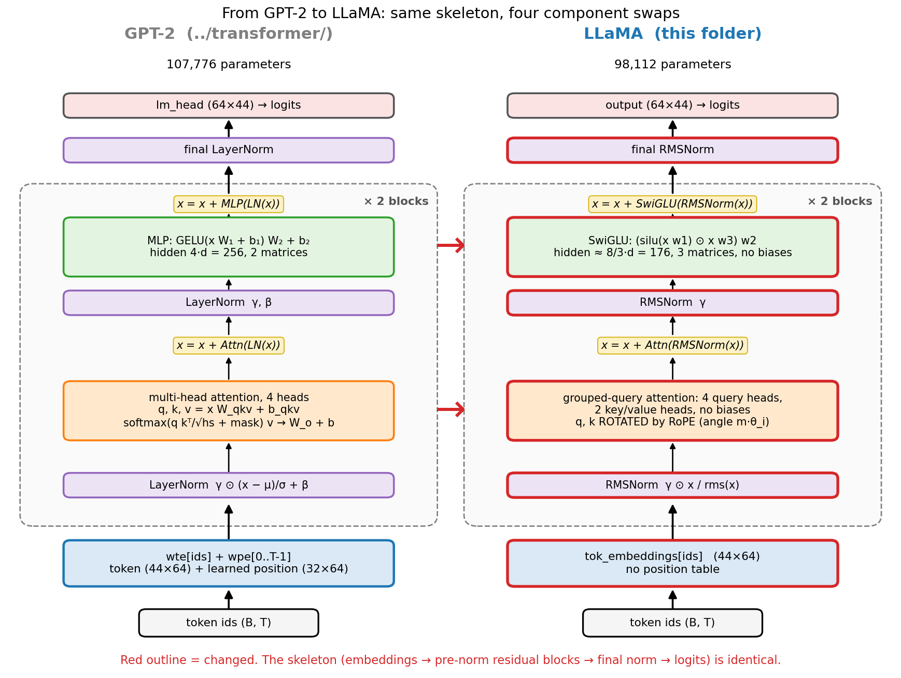
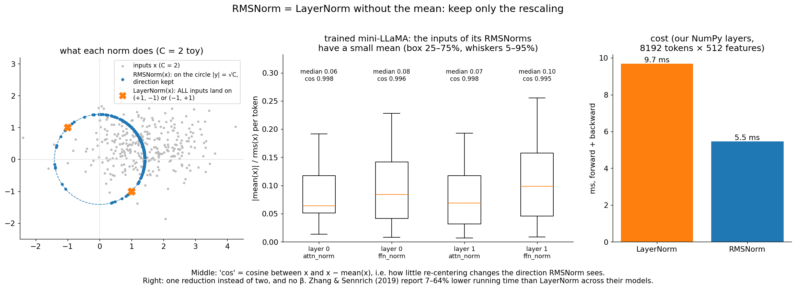
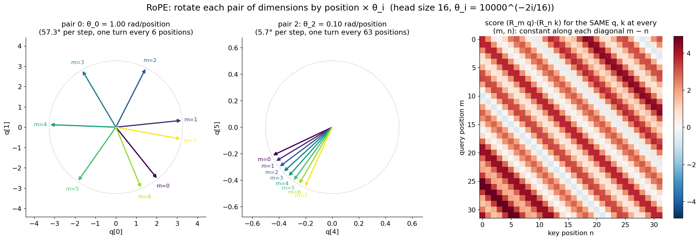
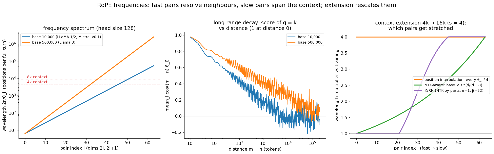
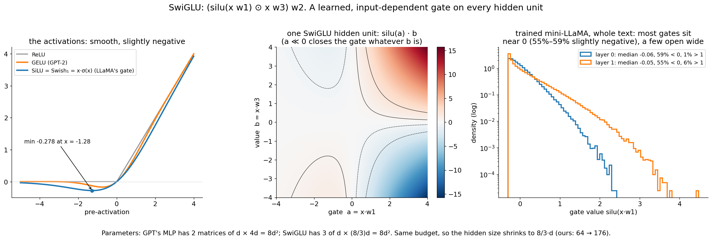
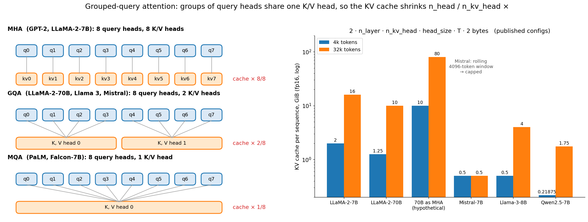
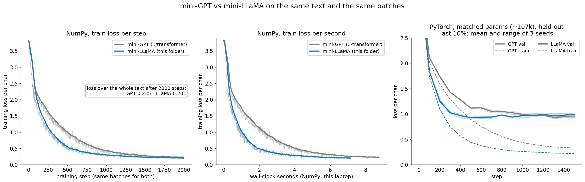
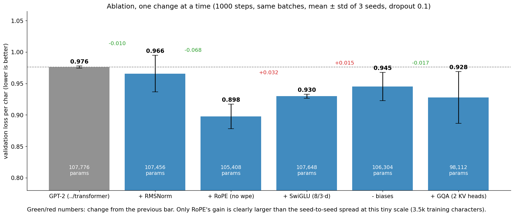
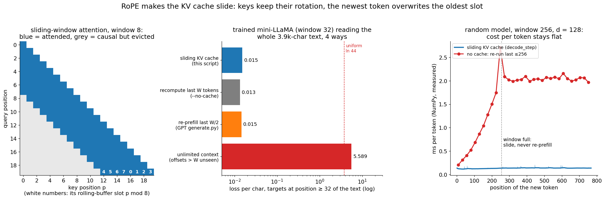
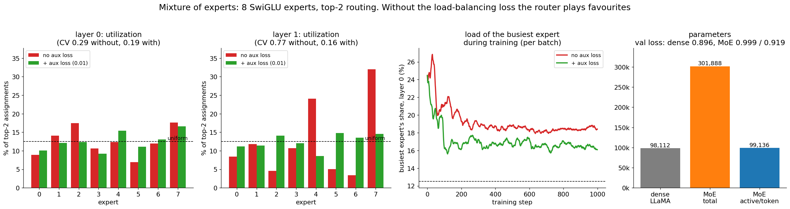

# LLaMA: a modern decoder from scratch

The GPT of [`../transformer/`](../transformer/) is the 2019 recipe. Almost every open
model since 2023 (LLaMA 1–3, Mistral, Mixtral, Qwen, Gemma, DeepSeek) keeps its
skeleton and swaps four parts: **RMSNorm** instead of LayerNorm, **RoPE** (rotary
position embeddings) instead of a learned position table, a **SwiGLU** feed-forward
instead of the GELU MLP, and **grouped-query attention** (GQA) with no biases anywhere.
This folder makes each swap by hand: a NumPy mini-LLaMA with a hand-written backward
pass for every new layer, the same model in PyTorch, a one-change-at-a-time ablation
against the GPT, a KV cache that *slides* thanks to RoPE, and a tiny mixture-of-experts
layer. It trains on the same 3.9 KB story as `../rnn/` and `../transformer/`, with the
same settings, so every number compares directly.

> **Prerequisite:** [`../transformer/`](../transformer/) (the GPT this folder
> upgrades: attention, the block, the backward pass, the KV cache; sections 3–10 there
> are assumed here). [`../tokenizer/`](../tokenizer/) explains the BPE vocabularies
> real LLaMAs use; we stay with characters ($V = 44$, as in [`../rnn/`](../rnn/)) so the
> losses compare with the earlier folders.

## Files

| File | What it teaches |
|------|-----------------|
| `llama_numpy.py` | A complete mini-LLaMA in NumPy: token embedding (no position table), RMSNorm, RoPE on q and k, grouped-query causal attention (`n_kv_head` divides `n_head`: MHA, GQA or MQA), SwiGLU feed-forward, no biases, final RMSNorm, tied or untied output, all with **hand-written backward**. Everything unchanged (Linear, Embedding, cross-entropy, AdamW, warmup + cosine, clipping, data) is imported from `../transformer/transformer_numpy.py`, so the file is exactly the diff. Trains on `../rnn/input.txt` with the GPT's settings and saves `model.npz` (~6 s). |
| `rope_visual.py` | Step-by-step terminal walkthrough: the frequency of every pair of dimensions, each pair drawn as an ASCII clock hand turning with the position, the rotation in numbers, the same q, k at different absolute positions giving the same score, the trained model reading a prompt at position 0 and at 1000, long-range decay, and which query heads share which K/V head. |
| `gradient_check.py` | Numerical vs analytic gradients for RMSNorm, RoPE, GQA attention with `n_kv_head` = 4, 2, 1, SwiGLU and a whole block, then every parameter of a tiny LLaMA (GQA untied, MQA tied); plus RoPE's rotation and relative-position properties. 79 checks, ~2 s. |
| `generate.py` | Prompt → continuation with a **GQA KV cache** of shape `(n_layer, n_kv_head, window, head_size)` that **slides** (a rolling buffer, never re-prefilled). Proves cached == full recompute inside the window and == sliding-window attention beyond it. KV-cache memory for MHA/GQA/MQA and for real models from their published configs, FLOPs per token, `--benchmark`. |
| `llama_pytorch.py` | (a) The same model in idiomatic PyTorch (`nn.RMSNorm`, RoPE as complex multiplication, `scaled_dot_product_attention(enable_gqa=True)`, `F.silu`); identical logits **and gradients** to the NumPy one. (b) GPT vs LLaMA at matched parameter count on the same batches, 3 seeds. (c) Ablation GPT → +RMSNorm → +RoPE → +SwiGLU → −biases → +GQA. (d) bf16 autocast on CPU. ~50 s. |
| `moe.py` | A top-2 mixture of 8 SwiGLU experts with a router, the Switch load-balancing loss and expert capacity. Expert utilization with and without the loss, tokens a capacity limit would drop, total vs active parameters. ~45 s. |
| `make_figures.py` → `images/` | Draws every picture in this README from real computations (~5 s once the `.npz` results exist, ~2 min from scratch). |

### Suggested order

1. Read section 1 (what changed and why) with the architecture picture.
2. Read sections 2–3. Then run `python llama/rope_visual.py` and press Enter to watch
   the clock hands turn and the scores stay put.
3. Read sections 4–6, then read `llama_numpy.py` top to bottom: every class is one red
   box of the architecture picture.
4. Read section 7 and run `python llama/gradient_check.py`.
5. Train: `python llama/llama_numpy.py` (~6 s). Then talk to it:
   `python llama/generate.py` and type `The keeper`.
6. Read sections 8–9, then run `python llama/llama_pytorch.py` (~50 s) and
   `python llama/generate.py --benchmark`.
7. Read section 10 and run `python llama/moe.py` (~45 s).
8. Read sections 11–14, then answer the interview questions out loud and do the
   exercises.

To redraw the pictures: `python llama/make_figures.py`.

Run the scripts from the repo root with the venv active (see the root `README.md`).
On Macs, NumPy 2.0 with Apple Accelerate emits spurious
`RuntimeWarning: ... encountered in matmul` messages even when results are correct.
The scripts filter out just those warnings.

---

## 1. What changed from GPT-2 to LLaMA, and why

LLaMA (Touvron et al. 2023) did not invent its parts. It collected the upgrades that
had each been shown to help (pre-norm from GPT-3, SwiGLU from PaLM, RoPE from GPT-Neo/J)
into one clean, well-documented recipe, and trained it on more tokens than anyone had
for its size. Llama 2 added GQA (34B and 70B); Llama 3 used GQA at every size and
changed the tokenizer (128k vocabulary), the data (15T tokens) and the RoPE base. Mistral, Qwen, Gemma and DeepSeek are all variations.

| Part | GPT-2 (`../transformer/`) | LLaMA (this folder) | Why |
|------|---------------------------|---------------------|-----|
| Positions | learned table `wpe` $(T_{\max} \times C)$, added to the input | **RoPE**: rotate $q$ and $k$ by $m \theta_i$ inside every attention layer | scores depend on the *relative* position; no table; the KV cache can slide; the context can be stretched later |
| Normalization | LayerNorm: subtract mean, divide by std, $\gamma, \beta$ | **RMSNorm**: divide by root-mean-square, $\gamma$ only | as good in practice, fewer reductions, no $\beta$ |
| Feed-forward | $\operatorname{GELU}(x W_1 + b_1) W_2 + b_2$, hidden $4d$ | **SwiGLU** $(\operatorname{silu}(x w_1) \odot x w_3) w_2$, hidden $\approx \tfrac{8}{3} d$ | a learned gate per hidden unit; better loss at equal parameters (Shazeer 2020) |
| K/V heads | one K and V head per query head (MHA) | **GQA**: $n_{\text{kv head}} < n_{\text{head}}$, groups of query heads share K, V | KV cache $n_{\text{head}} / n_{\text{kv head}} \times$ smaller, faster decoding |
| Biases | in every Linear and LayerNorm | **none** | they don't help at scale, cost memory traffic, and the key bias is useless anyway |
| Output head | tied to `wte` in GPT-2 | untied in LLaMA (tied in small Llama 3.2s, Gemma) | a choice: tying saves $V \cdot d$ params |
| Skeleton | pre-norm residual blocks + final norm | **unchanged** | |



**What to look at:** the two models of this repo side by side, drawn from their real
configs. Every red outline is a swap; the arrows and the residual adds are identical.
Same width ($d = 64$), depth (2 blocks) and heads (4): the LLaMA has 98,112 parameters
to the GPT's 107,776: no position table (−2,048), no biases (−1,472), only two K/V
heads (GQA: −4,096 per layer), while the SwiGLU's three $64 \times 176$ matrices have 1,024
more weights per layer than GELU's two $64 \times 256$.

The training loop does not change at all: `llama_numpy.train` is the GPT's loop with
`GPT` replaced by `LLaMA`, the same batches in the same order, AdamW, warmup + cosine
and clipping imported from `../transformer/`.

## 2. RMSNorm

For each token separately, over its $C$ features ($x$: $(B, T, C)$, $\gamma$: $(C,){}$):

```math
\begin{aligned}
\text{LayerNorm:}\quad y &= \gamma \odot \frac{x - \mu}{\sqrt{\sigma^2 + \epsilon}} + \beta && \mu, \sigma^2 = \text{mean and variance of } x \\
\text{RMSNorm:}\quad y &= \gamma \odot \frac{x}{\operatorname{rms}(x)} && \operatorname{rms}(x) = \sqrt{\operatorname{mean}(x^2) + \epsilon} \quad (B, T, 1)
\end{aligned}
```

RMSNorm drops the re-centering (and $\beta$) and keeps only the re-scaling. Zhang &
Sennrich (2019) argued that LayerNorm's success comes from its re-scaling invariance,
not the re-centering, and that dropping it costs nothing in quality while saving
7–64% of the running time in their models. LLaMA uses $\epsilon = 10^{-6}$ (LLaMA 1) or $10^{-5}$
(Llama 2/3, and us).

**Backward.** Write $\hat{x} = x \cdot r$ with $r = (\operatorname{mean}(x^2) + \epsilon)^{-1/2}$ and $d\hat{x} = dy \odot \gamma$
($dz$ is short for $\partial L / \partial z$). Since $\partial r / \partial x_j = -r^3 x_j / C$,

```math
\begin{aligned}
d\gamma &= \sum_{B,T} dy \odot \hat{x} && (C,) \\
dx_j &= \sum_i d\hat{x}_i \left(\delta_{ij}\, r + x_i \frac{\partial r}{\partial x_j}\right) = r \cdot \big(d\hat{x}_j - \hat{x}_j \cdot \operatorname{mean}(d\hat{x} \odot \hat{x})\big) && (B, T, C)
\end{aligned}
```

LayerNorm's backward (`../transformer/` section 7) had one more subtracted term,
$-\operatorname{mean}(d\hat{x})$, because it also subtracts $\mu$. The remaining term removes the part of
the gradient along $\hat{x}$ itself: making the whole token bigger or smaller changes
nothing after the division.



**What to look at:** left, the geometry with $C = 2$: RMSNorm puts every input on the
circle of radius $\sqrt{C}$, keeping its direction; LayerNorm first removes the mean (one whole
dimension), so with $C = 2$ every input lands on one of just two points. Middle, measured
on our trained model: for every token entering each of its RMSNorms, the mean is small
compared with the RMS (median ratio 0.06–0.10), and $x$ and $x - \operatorname{mean}(x)$ point in almost
the same direction (cosine 0.995–0.998), so re-centering would barely change anything.
Right: our NumPy RMSNorm's forward + backward takes 5.8 ms vs LayerNorm's 9.9 ms on
$8{,}192 \times 512$ numbers (the ratio, ~1.7×, varies a little from run to run).

## 3. RoPE: rotary position embeddings

### 3.1 The idea

The GPT *added* a learned vector `wpe[m]` to token $m$'s input. RoPE (Su et al. 2021,
RoFormer) adds nothing to the input. Inside every attention layer, after $q = x W_q$
and $k = x W_k$, it **rotates** each pair of dimensions $(2i, 2i+1)$ of every query and
key by an angle proportional to the token's position $m$:

```math
\begin{aligned}
\theta_i &= \text{base}^{-2i/\text{hs}}, \quad i = 0, \dots, \text{hs}/2 - 1 && \text{base} = 10{,}000 \text{ (LLaMA 1/2)},\ 500{,}000 \text{ (Llama 3)} \\
q'_{2i} &= q_{2i} \cos(m \theta_i) - q_{2i+1} \sin(m \theta_i) \\
q'_{2i+1} &= q_{2i} \sin(m \theta_i) + q_{2i+1} \cos(m \theta_i) && \text{same for } k \text{, at its own position } n \\
& q, k: (B, n_{\text{heads}}, T, \text{hs}) && \cos, \sin \text{ tables: } (T, \text{hs}/2) \text{, broadcast over batch and heads}
\end{aligned}
```

V is **not** rotated: positions only affect *who attends to whom*, not what is passed.

**The complex-number view** (how Meta's code and `llama_pytorch.py` write it): pair $i$
is one complex number $z_i = q_{2i} + j \cdot q_{2i+1}$, and the rotation is a multiplication
by a unit complex number:

```math
z'_i = z_i \cdot e^{j m \theta_i} \qquad (\text{hs}/2 \text{ complex numbers per head: } \texttt{view\_as\_complex} \text{, multiply, } \texttt{view\_as\_real})
```

### 3.2 Why rotate? The score only sees the offset

For each pair, a rotation by $m\theta$ followed by the transpose of a rotation by $n\theta$ is a
rotation by $(n - m)\theta$: $R(m\theta)^\top R(n\theta) = R((n-m)\theta)$. So

```math
q'_m \cdot k'_n = (R_m q) \cdot (R_n k) = q \cdot R_{n-m}\, k = \operatorname{Re}\Big[ \sum_i z_{q,i} \cdot \overline{z_{k,i}} \cdot e^{j (m-n) \theta_i} \Big]
```

The score depends on the contents $q, k$ and on $m - n$ only, never on $m$ or $n$ alone.
Relative position comes for free, through the same dot product attention already
computes. Two consequences we use below: the same text at a different absolute position
gets exactly the same attention (section 9's sliding cache relies on it), and keys can
be cached already rotated, forever.



**What to look at:** left and middle, the same query pair at positions 0–7: pair 0
turns 57.3° per position (one turn every 6 positions), pair 2 only 5.7° (one turn every
63); the length never changes. Right: the score of the same $q$ and $k$ placed at every
$(m, n)$ for 32 positions. Each diagonal $m - n = \text{const}$ has one colour; along a diagonal
the score varies by at most 1.7e-15 (round-off). `rope_visual.py` step 4 does the same
on the trained model: reading "The keeper" at positions 0–9 or 1000–1009 gives
attention weights equal to 1.2e-14. GPT's learned table simply has no position 1000.

### 3.3 Backward

RoPE has no parameters. A rotation is orthogonal, $R^{-1} = R^\top = R(-\theta)$, and the gradient
of $y = R x$ is $dx = R^\top dy$, so

```math
dq = \operatorname{rotate}(dq', -m \theta_i) \qquad dk = \operatorname{rotate}(dk', -n \theta_i) \qquad (\texttt{rope\_rotate(dy, cos, -sin)})
```

then $dq$ and $dk$ flow into the $W_q$ and $W_k$ Linear backwards as usual.

### 3.4 Frequencies, decay and context extension



**What to look at:** left, the wavelength (positions per full turn) of each of the 64
pairs of a 128-dim head: from 6.3 positions (pair 0) to about 54,000 (base 10,000) or
2.6 million (Llama 3's base 500,000). Fast pairs separate neighbours; slow pairs still
differ across the whole context. Middle: for $q = k$, the average $\cos((m - n)\theta_i)$
over the pairs, i.e. how the score of a token with itself falls with the distance.
RoPE has a built-in soft **long-range decay** (RoFormer section 3.4.3): for base 10,000
it is 1 at distance 0, 0.33 at 128 tokens, 0.16 at 1,000 and about 0 beyond 2,000–4,000;
with base 500,000 it is still 0.49 at 1,000 tokens. A larger base decays more slowly,
which is one reason long-context models raise it.

RoPE is relative, but it does **not** extrapolate by itself: a model only learned the
offsets it saw in training. `generate.py --benchmark` measures it on our model (trained
on 32-token windows): reading the whole 3,898-character text with unlimited context, so
that offsets up to 3,897 appear, the loss explodes to **5.589** per char, worse than
uniform guessing (3.784); keeping every offset below 32 gives 0.015 (section 9). Ways
to extend a trained model's context, right panel (4k → 16k):

- **Position interpolation** (Chen et al. 2023): use position $m/s$ instead of $m$
  (divide every angle by $s$), so 16k positions map onto the trained 0–4k range;
  ~1,000 fine-tuning steps recover the quality. Cost: neighbours become 4× closer in
  angle, so the fast pairs lose resolution.
- **NTK-aware scaling** (bloc97, 2023, a Reddit post): raise the base to
  $\text{base} \cdot s^{d/(d-2)}$. The fastest pair is unchanged, the slowest is stretched by $s$,
  smoothly in between. Works even without fine-tuning.
- **YaRN** (Peng et al. 2023): "NTK-by-parts": pairs that turn many times within the
  training context (more than $\beta = 32$ turns) are left alone, pairs that turn less than
  $\alpha = 1$ time are interpolated by $s$, a linear ramp in between; plus a small temperature
  on the attention logits. Extends LLaMA 2 to 64k–128k with little fine-tuning; Qwen2.5
  uses it for 128k.
- **Train with a bigger base**: Code Llama (Rozière et al. 2023) fine-tuned with base
  1,000,000 for 16k–100k contexts; Llama 3 pretrains with 500,000, and Llama 3.1
  applies a frequency-dependent scaling of the same "by parts" kind to reach 128k.

The convention trap: Meta's code rotates *adjacent* pairs $(2i, 2i+1)$ (as we do);
Hugging Face's `rotate_half` rotates $(i, i + \text{hs}/2)$. Both are RoPE, but the rows of
$W_q$ and $W_k$ must be permuted when converting weights between them. A model that
loads fine and outputs garbage often has exactly this bug.

## 4. SwiGLU (and why 8/3)

A GLU (gated linear unit, Dauphin et al. 2017) multiplies two linear projections, one
through a nonlinearity (the *gate*) and one without (the *value*). SwiGLU uses
$\operatorname{silu}(a) = a \cdot \sigma(a)$ (Swish with $\beta = 1$) as the gate (Shazeer 2020):

```math
\begin{aligned}
a &= x w_1, \quad b = x w_3 && x: (B, T, C) \quad w_1, w_3: (C, H) \quad a, b: (B, T, H) \\
h &= \operatorname{silu}(a) \odot b && (B, T, H) \\
y &= h w_2 && w_2: (H, C) \quad y: (B, T, C)
\end{aligned}
```

**Why 8/3?** GPT's MLP has two matrices of $d \times 4d = 8d^2$ parameters. SwiGLU has
three. To keep the same parameters and FLOPs, $3 \cdot d \cdot H = 8d^2$, so $H = 8d/3$. LLaMA
computes $\operatorname{int}(2 \cdot 4d/3)$ and rounds up to a multiple of 256 (LLaMA-7B: 4096 → 10,922 →
**11,008**); Llama 2 70B and Llama 3 multiply by 1.3 before rounding (→ 28,672 and
14,336). Ours: 64 → 170 → 176 (multiple of 16).

**Backward** ($\sigma = \operatorname{sigmoid}(a)$, $\operatorname{silu}'(a) = \sigma(1 + a(1 - \sigma)){}$):

```math
\begin{aligned}
dh &= dy\, w_2^\top & db &= dh \odot \operatorname{silu}(a) & da &= dh \odot b \odot \sigma(a)\big(1 + a(1 - \sigma(a))\big) \\
dx &= da\, w_1^\top + db\, w_3^\top && \text{(} x \text{ feeds two matrices, so its gradients add)}
\end{aligned}
```



**What to look at:** left, SiLU and GELU are both smooth ReLUs that dip slightly
below zero (SiLU's minimum is −0.278 at $x = -1.28$). Middle: one SwiGLU hidden unit
is a *product*: when the gate $a$ is very negative the unit is off whatever the value
$b$; when the gate is open, the sign and size come from $b$. That multiplicative
interaction is what a single nonlinearity can't do. Right, measured on our trained
model over the whole text: most gates sit near 0 (55–59% of them slightly negative,
median −0.05 to −0.06), and a few open wide (1% of layer 0's gates and 6% of layer 1's
exceed 1). Why does it work better? Shazeer's paper ends with: "We offer no
explanation as to why these architectures seem to work; we attribute their success, as
all else, to divine benevolence." It is an empirical win (section 8 measures it).

## 5. Grouped-query attention and the KV cache

In multi-head attention every query head has its own K and V head. When generating,
all those K and V vectors must be kept for every past token (the KV cache,
`../transformer/` section 10) and *read from memory for every new token*. That reading,
not the arithmetic, limits decoding speed. Shazeer (2019) noticed that the heads can
share K and V:

- **MQA** (multi-query): one K/V head for all query heads (PaLM, Falcon-7B).
- **GQA** (grouped-query, Ainslie et al. 2023): `n_kv_head` K/V heads; each group of
  $g = n_{\text{head}} / n_{\text{kv head}}$ consecutive query heads shares one. MHA ($n_{\text{kv head}} = n_{\text{head}}$)
  and MQA ($n_{\text{kv head}} = 1$) are the two ends.

```math
\begin{aligned}
q &= x W_q && (B, T, n_h \cdot \text{hs}) \to (B, n_h, T, \text{hs}) && W_q: (C, n_h \cdot \text{hs}) \\
k &= x W_k && (B, T, n_{\text{kv}} \cdot \text{hs}) \to (B, n_{\text{kv}}, T, \text{hs}) && W_k, W_v: (C, n_{\text{kv}} \cdot \text{hs}) \quad \leftarrow \text{smaller} \\
v &= x W_v && (B, T, n_{\text{kv}} \cdot \text{hs}) \to (B, n_{\text{kv}}, T, \text{hs}) \\
& \text{query head } h \text{ uses K/V head } \lfloor h / g \rfloor && (= \texttt{torch.repeat\_interleave(k, g, dim=1)})
\end{aligned}
```

`llama_numpy.py` never copies K and V: it views q as $(B, n_{\text{kv}}, g, T, \text{hs})$ and k as
$(B, n_{\text{kv}}, 1, T, \text{hs})$, and one broadcast matmul gives scores $(B, n_{\text{kv}}, g, T, T)$.
PyTorch's `scaled_dot_product_attention(..., enable_gqa=True)` (PyTorch ≥ 2.5) does the
same inside the kernel.

**Backward.** A K/V head was used by all $g$ query heads of its group, so it receives the
**sum** of their gradients:

```math
dk_j = \sum_{h:\, \lfloor h/g \rfloor = j} \frac{dS_h^\top q_h}{\sqrt{\text{hs}}} \qquad dv_j = \sum_{h:\, \lfloor h/g \rfloor = j} A_h^\top dy_h
```

In code that is one `.sum(axis=2)` over the group axis; it is the only new line in the
attention backward (exercise 1 removes it).



**What to look at:** left, which query heads read which K/V heads for 8 query heads.
Right, the KV cache per sequence, $2 \cdot n_{\text{layer}} \cdot n_{\text{kv head}} \cdot \text{head size} \cdot T \cdot 2\text{ bytes}$
in fp16, computed by `generate.py` from the published configs: LLaMA-2-7B (MHA) needs 2
GiB at 4k tokens and 16 GiB at 32k; LLaMA-2-70B with 8 K/V heads for 64 query heads
needs 1.25 GiB at 4k, where the same model with MHA would need 10 GiB. Llama-3-8B
(8 K/V heads) needs a quarter of LLaMA-2-7B's cache, Qwen2.5-7B (4 K/V heads) 0.22 GiB
at 4k. Mistral-7B's rolling 4,096-token window caps its cache at 0.5 GiB however long
the text.

What GQA does **not** save: FLOPs. Every query head still computes its own scores and
weighted sums. It saves memory and memory *bandwidth*, which is what decoding is
limited by. And sharing K and V does not mean sharing attention patterns:
`rope_visual.py` step 6 measures, on our trained model, that the two query heads sharing
a K/V head still differ by a total variation of 0.46 and 0.53 per row (unrelated heads:
0.54–0.56). Ainslie et al. also showed an existing MHA checkpoint can be converted
("uptrained") to GQA by mean-pooling its K and V heads and training for 5% of the
original compute.

## 6. No biases, tied or untied embeddings

**Biases.** LLaMA has no bias in any Linear and no `β` in its norms. `../transformer/`
section 7 showed one reason: the key bias gets exactly zero gradient (it shifts every
score in a row by the same amount, and softmax ignores that). The others are tiny
compared with the weights, cost memory traffic, and large-scale experiments (PaLM,
Chowdhery et al. 2022) found training more stable without them. Not universal: Qwen
keeps biases on q, k, v (129k parameters in Qwen2.5-7B).

**Tied embeddings** (`--tie-weights`): `logits = x · tok_embeddingsᵀ`, saving $V \cdot d$
parameters. LLaMA 1/2/3 untie (the 32k–128k × 4,096 tables are a small part of a 7–8B
model: 4% of LLaMA-2-7B and 13% of Llama-3-8B for both tables together), small models
tie (Llama 3.2 1B/3B, Gemma), because there the vocabulary table is a large share of
the parameters. On our model tying saves 2,816 parameters (95,296)
and the whole-text loss is 0.207 instead of 0.201.

## 7. The backward pass, layer by layer

Each class in `llama_numpy.py` has `forward` (which caches what it needs) and
`backward`. The new ones, in the order the gradient meets them going down a block:

| Layer | Backward |
|-------|----------|
| `FeedForward` (SwiGLU) | $dh = dy \thinspace w_2^\top$; $db = dh \odot \operatorname{silu}(a)$; $da = dh \odot b \odot \sigma(a)(1 + a(1 - \sigma(a)))$; $dx = da \thinspace w_1^\top + db \thinspace w_3^\top$ |
| `RMSNorm` | $d\gamma = \sum dy \odot \hat{x}$; $dx = r(d\hat{x} - \hat{x} \odot \operatorname{mean}(d\hat{x} \odot \hat{x}))$ |
| `Attention` | GPT's softmax backward per head, then **sum dk, dv over each group**, then **un-rotate** $dq, dk$ by $-m\theta$, then the three Linear backwards ($dx = dq \thinspace W_q^\top + dk \thinspace W_k^\top + dv \thinspace W_v^\top$) |
| `RoPE` | rotate the gradient by $-m \theta_i$ |
| `LLaMA` | no position table: the embedding gets the whole $dx$ (plus the head's gradient if tied) |

```
$ python llama/gradient_check.py          (excerpt)
Part 1: each layer on its own (B=2, T=5, C=16, 4 query heads of size 4)
  RMSNorm  input x                   shape=(2, 5, 16)     relative error = 5.51e-11  OK
  Attn GQA n_kv=2  wk.W              shape=(16, 8)        relative error = 4.97e-11  OK
  Attn GQA causal mask               d(out[0])/d(x[1:]) = 0.0e+00  OK  (the future can't influence the past)
Part 2: every parameter of a tiny LLaMA through the real loss (V=7, L=2, heads=4, kv heads=2, d=16, T=5, separate embeddings, 3376 params)
  layers.0.attention.wk.W            shape=(16, 8)        relative error = 2.21e-10  OK
Part 2: every parameter of a tiny LLaMA through the real loss (V=7, L=2, heads=4, kv heads=1, d=16, T=5, TIED embeddings, 3008 params)
  layers.0.attention.wk.W            shape=(16, 4)        relative error = 3.09e-10  OK
Part 3: RoPE properties (head size 16, base 10000)
  rotation keeps the norm            shape=(16,)          relative error = 2.22e-16  OK
  q_m·k_n depends only on m - n      shape=(16,)          relative error = 1.80e-14  OK
Gradient check PASSED
```

79 checks pass with a worst relative error of 6.5e-10, in ~2 s. Break a backward and
it fails loudly: flipping the sign in `RoPE.backward` makes 41 checks fail (RoPE itself
and every gradient that flows through q or k: errors 0.2–0.7), while `wv` and `wo` still
pass, because V is never rotated; dropping the subtracted term in `RMSNorm.backward`
gives 0.12; replacing
the group sum of `dk` by "the first head only" passes for MHA ($g = 1$) and fails for GQA
(0.44) and MQA (0.23). `llama_pytorch.py` then shows PyTorch's autograd gives the same
gradients as our backward to 4.3e-15 for MHA, GQA and MQA.

## 8. Training results and the ablation (honest)

`python llama/llama_numpy.py` (2,000 steps of $16 \times 32$ characters, the GPT's exact
settings and batches, ~6 s):

```
model: n_layer=2 n_head=4 n_kv_head=2 (GQA, 2 query heads per KV head) d_model=64 ffn_hidden=176 block_size=32
       -> 98,112 parameters (no biases, no position table)
step     0 | loss/char 3.803 (avg 3.803) | ppl  44.81 | …
step  1999 | loss/char 0.203 (avg 0.205) | ppl   1.23 | …
loss over the whole text: 0.201 per char = perplexity 1.22
```

| NumPy, same settings and batches | params | loss over the whole text | training time |
|---|---|---|---|
| mini-GPT (`../transformer/`) | 107,776 | 0.235 | 8.7 s |
| mini-LLaMA, MHA (`--n-kv-head 4`) | 106,304 | 0.204 | 6.4 s |
| **mini-LLaMA, GQA (default)** | **98,112** | **0.201** | **5.6–6.4 s** |
| mini-LLaMA, MQA (`--n-kv-head 1`) | 94,016 | 0.207 | 5.9 s |
| mini-LLaMA, GQA, tied (`--tie-weights`) | 95,296 | 0.207 | |



**What to look at:** left, on identical batches the LLaMA's training loss drops faster
from the first hundred steps on, and ends lower (0.201 vs 0.235 over the whole text)
with 9% fewer parameters. Middle: per second it is further ahead, because our NumPy
LLaMA step is also cheaper (no GELU $\tanh$ of a $x^3$, no LayerNorm mean, no biases;
the GPT's 8.7 s was recorded when `../transformer/model.npz` was trained, so treat the
time ratio as approximate). Right: the PyTorch models on held-out text (below).

Training loss on a memorized 3.9 KB story does not say much. `llama_pytorch.py` holds
out the last 10% and trains `../transformer/transformer_pytorch.py`'s GPT and a LLaMA
whose SwiGLU hidden size (200) is chosen to **match the parameter count**, with the
same batches, dropout 0.1, AdamW and schedule, 3 init/dropout seeds each:

```
           params  train loss        val loss        best val  val ppl   val per seed
GPT       107,776       0.326    0.940 ± 0.020    0.922 ± 0.012     2.56   0.925 0.927 0.968
LLaMA     107,328       0.220    0.994 ± 0.024    0.915 ± 0.016     2.70   0.987 0.968 1.026
uniform                 3.784    3.784                              44
```

(GPT seed 0 is exactly the 0.925 run in `../transformer/README.md` section 9.) The
honest reading: the LLaMA **learns about 2.5× faster** (its mean validation loss drops
below 1.0 at step 400, the GPT's at step 1,000; best mean val 0.926 at step 500 vs the
GPT's 0.933 at step 1,300), then **overfits sooner** (train 0.220 vs 0.326), so after
1,500 steps its final validation loss is *worse*. With 3.5k training characters,
regularization and early stopping matter more than architecture; the upgrades pay off
as better loss per FLOP at scale, which is where they were measured.

**The ablation**, one change at a time, 1,000 steps (near the best validation point
for all models), same batches, 3 seeds, all run in parallel worker processes. Row 0
is checked to compute exactly `../transformer`'s GPT (logits identical):

```
                             params   val loss (mean ± std)   change   per seed
  GPT-2 (../transformer)    107,776          0.976 ± 0.002            0.979 0.976 0.974
  + RMSNorm                 107,456          0.966 ± 0.029   -0.010   0.953 0.938 1.006
  + RoPE (no wpe)           105,408          0.898 ± 0.020   -0.068   0.924 0.878 0.890
  + SwiGLU (8/3·d)          107,648          0.930 ± 0.003   +0.032   0.926 0.934 0.930
  - biases                  106,304          0.945 ± 0.023   +0.015   0.965 0.914 0.957
  + GQA (2 KV heads)         98,112          0.928 ± 0.041   -0.017   0.909 0.889 0.985
```



**What to look at:** the full LLaMA (0.928) beats the GPT (0.976) with 9% fewer
parameters, and almost all of the gain comes from **RoPE** (−0.068, three times the
seed spread): relative positions are a better inductive bias for text than a learned
table of 32 absolute ones, and the model doesn't have to learn 2,048 position
parameters from 3.5k characters. RMSNorm, SwiGLU, removing biases and GQA each move
the loss by less than the seed-to-seed spread here. That matches the literature: these
were adopted for speed and memory (RMSNorm, no biases, GQA) or for small, consistent
gains that only show up reliably at scale (SwiGLU: Shazeer 2020 reports ~0.04 lower
log-perplexity at equal compute on C4). An ablation on a toy dataset tells you whether
the parts work, not how much they are worth at 7B.

**bf16 autocast on CPU** (part d): 150 steps from the same init and batches reach a
training loss of 1.085 in fp32 and 1.086 under `torch.autocast("cpu",
dtype=torch.bfloat16)`. Under autocast the logits come out in bf16 while the weights and
their gradients stay fp32 (that's what makes it mixed precision); one forward with the
same weights differs from fp32 by a relative 3.3e-3 (bf16 keeps 8 bits of mantissa).
Here it is ~7× **slower** (39.6 vs 5.8 ms/step in the last run): this CPU has no fast bf16 matmul path
and the casts cost more than they save. On GPUs (and CPUs with AMX) bf16 roughly halves
memory traffic and doubles matmul throughput; see `../distributed/`.

## 9. Generation with a sliding KV cache

`generate.py` keeps, for every layer, the K and V of the last `window` tokens in a
**rolling buffer**:

```
cache.k, cache.v: (n_layer, n_kv_head, window, head_size)      window = block_size = 32
new token at absolute position p:
    x = tok_embeddings[token]                     (no position added!)
    per layer: q, k, v = RMSNorm(x) W_q, W_k, W_v;  q, k = rotate(q, k by p·θ_i)
               cache[l, :, p mod window] = k, v    (overwrite the oldest token once full)
               y = softmax(q · cache_kᵀ / √hs) cache_v   over the min(p+1, window) valid slots
```

Slots are not in time order once the buffer wraps, and that is fine: the position is
baked into each cached key by its rotation, and attention is a weighted *sum* over the
slots, which doesn't care about their order. This is Mistral's rolling buffer cache
(Jiang et al. 2023). It never re-computes anything. Compare `../transformer/generate.py`:
the GPT's keys were computed from `wte + wpe[position]`, so when the 32-position table
ran out it had to keep the last 16 tokens and re-run them through the model with new
positions.

What the rolling cache computes is **sliding-window attention**: every token, at every
layer, sees exactly the previous `window` tokens. `generate.py` proves both regimes on
every start (float64):

```
Check 1 (inside the window): 32 tokens decoded one at a time with the cache vs one full forward pass: max |logit diff| = 1.6e-14 ✔
Check 2 (beyond the window): 200 tokens through a 32-slot rolling cache, never re-prefilled, vs one forward
  pass with a sliding-window mask (token i sees i-31..i): max |logit diff| = 2.1e-14 ✔
  cache K, V shape (n_layer, n_kv_head, window, head_size) = (2, 2, 32, 16); the newest token (position 199) sits in slot 7
```



**What to look at:** left, the band mask the rolling cache implements (window 8 here):
each query attends to the last 8 keys (blue); the grey keys are causal but evicted; the
white numbers in the last row are the buffer slots of its 8 keys. Middle, measured by
`generate.py --benchmark` over the 3,866 targets at position $\ge 32$ of the whole text:

| Strategy for text longer than the training window (32) | loss per char |
|---|---|
| sliding KV cache (this folder) | 0.015 |
| recompute the last 32 tokens for every new token (`--no-cache`) | 0.013 |
| GPT-style: re-prefill the last 16 when full | 0.015 |
| unlimited context: offsets up to 3,897 that training never saw | **5.589** |

The three bounded strategies are equally good on this memorized text (0.013–0.015 when
every prediction has 17–32 characters of context, vs 0.201 for evaluation windows that
start from scratch); the sliding cache gets there with no recomputation at all. The
unlimited one shows RoPE does not extrapolate (section 3.4). Note a subtlety: with the
sliding cache, the layer-1 keys were computed when their tokens still saw *their* last 32
tokens, so information can travel $n_{\text{layer}} \times \text{window}$ tokens back (Mistral's argument
for why a 4k window gives a much longer effective context), while "recompute the last
32" starts every window from scratch. Right: time per generated token for a random
model with a 256-token window: flat at 0.13–0.14 ms with the sliding cache, before and
after the window fills; re-running up to 256 tokens costs ~2.2 ms per token.

`python llama/generate.py --benchmark`: our trained model 0.23 → 0.11 ms/token (2.0×
faster) over 128 tokens (four windows' worth, no re-prefill); the 256-window random
model 1.59 → 0.15 ms/token (10.9×). The exact numbers vary a little from run to run.

**KV cache memory**, as printed by `generate.py`:

```
KV cache of OUR model (float32, 32-token window, 2 layers, head size 16):
  MHA n_kv_head=4: 2 × 2 × 4 × 16 × 4 B = 1,024 B/token,   32 KiB for the full window
  GQA n_kv_head=2: 2 × 2 × 2 × 16 × 4 B =   512 B/token,   16 KiB for the full window   <- this model
  MQA n_kv_head=1: 2 × 2 × 1 × 16 × 4 B =   256 B/token,    8 KiB for the full window

KV cache of real models, fp16 (2 bytes), batch 1:  bytes/token = 2 (K,V) × n_layer × n_kv_head × head_size × 2
  model                   params   L heads  kv   hs  KiB/token    4k ctx   32k ctx
  LLaMA-2-7B               6.74B  32    32  32  128        512    2.00 G   16.00 G
  LLaMA-2-70B             68.98B  80    64   8  128        320    1.25 G   10.00 G
  (70B if it were MHA)    78.37B  80    64  64  128       2560   10.00 G   80.00 G
  Mistral-7B v0.1          7.24B  32    32   8  128        128    0.50 G    0.50 G  (rolling 4096-token window)
  Llama-3-8B               8.03B  32    32   8  128        128    0.50 G    4.00 G
  Qwen2.5-7B               7.62B  28    28   4  128         56    0.22 G    1.75 G
```

The parameter counts come from our formula (section 11) applied to the published
configs, and match the official 6.74B, 69B, 7.24B, 8.03B and 7.6B. Multiply the cache by
the batch size: $32 \text{ users} \times 4\text{k tokens}$ of LLaMA-2-7B is 64 GiB of cache, more than the 13.5
GB of fp16 weights. LLaMA-2 itself was trained for 4k tokens; the 32k column is the
formula, to show the scaling.

## 10. Mixture of experts

A **mixture-of-experts** (MoE) layer replaces the feed-forward of a block by $E$
expert feed-forwards and a **router** (Shazeer et al. 2017; Switch Transformer, Fedus et
al. 2021; Mixtral, Jiang et al. 2024):

```math
\begin{aligned}
\text{logits} &= x W_{\text{router}} && x: (N, C) \text{ all tokens flattened} \quad W_{\text{router}}: (C, E) \\
\text{top-}k\text{:}\quad e_1, \dots, e_k &= \text{indices of the } k \text{ largest logits}; \quad g = \operatorname{softmax}(\text{those } k \text{ logits}) && \text{(Mixtral)} \\
y &= \sum_j g_j \cdot \operatorname{Expert}_{e_j}(x) && \operatorname{Expert} = \text{a SwiGLU feed-forward}
\end{aligned}
```

Each token pays for $k$ experts, the model stores $E$. Mixtral 8×7B: 46.7B parameters,
12.9B active per token (2 of 8 experts; attention and embeddings are shared).

**Load balancing.** Nothing stops the router from favouring a few experts; the others
then get few tokens, little gradient, and fall further behind. The Switch Transformer
auxiliary loss (coefficient 0.01) pushes back:

```math
\begin{aligned}
\text{aux} &= E \cdot \sum_e f_e \cdot P_e \\
f_e &= \text{fraction of the } N \cdot k \text{ assignments that went to expert } e && \text{(a count: no gradient)} \\
P_e &= \text{mean over tokens of } \operatorname{softmax}(\text{logits})_e && \text{(differentiable)}
\end{aligned}
```

It is 1 for a perfectly uniform load and up to $E$ if one expert takes everything; its
gradient lowers the router probability of the overloaded experts.

**Capacity.** For efficient batched kernels each expert gets a fixed buffer of
$\text{capacity} = \lceil \text{capacity factor} \cdot N \cdot k / E \rceil$ token slots per batch. Tokens beyond it are
**dropped** for that expert: they get no contribution from it and only the residual
connection carries them through. A bigger capacity factor drops fewer tokens but wastes
compute on padding; "dropless" implementations (MegaBlocks, used for Mixtral) use
variable-size grouped matmuls instead.

`python llama/moe.py` first checks the sparse dispatch against a brute force that runs
every expert on every token (max difference 1.1e-16), then trains three models on
identical batches for 1,000 steps:

```
2. Parameters (d=64, 2 layers, 8 experts of SwiGLU hidden 88, top-2):
   dense LLaMA (hidden 176):         98,112 params, all active
   MoE LLaMA:                       301,888 params total, 99,136 active per token (33%)
3. dense              val loss 0.896
   MoE, no aux loss   val loss 0.999
   MoE + aux loss     val loss 0.919
   MoE, no aux loss   layer 1:  8.5% 11.8%  4.6% 10.7% 24.1%  5.0%  3.4% 32.0%   max 32.0%, CV 0.77, aux 1.46
   MoE + aux loss     layer 1: 11.1% 11.4% 14.0% 12.0%  8.6% 14.8% 13.5% 14.5%   max 14.8%, CV 0.16, aux 1.03
   Assignments a capacity limit would DROP:
   MoE, no aux loss   cf 1.0: 21.4%   cf 1.25: 14.3%   cf 2.0:  3.5%
   MoE + aux loss     cf 1.0:  7.3%   cf 1.25:  0.5%   cf 2.0:  0.0%
```



**What to look at:** two experts of layer 1 take 24% and 32% of the assignments without
the auxiliary loss (uniform is 12.5%) while others get 3–5%; with it, every expert gets
8.6–14.8% and the loss sits at 1.03 (1.00 is perfect). Third panel: during training the
busiest expert of layer 0 settles at ~18% of each batch without the loss, ~16% with it.
That imbalance is what a capacity limit punishes: at capacity factor 1.25, 14.3% of the
assignments would be dropped without the loss and 0.5% with it. The router also
specializes: with the loss on, layer 0's experts get recognizable character groups
(one takes 19% of tokens, mostly spaces; others take mostly `e,n,w`, or `t,i,T,S`).

Honest result: on 3.5k characters the dense model (0.896) beats both MoEs (0.919 with
the loss, 0.999 without). Three times the parameters is just more room to memorize
a tiny text, and routing adds noise. MoE wins when there is far more data than a dense
model with the same active parameters can absorb, which is the regime of Mixtral,
DeepSeek-V3 and (reportedly) most frontier models. The load-balancing result, though,
is exactly what you see at scale.

## 11. Parameter and FLOP count of a LLaMA layer

With $d = d_{\text{model}}$, $\text{hs} = d / n_{\text{head}}$, $H$ = SwiGLU hidden size:

```math
\begin{aligned}
\text{attention:} &\quad W_q\,(d, d) + W_k\,(d, n_{\text{kv}} \cdot \text{hs}) + W_v\,(d, n_{\text{kv}} \cdot \text{hs}) + W_o\,(d, d) &&= 2d^2 + 2 \cdot d \cdot n_{\text{kv}} \cdot \text{hs} \\
\text{SwiGLU:} &\quad w_1, w_3\,(d, H) + w_2\,(H, d) &&= 3 \cdot d \cdot H \quad (\approx 8d^2 \text{ with } H = 8d/3) \\
\text{2 RMSNorms:} &\quad \gamma &&= 2d \\
\text{layer total (MHA, } H = 8d/3 \text{)} & &&\approx 12d^2 \quad \text{(same as GPT)} \\
\text{model} &= L \cdot \text{layer} + V \cdot d \text{ (embedding)} + d \text{ (final norm)} + V \cdot d \text{ (output, 0 if tied)}
\end{aligned}
```

Ours: $2 \cdot 64^2 + 2 \cdot 64 \cdot 32 + 3 \cdot 64 \cdot 176 + 2 \cdot 64 = 46{,}208$ per layer,
$2 \cdot 46{,}208 + 2 \cdot 44 \cdot 64 + 64 = 98{,}112$, exactly what `llama_numpy.py` counts (it asserts this).
LLaMA-2-7B ($d = 4{,}096$, 32 layers, $H = 11{,}008$, $V = 32{,}000$):
$32 \cdot 202{,}383{,}360 + 2 \cdot 131{,}072{,}000 + 4{,}096 = 6{,}738{,}415{,}616$, the "6.7B". GQA shrinks only the
$2 \cdot d \cdot n_{\text{kv}} \cdot \text{hs}$ term: for LLaMA-2-70B the
K and V projections are 8/64 of a full MHA's, which saves 9.4B parameters (78.37B → 68.98B).

**FLOPs per token** (forward, 2 FLOPs per multiply-add): every weight is used once,
$2N$, plus attention, $2 \cdot L \cdot 2 \cdot n_{\text{head}} \cdot \text{hs} \cdot T$ for a token that attends over $T$
others ($q \cdot k$ and $A \cdot v$). From `generate.py`:

```
  model                       T     weights   attention      total     ≈ 2N
  LLaMA-2-7B               4096    13.21 G      2.15 G    15.36 G  13.48 G   (GFLOP)
  LLaMA-2-7B              32768    13.21 G     17.18 G    30.39 G  13.48 G   (GFLOP)
  LLaMA-2-70B              4096   137.43 G     10.74 G   148.16 G 137.95 G   (GFLOP)
```

($2N$ counts the embedding table, which is a lookup, not a matmul; the "weights" column
doesn't.) Training costs $\approx 3\times$ the forward ($6N$ per token). Note that `n_kv_head` does
not appear in the attention FLOPs: GQA saves memory traffic, not arithmetic.

## 12. Real configs: LLaMA, Llama 3, Mistral, Mixtral, Qwen

From the published papers and configuration files:

| Model (year) | d | layers | heads | KV heads | FFN hidden | vocab | context | RoPE base | notes |
|---|---|---|---|---|---|---|---|---|---|
| LLaMA-7B (2023) | 4,096 | 32 | 32 | 32 | 11,008 | 32,000 | 2,048 | 10,000 | RMSNorm $\epsilon$ 1e-6 |
| Llama-2-7B (2023) | 4,096 | 32 | 32 | 32 | 11,008 | 32,000 | 4,096 | 10,000 | |
| Llama-2-70B (2023) | 8,192 | 80 | 64 | **8** | 28,672 | 32,000 | 4,096 | 10,000 | GQA |
| Mistral-7B v0.1 (2023) | 4,096 | 32 | 32 | 8 | 14,336 | 32,000 | 8,192 | 10,000 | sliding window 4,096 |
| Mixtral-8×7B (2024) | 4,096 | 32 | 32 | 8 | $14{,}336 \times 8$ experts | 32,000 | 32,768 | 1,000,000 | top-2 MoE |
| Llama-3-8B (2024) | 4,096 | 32 | 32 | 8 | 14,336 | 128,256 | 8,192 | 500,000 | |
| Llama-3-70B (2024) | 8,192 | 80 | 64 | 8 | 28,672 | 128,256 | 8,192 | 500,000 | |
| Llama-3.1-405B (2024) | 16,384 | 126 | 128 | 8 | 53,248 | 128,256 | 128k | 500,000 | + frequency-dependent RoPE scaling |
| Qwen2.5-7B (2024) | 3,584 | 28 | 28 | 4 | 18,944 | 152,064 | 32k (128k YaRN) | 1,000,000 | q, k, v biases |
| **ours** | 64 | 2 | 4 | 2 | 176 | 44 | 32 | 10,000 | characters |

Everything in this table is the block of `llama_numpy.py` with different numbers. The
head size is 128 in every real model; GQA with 8 K/V heads became the default; the RoPE
base went up with the context length; and the vocabulary grew 4–5× (see `../tokenizer/`
for why bigger vocabularies mean shorter sequences).

## 13. Practical tips and debugging

- **First loss $\approx \ln V$** (3.803 vs 3.784 here). If not, check the init and the loss.
- **Gradient-check every new layer** in float64, including every `n_kv_head` you plan to
  use: an MHA-only test can't catch a missing group sum (it passes when $g = 1$).
- **RoPE convention**: interleaved pairs (Meta, this folder) vs `rotate_half` (Hugging
  Face) is the #1 bug when porting weights. Test with `rope_visual.py`'s relative check:
  the score must depend only on $m - n$.
- **Compute RoPE in fp32**: angles $m \cdot \theta_i$ reach thousands of radians; in bf16 or fp16
  $\cos(m \cdot \theta)$ is wrong for large $m$. Meta's code casts q, k to float before the complex
  multiply, as `apply_rotary_emb` does here.
- **Never let the model see offsets it wasn't trained on** without a context-extension
  method (5.589 vs 0.015 per char here). Check the positions you feed at inference.
- **KV-cache bugs** hide in positions: the new token's rotation angle must be its
  absolute position $p$, not its index in the cache. `generate.py`'s two checks catch it.
- **MoE**: log the per-expert load from the first step. A collapsed router looks like a
  normal loss curve with fewer effective parameters.
- **Repeat runs**: on small data, seed-to-seed spread (±0.02–0.04 here) is as big as
  most architecture effects. Report mean ± std and per-seed values, never one run.
- **bf16**: keep the weights, softmax, norms and loss in fp32 (autocast does), and
  measure that it is actually faster on your hardware (it wasn't on this CPU).

## 14. From this folder to production / frontier labs (why this matters for an AI engineer)

Every open model you will fine-tune (`../finetuning/`), evaluate (`../evals/`), put
behind a RAG pipeline (`../rag/`) or an agent (`../agents/`) and serve
(`../serving/`) is this block. Concretely:

- **Reading a config.json** becomes reading this README: `num_key_value_heads`,
  `intermediate_size`, `rope_theta`, `rope_scaling`, `rms_norm_eps`, `tie_word_embeddings`,
  `attention_bias` are sections 2–6. You can estimate parameters, FLOPs and KV-cache
  memory before downloading anything (sections 9 and 11).
- **Serving cost is the KV cache.** How many users fit on a GPU is
  $\text{free memory} / (\text{KV bytes per token} \times \text{context})$. GQA, sliding windows, paged caches (vLLM),
  KV quantization and DeepSeek's latent attention (MLA) all attack that one formula.
- **Long context** is RoPE engineering: choosing the base, position interpolation /
  NTK / YaRN, and evaluating whether the model really uses the extra tokens.
- **Fine-tuning** (LoRA etc.) attaches to exactly these matrices: `wq, wk, wv, wo, w1,
  w2, w3`. Knowing their shapes (GQA makes `wk, wv` smaller) is knowing what LoRA adapts.
- **MoE** is how frontier models grow parameters without growing per-token compute;
  routing balance and capacity are its production failure modes (dropped tokens look
  like random quality regressions).
- **Interviews** at labs ask you to implement RMSNorm, RoPE or GQA on a whiteboard, or
  to compute a model's KV cache. Everything here is ≤ 30 lines and gradient-checked.

## 15. Interview check

Answer each one out loud in under a minute:

1. List the changes from GPT-2 to LLaMA and give the reason for each.
2. Write RMSNorm and its backward. What is the difference from LayerNorm's backward?
3. Why might re-centering (subtracting the mean) be unnecessary?
4. Write RoPE for one pair of dimensions. Which tensors are rotated, and why not V?
5. Prove that the RoPE score depends only on $m - n$. Use the complex-number view.
6. What is RoPE's backward pass?
7. Why do the pairs have different frequencies? What do the fast and slow pairs do?
8. Does RoPE let a model run beyond its training context? What happens if you just try?
9. Explain position interpolation, NTK-aware scaling and YaRN in one sentence each.
10. Write SwiGLU. Why is the hidden size $8/3 \cdot d$, and how does LLaMA round it?
11. What do MQA and GQA change? Give the shapes of $W_q, W_k, W_v$ with GQA.
12. In GQA's backward, why are the K/V gradients summed over a group?
13. Compute the KV cache of LLaMA-2-7B and LLaMA-2-70B at 4k tokens in fp16.
14. Does GQA reduce FLOPs? What does it reduce, and why does that matter for decoding?
15. How can you convert an MHA checkpoint to GQA?
16. Why does a RoPE model's KV cache slide without recomputation while a learned-position
    model's cannot? What exactly does the rolling buffer compute?
17. Derive the parameter count of a LLaMA layer and of LLaMA-2-7B.
18. Why did LLaMA drop biases? Which modern model family still has some?
19. When would you tie the input and output embeddings?
20. Explain top-k routing, the Switch load-balancing loss and expert capacity. What
    happens without the loss?
21. Mixtral has 46.7B parameters but 12.9B active. What does that mean for memory and
    for FLOPs?
22. What does bf16 autocast keep in fp32 and why?
23. Our ablation found only RoPE's gain to be clearly significant. How would you design
    an ablation that measures SwiGLU's benefit reliably?

## 16. Exercises

1. In `Attention.backward`, replace `.sum(axis=2)` in the `dk` line by `[:, :, 0]`. Run
   `gradient_check.py`: why does MHA still pass while GQA and MQA fail?
2. Flip the sign in `RoPE.backward` (`-self.sin` → `self.sin`) or drop the subtracted
   term in `RMSNorm.backward`, and watch the check catch it. Restore it.
3. Switch `rope_rotate` to the Hugging Face `rotate_half` convention (pairs
   $(i, i + \text{hs}/2){}$). The relative-position check must still pass. Then write the permutation of
   `wq`/`wk` rows that converts a model between the two conventions, and test that the
   logits are unchanged.
4. Implement position interpolation in `generate.py` (`--rope-scale s`: positions $p/s$).
   Measure the unlimited-context loss of section 9 for $s$ = 1, 4, 16 and 122 ($3{,}898/32$).
   Then try the NTK base $10000 \cdot s^{\text{hs}/(\text{hs}-2)}$.
5. Train with `--rope-base 100` and `--rope-base 1000000`. What happens to the loss,
   and to the long-range decay curve of `rope_visual.py` step 5?
6. Add **ALiBi** (`../transformer/` section 2) as a `--pos alibi` option of the PyTorch
   model and add it to the ablation.
7. Add `--n-kv-head` to `llama_pytorch.py`'s part (b) and compare MHA, GQA and MQA at
   matched parameters (widen the SwiGLU to compensate).
8. Replace SwiGLU by GeGLU (`gelu` gate) and ReGLU (`relu` gate) in `FeedForward`
   (NumPy, with backward and gradient check) and compare.
9. Make the ablation trustworthy: 10 seeds and a paired comparison (same seed for both
   arms), then a significance test (see `../evals/`).
10. Add top-1 routing with capacity factor 1.25 *during training* to `moe.py` (Switch
    style) and plot validation loss vs capacity factor and the fraction of dropped tokens.
11. Add a router z-loss ($\operatorname{mean}(\operatorname{logsumexp}(\text{router logits})^2)$, ST-MoE) and see whether it
    changes utilization.
12. Train on a 1 MB+ text (`--file`) with `--block-size 128` and repeat section 8's
    comparison. Does the LLaMA's advantage grow with data?

## 17. Resources

- Touvron et al. (2023), *LLaMA: Open and Efficient Foundation Language Models*.
- Touvron et al. (2023), *Llama 2: Open Foundation and Fine-Tuned Chat Models*.
- Dubey et al. (2024), *The Llama 3 Herd of Models*.
- Zhang & Sennrich (2019), *Root Mean Square Layer Normalization*.
- Su et al. (2021), *RoFormer: Enhanced Transformer with Rotary Position Embedding*.
- Shazeer (2020), *GLU Variants Improve Transformer*.
- Shazeer (2019), *Fast Transformer Decoding: One Write-Head is All You Need* (MQA).
- Ainslie et al. (2023), *GQA: Training Generalized Multi-Query Transformer Models from
  Multi-Head Checkpoints*.
- Chen et al. (2023), *Extending Context Window of Large Language Models via Positional
  Interpolation*.
- Peng et al. (2023), *YaRN: Efficient Context Window Extension of Large Language Models*.
- bloc97 (2023), *NTK-Aware Scaled RoPE allows LLaMA models to have extended (8k+)
  context size without any fine-tuning and minimal perplexity degradation* (Reddit
  r/LocalLLaMA post).
- Rozière et al. (2023), *Code Llama: Open Foundation Models for Code* (RoPE base $10^6$).
- Fedus, Zoph & Shazeer (2021), *Switch Transformers: Scaling to Trillion Parameter
  Models with Simple and Efficient Sparsity*.
- Shazeer et al. (2017), *Outrageously Large Neural Networks: The Sparsely-Gated
  Mixture-of-Experts Layer*.
- Jiang et al. (2023), *Mistral 7B* (sliding-window attention, rolling buffer cache).
- Jiang et al. (2024), *Mixtral of Experts*.
- Chowdhery et al. (2022), *PaLM: Scaling Language Modeling with Pathways* (SwiGLU,
  MQA, RoPE, no biases).
- Dauphin et al. (2017), *Language Modeling with Gated Convolutional Networks* (GLU).
- Meta's reference implementation `llama/model.py` (github.com/meta-llama/llama), whose
  names (`wq`, `w1`, `freqs_cis`, `apply_rotary_emb`) this folder follows.
- EleutherAI blog (2021), *Rotary Embeddings: A Relative Revolution*.
