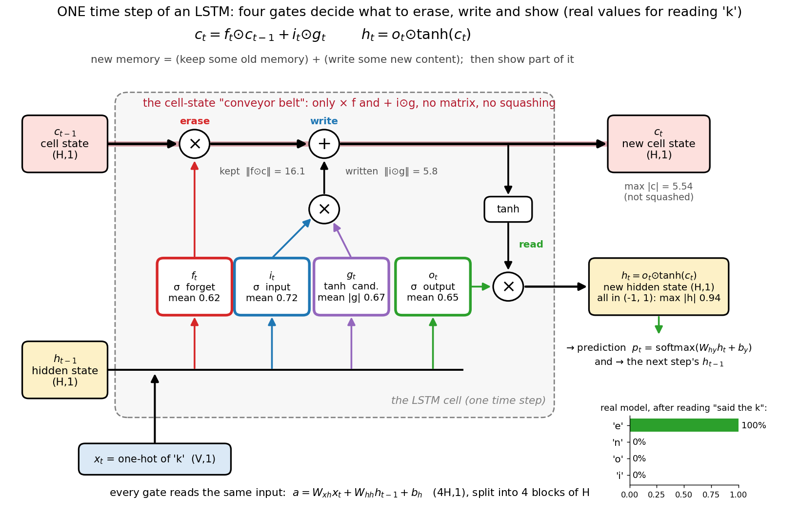
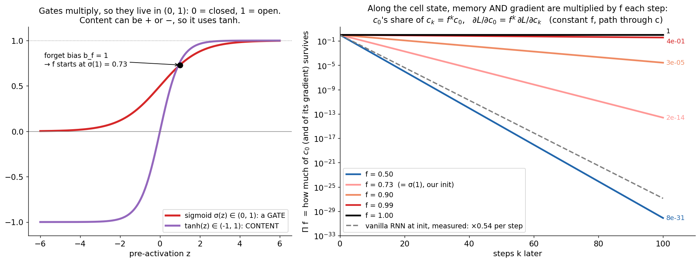
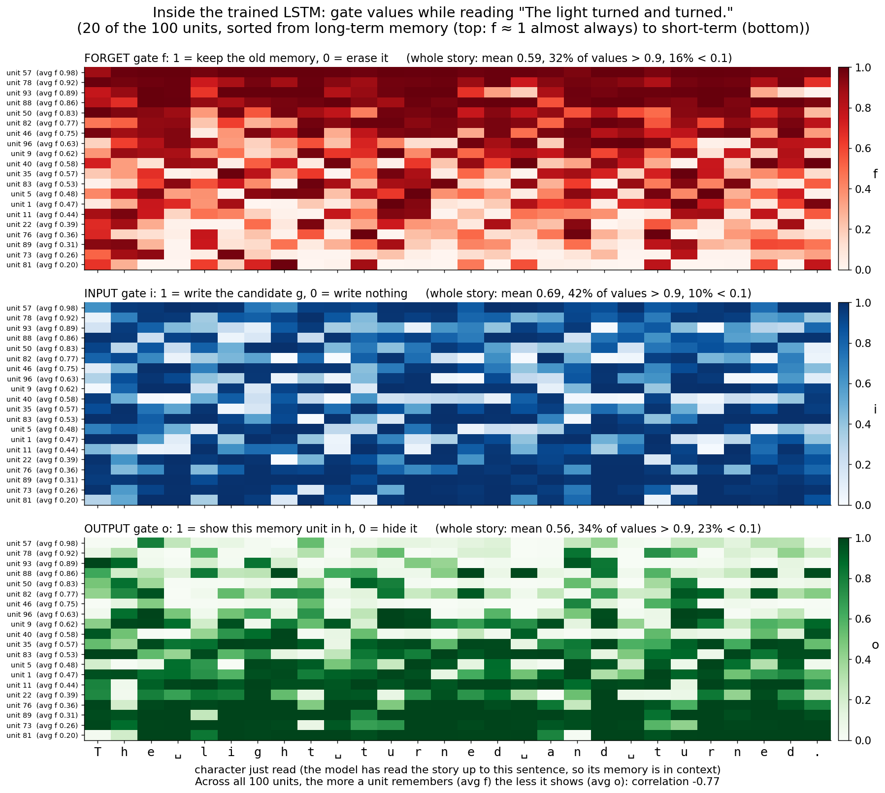
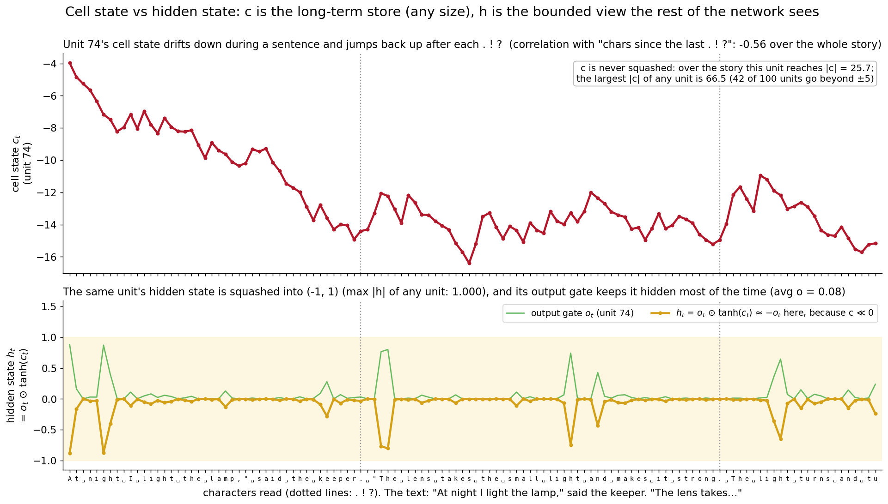
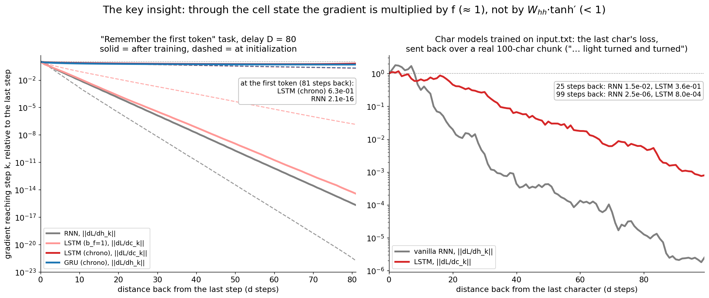
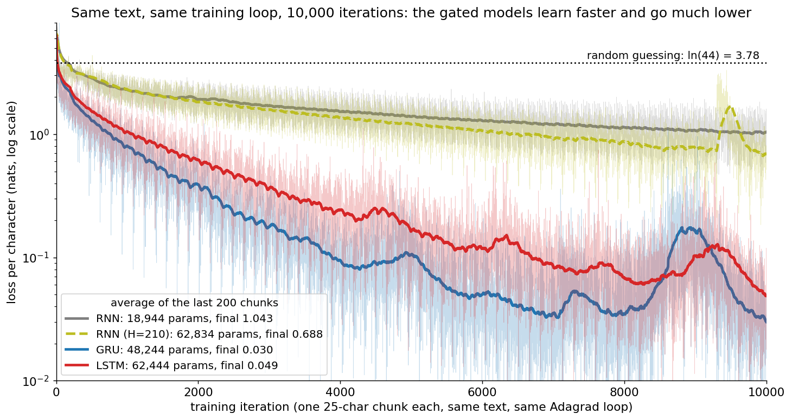
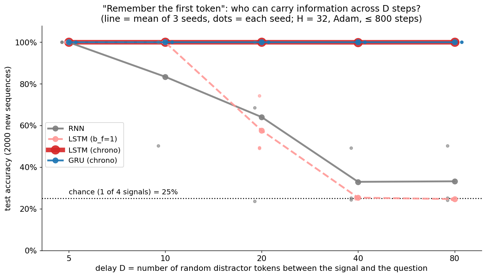
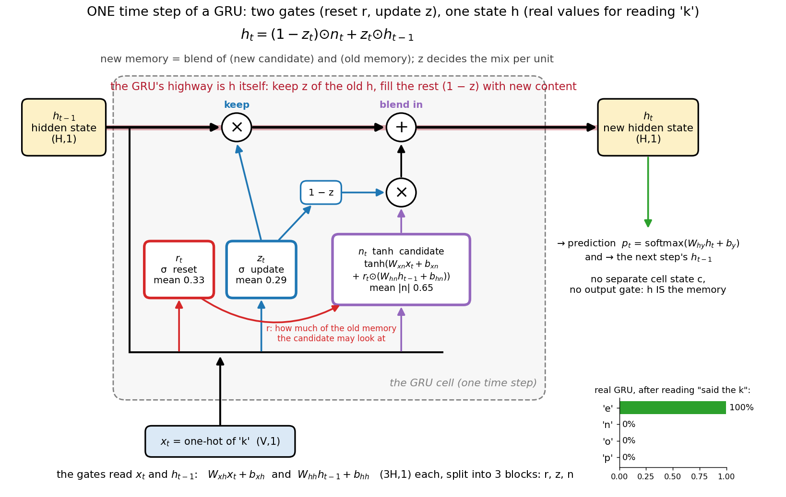
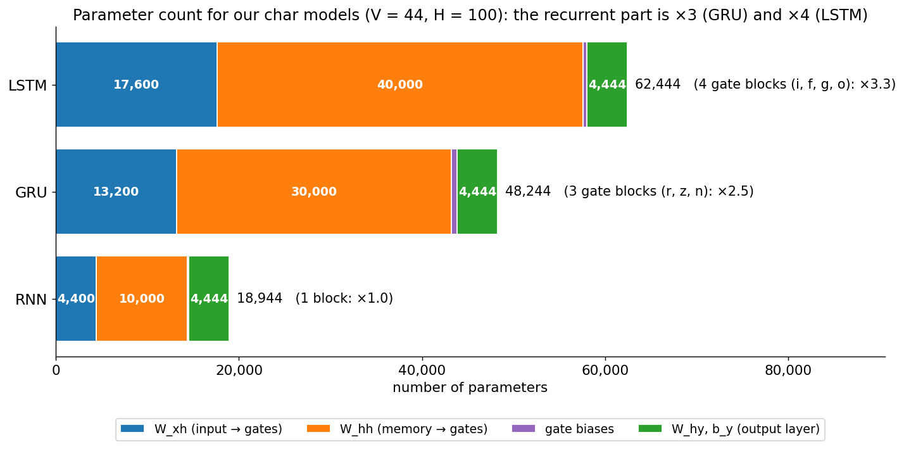

# LSTM and GRU: RNNs with gated memory

A hands-on guide to the two gated RNNs that made sequence learning work in
practice: the **LSTM** (Long Short-Term Memory) and the **GRU** (Gated
Recurrent Unit). The intuition, every equation and its shape, hand-written
backprop through time, a from-scratch NumPy implementation checked against
numerical gradients and PyTorch, and an experiment where a vanilla RNN fails
and the gated models succeed.

> **Prerequisite:** [`../rnn/`](../rnn/), especially section 5 (vanishing and
> exploding gradients). This folder is the direct sequel: same notation (column
> vectors, `W_xh`, `W_hh`, `W_hy`), same character-level language model, same
> training text (`../rnn/input.txt`), so the losses are directly comparable.
>
> **Next:** [`../attention/`](../attention/), seq2seq with attention, which fixes
> the fixed-size-memory bottleneck that even LSTMs have.

## Files

| File | What it teaches |
|------|-----------------|
| `lstm_numpy.py` | LSTM **and** GRU in NumPy: forward, full hand-written BPTT, Adagrad, truncated BPTT that carries `(h, c)` across chunks, clipping, sampling. Trains a char-level LM on `../rnn/input.txt` and saves `model.npz` (or `model_gru.npz` with `--cell gru`). |
| `generate.py` | Loads the trained LSTM (or GRU with `--cell gru`). You type the start of some text and it continues it. |
| `lstm_step_visual.py` | Step-by-step terminal walkthrough: watch the trained LSTM read a prompt one character at a time (the four gates, the cell update split into "kept" and "written", `h_t`, top-5 next-char guesses). |
| `gradient_check.py` | Verifies every LSTM and GRU gradient (and the initial `h0`, `c0`) against numerical gradients. |
| `long_memory.py` | **The key insight.** "Remember the first token" across D random distractors: RNN vs LSTM vs GRU for D = 5…80, plus how much gradient reaches far-back steps. (~45 s) |
| `lstm_pytorch.py` | Proves `nn.LSTMCell`, `nn.LSTM` and `nn.GRU` compute exactly our equations, and that autograd gives exactly our NumPy gradients. Then trains a CharLSTM (or `--cell gru`) the PyTorch way. |
| `make_figures.py` | Draws every picture in this README into `images/` from the real trained models. |
| `images/` | The figures (PNG) shown below. |

### Suggested order

1. Read sections 1–2 (the problem, and the one idea that fixes it).
2. Read section 3 and look closely at the pictures. Then run
   `python lstm/lstm_step_visual.py` and press Enter to watch the LSTM read `keep`.
   Try `python lstm/lstm_step_visual.py --prompt "said the keep"`.
3. Read section 4 (backprop), then read `LSTM.backward` in `lstm_numpy.py` and run
   `python lstm/gradient_check.py`.
4. Train: `python lstm/lstm_numpy.py` (~25 s) and `python lstm/lstm_numpy.py --cell gru` (~22 s).
   Then `python lstm/generate.py` and type a prompt like `The keeper`. Read section 5.
5. Read section 6, then run `python lstm/long_memory.py` (~45 s). This is the heart of the folder.
6. Read section 7 (GRU), then run `python lstm/lstm_pytorch.py`.
7. Read sections 8–11 (practice, variants, limits, the road to LLMs).
8. Answer the interview questions out loud, then do the exercises.

To redraw the pictures: `python lstm/make_figures.py`. It reuses `model.npz`,
`model_gru.npz` and `long_memory.npz` if you already made them with the default
settings, and caches the two vanilla-RNN baselines it trains for comparison
(`rnn_baseline_h*.npz`). From scratch it takes 2–3 minutes, about 45 s if you
already ran the scripts in the suggested order, and a few seconds after that.

Run the scripts from the repo root with the venv active (see the root `README.md`).
On Macs, NumPy 2.0 with Apple Accelerate emits spurious
`RuntimeWarning: ... encountered in matmul` messages even when results are correct.
The scripts filter out just those warnings.

---

## 1. The problem: a vanilla RNN forgets

Recall the vanilla RNN from [`../rnn/`](../rnn/):

```
h_t = tanh(W_xh · x_t + W_hh · h_{t-1} + b_h)
```

In `../rnn/README.md`, section 5, we saw what this means for learning. How much the
loss at step `t` depends on the memory at an earlier step `k` is

```
∂h_t/∂h_k = Π_{i=k+1..t}  diag(1 - h_i²) · W_hh
```

**a product of `t - k` Jacobians**. Each factor contains `W_hh` and the tanh
slope (≤ 1). If they shrink the signal a little each step, then after many steps
the product is essentially zero: the **vanishing gradient**. The model cannot
learn that something it saw 40 characters ago matters now.

You can measure it. In `long_memory.py` (section 6) a freshly initialized RNN
shrinks the gradient by about **×0.54 per step**, so after 80 steps only
`3.5e-22` of it is left. That is not "small", it is nothing.

The fix is not a better optimizer. It is a better **path** for information
(and gradient) to travel through time.

## 2. The core idea: a separate memory with an ADDITIVE update

The LSTM keeps **two** state vectors:

- the **cell state** `c_t`: the long-term memory, a "conveyor belt" running through time,
- the **hidden state** `h_t`: what the cell shows to the outside world (the output layer, the next step's gates).

The cell state is updated by **scaling and adding**, never by a matrix multiply
or a squashing function:

```
c_t = f_t ⊙ c_{t-1}  +  i_t ⊙ g_t
      └── keep ──┘      └─ write ─┘
```

(`⊙` = element-wise product.) Now look at the gradient along the belt:

```
∂c_t/∂c_{t-1} = diag(f_t)            (along the direct path)

vanilla RNN:   dh_{t-1} = W_hhᵀ · (tanh′ ⊙ dh_t)      ← a matrix and a slope, every step
LSTM:          dc_{t-1} = f_t ⊙ dc_t  + ...           ← just an element-wise gate
```

If the forget gate `f ≈ 1`, the gradient passes back **unchanged**, step after
step. Hochreiter & Schmidhuber (1997) called this the **constant error
carousel**: in the original LSTM there was no forget gate at all, the cell's
self-connection was fixed at exactly 1.0, so errors could circulate forever.
The forget gate (Gers et al., 2000) made the "1" learnable, so the cell can
also *choose* to forget.

The same trick appears all over deep learning: a ResNet's `x + F(x)` is an
additive path for gradients through depth, the LSTM's `f ⊙ c + i ⊙ g` is an
additive path through time. (Highway networks, a stepping stone to ResNets,
were directly inspired by LSTM gating.)

## 3. The LSTM equations

All four gates are computed from the same input, the current character `x_t`
and the previous hidden state `h_{t-1}`:

```
a_t = W_xh · x_t + W_hh · h_{t-1} + b_h          (4H, 1): all four gates in one matmul
i_t = σ(a_t[0:H])        input gate:  how much to WRITE        ∈ (0, 1)
f_t = σ(a_t[H:2H])       forget gate: how much old memory to KEEP ∈ (0, 1)
g_t = tanh(a_t[2H:3H])   candidate:   WHAT to write              ∈ (-1, 1)
o_t = σ(a_t[3H:4H])      output gate: how much memory to SHOW    ∈ (0, 1)

c_t = f_t ⊙ c_{t-1} + i_t ⊙ g_t                  new cell state (not squashed)
h_t = o_t ⊙ tanh(c_t)                            new hidden state, in (-1, 1)

y_t = W_hy · h_t + b_y,   p_t = softmax(y_t)     same output layer as the RNN
```

**Which form does the code use?** `lstm_numpy.py` keeps the RNN's names and
stacks the four gates: `W_xh` is `(4H, V)`, `W_hh` is `(4H, H)`, `b_h` is
`(4H, 1)`, with the blocks in the order **i, f, g, o**. That is exactly PyTorch's
layout (`weight_ih_l0`, `weight_hh_l0`), which makes the comparison in
`lstm_pytorch.py` a plain copy. Many papers and blogs (e.g. Olah) instead write
one matrix per gate acting on the concatenation `[h_{t-1}; x_t]`:

```
f_t = σ(W_f · [h_{t-1}; x_t] + b_f)      W_f: (H, H+V)
```

Same thing: `W_f = [W_hh,f  W_xh,f]` side by side. Stack the four `W_•` and you
get our `[W_hh  W_xh]`, shape `(4H, H+V)`.

Shapes (column vectors, as in `lstm_numpy.py`), with `V` = vocab size and `H` = hidden size:

| Symbol | Shape | Meaning |
|--------|-------|---------|
| `x_t` | (V, 1) | input at step t (one-hot character) |
| `h_t` | (H, 1) | hidden state: what the cell shows, in (-1, 1) |
| `c_t` | (H, 1) | cell state: the long-term memory, unbounded |
| `W_xh` | (4H, V) | input → the four gates (blocks i, f, g, o) |
| `W_hh` | (4H, H) | hidden → the four gates |
| `b_h` | (4H, 1) | gate biases (the f block starts at 1, see below) |
| `a_t` | (4H, 1) | gate pre-activations, split into 4 blocks of H |
| `i_t, f_t, g_t, o_t` | (H, 1) each | the gates and the candidate |
| `W_hy`, `b_y` | (V, H), (V, 1) | output layer, identical to the RNN |

`h_{-1}` and `c_{-1}` are zeros. With `V = 44` and `H = 100` the LSTM has 62,444
parameters, the vanilla RNN 18,944 (section 7).



**What to look at:** the red-tinted belt on top is the cell state. Along it
there are only two operations: `× f` (erase) and `+ i⊙g` (write). No matrix, no
squashing, which is why gradient survives along it. All four gates read the same
`[h_{t-1}; x_t]` from the bus at the bottom. The numbers are real: after reading
"said the " the trained LSTM reads 'k'. The gates average f = 0.62, i = 0.72,
o = 0.65; the memory it kept (`‖f⊙c‖ = 16.1`) is much bigger than what it wrote
(`‖i⊙g‖ = 5.8`), and it predicts 'e' with 100%.

### What each gate does

| Gate | Range | Job | Intuition |
|------|-------|-----|-----------|
| `f` forget | (0, 1) | scales the old memory `c_{t-1}` | **erase**: 1 = keep everything, 0 = wipe this unit |
| `i` input | (0, 1) | scales the candidate before adding | **write**: how loudly to write |
| `g` candidate | (-1, 1) | the new content | **what** to write (can push a unit up or down) |
| `o` output | (0, 1) | scales `tanh(c_t)` into `h_t` | **read / expose**: which memories are relevant *right now* |

A unit with `f ≈ 1, i ≈ 0` is a perfect memory: it holds its value untouched.
A unit with `f ≈ 0, i ≈ 1` behaves like a fresh scratchpad each step. The
network learns per unit, per step, which mode to be in.

### Why sigmoid for gates and tanh for content

- A **gate multiplies** something. Its natural range is "fraction of": 0 = closed,
  1 = fully open. `σ` maps any number into (0, 1) smoothly, so it can be
  learned by gradient descent (a hard 0/1 switch could not).
- The **content** `g` must be able to *increase or decrease* a memory, so it
  needs both signs: `tanh` gives (-1, 1), zero-centered, bounded so one step
  cannot write an enormous value.
- `h_t = o ⊙ tanh(c_t)` squashes the unbounded cell back into (-1, 1) before
  anyone else sees it, so the downstream layers get well-scaled inputs.

### The forget-gate bias = 1 trick

At initialization the weights are tiny, so every gate is about `σ(bias)`. With
bias 0, `f ≈ 0.5`: each step the cell **halves** its memory, and the gradient
along the belt halves too (`0.5^20 ≈ 1e-6`). That is a vanishing gradient again!
Setting the forget bias to **1** (Gers et al. 2000; Jozefowicz et al. 2015 found
it closes most of the gap between LSTM and GRU) starts `f` at `σ(1) = 0.73`: the
cell remembers by default until it learns what to forget. `lstm_numpy.py` does
this in one line: `b_h[H:2 * H] = 1.0`.



**What to look at:** left, the gate (σ) lives in (0, 1) and the content (tanh)
in (-1, 1); the dot is where the forget bias of 1 puts `f` at the start. Right,
how much of `c_0` (and of its gradient) is left after k steps of a constant
forget gate. `f = 0.5` leaves `8e-31` after 100 steps, our init `f = 0.73` leaves
`2e-14`, `f = 0.99` still leaves 37%, `f = 1` everything. The dashed line is a
real vanilla RNN at initialization (×0.54 per step, measured in
`long_memory.py`): it is as bad as `f = 0.5`. So even an LSTM needs some units
with `f` very close to 1 to remember for 100 steps. Section 6 shows that this
matters in practice.

### Looking inside: what the gates do in the trained model



**What to look at:** each column is one time step, each row one unit, sorted by
how much that unit remembers on average (its mean `f` over the whole story,
from 0.98 at the top down to 0.20 at the bottom). The top rows of the red panel
are dark almost everywhere: those are the **long-term** units that keep their
memory through the whole sentence. The bottom rows flicker: **short-term**
units that are rewritten nearly every character. The gates are often saturated
(over the whole story 32% of `f` values are above 0.9 and 16% below 0.1): they
act like soft switches. Now compare the green panel: the long-term units mostly
have `o ≈ 0`. Across all 100 units the correlation between "how much a unit
remembers" (mean `f`) and "how much it shows" (mean `o`) is **-0.77**: the
model keeps its long-term memories hidden and shows its short-term ones.

### Cell state vs hidden state



**What to look at:** top, the cell state of unit 74 over a real passage. It is a
rough **sentence clock**: it drifts down while a sentence goes on and jumps back
up after each `.` (correlation -0.56 with "characters since the last `. ! ?`").
Its values are around -4 to -16: the cell state is **not squashed** (the largest
`|c|` of any unit in the story is 66.5; 42 of the 100 units go beyond ±5).
Bottom, the same unit's hidden state stays in (-1, 1) and is almost always 0,
because its output gate is mostly closed (average `o = 0.08`). Since `c ≪ 0`,
`tanh(c) ≈ -1` and `h ≈ -o`: the unit only "speaks" at the few characters
where the output gate opens. That is the division of labour: `c` stores, `o`
decides when the stored value is relevant.

To see all of this with real numbers in your terminal, run
`python lstm/lstm_step_visual.py`.

## 4. Backward pass: BPTT through an LSTM

The loss is the same summed cross-entropy as the RNN, `L = Σ_t -log p_t[target_t]`.
BPTT is ordinary backprop on the unrolled graph; shared weights sum their
gradients over all steps. The difference is that the state is now two vectors,
so **two** gradients flow back from the future: `dh_next` and `dc_next`.

Going backwards from the last step, with `dh_next = dc_next = 0` (this is
`LSTM.backward` in `lstm_numpy.py`, line by line):

```
dy_t   = p_t - onehot(target_t)                   # softmax + cross-entropy
dW_hy += dy_t · h_tᵀ ;   db_y += dy_t

dh_t   = W_hyᵀ · dy_t + dh_next                   # from the output now + from the future
do_t   = dh_t ⊙ tanh(c_t)                         # h = o ⊙ tanh(c)
dc_t   = dh_t ⊙ o_t ⊙ (1 - tanh²(c_t)) + dc_next  # through tanh(c), PLUS c's own future

di_t   = dc_t ⊙ g_t                               # c = f ⊙ c_prev + i ⊙ g
dg_t   = dc_t ⊙ i_t
df_t   = dc_t ⊙ c_{t-1}
dc_next = dc_t ⊙ f_t                              # ← the constant error carousel

da_t   = [ di ⊙ i(1-i) ;  df ⊙ f(1-f) ;  dg ⊙ (1-g²) ;  do ⊙ o(1-o) ]   (4H, 1)
         (σ' = σ(1-σ),  tanh' = 1 - tanh²)
dW_xh += da_t · x_tᵀ ;   dW_hh += da_t · h_{t-1}ᵀ ;   db_h += da_t
dh_next = W_hhᵀ · da_t                            # gradient to h_{t-1}
```

Two lines deserve a second look:

- `dc_t = ... + dc_next`: the cell affects the loss through `h_t` now **and**
  through `c_{t+1}` later, so both contributions add (exactly like
  `dh = W_hyᵀ·dy + dh_next` in the RNN).
- `dc_next = dc_t ⊙ f_t`: going one step back along the belt multiplies the
  gradient by `f`, and by nothing else. No `W_hh`, no tanh slope. With `f ≈ 1`
  that is the **constant error carousel**: the error signal rides the belt back
  in time. (The gradient also leaks into `h_{t-1}` through `W_hhᵀ · da_t`;
  that path behaves like a vanilla RNN and does vanish.)

`gradient_check.py` compares every one of these gradients (and `dL/dh0`,
`dL/dc0`) with central differences. All relative errors are below `5e-7`:

```
LSTM (V=6, H=5, T=8 steps)
  W_xh  shape=(20, 6)  max relative error = 4.33e-07  OK
  ...
  c0    shape=(5, 1)   max relative error = 6.20e-08  OK
Gradient check PASSED
```



**What to look at:** how much gradient reaches a step d steps back, relative to
the last step (log scale). Left, the long-memory task of section 6 with D = 80:
the vanilla RNN's line is straight on a log scale (a constant shrink factor per
step) and has `2.1e-16` left at the first token, 81 steps back; the LSTM with
chrono init still has `0.63` of its gradient along `c` there. Right, our two char
models trained on `input.txt`, sending the last character's loss back over a
real 100-character chunk: 25 steps back the RNN has `1.5e-02` left and the LSTM
`3.6e-01`; 99 steps back, `2.5e-06` vs `8.0e-04`. Note that the char LSTM's
gradient still decays: it learned many short-term units (`f` well below 1)
because this text rewards local patterns. The cell path makes long memory
*possible*, it does not force it.

## 5. Training on the same text as the RNN

`lstm_numpy.py` uses exactly the recipe of `../rnn/rnn_numpy.py`: 25-character
chunks, Adagrad with lr 0.1, element-wise clipping at ±5, 10,000 iterations,
seed 0, `H = 100`. Truncated BPTT now carries **both** `h` and `c` from one
chunk to the next (forward only; gradients stop at the chunk boundary).

```
python lstm/lstm_numpy.py              # ~25 s, saves lstm/model.npz
python lstm/lstm_numpy.py --cell gru   # ~22 s, saves lstm/model_gru.npz
```

| Model | Params | Smoothed loss printed at iter 10,000 (sum over 25 chars) | Avg loss per char, last 200 chunks |
|-------|-------:|------:|------:|
| vanilla RNN (`../rnn/rnn_numpy.py`) | 18,944 | 26.837 | 1.043 |
| vanilla RNN, `H = 210` (same params as the LSTM, lr 0.05) | 62,834 | — | 0.688 |
| **GRU** (`--cell gru`) | 48,244 | 1.657 | **0.030** |
| **LSTM** | 62,444 | 2.027 | **0.049** |



**What to look at:** same text, same loop, same number of updates (log scale).
Both gated models drop far faster: after 2,000 iterations the RNN is at 1.92
nats per char, the LSTM at 0.62 and the GRU at 0.39. By the end the gated models
are around 0.03–0.05, the RNN around 1.04. The dashed line answers "isn't it just
3× more parameters?": an RNN with the **same** parameter count (`H = 210`, with
lr 0.05, which worked better than 0.1 for this bigger RNN) only reaches 0.69, and
spikes near iteration 9,400.

An honest caveat: `input.txt` is only 3,898 characters, so a loss of 0.03–0.05
means the gated models have **memorized** the story (their samples quote it
almost verbatim). That shows how much better they are at fitting long
character patterns, not that they generalize better. To measure
generalization, hold out a validation split (exercise 8).

Then talk to it:

```
$ python lstm/generate.py --prompt "The keeper" --seed 0 --length 200
The keeper in the lun, a keeper when the light?"

The girl smiled and followed him up the stairs. One step, two steps, ten steps, fifty steps, ...
```

## 6. The key experiment: remembering across a long gap

`long_memory.py` builds a task where the answer depends **only** on something
far back:

```
input :  B  x q t q w e ... r  ?       first token = one of 4 signals (A B C D)
         ^  └─ D distractors ─┘        then D random distractor tokens, then "?"
target:  B                             at "?" output the FIRST token
```

Chance is 25%. Each model (`H = 32`, Embedding → recurrent layer → Linear on the
last state, Adam lr 0.01, batch 64, up to 800 steps on fresh random data) is
trained for every delay D with 3 seeds. Four models:

- **RNN**: vanilla tanh RNN.
- **LSTM (b_f=1)**: the standard forget bias of 1 (`f` starts at 0.73).
- **LSTM (chrono)**: "chrono" initialization (Tallec & Ollivier, 2018): per unit
  `b_f = log(U(1, T))` and `b_i = -b_f`, so the units start with a spread of
  memory lengths up to about T steps, and write little.
- **GRU (chrono)**: the same idea for the GRU's keep gate: `b_z = log(U(1, T))`.

Test accuracy on 2,000 new sequences (`python lstm/long_memory.py`, one number per seed):

```
 delay D |           RNN |  LSTM (b_f=1) | LSTM (chrono) |  GRU (chrono)
------------------------------------------------------------------------
       5 | 100% 100% 100% | 100% 100% 100% | 100% 100% 100% | 100% 100% 100%
      10 | 100% 100%  50% | 100% 100% 100% | 100% 100% 100% | 100% 100% 100%
      20 | 100%  24%  69% |  49%  74%  49% | 100% 100% 100% | 100% 100% 100%
      40 |  24%  49%  25% |  25%  26%  26% | 100% 100% 100% | 100% 100% 100%
      80 |  25%  24%  50% |  25%  25%  25% | 100% 100% 100% | 100% 100% 100%
```



**What to look at:** the vanilla RNN (grey) solves short gaps and drops towards
chance (25%) as D grows. The chrono-initialized LSTM (red) and GRU (blue) solve
**every** delay with every seed, and fast: the LSTM needed 180 steps at D = 80,
the GRU 104. The surprise is the pink dashed line: an LSTM with the standard
`b_f = 1` does no better than the RNN.

**Why the surprise?** Section 4 says the cell path multiplies the gradient by
`f`. With `b_f = 1`, `f ≈ 0.73` at the start, and `0.73^80 ≈ 1.3e-11`. The
measured gradient that reaches the first token (`long_memory.py` prints these):

```
                            d=1       d=10      d=40      d=80
  RNN, init                 5.6e-01   1.4e-03   1.5e-11   3.5e-22
  LSTM (b_f=1), init        7.4e-01   8.6e-02   2.9e-04   1.7e-07
  LSTM (chrono), init       9.7e-01   7.6e-01   4.0e-01   2.0e-01
  LSTM (chrono), trained    9.1e-01   7.3e-01   5.7e-01   6.2e-01
```

The `b_f = 1` LSTM gets far more gradient than the RNN, but `1e-7` of a noisy
signal is still not enough for gradient descent to discover "store the first
token, ignore the rest". It is a chicken-and-egg problem: the gate only learns
to stay open if remembering helps, and remembering only helps if the gate is
already open. Training longer does not fix it:
`python lstm/long_memory.py --delays 20 40 --steps 4000` (~95 s) leaves the
`b_f = 1` LSTM at 25% / 26% / 25% for D = 40, while the RNN creeps up to
75% / 50% / 41%. Chrono init starts some units with `f` close to 1
(for D = 80, `b_f = log(U(1, 81))` gives `f = σ(b_f)` up to `81/82 ≈ 0.99`), the gradient arrives, and
the task is learned in under 200 steps.

**The lesson: gating makes long memory POSSIBLE; initialization makes it
FINDABLE.** In real work: use forget bias 1 by default, and for known
long-range tasks consider a larger forget bias or chrono init.

## 7. The GRU: a lighter gated cell

The GRU (Cho et al., 2014) merges the cell and hidden state into one vector `h`
and uses two gates. PyTorch's equations (this is what `GRU` in
`lstm_numpy.py` implements, gate order **r, z, n**):

```
r_t = σ(W_xr x_t + b_xr + W_hr h_{t-1} + b_hr)          reset gate   ∈ (0, 1)
z_t = σ(W_xz x_t + b_xz + W_hz h_{t-1} + b_hz)          update gate  ∈ (0, 1)
n_t = tanh(W_xn x_t + b_xn + r_t ⊙ (W_hn h_{t-1} + b_hn))   candidate ∈ (-1, 1)
h_t = (1 - z_t) ⊙ n_t + z_t ⊙ h_{t-1}
```

- `z` is a **keep/write switch in one**: keep a fraction `z` of the old memory and
  fill the rest `(1 - z)` with new content. It is an LSTM with the forget and
  input gates **coupled** (`i = 1 - f`), so writing automatically erases.
- `r` decides how much of the old memory the candidate may look at
  (`r ≈ 0`: compute the candidate as if starting fresh).
- There is no output gate and no separate `c`: the whole memory is always visible.
- The gradient highway is `∂h_t/∂h_{t-1} = diag(z_t) + (terms through the gates)`:
  with `z ≈ 1` the gradient passes straight back, like the LSTM's `f`.

**Conventions differ, read carefully.** Some papers swap `z` and `1 - z`
(Chung et al. 2014 write `h_t = (1 - z) ⊙ h_{t-1} + z ⊙ h̃_t`, so their `z` means
"update", PyTorch's means "keep"). And the original GRU (Cho et al.) applies the
reset gate **before** the matrix, `W_hn (r ⊙ h_{t-1})`, while PyTorch and cuDNN
apply it **after**, `r ⊙ (W_hn h_{t-1} + b_hn)` (cheaper: `W_hh · h` for all three
gates is one matmul). That is why the GRU needs **two** bias vectors: `b_hn` sits
inside the `r ⊙ (...)`. `lstm_pytorch.py` verifies the PyTorch version
explicitly.



**What to look at:** the belt on top is `h` itself: `× z` keeps part of the old
memory, `+ (1 - z) ⊙ n` blends in the new candidate. The reset gate (red) only
reaches into the candidate. Real values from the trained GRU reading 'k' after
"said the ": mean `r = 0.33`, mean `z = 0.29` (so this step mostly rewrites),
and it predicts 'e' with 99.9%.

The backward pass follows the same pattern as the LSTM (see `GRU.backward`):

```
dn = dh ⊙ (1 - z) ;   dz = dh ⊙ (h_{t-1} - n) ;   dh_prev  = dh ⊙ z   (the highway)
da_n = dn ⊙ (1 - n²) ;   dr = da_n ⊙ (W_hn h_{t-1} + b_hn)
then through σ' for r and z, and the memory's n-vote is scaled by r:
dh_prev += W_hhᵀ · [dr⊙r(1-r) ; dz⊙z(1-z) ; da_n ⊙ r]
```

### GRU vs LSTM

| | LSTM | GRU |
|---|---|---|
| State | `h` and `c` | `h` only |
| Gates | input, forget, output + candidate (4 blocks) | reset, update + candidate (3 blocks) |
| Keep vs write | independent (`f`, `i`) | coupled (`z`, `1 - z`) |
| Memory exposed | filtered by `o` | always all of it |
| Params, PyTorch, input I | `4(H·I + H·H + 2H)` | `3(H·I + H·H + 2H)` |
| Params, our char model (V = 44, H = 100) | 62,444 | 48,244 |
| NumPy training time here (10k iters) | ~25 s | ~22 s |
| Char-LM loss here (last 200 chunks) | 0.049 | 0.030 |
| Long-memory task, chrono init | 100% up to D = 80 | 100% up to D = 80 |

Large studies (Chung et al. 2014; Jozefowicz et al. 2015; Greff et al. 2017)
found **no consistent winner**: GRUs are smaller and often train faster, LSTMs
are sometimes better on very long or counting-like dependencies (the separate,
unbounded `c` can count, see the sentence clock in section 3). A reasonable
default: try both, tune the forget/update bias.



**What to look at:** the output layer (green, 4,444) is the same for all three.
The recurrent part grows with the number of gate blocks: 1 for the RNN, 3 for
the GRU, 4 for the LSTM, and the `W_hh` block (orange, `H × H` per gate)
dominates. Totals 18,944 / 48,244 / 62,444.

## 8. Practical tips

- **Gradient clipping is still useful.** The cell path fixes *vanishing*, but
  the `W_hh` path can still *explode*. Clip by global norm in PyTorch
  (`clip_grad_norm_(params, 1.0)`) or element-wise like `lstm_numpy.py`.
- **Initialization.** Forget bias 1 (PyTorch's default is a small *random* bias:
  set it yourself, see `CharModel` in `lstm_pytorch.py`). For long gaps, a larger
  forget bias or chrono init (section 6). Orthogonal `W_hh` blocks also help.
- **PyTorch gate order is i, f, g, o** for `nn.LSTM` and **r, z, n** for `nn.GRU`.
  `weight_ih_l0` is `(4H, I)` (`(3H, I)` for GRU), `weight_hh_l0` is `(4H, H)`.
  There are two biases, `bias_ih` and `bias_hh`, which are simply **added**. So the
  forget bias lives in `bias_ih_l0[H:2H] + bias_hh_l0[H:2H]`.
- **Shapes.** With `batch_first=True` the output is `(B, T, H)`, but `h_n` **and**
  `c_n` are always `(num_layers × num_directions, B, H)`. The LSTM's state is a
  **tuple** `(h, c)`: pass it in and get it back as a tuple.
- **Truncated BPTT: detach both.** `state = tuple(s.detach() for s in state)`.
  If you forget `c`, the next `backward()` tries to go through the previous
  chunk's graph, which was already freed: "Trying to backward through the graph a
  second time". (With `retain_graph=True` it would instead backprop through the
  whole history, slower every chunk.)
- **Variable-length sequences**: pad them, then
  `nn.utils.rnn.pack_padded_sequence(x, lengths, batch_first=True, enforce_sorted=False)`.
  The LSTM then skips the padding, and `h_n` holds each sequence's **last real**
  step (with plain padding it would be the state after the pads).
- **Dropout between layers**: `nn.LSTM(..., num_layers=2, dropout=0.3)` applies
  dropout to the outputs of every layer except the last. Do not put standard
  dropout on the recurrent connection `h_{t-1} → h_t`; use variational / weight
  dropout if you need it there (AWD-LSTM).
- **Our runs.** `lstm_pytorch.py` (CharLSTM, Embedding 32 → LSTM 128 → Linear,
  90,028 params, Adam 3e-3, 32 streams × 50 chars) reaches 0.027 nats/char after
  1,500 steps in ~15 s; `--cell gru` reaches 0.016 in ~19 s. Like the RNN folder,
  that is memorization of a 4 KB text.
- **Debugging.** Start loss ≈ `ln(V)` per char (3.78 here). Gradient-check new
  cells. If a model "won't remember", look at the forget gate values first.

## 9. Variants

- **Peephole connections** (Gers & Schmidhuber 2000): the gates also look at the
  cell, e.g. `f_t = σ(... + w_cf ⊙ c_{t-1})`. Helps precise timing; Greff et al.
  2017 found it rarely matters.
- **Coupled input-forget gate (CIFG)**: `i = 1 - f`, one gate fewer. The GRU uses
  the same idea. Greff et al. found it performs about as well as the full LSTM.
- **Stacked LSTM**: the `h_t` of layer 1 is the `x_t` of layer 2
  (`num_layers=2`). 2–4 layers were standard; GNMT used 8 with residual
  connections between them.
- **Bidirectional LSTM**: one LSTM reads left→right, another right→left, and
  their states are concatenated (`bidirectional=True`, so `num_directions = 2`).
  Great for tagging and encoding; impossible for generation (it would see the future).
- **LSTM projection** (`proj_size` in PyTorch): `h` is projected to a smaller size
  to save parameters (used in large speech models).
- **LSTM in seq2seq** (Sutskever et al. 2014): an encoder LSTM reads the source
  sentence into its final `(h, c)`; a decoder LSTM starts from it and generates the
  translation. That final state is the **only** bridge between the two, which
  leads directly to the next problem.

## 10. What LSTMs still cannot do

- **The fixed-size memory bottleneck.** Everything the model knows about the past
  must fit into `h` and `c`: 2 × H numbers, no matter if the input is 10 or
  10,000 tokens long. In seq2seq translation, the quality of LSTM models drops on
  long sentences because the whole source sentence is squeezed into one vector.
  **Attention** (Bahdanau et al. 2014, next folder) lets the decoder look back at
  *every* encoder state instead.
- **Memory still fades.** `f` is never exactly 1, so information decays like Π f,
  and anything must be actively protected from being overwritten.
- **Sequential compute.** Step t needs step t-1, so training cannot be
  parallelized across time. On GPUs that is a huge handicap compared to the
  **Transformer**, which processes all positions at once and lets every token
  attend directly to every other one: a path length of 1 between any two tokens,
  instead of the LSTM's `t - k`.

## 11. From LSTMs to LLMs (why this matters for an AI engineer)

- **LSTMs ran the 2015–2018 era of NLP.** Google's neural machine translation
  system (GNMT, 2016) was a deep LSTM encoder-decoder with attention. ELMo
  (2018) produced contextual word embeddings from a bidirectional LSTM language
  model, the direct predecessor of BERT and GPT-style pre-training. Speech
  recognition and keyboard next-word prediction used LSTMs too.
- **Then attention took over**, for the reasons in section 10. But the
  vocabulary of gating stayed.
- **Gates live on inside Transformers.** LLaMA-style models use a **SwiGLU** MLP:
  `FFN(x) = W_2 · (SiLU(W_1 x) ⊙ W_3 x)`. The `⊙` with a learned, input-dependent
  branch is a gate, the same idea as `o ⊙ tanh(c)`.
- **Gated / linear RNNs are back.** To get Transformer-quality models with
  constant memory per generated token:
  - **xLSTM** (Beck et al. 2024) revisits the LSTM with exponential gating and a
    matrix-valued cell state.
  - **Mamba** (Gu & Dao 2023) is a state-space model with **selective** (input-
    dependent) parameters: roughly `h_t = exp(Δ_t A) ⊙ h_{t-1} + Δ_t B_t x_t`, where
    the input-dependent step size `Δ_t` acts like a forget/input gate pair.
  - **RWKV** (Peng et al. 2023) uses learned per-channel decays (a forget gate
    that does not depend on `h`) and a sigmoid "receptance" gate, so it can be
    trained in parallel like a Transformer and run like an RNN.

  The core lesson from this folder carries over directly: memory is a product of
  per-step decay factors, so the model needs factors close to 1 to remember, and
  their initialization and parameterization decide what it can learn.

## 12. Interview check

Answer each one out loud in under a minute:

1. Why do vanilla RNNs suffer from vanishing gradients? Write `∂h_t/∂h_k`.
2. Write the LSTM equations with shapes. Which gate does what?
3. How exactly does the cell state fix vanishing gradients? Write `∂c_t/∂c_{t-1}` and explain the "constant error carousel".
4. Why sigmoid for the gates and tanh for the candidate? What would go wrong with ReLU for `g`?
5. Why initialize the forget-gate bias to 1? When is that not enough, and what can you do?
6. Do LSTMs still need gradient clipping? Why?
7. How many parameters does an `nn.LSTM(I, H)` have? An `nn.GRU(I, H)`?
8. Write the GRU equations. How does it differ from the LSTM? Which would you pick, and why?
9. In PyTorch's GRU, where is the reset gate applied, and why does that need two biases?
10. What are the shapes of `h_n` and `c_n` from `nn.LSTM(batch_first=True, num_layers=2, bidirectional=True)`? What is the gate order?
11. What is truncated BPTT, and why must you detach both `h` and `c`?
12. How do you batch sequences of different lengths for an LSTM?
13. Why is `c_t` unbounded while `h_t` is in (-1, 1)? Is that a problem?
14. What limitations of LSTMs did attention and Transformers fix?
15. Where do you see gating in modern LLM architectures?

## 13. Exercises

1. Derive the LSTM BPTT equations of section 4 on paper. Then delete `+ dc_next`
   in `LSTM.backward()` and confirm that `gradient_check.py` catches it. Which
   parameters fail?
2. Set the forget bias to 0 in `LSTM.__init__` and retrain. Compare the loss at
   iteration 2,000 and 10,000.
3. Make the original 1997 LSTM: no forget gate (`f = 1` always). Gradient-check it,
   train it, and watch `|c|` with `lstm_step_visual.py`. What happens to the cell
   state over a long text?
4. Implement a coupled input-forget gate (`i = 1 - f`) and compare it with the
   full LSTM and the GRU on `input.txt`.
5. In `long_memory.py`, give the GRU a plain init (no chrono bias). Does it still
   solve D = 80? Then try forget bias 3 for the LSTM instead of chrono.
6. Give the RNN in `long_memory.py` a fair chance: identity-initialized `W_hh` with
   ReLU (the IRNN of Le et al. 2015). How far does it get?
7. Push the gap: `python lstm/long_memory.py --delays 80 160 320 --seeds 0`. Where
   does the chrono LSTM break? Does increasing `H` help?
8. Hold out the last 10% of `input.txt` as validation data and report the
   validation perplexity of RNN, GRU and LSTM. Which overfits first?
9. Add peephole connections to `LSTM` and extend `gradient_check.py` to cover them.
10. Stack two LSTM layers in NumPy (the `h_t` of layer 1 is the input of layer 2),
    or in PyTorch with `num_layers=2, dropout=0.2`.
11. Write a many-to-one classifier for variable-length sequences in PyTorch using
    `pack_padded_sequence`, and check that `h_n` equals the output at each
    sequence's last real step.
12. Find an interpretable unit in the trained GRU (adapt `fig_cell_vs_hidden` in
    `make_figures.py`), e.g. a quote, space or sentence-position detector.

## 14. Resources

- Hochreiter & Schmidhuber (1997), *Long Short-Term Memory*: the original paper, the constant error carousel.
- Gers, Schmidhuber & Cummins (2000), *Learning to Forget: Continual Prediction with LSTM*: adds the forget gate.
- Cho et al. (2014), *Learning Phrase Representations using RNN Encoder-Decoder for Statistical Machine Translation*: introduces the GRU.
- Chung, Gulcehre, Cho & Bengio (2014), *Empirical Evaluation of Gated Recurrent Neural Networks on Sequence Modeling*: GRU vs LSTM vs tanh RNN.
- Jozefowicz, Zaremba & Sutskever (2015), *An Empirical Exploration of Recurrent Network Architectures*: searched thousands of variants; forget bias 1.
- Greff et al. (2017), *LSTM: A Search Space Odyssey*: which LSTM parts matter (forget gate and output activation most).
- Tallec & Ollivier (2018), *Can Recurrent Neural Networks Warp Time?*: chrono initialization.
- Christopher Olah, *Understanding LSTM Networks* (blog): the classic diagrams.
- Andrej Karpathy, *The Unreasonable Effectiveness of Recurrent Neural Networks* (blog): char-level LSTMs and interpretable cells (the quote-detection cell).
- Sutskever, Vinyals & Le (2014), *Sequence to Sequence Learning with Neural Networks*: LSTM encoder-decoder.
- Stanford CS231n, Lecture 10 (RNNs, LSTMs), and Goodfellow, Bengio & Courville, *Deep Learning*, Chapter 10.
