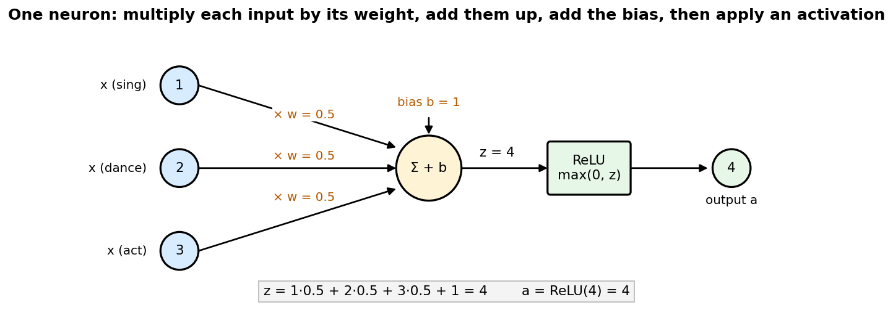
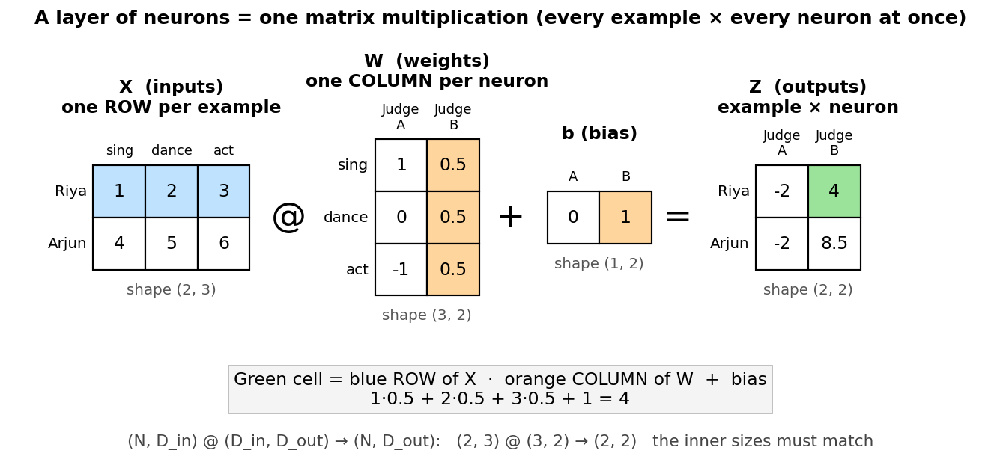
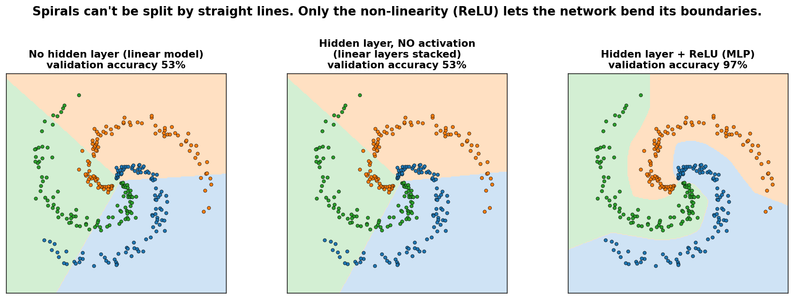
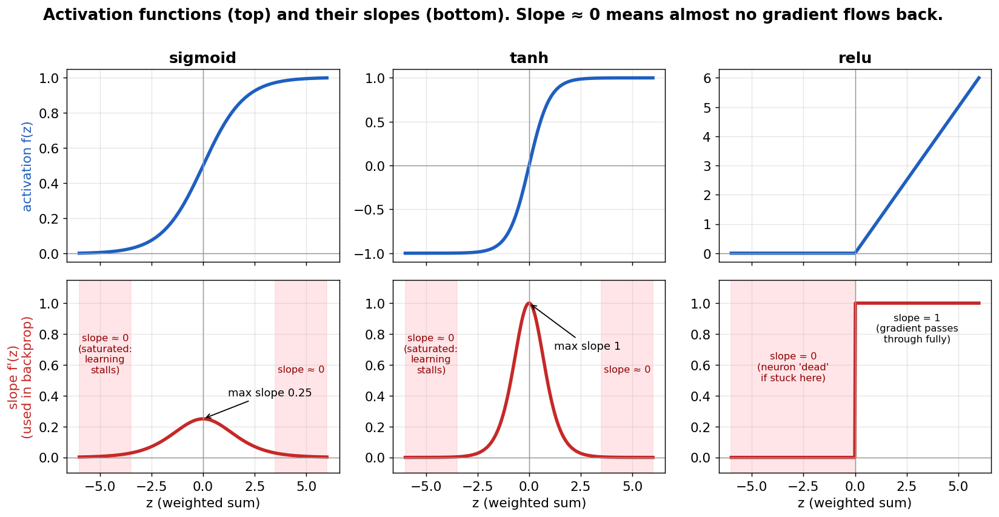
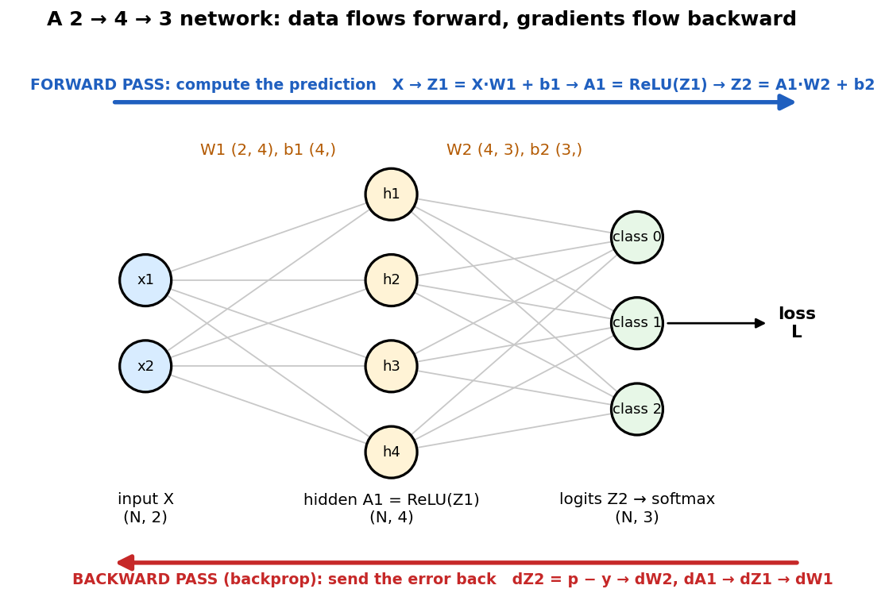
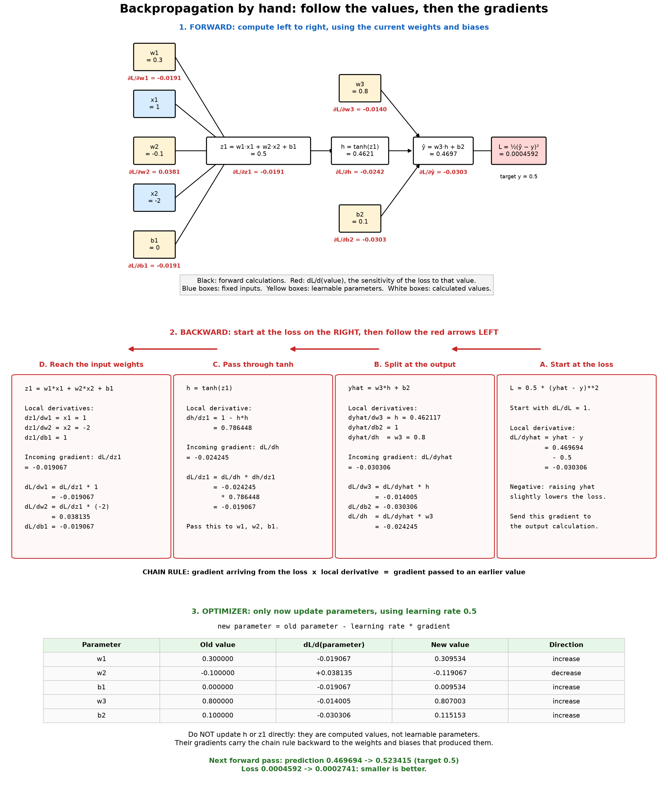
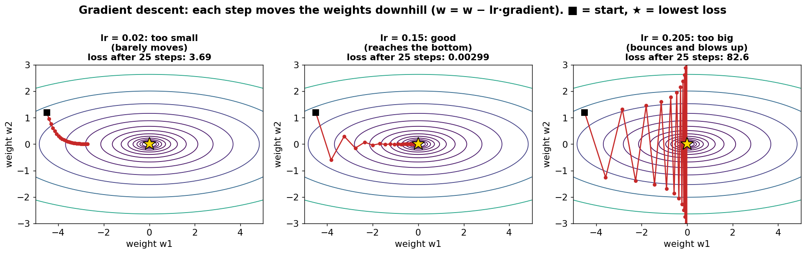
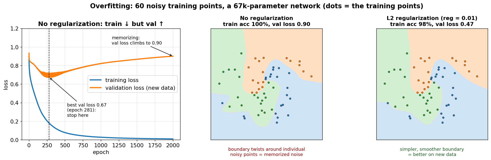

# Multi-Layer Perceptron (MLP): the basic neural network

Everything else (CNNs, RNNs, Transformers) is built from the ideas in this
folder: **neurons, activations, forward pass, loss, backpropagation, gradient
descent, and overfitting**. Learn these well and the other models become
"the same thing, wired differently."

## Files

| File | What it teaches |
|------|-----------------|
| `layer_visual.py` | **Visual, step by step in your terminal:** how one layer of neurons turns into `X @ W + b` (talent-show analogy: examples = contestants, neurons = judges). Press Enter for each step. |
| `backprop_by_hand.py` | A tiny network computed with plain numbers. Every chain-rule step is printed. |
| `mlp_numpy.py` | A full MLP from scratch: any number of layers, ReLU/tanh/sigmoid, softmax + cross-entropy, backprop, mini-batch SGD, L2 regularization. Learns to separate 3 spirals and draws the result in the terminal. |
| `predict.py` | Type in a point and the trained model tells you its class and how confident it is. |
| `gradient_check.py` | Verifies the backprop code against numerical gradients for every activation. |
| `overfitting.py` | Shows overfitting, then fixes it with L2 regularization and more data (~45 s). |
| `mlp_pytorch.py` | Checks that PyTorch autograd gives the same gradients as our code, then trains the same model the PyTorch way. |
| `make_figures.py` → `images/` | Generates every picture in this README from real computations (`python mlp/make_figures.py`, ~20 s). |

### Suggested order

1. Read section 1 (look at the pictures), then run `python mlp/layer_visual.py`.
2. Read sections 2–5, then run `python mlp/backprop_by_hand.py` and follow every line.
3. Read section 6, then read `MLP.forward` and `MLP.backward` in `mlp_numpy.py`.
4. Run `python mlp/gradient_check.py`.
5. Read section 7 and train: `python mlp/mlp_numpy.py`. Then `python mlp/predict.py`.
6. Read section 9 and run `python mlp/overfitting.py`.
7. Run `python mlp/mlp_pytorch.py`.
8. Answer the interview questions (section 12) out loud, then do the exercises.

Run everything from the repo root with the venv active (`source .venv/bin/activate`).

---

## 1. The neuron

A neuron takes some numbers, multiplies each by a **weight**, adds them up
with a **bias**, then applies an **activation function**:

```
z = w1*x1 + w2*x2 + ... + wn*xn + b      (weighted sum: "how strongly do the inputs vote?")
a = f(z)                                 (activation: a non-linear "squash")
```

- **Weights** say how important each input is (they can be negative).
- **The bias** shifts the threshold: how easily the neuron "fires".
- **Learning** means finding good values for all the weights and biases.


*What to look at: each input is multiplied by its weight, everything is summed with the bias (z = 4), and ReLU turns z into the output.*

A whole **layer** of neurons is a matrix multiplication. With a batch of `N`
examples as rows:

```
Z = X @ W + b      X: (N, D_in)   W: (D_in, D_out)   b: (D_out,)   Z: (N, D_out)
A = f(Z)
```

Each **column** of `W` holds one neuron's weights. Always track the shapes:
most bugs are shape bugs.


*What to look at: **rows of X = examples** (contestants), **columns of W = neurons** (judges, each with their
own opinion of each skill). Every cell of Z is one example's row · one neuron's column + that neuron's bias.
The green cell is the same calculation as the single neuron above. Run `python mlp/layer_visual.py`
to watch the table get filled in one cell at a time.*

## 2. Why multiple layers, and why non-linearity?

An **MLP** stacks layers. The output of one layer is the input of the next:

```
input (2) → hidden layer (64, ReLU) → output layer (3 scores, "logits")
```

**Without an activation function, stacking layers is useless.**
`(X @ W1) @ W2 = X @ (W1 @ W2)`: two linear layers are just one linear layer. A
linear model can only draw straight-line boundaries, and the spirals in this
folder can't be separated by straight lines.

The non-linearity (ReLU, tanh, ...) lets each layer **bend** the space. Many
simple bends stacked together can make any shape (the **universal approximation
theorem**: one hidden layer with enough neurons can approximate any
continuous function). Deeper networks usually get there with far fewer neurons.


*What to look at: the left two models only draw straight boundaries (53%). Adding a hidden layer **without**
an activation changes nothing. With ReLU the boundaries curve to follow the spirals (97%).*

Try it: `python mlp/mlp_numpy.py --hidden` (no hidden layer = linear model) gets
about 50% accuracy, and the picture shows straight boundaries.

## 3. Activation functions

| Name | Formula | Derivative | Output range | Notes |
|------|---------|-----------|--------------|-------|
| **Sigmoid** | `1 / (1 + e^-z)` | `a(1 - a)` | (0, 1) | Historical. Saturates at both ends (slope ≈ 0 → **vanishing gradients**). Max slope is only 0.25. Still used for gates (LSTM) and yes/no outputs. |
| **Tanh** | `(e^z - e^-z)/(e^z + e^-z)` | `1 - a²` | (-1, 1) | Zero-centered sigmoid. Also saturates. Used in RNNs. |
| **ReLU** | `max(0, z)` | `1 if z > 0 else 0` | [0, ∞) | **Default choice.** Cheap, and doesn't saturate for z > 0. Downside: "dead" neurons stuck at z < 0 never update. |
| GELU / SiLU | smooth ReLU-like | — | — | Used in Transformers (GPT uses GELU). |

**Saturation** matters: if `f'(z) ≈ 0`, almost no gradient flows back through
that neuron, so the weights before it barely learn. This is the same problem
that hurts RNNs (see `rnn/README.md`, section 5).


*What to look at: the bottom row (the slope) is what backprop multiplies by. Red zones = slope ≈ 0 = no learning
signal. Sigmoid's best slope is only 0.25, while ReLU passes the gradient through unchanged (slope 1) for z > 0.*

## 4. Forward pass

"Forward pass" just means running the network on an input to get the output:

```
A0 = X
Z1 = A0 @ W1 + b1 ;  A1 = relu(Z1)        # hidden layer
Z2 = A1 @ W2 + b2                         # output logits (no activation)
```

We **save** (cache) `A0, Z1, A1, ...` because the backward pass needs them.
That's why training uses more memory than inference.


*What to look at: every grey line is one weight. Forward (blue) turns inputs into class scores, layer by layer.
Backward (red) starts from the error at the end and walks back through the same layers to find each weight's gradient.*

## 5. Loss: how wrong are we?

The **loss** is a single number that measures how bad the predictions are. Training = making it small.

- **Regression** (predict a number): mean squared error, `L = mean((ŷ - y)²)`.
  Used in `backprop_by_hand.py`.
- **Classification** (pick a class): **softmax + cross-entropy**. Used in `mlp_numpy.py`.

```
p = softmax(z)_k = e^{z_k} / Σ_j e^{z_j}     # turn scores into probabilities that sum to 1
L = -log p[correct class]                    # small if the model is confident AND right
```

- If the model gives the right class probability 1.0, `L = 0`.
- If it gives 0.01, `L = 4.6`. Confident-and-wrong is punished hard.
- Random guessing over C classes gives `L = ln(C)` (1.10 for 3 classes). That's a good sanity check at epoch 1.

The gradient of softmax + cross-entropy is beautifully simple:

```
dL/dz = p - onehot(y)        # predicted probabilities minus the truth
```

## 6. Backpropagation (the important part)

Goal: for **every** weight, find `dL/dw`, i.e. "if I nudge this weight up a tiny
bit, how much does the loss change?" Then we know which direction to move it.

**The chain rule**: if `L` depends on `y`, and `y` depends on `w`, then
`dL/dw = dL/dy · dy/dw`. Backprop applies this from the loss **backwards**
through the network, reusing results so every gradient is computed in one pass.

Worked example (exactly what `backprop_by_hand.py` prints):

```
forward:   z1 = w1*x1 + w2*x2 + b1 → h = tanh(z1) → ŷ = w3*h + b2 → L = ½(ŷ - y)²

backward:  dL/dŷ  = ŷ - y
           dL/dw3 = dL/dŷ · h            dL/db2 = dL/dŷ
           dL/dh  = dL/dŷ · w3
           dL/dz1 = dL/dh · (1 - h²)     ← through tanh
           dL/dw1 = dL/dz1 · x1          dL/dw2 = dL/dz1 · x2      dL/db1 = dL/dz1
```

Notice the pattern: **gradient arriving from above × local derivative**.


*What to look at: the top graph shows forward values and gradients. Follow the backward cards
from A on the right to D on the left: each step multiplies the incoming gradient by a local derivative.
At the output, gradients branch to w3, b2, and h; the gradient for h continues through tanh
to w1, w2, and b1. We do not update h or z1 directly: their gradients help compute parameter gradients.
The bottom table shows the optimizer's updates and the next forward pass.
All gradients use the old parameters, before any updates.*

The same pattern in matrix form, for one layer `Z = A_prev @ W + b`, `A = f(Z)`
(this is `MLP.backward`):

```
dZ      = dA ⊙ f'(Z)            # through the activation (⊙ = element-wise)
dW      = A_prevᵀ @ dZ          # gradient for this layer's weights
db      = sum of dZ over the batch
dA_prev = dZ @ Wᵀ               # pass the gradient down to the previous layer
```

**Shape trick:** `dW` must have the same shape as `W`, and there's only one way to
multiply `A_prev` (N, D_in) and `dZ` (N, D_out) to get (D_in, D_out). If you
forget the formula, the shapes tell you.

**Always gradient-check** new backprop code (`gradient_check.py`): compare
against `(L(w+ε) − L(w−ε)) / 2ε`. It's slow but it can't be wrong in the same way.

**Autograd** (PyTorch's `loss.backward()`) does exactly this for you
automatically. `mlp_pytorch.py` proves it gives the same numbers.

## 7. Gradient descent: actually learning

The gradient points uphill (the direction that increases the loss). So step the other way:

```
w = w - learning_rate * dL/dw
```

Repeat thousands of times and the loss rolls downhill.


*What to look at: the rings are a loss "map" for two weights (center ★ = lowest loss). Each red dot is one
update step. Too small a learning rate creeps along, a good one arrives, and too big a one overshoots
further every step and explodes. This is why the loss becomes NaN when lr is too high.*

- **Learning rate (lr):** the step size. Too small: slow. Too big: the loss bounces or explodes (NaN).
  It's the single most important hyperparameter. Try 0.01, 0.1, 1.0.
- **Batch GD** uses all data per step (accurate but slow). **Stochastic GD (SGD)** uses
  1 example (noisy). **Mini-batch SGD** uses e.g. 32 examples, the standard compromise.
  The noise even helps escape bad spots.
- **Epoch:** one pass over the whole training set. Shuffle every epoch.
- **Better optimizers:** **Momentum** keeps a running "velocity" to smooth out zig-zags.
  **Adam** adapts the step size per parameter. Adam (AdamW) is the default for
  Transformers/LLMs, and SGD+momentum is common for CNNs.

### Initialization

Start weights **small and random**:
- **All zeros:** every neuron in a layer computes the same thing and gets the same
  gradient forever (the symmetry is never broken).
- **Too large:** activations saturate or explode.
- **He init** (`std = √(2/fan_in)`) for ReLU and **Xavier init** (`√(1/fan_in)`) for
  tanh keep the signal's size stable from layer to layer. `mlp_numpy.py` uses these.

## 8. Training loop, in one picture

```
for epoch in range(E):
    shuffle training data
    for each mini-batch (X, y):
        logits, cache = forward(X)                 # 1. predict
        loss, dlogits = cross_entropy(logits, y)   # 2. measure error
        grads = backward(dlogits, cache)           # 3. backprop
        params -= lr * grads                       # 4. update
    evaluate on validation data                    # 5. are we generalizing?
```

This loop is the same for every model in this repo, up to GPT.

## 9. Overfitting (and underfitting)

We don't care about doing well on the training data. We care about **new**
data. So we split the data:

- **Training set:** used to update the weights.
- **Validation set:** used to choose hyperparameters and decide when to stop. Never trained on.
- **Test set:** touched once at the very end to report the final score.

| | Train loss | Val loss | Meaning | Fix |
|---|---|---|---|---|
| **Underfitting** | high | high | Model too simple / not trained enough | Bigger model, train longer, higher lr |
| **Good fit** | low | low (close to train) | 🎉 | — |
| **Overfitting** | very low | high / rising | Memorized the training noise | See below |

`overfitting.py` output (60 training points, ~67k-parameter network):

```
 epoch | train loss | val loss | train acc | val acc
   281 |   0.179    |  0.673   |    98%    |   83%  <- best val loss (early stopping)
  2000 |   0.009    |  0.900   |   100%    |   87%
```

Train loss goes to ~0 while val loss climbs: the model becomes **over-confident**
on new points. (Val *accuracy* can still creep up while val *loss* gets worse.
Loss also measures confidence, which is why we watch it.)


*What to look at: left, the gap opening between the blue (training) and orange (validation) curves after
epoch 281 is overfitting. Middle vs right: the same network without and with L2 regularization. Regularization
gives up a little training accuracy (100% → 98%) but nearly halves validation loss (0.90 → 0.47).*

**Fixes, roughly in order of how much they help:**
1. **More data.** In Part 3 of `overfitting.py`, best val loss goes from 0.67 to 0.26.
2. **L2 regularization / weight decay:** add `½·λ·Σw²` to the loss, which keeps weights
   small and the function smooth. The gradient gains a `+λw` term (see `--reg`).
3. **Early stopping:** keep the weights from the epoch with the best val loss.
4. **Dropout:** randomly zero neurons during training so no single neuron can be relied on.
5. **A smaller model.**

**Bias–variance tradeoff:** simple models underfit (high bias), and huge models
overfit small datasets (high variance). Modern LLMs are huge but are trained on
so much data that they mostly sit on the "more data" side of this.

## 10. How this connects to everything else

- **RNN:** an MLP layer applied at every timestep, reusing the same weights, with the
  previous hidden state as an extra input. Backprop through time = this folder's
  backprop on the unrolled network.
- **CNN:** an MLP whose weights are shared across positions in an image.
- **Transformer:** attention layers plus **MLP blocks** (`Linear → GELU → Linear`) in every
  layer. In GPT-style models, about 2/3 of the parameters are in these MLPs.

## 11. Practical tips / debugging checklist

- **First-step loss ≈ ln(C)?** If not, the initialization or the loss is wrong.
- **Overfit a tiny batch first** (e.g. 10 examples → ~0 loss). If the model can't, there's a bug.
- **Loss is NaN** → lower the lr, and check `log(0)` / `exp(big)` (softmax must subtract the max).
- **Loss is flat** → the lr is too small, there are dead ReLUs, or the gradients don't reach the weights (gradient check!).
- **Always print shapes** when something is off.

## 12. Interview check

Questions that come up in ML engineer interviews. Answer each one out loud in under a minute:

1. Why do we need non-linear activation functions?
2. Derive the gradient of softmax + cross-entropy w.r.t. the logits.
3. Write backprop for a 2-layer MLP from memory (shapes included).
4. Why not initialize all weights to zero?
5. Sigmoid vs tanh vs ReLU: pros and cons? What is a dead ReLU?
6. What happens if the learning rate is too high? Too low?
7. Batch vs mini-batch vs stochastic gradient descent?
8. How do you detect overfitting? Name 4 ways to reduce it.
9. What's the difference between the validation set and the test set?
10. How does Adam differ from SGD? What is weight decay?
11. Why does training use more memory than inference?
12. How would you debug a network whose loss isn't going down?

## 13. Exercises

1. In `backprop_by_hand.py`, change the activation to sigmoid and redo the derivatives on paper first.
2. Break one line in `MLP.backward()` and confirm that `gradient_check.py` catches it.
3. `python mlp/mlp_numpy.py --hidden` (linear model): what does the picture look like, and why?
4. Compare `--activation relu`, `tanh` and `sigmoid`, and `--hidden 8` vs `--hidden 64 64`.
5. Try `--lr 0.01`, `--lr 0.5` and `--lr 5`. Describe what happens.
6. Add **momentum** to `sgd_step` (`v = 0.9*v - lr*g; w += v`). Does it train faster?
7. Implement **dropout** in `forward` (training only) and use it in `overfitting.py`.
8. Implement **early stopping** in `train()`: save the best weights by val loss.
9. Train on MNIST digits (download via `torchvision`) with your NumPy MLP. ~97% is achievable.

## 14. Resources

- 3Blue1Brown, *Neural Networks* series (YouTube), chapters 1–4: best visual intuition.
- Andrej Karpathy, *Neural Networks: Zero to Hero*, video 1 ("micrograd"): build backprop from scratch.
- Stanford CS231n notes: "Optimization", "Backpropagation", "Neural Networks Part 1–3".
- Michael Nielsen, *Neural Networks and Deep Learning* (free online book), chapters 1–3.
- Goodfellow, Bengio & Courville, *Deep Learning*, chapters 6–8.
