# Serving and monitoring: from a trained model to a monitored production endpoint

A hands-on guide to what happens after training: how an LLM inference server turns a
model into an endpoint that many users can hit at once, and how you keep it healthy.
Everything is built from scratch with the standard library, NumPy and PyTorch, around the
mini-GPT of [`../transformer/`](../transformer/): batched generation (static and
continuous) over a paged KV cache, int8/int4 weight quantization, speculative decoding,
a real HTTP server with streaming, backpressure, timeouts and Prometheus metrics, a load
tester with fault injection, and a monitor that turns the request logs into SLOs, a
failure-mode taxonomy, drift alerts and eval cases. No vLLM, TGI, FastAPI or Prometheus
client: you see every line.

> **Prerequisite:** [`../transformer/`](../transformer/) (the GPT we serve; its
> sections 10–11 on sampling, the KV cache and the cost of generation are the starting
> point here). [`../llama/`](../llama/) for grouped-query attention, which shrinks the
> KV cache (section 2), and [`../evals/`](../evals/) for the eval harness that the
> production failures exported here feed into (section 16). The code only depends on
> `../transformer/`.

## Files

| File | What it teaches |
|------|-----------------|
| `common.py` | The model we serve (`transformer/model.npz`, trained on demand if missing), its content-hash version, the char tokenizer that reports unseen characters, the percentile function, cheap output-quality signals (repetition ratio, loop detection). |
| `heldout.txt` | 1,392 characters of new sentences in the style of the training text, never trained on: the held-out set for quantization and speculative decoding. |
| `batching.py` | **Static batching** (left padding + attention mask + per-sequence positions), a **paged KV cache** (blocks, block tables, free list, gather), a **continuous batching** scheduler with admission, preemption and window slides; replays a Poisson trace and measures throughput, TTFT, TPOT, p50/p95/p99 and KV memory; measures this CPU's **roofline**. |
| `quantize_numpy.py` | int8 absmax per-tensor and per-channel, int4 group-wise with two nibbles per byte, dequantize-on-the-fly matmul; size, weight error, held-out bits/char, KL and top-1 agreement for fp32/fp16/int8/int4; the **outlier problem**; KV-cache quantization. |
| `speculative.py` | Speculative decoding with a tiny draft GPT (and an n-gram draft): γ drafts, one target pass, the exact accept/reject rule and residual resampling; greedy equality, a chi-square test that the output distribution is the target's, acceptance rate and speed-up vs γ. |
| `server.py` | A real HTTP server (`ThreadingHTTPServer`): `POST /v1/completions` (JSON or server-sent events over chunked encoding), `GET /health`, `GET /metrics` (Prometheus text format), strict validation, bounded queue + 429, per-request timeouts, a continuous-batching engine thread, canary routing, graceful shutdown, one JSON log line per request. `--quantize int8`. |
| `load_test.py` | An open-loop load generator with threads and fault injection (oversized and invalid requests, unseen characters, timeouts, slow uploads, disconnects, a burst, input drift, a canary rollout). `--spawn-server` runs everything in one process. |
| `monitor.py` | Production log analysis: SLIs, SLO error budget and multi-window burn rates, a **failure-mode taxonomy**, quality by model version (z-test), **drift** (PSI, KL), alert rules, a markdown report and an **eval-case export** for `../evals/`. |
| `serving_check.py` | Every fast path vs a reference: static and continuous batching == one-at-a-time generation, paged reads == contiguous cache, quantization error bounds and packing, speculative sampling distribution, server schema over real HTTP, percentiles, histograms, PSI and the taxonomy on a synthetic log. ~2.5 s. |
| `serving_visual.py` | Step-by-step terminal walkthrough: one request from raw HTTP bytes to the log line (KV blocks filling up, decode steps, SSE frames), then continuous vs static batching of six requests with the KV block owners per step. |
| `serving_pytorch.py` | The same GPT in PyTorch with a KV-cache decode loop checked against full recompute and against NumPy; `quantize_dynamic` int8 vs our int8; bf16; `torch.compile`; decode throughput vs batch size of a 53M-parameter model. |
| `make_figures.py` → `images/` | Draws every picture in this README from real computations and the load-test log (~60 s). |

### Suggested order

1. Read sections 1–3 (what serving optimizes, the inference arithmetic, prefill vs decode).
2. Run `python serving/serving_visual.py` and press Enter to follow one request through
   the server, then watch six requests share the engine.
3. Read sections 4–5. Run `python serving/batching.py` (~15 s) and read `batching.py`
   top to bottom: static batching, then the paged KV cache, then the scheduler.
4. Read section 6 and run `python serving/quantize_numpy.py` (~1 s).
5. Read section 7 and run `python serving/speculative.py` (~25 s).
6. Run `python serving/serving_check.py`: every claim so far, checked in ~2.5 s.
7. Read sections 8–9. Start the server, `python serving/server.py`, and talk to it with
   the `curl` commands it prints. Stop it with Ctrl+C (a graceful shutdown).
8. Read section 10 and run `python serving/load_test.py --spawn-server` (~22 s).
9. Read sections 11–16 with `python serving/monitor.py` and `serving/logs/report.md` open.
10. Run `python serving/serving_pytorch.py` (~15 s) and read sections 17–18.
11. Read sections 19–20, then answer the interview questions out loud and do the exercises.

To redraw the pictures: `python serving/make_figures.py` (it runs the load test first if
`serving/logs/requests.jsonl` doesn't exist).

Run the scripts from the repo root with the venv active (see the root `README.md`).
On Macs, NumPy 2.0 with Apple Accelerate emits spurious
`RuntimeWarning: ... encountered in matmul` messages even when results are correct.
The scripts filter out just those warnings. Logs, reports and eval exports go to
`serving/logs/` (gitignored).

---

## 1. What serving is: latency, throughput, cost

Training is one big batch job. Serving is the opposite: many small, independent requests
arrive at random times, each user waits for *their* answer, and the bill is per GPU-hour.
Three numbers matter, and they pull against each other.

| Metric | Definition | Who cares |
|---|---|---|
| **TTFT** (time to first token) | arrival → first generated token (queueing + prefill) | a chat user staring at an empty box |
| **TPOT** (time per output token, a.k.a. inter-token latency) | (last token time − first token time) / (n − 1) | anyone reading a stream; must beat reading speed |
| **End-to-end latency** | arrival → last token ≈ TTFT + (n − 1) · TPOT | API callers, agents chaining calls |
| **Throughput** | generated tokens per second across all users | whoever pays for the GPUs |
| **Goodput** | throughput of requests that *met* their latency SLO | the honest version of throughput |

**Cost** follows from throughput: dollars per million tokens = GPU $/hour ÷ (tokens/s ×
3,600) × 10⁶. At an assumed $2 per GPU-hour, a GPU that decodes 140 tokens/s (one user
at a time, see section 2) costs $3.97 per million tokens; batching it up to 2,500 tokens/s
brings that to $0.22. Most of this folder is about getting from the first number to the
second without wrecking latency.

The model we serve is the mini-GPT from `../transformer/`: 107,776 parameters, two
layers, `d_model = 64`, a 32-character context window, a 44-character vocabulary,
trained on a 3.9 KB story. Its version string is a hash of its weights,
`gpt-5e812e7b`; every log line carries it. (If `transformer/model.npz` is missing,
`common.get_model()` trains the same model with the same seed in ~9 s and caches it as
`serving/model_cache.npz`: bit-identical, same hash.) It is tiny on purpose: every
mechanism below is the real one, and every check runs in seconds on a laptop.

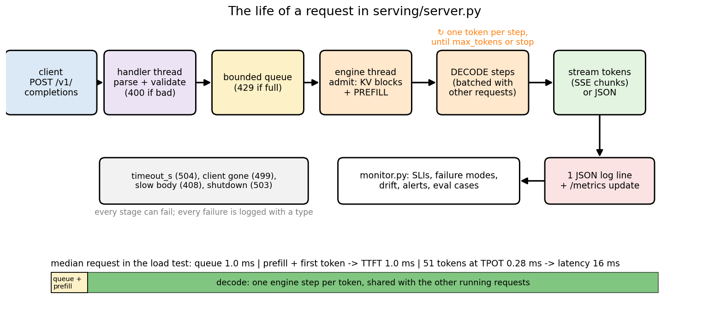

**What to look at:** the path of one request through `server.py`. A handler thread
parses and validates it, a bounded queue holds it (or answers 429), the engine thread
admits it into the running batch (allocating KV-cache blocks), prefills the prompt, then
generates one token per engine step, *sharing every step with the other running
requests*, and streams the tokens back. Every request ends as one JSON log line and a
few metric updates, which `monitor.py` analyzes later. The bottom bar is the median
request of the load test (section 10): 1.0 ms of queue + prefill until the first token,
then 51 tokens at 0.28 ms each, 16 ms in total. Decode dominates.

## 2. Inference math: 2N FLOPs, the KV cache, memory bandwidth

**FLOPs.** A forward pass costs about `2N` FLOPs per token (one multiply and one add per
weight, `../transformer/` section 11), plus attention's `4 · L · t · d` for a context of
`t` tokens. Our model: `2 × 107,776 ≈ 0.22` MFLOP per token. A 7B model: 14 GFLOP per
token.

**The KV cache.** Generating token `t+1` needs the keys and values of all `t` earlier
tokens in every layer, so the server keeps them:

```
KV bytes = 2 (K and V) · n_layer · n_kv_heads · d_head · tokens · bytes_per_number

ours (fp32):        2 · 2 · 4 · 16 · 4 B   = 1,024 B per token  (32 KB for a full window)
LLaMA-2-7B (fp16):  2 · 32 · 32 · 128 · 2 B = 0.5 MiB per token  (2 GiB for 4,096 tokens)
LLaMA-2-70B, GQA:   2 · 80 · 8 · 128 · 2 B  = 0.31 MiB per token (MHA would be 2.5 MiB)
```

For a big batch of long conversations the KV cache, not the weights, fills the GPU. That
is why grouped-query attention ([`../llama/`](../llama/): 8 KV heads shared by 64 query
heads in LLaMA-2-70B) and KV-cache quantization (section 6) matter so much for serving,
and why section 5 manages this memory like an operating system manages RAM.

**Memory bandwidth.** A decode step processes *one* new token per sequence but must read
*every* weight from memory. A 7B model in fp16 is 14 GB; an A100 reads 2 TB/s, so one
step takes at least 7 ms, i.e. at most ~140 tokens/s for a single user, while the
tensor cores (312 TFLOP/s) sit at about 0.6% utilization (14 GFLOP in 7 ms = 2 TFLOP/s).
The fix is to make one read of the weights serve many tokens: batching.

**Arithmetic intensity** is FLOPs per byte moved. For one weight matrix `W (d × d)` in
fp16 applied to `b` token vectors `x (b × d)`:

```
FLOPs = 2 · b · d²        bytes ≈ 2 · d² (read W) + 4 · b · d (read x, write y)
intensity ≈ 2bd² / 2d² = b          (for b ≪ d)
```

A machine with peak `P` FLOP/s and bandwidth `B` bytes/s is **memory-bound** below the
*ridge point* `P / B` and **compute-bound** above it (the roofline model, Williams et al.
2009). For an A100, `312e12 / 2e12 = 156`: decode steps with fewer than ~156 tokens in
the batch are memory-bound, and adding sequences to the batch is nearly free.

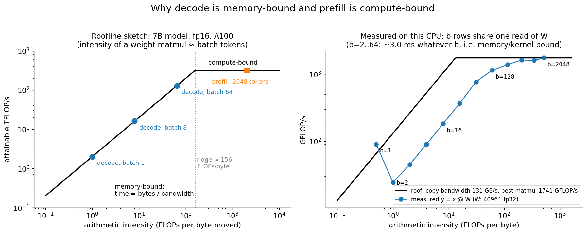

**What to look at:** left, the roofline sketch for a 7B model on an A100: a decode step
at batch 1 has intensity ~1 and reaches ~2 TFLOP/s; batch 64 reaches ~128; a 2,048-token
prefill sits on the flat compute roof. Right, *measured* on this CPU by `batching.py`
(`y = x @ W` with a 64 MB fp32 matrix): in the run quoted here, copy bandwidth
127 GB/s, best matmul 1,787 GFLOP/s, ridge ≈ 14 FLOPs/byte. From `b = 2` to `b = 64`
rows the matmul takes 3.2–3.7 ms *whatever b is*: 32× more work for the same time, the
signature of a memory-bound kernel. (Honest caveat: `b = 1` takes only 0.34 ms because
Accelerate switches to a dedicated matrix-vector routine; the general small-`b` matrix
multiply is far below the roof. GPU libraries ship special small-batch "GEMV / split-K"
kernels for decode for exactly this reason.)

## 3. Prefill vs decode, TTFT and TPOT

Every request has two phases with opposite costs (`../transformer/generate.py` already
has both):

```
PREFILL   the whole prompt (P tokens) in ONE forward pass; fills the KV cache
          intensity ~ P: compute-bound; determines TTFT
DECODE    one token per forward pass, reading the whole cache and all weights
          intensity ~ batch size: memory-bound; determines TPOT
```

Measured by `batching.py` on the mini-GPT (float32):

| | time | tokens/s |
|---|---|---|
| prefill, 32 tokens in one pass | 0.28 ms | 115,768 |
| decode, batch 1 | 0.168 ms/step | 5,964 |
| decode, batch 16 | 0.452 ms/step | 35,419 |
| decode, batch 64 | 1.288 ms/step | 49,706 |

Prefill processes ~19× more tokens per second than single-sequence decode, and batch 16
gets 16 tokens per step for 2.7× the time of one. Honest caveat: our 431 KB of weights
fit in the CPU's cache, so what makes *our* decode step expensive is mostly Python
overhead per layer, not memory traffic; the cost structure is the same (a fixed cost per
step that batching amortizes), and section 17 measures a 53M-parameter model where the
weights really must be streamed from memory.

Two consequences shape every serving system:

- **TTFT and TPOT fight.** A long prefill admitted into the running batch stalls every
  decoding user for one step (a TPOT spike). *Chunked prefill* (section 8) splits it.
- **Latency = TTFT + (n − 1) · TPOT**, and for typical chat lengths the decode part
  dominates (51 tokens × 0.28 ms vs 1 ms TTFT in our load test).

## 4. Batching: static, dynamic, continuous

**Static batching** runs B requests through the model together. Prompts have different
lengths, so they are padded to a rectangle, and three things must be right or the
batched answer silently differs from the single one:

```
            column:   0  1  2  3  4
row 0 "The"           ·  ·  T  h  e      valid: F F T T T    positions: 0 0 0 1 2
row 1 "The k"         T  h  e  ␣  k      valid: T T T T T    positions: 0 1 2 3 4

LEFT padding:  every prompt's last token is in the last column -> next logits = logits[:, -1]
MASK:          query t sees key j  iff  j <= t (causal) AND valid[j] (not a pad)
POSITIONS:     each row counts from 0 at its own first real token, not at column 0
```

```python
# batching.padded_prefill
causal = np.tril(np.ones((W, W), dtype=bool))
mask = (causal[None] & valid[:, None, :]) | np.eye(W, dtype=bool)[None]  # (B, W, W)
x = embed(model, idx, pos)                                               # per-row positions
```

(A pad query sees only itself, so its softmax row is never all `-inf`; its output is
garbage that no real token reads.) Decoding then appends one column per step for all
rows. One more subtlety: our model only knows positions 0..31, so when a row's window is
full it must re-prefill its last 16 tokens exactly when `generate.py` would;
`refill_rows` does that for some rows of the rectangle while the others keep going.
`serving_check.py` proves the result equal to one-at-a-time `generate.py`, greedy and with
per-request seeds, prompts of 1–20 tokens, windows sliding.

The problem with static batching: **the batch runs until its longest request is done.**
Finished rows keep burning compute, and new arrivals wait for the whole batch.
**Dynamic batching** (wait up to a few ms to fill a batch) helps the start, not the end.

**Continuous batching** (iteration-level scheduling, Orca, Yu et al. 2022) re-forms the
batch at *every* decode step: finished requests leave, waiting ones join immediately.
The trick that makes it work is Orca's *selective batching*: every Linear, LayerNorm and
MLP sees all the new tokens of all requests as one `(B, C)` matrix (the weights are read
once), and only attention is per sequence, because each has its own cache length.

```python
# batching.ContinuousBatcher._decode (one engine step)
x = embed(model, last_tokens, positions)[:, None]               # (B, 1, C): one per request
for l, blk in enumerate(model.blocks):
    q, k, v = split(blk.attn.c_attn.forward(blk.ln_1.forward(x)))   # batched
    kv.write_tokens(l, seqs, positions, k, v)                        # into each request's blocks
    K, V, mask = kv.gather(l, seqs, positions + 1)                   # per request, via block tables
    x = x + c_proj(attend(q, K, V, mask)); x = x + mlp(ln_2(x))      # batched
```

`batching.py` replays the same trace through both policies on the real model: 300
requests, Poisson arrivals at 300 req/s, prompts of 4–32 characters, outputs of 5–160
tokens (log-normal, mean 48), at most 16 in a batch. Compute time is real
(`perf_counter` around each engine step); waiting for the next arrival is simulated.

| | tokens/s | TTFT p50 / p99 | TPOT p50 | latency p50 / p95 / p99 |
|---|---|---|---|---|
| static | 10,763 | 140.6 / 211.5 ms | 0.54 ms | 202.3 / 258.0 / 271.1 ms |
| continuous | 12,276 | 0.7 / 1.7 ms | 0.35 ms | 14.5 / 47.1 / 72.4 ms |

At this load both keep up with the arrivals, so throughput is similar (1.14×), but
continuous batching cuts the median TTFT 190× and the p99 latency 3.7×: nobody waits for
someone else's long answer. Saturate the server instead (the same 300 requests at
3,000 req/s) and sweep the batch size:

| max batch | static tokens/s | continuous tokens/s | static TPOT p50 | continuous TPOT p50 |
|---|---|---|---|---|
| 1 | 6,194 | 5,558 | 0.16 ms | 0.18 ms |
| 4 | 9,078 | 12,773 | 0.25 ms | 0.30 ms |
| 16 | 11,238 | 20,395 | 0.54 ms | 0.72 ms |
| 64 | 13,525 | 24,088 | 1.51 ms | 2.36 ms |

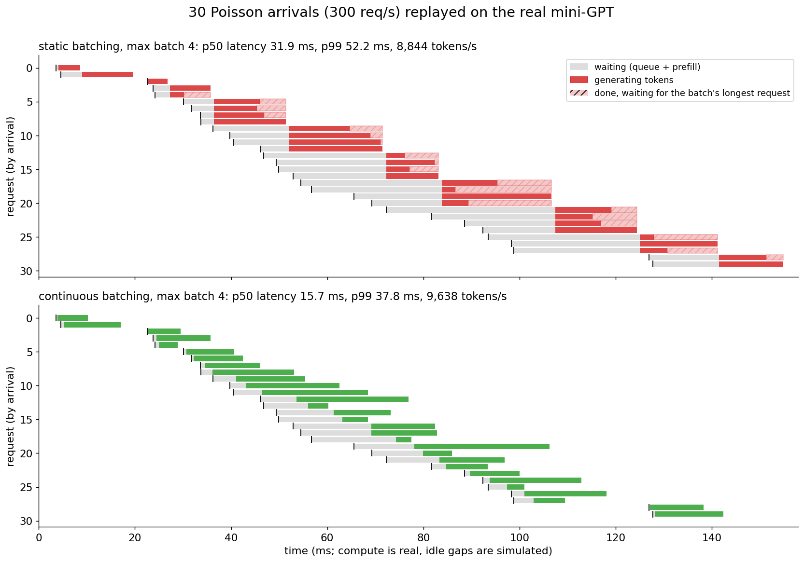

**What to look at:** thirty requests of a real replay, one row each (grey: waiting,
color: generating, hatched: finished but stuck in its batch). Static batching (top)
forms a batch of 4, and everybody waits for its longest member: request 19 finished
early and then idled for ~20 ms; requests 21–24 queued behind a whole batch. Continuous
batching (bottom) starts each request as soon as a slot frees up. In this figure's run:
p50 latency 31.9 → 15.7 ms, p99 52.2 → 37.8 ms, 8,844 → 9,638 tokens/s.

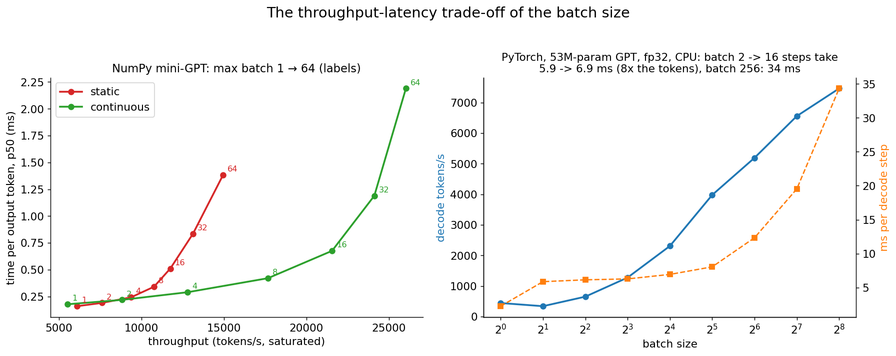

**What to look at:** left, the batch-size knob of the saturated replay: bigger batches
give more tokens/s *in total* but make every step slower (higher TPOT for each user).
That is the fundamental serving trade-off; you pick the largest batch whose TPOT still
meets the SLO. Continuous batching dominates static at every batch size above 1 (at
batch 1 there is nothing to schedule and the paged gather costs a little). Our static
steps are slightly cheaper per step (one rectangular attention vs a gather through block
tables), but static batching wastes so many steps on finished rows that it loses anyway.
Right, the PyTorch 53M-parameter model (section 17): the step time is almost flat from
batch 2 to 16 (5.9 → 6.9 ms for 8× the tokens): memory-bound.

## 5. PagedAttention: the KV cache as virtual memory

How do you store the KV cache of requests whose final length you don't know? Reserving
`prompt + max_tokens` contiguous slots per request wastes the unused tail, and
fragments memory as requests come and go. vLLM's **PagedAttention** (Kwon et al. 2023)
borrows the operating system's answer, paging:

```
pool:        K, V arrays of shape (n_layer, num_blocks, block_size, n_head, head_size)
free list:   ids of unused blocks
block table: per sequence, the physical block of each logical block
             token at position p  ->  block table[p // block_size], slot p % block_size

request "The keeper was ..." (block_size 4):  table [7, 8, 9, 10, 11]
  #7 [T h e ␣]  #8 [k e e p]  #9 [e r ␣ w]  #10 [a s ␣ o]  #11 [l d · ·]
```

A new block is taken from the free list only when a sequence crosses a block boundary,
and all of a sequence's blocks go back the moment it finishes. The only waste is the
unfilled tail of each sequence's last block (internal fragmentation, < one block per
sequence). The attention kernel reads K and V *through* the table (`PagedKVCache.gather`
does it with one fancy-indexing gather per layer); `serving_check.py` checks that this
returns exactly the contiguous cache, bit for bit, even with scattered physical blocks.

When the pool runs dry mid-generation, the scheduler **preempts** the most recently
admitted request: frees its blocks and re-queues it at the front; later it is re-admitted
by recomputing its cache from its tokens (vLLM's "recompute" policy; the alternative is
swapping blocks to CPU memory). Admission keeps a watermark of one free block per running
request so a newcomer isn't preempted again at once (thrashing). The same block tables
enable **prefix sharing**: requests with the same system prompt can point at the same
physical blocks (reference counts, copy-on-write), the basis of prefix caching (section 8).

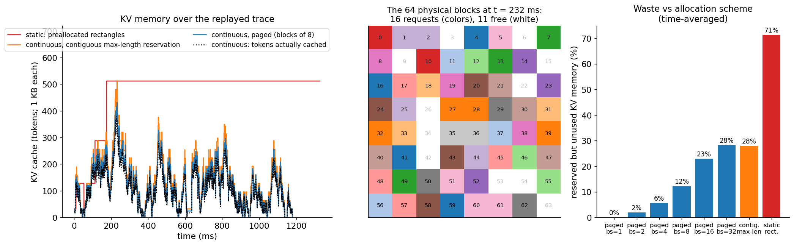

**What to look at:** left, KV memory over the replayed trace. Static batching reserves
a rectangle (batch × longest prompt + longest output) for the whole batch duration (red);
the paged cache (blue) tracks the tokens actually cached (dotted) closely. Middle, the 64
physical blocks at the busiest moment: 15 requests' blocks interleaved anywhere in the
pool, which is fine because the table, not adjacency, defines a sequence. Right, the
time-averaged waste: paged with blocks of 1, 2, 4, 8, 16, 32 tokens wastes 0%, 2%, 6%,
12%, 23%, 28%; contiguous max-length reservation 28%; static rectangles 71%.
`batching.py` reports the same thing as utilization: static 29% (132.9 tokens used of
463.5 reserved on average), continuous + paged 88% (109.5 of 124.8). Honest caveat:
our context is only 32 tokens, which caps how much a contiguous reservation can waste
(28%). With real context limits of thousands of tokens it is much worse: Kwon et al.
measured that existing systems used only 20.4–38.2% of their KV memory for actual tokens; paging is what lets vLLM
reach 2–4× the throughput of earlier systems at the same latency (Kwon et al. 2023).

Block size is a trade-off: small blocks waste less, but every gather reads more, smaller
pieces and the block tables grow. vLLM defaults to 16 tokens.

## 6. Quantization

Decode is memory-bound, so **bytes per weight is speed**. Store weights in 8 or 4 bits
instead of 32 (or 16), dequantize inside the matmul, and each step moves 4–8× fewer
bytes. Our `Linear` stores `W` as `(n_in, n_out)`; an output channel is a column.

```
int8 absmax per tensor:   s = max|W| / 127                q = round(W / s) ∈ [-127, 127]
int8 absmax per channel:  s_j = max_i |W_ij| / 127        (one scale per output column)
int4 group-wise:          each group of g consecutive inputs of a column (g = 32 or 64):
                          s = max|W_group| / 7,  q ∈ [-8, 7],  two values per byte
dequantize:               Ŵ = q · s,   |W − Ŵ| <= s / 2 elementwise (rounding)
on-the-fly matmul:        y_j = s_j · Σ_i x_i q_ij        (the scale leaves the sum)
int4 packing:             byte = (q[2i] & 0xF) | (q[2i+1] << 4); unpack, then sign-extend
                          with (n ^ 8) - 8:   [-8, 7, -1, 0, 3, -5] -> 0x78 0x0f 0xb3
```

The `s / 2` bound and the exact pack/unpack round-trip (all 256 nibble pairs) are checked
in `serving_check.py`. `QLinear` is a drop-in replacement for the model's `Linear`; we
quantize every Linear (95% of the parameters) and keep embeddings, LayerNorms and biases
in fp32. Measured by `quantize_numpy.py`:

| variant | size | × smaller | mean \|ΔW\| | held-out bits/char | loss on train text | top-1 = fp32 | KL vs fp32 |
|---|---|---|---|---|---|---|---|
| fp32 | 431,104 B | 1.00 | 0 | 4.0838 | 0.2355 | 100.0% | 0 |
| fp16 | 228,864 B | 1.88 | 0.000009 | 4.0838 | 0.2355 | 100.0% | 0.00000 |
| int8 per-tensor | 127,780 B | 3.37 | 0.000704 | 4.0844 | 0.2363 | 99.3% | 0.00157 |
| int8 per-channel | 132,528 B | 3.25 | 0.000370 | 4.0831 | 0.2359 | 99.3% | 0.00042 |
| int4 per-channel | 81,968 B | 5.26 | 0.006709 | 4.0581 | 0.2657 | 88.4% | 0.12824 |
| int4 group 64 | 83,504 B | 5.16 | 0.006271 | 4.0514 | 0.2668 | 88.4% | 0.11875 |
| int4 group 32 | 89,824 B | 4.80 | 0.005519 | 4.0470 | 0.2589 | 90.5% | 0.09503 |

**Honest caveat about the held-out column.** Int4 makes held-out bits/char *better*
(4.047 vs 4.084). That is not a free lunch: our model memorized its 3.9 KB story (loss
0.24 on it vs 2.83 nats on new text), and the quantization noise acts like a little
regularization on text it is unsure about anyway. The columns that measure what
quantization does to *this model's function* tell the real story: on the text it knows,
int4 raises the loss by 0.023–0.031, and it changes the most likely next character at
9.5–11.6% of held-out positions, while int8 changes 0.7%. In practice you always compare a
quantized model with its own fp16 version on agreement and downstream evals, not only
perplexity. Smaller groups help int4 (group 32 beats per-channel: KL 0.095 vs 0.128), at
the cost of more scales (89,824 vs 81,968 bytes).

**The outlier problem.** LLM activations have a few feature dimensions with values 20–100×
larger than the rest (Dettmers et al. 2022), and weights have outliers too. A single big
value sets the absmax scale for everything that shares it. `quantize_numpy.py` makes
one: it scales output column 5 of `W_v` in layer 0 by 50 and divides row 5 of `W_o` by
50, so the model computes *exactly the same function* (attention is linear in `v`), but
`c_attn` now has an outlier column.

| scheme | other weights of the matrix rounded to 0 | their mean relative error | top-1 = fp32 (without → with outlier) |
|---|---|---|---|
| int8 per-tensor | 40.5% | 30.2% | 99.3% → 85.6% |
| int8 per-channel | 0.9% | 0.7% | 99.3% → 98.6% |
| int4 group 32 | 15.6% | 11.3% | 90.5% → 88.2% |

Per-tensor int8 collapses because the scale is now 50× too coarse for every other
weight; per-channel and group scales are local, so only the outlier's own column or
group pays. (The small drop of per-channel int8 is the *activation* side: the scaled-up
`v_5` makes the next layer's rounding error in row 5 count 50× more.) The real methods:

- **LLM.int8()** (Dettmers et al. 2022): int8 per-row/column, but the few outlier
  feature dimensions are computed in fp16 (mixed-precision decomposition).
- **SmoothQuant** (Xiao et al. 2022): divide activation outlier channels by `s` and
  multiply the matching weight rows by `s` (our transform, used on purpose) to make both
  easy to quantize to int8 (W8A8).
- **GPTQ** (Frantar et al. 2022): quantize weights one column at a time and update the
  remaining columns to compensate the error, using second-order (Hessian) information
  from calibration data; int4/int3 with little loss.
- **AWQ** (Lin et al. 2023): protect the ~1% of *salient* weight channels (those that see
  large activations) by scaling them before group-wise int4 quantization.

**KV-cache quantization.** For long contexts and big batches the cache, not the weights,
dominates memory. Quantizing every K and V vector per (token, head) with absmax:

| KV cache | bytes/token | held-out loss |
|---|---|---|
| fp32 | 1,024 | 2.8307 |
| int8 | 320 | 2.8303 (−0.0004) |
| int4 | 192 | 2.8513 (+0.0207) |

**Speed caveat.** In NumPy, quantization makes our decode step *slower* (0.128 ms fp32,
0.165 ms int8, 0.208 ms int4): NumPy has no int8/int4 matmul, so we materialize fp32
weights to multiply. The speed comes from kernels that read the small weights and
dequantize in registers (bitsandbytes, GPTQ/AWQ/Marlin kernels, llama.cpp); section 17
shows PyTorch's CPU int8 isn't faster here either. Quantization buys memory first, speed
only with the right kernels on memory-bound hardware.

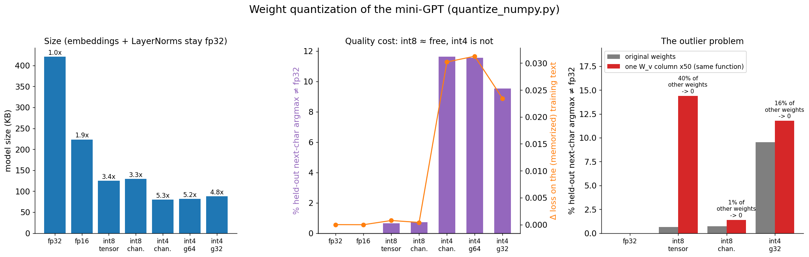

**What to look at:** left, the sizes (the fp32 embeddings and LayerNorms put a floor
under the compression: 3.4× for int8, 5.3× for int4 instead of 4× and 8×). Middle, the
quality cost: int8 is nearly free, int4 is not, and group-wise int4 is the best int4.
Right, the outlier: per-tensor int8 goes from 0.7% to 14.4% of next-char predictions
changed, because 40% of the matrix's other weights round to zero.

## 7. Speculative decoding

Decode is memory-bound: scoring γ+1 tokens in one forward pass costs about the same as
scoring one (our target: one step 0.117 ms, a pass over 5 tokens 0.147 ms, 1.25×). So let
a small, cheap **draft** model guess γ tokens, and let the big **target** model check all
of them in one pass (Leviathan et al. 2023; Chen et al. 2023):

```
1. draft:   x_1..x_γ  with  x_i ~ q_i = q(· | context, x_<i)            γ cheap steps
2. target:  ONE forward over [last token, x_1..x_γ]  ->  p_1..p_{γ+1}     one pass
3. for i = 1..γ:
       accept x_i with probability min(1, p_i(x_i) / q_i(x_i))
       on the first rejection: sample from the residual  norm(max(0, p_i − q_i))  and stop
   if all γ accepted: sample a bonus token from p_{γ+1}
4. roll both KV caches back to the accepted tokens
```

**Why the output is distributed exactly as the target's.** For one position,
`P(output = x) = q(x) · min(1, p(x)/q(x)) + P(reject) · residual(x)`. The first term is
`min(p(x), q(x))`. The rejection probability is `1 − Σ_y min(p(y), q(y))`, and the
residual is `(p(x) − min(p(x), q(x))) / (1 − Σ_y min(p(y), q(y)))`, so the second term
is `p(x) − min(p(x), q(x))`. They add up to `p(x)`. Each accepted token is therefore a
genuine sample from the target, whatever the draft is; a bad draft only lowers the
acceptance rate `α = Σ min(p, q) = 1 − TV(p, q)`. If tokens were accepted independently
with probability α, each target pass would yield `(1 − α^{γ+1}) / (1 − α)` tokens.

Our model's window adds one rule: never draft across a window slide (`γ_eff = min(γ,
room left)`), so the target computes exactly the conditionals `generate.py` would.
`speculative.py` measures:

- **The rule**, vectorized (V = 10, random p and q, 200,000 draws): accept rate 0.5134
  vs theory Σ min(p, q) = 0.5139; output vs p: TV 0.0038, chi² 21.5 < 28.1 (the p = 0.001
  critical value, 9 degrees of freedom). A *naive* rule (keep the draft if p(x) ≥ q(x),
  else resample from p) gives TV 0.1269, chi² 17,454: biased.
- **Greedy** speculative decoding == greedy target decoding, token for token, for 300
  tokens in float64.
- **The distribution, end to end:** 20,000 runs of 3 characters after `"The "` at
  temperature 1 with γ = 3, vs the target's exact marginals (computed by enumerating all
  44 and 44² prefixes): TV 0.0097 / 0.0084 / 0.0096, chi² 22.0 / 25.8 / 32.9 against
  critical values 52.7 / 42.4 / 49.8. 28,326 of 46,753 drafted tokens were accepted.

| draft | cost per step | γ | α | tokens per target pass | speed-up (temperature 0.8) |
|---|---|---|---|---|---|
| GPT, 1 layer, d = 32 (16,608 params, ~2 s to train) | 0.060 ms (0.51× target) | 1 | 0.783 | 1.58 | 0.85× |
| | | 3 | 0.604 | 2.29 | 0.83× |
| | | 8 | 0.333 | 2.61 | 0.57× |
| 6-gram counts of the training text | 0.002 ms (0.02×) | 1 | 0.838 | 1.63 | 1.24× |
| | | 4 | 0.629 | 2.68 | 1.68× |
| | | 6 | 0.577 | 3.12 | 1.78× |

With greedy decoding the n-gram draft reaches 2.15× at γ = 8 (α = 0.650, 3.93 tokens per
pass). **Honest caveat:** the GPT draft accepts plenty of tokens but *loses* time,
because in NumPy a 1-layer model still costs half a 2-layer one (Python overhead per
layer dominates our tiny models). Speculative decoding pays when the draft is much
cheaper than the target: a 1B draft for a 70B target costs a few percent of a target pass
on a GPU, where 2–3× speed-ups are typical. The n-gram draft, which is free, shows the
mechanism working here; it is also a real technique ("prompt lookup" decoding drafts from
n-grams of the prompt). Other draft designs: extra decoding heads on the target itself
(Medusa, Cai et al. 2024; EAGLE, Li et al. 2024).

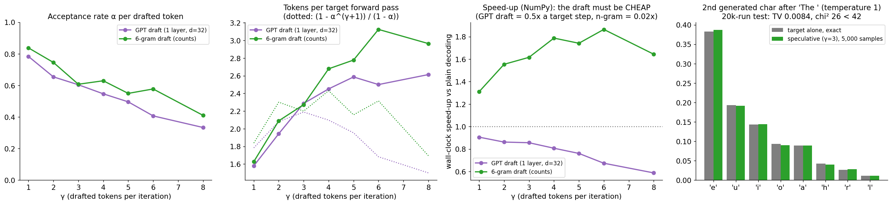

**What to look at:** α falls as γ grows (later drafts depend on earlier guesses), while
tokens per target pass keep rising; the measured tokens per pass even *beat* the
independent-acceptance formula (dotted) at large γ, because acceptances are correlated:
in passages the model knows by heart whole drafts are accepted, at hard spots the first
token is rejected. Third panel: speed-up needs a cheap draft. Right: the 2nd generated
character after `"The "`, exact target distribution vs 5,000 speculative samples: the
same distribution.

## 8. Other tricks: prefix caching, chunked prefill, FlashAttention, parallelism

Each of these is a paragraph here and a big engineering project in a real server.

- **Prefix caching.** Many requests share a long prefix (a system prompt, few-shot
  examples, a document in RAG, the history of a multi-turn chat). Keep the KV blocks of
  previous prefixes and point new requests at them: TTFT drops and memory is shared.
  SGLang's **RadixAttention** (Zheng et al. 2023) keeps all cached prefixes in a radix tree
  with LRU eviction; vLLM's automatic prefix caching hashes full blocks. Exercise 5 builds
  it on our block tables.
- **Chunked prefill** (Sarathi-Serve, Agrawal et al. 2024). A 4,000-token prompt admitted
  into a running batch makes that step long and stalls every decoding user. Split the
  prefill into chunks and run each chunk *in the same step* as the ongoing decodes
  ("stall-free batching"): steadier TPOT, better GPU utilization (decode alone is
  memory-bound, the prefill chunk fills the compute). A related idea, *disaggregated*
  serving (e.g. DistServe, Zhong et al. 2024), runs prefill and decode on different GPUs.
- **FlashAttention / FlashDecoding.** FlashAttention (Dao et al. 2022) computes exact
  attention in on-chip tiles without writing the `T × T` matrix; it accelerates prefill.
  At decode time there is one query per sequence, so the parallelism must come from the
  *keys*: Flash-Decoding (Dao et al. 2023) splits a long KV cache into chunks processed in
  parallel and combines them with a log-sum-exp reduction. PagedAttention kernels do the
  same through block tables.
- **Tensor-parallel inference.** A model too big for one GPU (or too slow on one) is
  split across GPUs: each holds a slice of every weight matrix (Megatron-style column/row
  parallel layers, two all-reduces per layer) and its slice of the KV heads. Pope et al.
  (2022) work out the partitioning that minimizes latency and communication for large
  models on TPUs, including the multi-query attention that makes the KV cache cheap.
  Pipeline parallelism (layers on different GPUs) adds throughput but not latency. See
  [`../distributed/`](../distributed/) for the training-side versions.
- Also standard: CUDA graphs and fused kernels to remove launch overhead from the decode
  step, structured/constrained decoding (JSON schemas, grammars), and LoRA adapters
  served on top of one shared base model.

## 9. The server: API design, streaming, backpressure, timeouts

`server.py` is about 800 lines of standard library (plus the engine from `batching.py`).
Its shape:

```
ThreadingHTTPServer ─ one handler thread per connection ─┐
   parse, validate (400), tokenize, make a Job ─────────┤
   engine.submit(job): bounded queue.Queue ──── full ──> 429 + Retry-After
                                                        │
Engine thread (one per model version):                  │
   loop: pull jobs while the batch has room (max_batch) │
         abort timed-out / cancelled jobs (free KV)     │
         ContinuousBatcher.step()  ─── tokens ──> job.events (a queue per request)
handler thread: waits on job.events until done or deadline -> JSON (Content-Length)
                or SSE frames (Transfer-Encoding: chunked)
finally: metrics + one JSON log line
```

Why a single engine thread? The batch *is* the unit of work: a GPU runs one batched step
at a time, and the model and KV pool are not thread-safe. Handler threads only parse,
wait and write, so many slow clients don't slow down generation. (In CPython the GIL
also serializes Python bytecode; NumPy releases it inside matmuls.)

**The API** follows the shape of OpenAI-style completions, so any client library would
fit (we use `urllib`):

```
$ curl -s localhost:8000/v1/completions -d '{"prompt": "The keeper", "max_tokens": 60, "seed": 1}'
{"id": "cmpl-d13ac70df117", "object": "text_completion", "model": "gpt-5e812e7b",
 "created": 1793752020, "choices": [{"text": " was old and his legs were tired, and he could
 not climbed t", "index": 0, "finish_reason": "length"}], "usage": {"prompt_tokens": 10,
 "completion_tokens": 60, "total_tokens": 70}, "timing": {"queue_s": 0.00059, "ttft_s":
 0.00059, "latency_s": 0.013261}, "warnings": []}
```

| field | rule | error type (400) |
|---|---|---|
| `prompt` | non-empty string, ≤ 512 chars | `invalid_prompt`, `prompt_too_long` |
| `max_tokens` | integer in [1, 256] (not a bool), default 64 | `invalid_max_tokens` |
| `temperature` | number in [0, 2] (0 = greedy; NaN rejected), default 0.8 | `invalid_temperature` |
| `top_k` | null or integer in [1, 44] | `invalid_top_k` |
| `seed` | null or non-negative integer (reproducible sampling) | `invalid_seed` |
| `stop` | null, a string or ≤ 4 strings of 1–16 chars; not returned in the text | `invalid_stop` |
| `stream` | boolean | `invalid_stream` |
| `timeout_s` | number in (0, 60], default 10 | `invalid_timeout` |
| anything else | rejected: a typo like `max_token` fails loudly instead of being ignored | `unknown_field` |

Other statuses: 404 (unknown path), 408 `slow_client` (body not received within the read
timeout), 411 (no `Content-Length`), 413 (body > 64 KB), 429 `overloaded`, 499
`client_disconnected` (logged only: the client is gone), 500, 503 `shutting_down`, 504
`timeout`. Characters the model has never seen are *dropped with a warning* (and counted
in the log); a prompt longer than the 32-token context is truncated to its end, also with
a warning. Silent truncation is a classic production bug: always tell the caller.

**Streaming.** With `"stream": true` the response is a stream of server-sent events, each
token one `data: {...}\n\n` frame, then a final frame with the usage and `data: [DONE]`.
Without a known length, HTTP/1.1 sends the body in *chunks*: `<hex length>\r\n<bytes>\r\n`,
ended by a zero-length chunk (`serving_visual.py` step 7 shows the bytes). Streaming
doesn't make generation faster; it makes TTFT the latency the user perceives. Once the
200 status line is sent you can't change it, so a mid-stream timeout is reported as an
in-band `{"error": ...}` event.

**Backpressure.** Without a bound, an overloaded server queues requests until every one
of them times out: latency explodes, throughput collapses, and clients retry, making it
worse. A bounded queue (32 per model) answers **429 + `Retry-After`** immediately, so
clients back off and the requests that are admitted still meet their SLO. A lesson from
building it: Python's `TCPServer` listens with a backlog of only 5 pending connections. In
the first load test, the 150-request burst got **128 connection errors** at the kernel
level before our code ever saw them; raising `request_queue_size` to 512 turned those into
proper 429s (70 in the run below). Overload protection has to exist at every layer.

**Timeouts.** Each request has a deadline (`timeout_s`). The handler stops waiting at the
deadline (504), *and* the engine aborts the job and frees its KV blocks, so an abandoned
request doesn't keep consuming the batch. Client disconnects (a write fails) cancel the
job the same way. The socket read timeout (5 s; 2 s in the load test) protects the
handler threads from slow-upload ("slowloris") clients.

**Graceful shutdown** (Ctrl+C or SIGTERM, as a deployment would send): `/health` turns
503 so the load balancer stops routing new traffic, new requests get 503, in-flight
requests finish (up to a drain timeout), then the engines stop, the socket closes and the
logs are flushed. Tested by killing the server during a 256-token stream: `draining: 1 in
flight`, the stream completed, `stopped after 9.4 s`.

**Canary routing.** `--canary draft --canary-frac 0.1` serves a second model version to a
fraction of the traffic (sticky by request id). Every response and log line names the
version. That is how new models, quantizations or prompts are rolled out: a slice of
real traffic first, compared with the stable version (section 13).

**`/metrics`** is the Prometheus text format, written by hand (`Metric`, `Histogram`):

```
# TYPE serving_requests_total counter
serving_requests_total{status="200"} 3
serving_requests_total{status="400"} 2
# TYPE serving_request_latency_seconds histogram
serving_request_latency_seconds_bucket{le="0.01"} 2
serving_request_latency_seconds_bucket{le="0.025"} 3
...
serving_request_latency_seconds_bucket{le="+Inf"} 3
serving_request_latency_seconds_sum 0.028105
serving_request_latency_seconds_count 3
```

Histogram buckets are *cumulative* counters, so a monitoring system can sum them across
servers and compute percentiles over any time window (`histogram_quantile`). Averaging
per-server p99s is meaningless; summing buckets is not. Also exported: tokens generated,
prompt tokens, engine steps, queue depth, in-flight requests, batch size and KV blocks in
use (per model), uptime, and `serving_model_info{version, quantization, role}`.

**One JSON line per request** in `serving/logs/requests.jsonl` (a real one from the load
test, shortened):

```json
{"ts": "2026-11-04T00:47:21.271+00:00", "request_id": "cmpl-7c36107984e4",
 "model_version": "gpt-5e812e7b", "quantization": "none", "status": 200, "error_type": null,
 "prompt_chars": 20, "prompt_tokens": 20, "unknown_chars": 0, "prompt_truncated": false,
 "max_tokens": 32, "temperature": 0.8, "top_k": null, "seed": 166879142, "stop": null,
 "stream": false, "output_tokens": 32, "finish_reason": "length", "queue_s": 0.001331,
 "ttft_s": 0.001331, "latency_s": 0.013927, "tpot_s": 0.000387, "queue_depth": 0,
 "inflight": 3, "preemptions": 0, "rep4": 0.3448, "loop_period": 0,
 "prompt_sha": "ac8715ab8ab3", "prompt": "own careful hand.\n\nT",
 "output": "he wind was cold. The wind was c"}
```

## 10. Load testing and capacity planning

A load test answers "how much traffic can this deployment take while meeting its SLO, and
how does it fail beyond that?". Two rules:

- **Open loop.** Real users don't wait for each other. `load_test.py` sends requests on a
  fixed Poisson schedule regardless of responses (a thread pool fires each one on time).
  A closed loop (N clients, each waiting for its answer) slows down with the server and
  hides overload ("coordinated omission").
- **Realistic mix, plus faults.** Production traffic is not your happy path.

`python serving/load_test.py --spawn-server` (20 s at 40 req/s + a burst):

| traffic | what it is | expected |
|---|---|---|
| normal | story-like prompts (5–40 chars), mixed temperatures, 30% streamed, 25% with a stop string | 200 |
| oversized (2%) | 600–2,000 char prompts | 400 `prompt_too_long` |
| invalid (4%) | `temperature: -1`, `max_tokens: 0`, `max_token`, `top_k: 999`, `stream: "yes"`, broken JSON | 400 |
| unseen (4%) | `"Hello! "`, `"café "`, `"✓ done. "` ... prepended | 200 + warning |
| timeout (2%) | `timeout_s` of 5–20 ms for 200 tokens | 504 |
| slow (1%) | half the body, a stall longer than the read timeout | 408 |
| disconnect (2%) | streaming client hangs up after 3 events | 499 (server log) |
| greedy (8%) | temperature 0, 100–200 tokens | 200 |
| burst | 150 requests at once at t = 12 s | 429 |
| drift | from t = 10 s, half the clients send 60–300 char ALL-CAPS prompts | 200 + truncation/unknown chars |
| canary | from t = 8 s, 30% of traffic goes to the 6× smaller draft model | 200 (worse quality) |

Result of the run analyzed below: 972 requests in 21.9 s; 809 successful (36.9 req/s,
2,353 tokens/s); by status (client side) 200: 828, 400: 52, 408: 7, 429: 70, 504: 13,
and 2 slow clients that saw a connection reset when the server closed on them. Client-side
latency of successes: p50 17 ms, p95 465 ms, p99 709 ms; TTFT p50 1.3 ms, p95 258 ms. The
server's own `/metrics` agree: 200: 809, 400: 52, 408: 9, 429: 70, 499: 16, 504: 16
(three timeouts happened mid-stream, after a 200 status line; the 16 disconnects only the
server can see).

**Capacity planning** starts from Little's law (Little 1961): the average number of
requests in the system = arrival rate × average time in the system, `L = λ W`. At 37 req/s
and the median 17 ms, ~0.6 requests are in flight: the server is mostly idle, which is
why the median is good. The burst pushed the queue depth past 60 (section 15's
dashboard) and the p95/p99 up to ~0.5–0.7 s. To size a deployment: measure the saturated
throughput at the batch size whose TPOT meets the SLO (section 4), divide the peak
expected tokens/s by it, add headroom for bursts and a failed replica (N + 1), and verify
with a load test at the target rate. Honest caveat: through HTTP, threads and the GIL our
server peaks at ~8k tokens/s during the burst (dashboard), while the in-process engine
does 20k at batch 16 (section 4); the HTTP layer is not free.

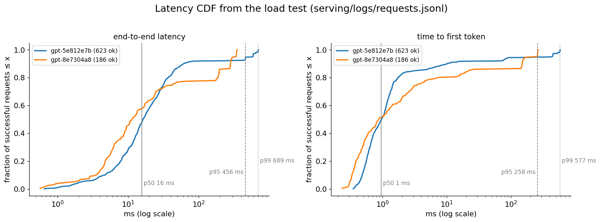

**What to look at:** latency CDFs of the successful requests, per model version. Most
requests finish in ~5–50 ms; the knee at ~0.9 is the burst: requests that queued behind
150 simultaneous arrivals took 0.2–0.7 s. That is why you track p95/p99 and not the mean:
the median (16 ms) says nothing about the users who waited 40× longer. TTFT has the same
shape: 1 ms normally, 0.26 s at p95.

## 11. Observability: logs, metrics, traces

- **Metrics** are cheap aggregate numbers over time (counters, gauges, histograms),
  scraped every few seconds: dashboards and alerts. They answer "is something wrong?"
  Keep label cardinality low: label by status, model version, endpoint, never by request
  id or prompt.
- **Logs** are one structured record per event, here per request: they answer "what
  exactly happened to *these* requests?" and they are what the failure analysis, drift
  detection and eval export below run on. JSON lines, one schema, a request id, the model
  version: then any question is a query.
- **Traces** follow one request through every service and stage as timed spans
  (OpenTelemetry). We only log the stage timestamps (`queue_s`, `ttft_s`, `latency_s`,
  `tpot_s`), a poor man's trace; with a retriever, a reranker and tools in front of the
  model (`../rag/`, `../agents/`), real traces become essential.

**What to log for an LLM endpoint:** request id, timestamps, model version and
quantization, sampling parameters and seed, prompt/output lengths in tokens, finish
reason (length vs stop), the latency breakdown, queue depth at arrival, preemptions,
error type, cheap quality signals of the output (our `rep4`: fraction of repeated
4-grams; `loop_period`: does the text end in a repeating unit), and input signals
(unknown characters, truncation). In a real product add user feedback (thumbs,
regenerations, edits), safety-classifier scores and tool-call outcomes.

**PII care.** Prompts and outputs are the most useful debugging data and the most
sensitive. `server.py --no-log-text` logs only a SHA-256 hash of the prompt (enough to
deduplicate and join, not to read). In production: redact or hash identifiers, restrict
access, set retention limits, keep raw text in a separate, audited store, and only export
consented data into eval sets.

## 12. SLIs, SLOs and error budgets

An **SLI** is a measured ratio of good events; an **SLO** is the target for it over a
window; the **error budget** is what the SLO allows to fail (Google SRE book, ch. 4).

```
availability SLI = good requests / valid requests
                   good  = 200 with no error
                   valid = everything except the client's own faults (400, 408, 411, 413, 499)
                   (429, 5xx and timeouts count against us)
SLO: 99%          ->  error budget = 1% of valid requests
burn rate         =  observed error rate / (1 − SLO)      (1 = spend exactly the budget)
```

`monitor.py` on the load-test log: availability **90.39%** (809 good / 895 valid), i.e.
**9.6× the error budget** over the run: the burst's 429s and the timeouts. Latency SLI:
95.9% of successes under 500 ms; p50 16 ms, p95 456 ms, p99 689 ms; TTFT p50 1.0 ms, p95
258 ms; 2,592 tokens/s over the log's 19.9 s.

Why an error budget instead of "as reliable as possible": it turns reliability into a
number product and infra can trade. Budget left: ship faster (canaries, experiments).
Budget burnt: freeze risky changes and fix reliability. Alerting on it is section 15.

## 13. Failure modes in production: the taxonomy

A dashboard says *that* the error rate went up; a **taxonomy** says *why*. `monitor.py`
classifies every request (a request can have several modes) and keeps counts, the
first-seen time and examples:

| mode | detected by | count (of 972) | first seen | typical fix |
|---|---|---|---|---|
| timeout | 504 / `error_type` | 16 (1.6%) | 0.3 s | capacity, shorter `max_tokens`, check client timeouts |
| validation_4xx | 400/411/413 (+ subtype) | 52 (5.3%) | 0.7 s | client bug: tell the owner; document the schema |
| overload_429 | 429 | 70 (7.2%) | 12.0 s | autoscale, rate limits per client, bigger batch |
| slow_client | 408 | 9 (0.9%) | 1.8 s | fine as is; watch for abuse |
| client_disconnect | 499 | 16 (1.6%) | 0.1 s | users giving up: check latency at that moment |
| server_error_5xx | 500/503 | 0 | – | page someone |
| empty_output | 200 but empty/whitespace text | 16 (1.6%) | 0.4 s | here: `stop: " "` matching the very first token |
| degenerate_repetition | ≥ 20 tokens and (repeating suffix or `rep4` ≥ 0.35) | 9 (0.9%) | 1.2 s | roll back the model, repetition penalty, eval set |
| max_token_truncation | a stop string was requested but `max_tokens` hit first | 58 (6.0%) | 1.4 s | raise the default, document it |
| unknown_chars | characters dropped by the tokenizer | 192 (19.8%) | 2.6 s | byte-level tokenizer ([`../tokenizer/`](../tokenizer/)) |
| context_truncation | prompt longer than the context | 314 (32.3%) | 0.1 s | longer context ([`../llama/`](../llama/) RoPE), chunking |
| latency_outlier | latency per output token > median + 4 robust SDs (≥ 10 tokens) | 79 (8.1%) | 9.0 s | the burst (queueing); find what else coincides |

The canary is the most instructive one. **By model version:**

| version | requests | degenerate | rate | z vs the rest | p |
|---|---|---|---|---|---|
| gpt-5e812e7b (stable) | 783 | 2 of 623 ok | 0.3% | −3.9 | 9e-05 |
| gpt-8e7304a8 (canary, from 8.1 s) | 189 | 7 of 186 ok | 3.8% | +3.9 | 9e-05 |

The 6× smaller canary falls into loops under greedy decoding (real log lines:
`'ten steps, ten steps, ten steps, ten steps, ten steps, ten steps, ten '`, rep4 0.73,
loop period 11). Its *latency* is fine (p95 327 vs 568 ms: it is smaller); a latency-only
dashboard would have promoted it. A two-proportion z-test on the degenerate rate flags
it at p = 9·10⁻⁵ with only 186 requests. Honest caveat: both stable "degenerate" outputs
are false positives of the 4-gram heuristic on genuinely repetitive training text
(`'e wind was cold. The wind was warm. The sea was grey. The sea w'`, rep4 0.35).
Heuristic quality signals need a threshold calibrated on the stable version and a
statistical comparison, not an absolute rule; in production, an LLM judge or a reward
model scores a sample of outputs (`../evals/`).

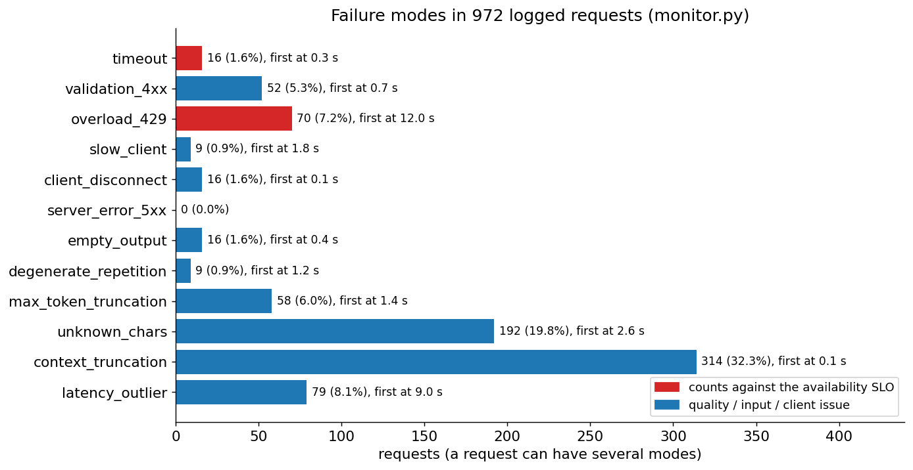

**What to look at:** red bars count against the availability SLO (timeouts, 429s,
5xx); blue ones are quality, input and client issues that availability can't see. The
biggest bars are *input* problems (context truncation 32%, unknown characters 20%) that
never show up as errors at all: every one of those requests returned 200.

## 14. Drift detection

Models are evaluated on one input distribution and then served on whatever arrives.
**Drift** monitoring compares a reference window of inputs with recent windows. For a
feature binned into `k` bins with proportions `r` (reference) and `c` (current):

```
PSI = Σ_i (c_i − r_i) · ln(c_i / r_i)   = KL(c‖r) + KL(r‖c)   (checked in serving_check.py)
rule of thumb: < 0.1 stable, 0.1–0.25 moderate shift, > 0.25 major shift
bins: reference deciles for numeric features (each bin holds 10% of the reference);
      one bin per character (+ one for "never seen in the reference") for text
```

`monitor.py` uses the first 30% of the log as the reference and compares prompt length,
the character histogram and character classes:

- prompt length: mean 42 → 102 characters, **PSI 0.85**;
- characters: **PSI 5.00**, KL(current ‖ reference) 3.63; character classes PSI 3.30.

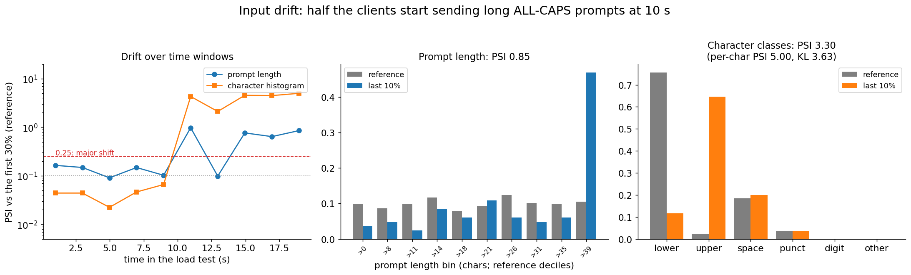

**What to look at:** left, PSI of each 2-second window vs the reference: flat until the
drift starts at 10 s, then far above 0.25 for both features (the window at 13 s, mostly
the burst's short story prompts, dips back for length). Honest caveat: even without drift
the length PSI wanders between 0.09 and 0.16 with ~80 prompts per window; small windows are
noisy, so use enough samples or confidence intervals before paging anyone. Middle, the
length histogram: the last 10% has 47% of its prompts in the top reference bin (> 39
characters). Right, character classes: lowercase 76% → 12%, uppercase 3% → 65%.

Input drift is not always bad (new users, new use cases), but it means the offline evals
no longer describe production: sample the drifted traffic into the eval set. For real
LLMs, character histograms become embedding distributions (drift of prompt embeddings,
topic clusters) and output-side signals (length, refusal rate, judge scores).

## 15. Alerting

Good alerts are about **symptoms users feel** (errors, latency, bad answers), page only
when someone must act now, and come with a runbook. `monitor.py`'s rules on this log:

| rule | state | detail |
|---|---|---|
| availability fast burn (page): 5 s & 1 s windows > 14.4 | **FIRING** | first at t = 12.5 s; max burn 26.1 over 5 s, 46.7 over 1 s |
| availability slow burn (page): 15 s & 3 s windows > 6 | **FIRING** | first at t = 12.5 s; 12.5 over 15 s, 33.5 over 3 s |
| error budget exhausted (ticket) | **FIRING** | 9.6× the budget used |
| p95 latency > 500 ms | ok | p95 456 ms |
| overload: 429 rate > 2% | **FIRING** | 7.2% |
| server errors: 5xx > 0.5% | ok | 0.0% |
| quality regression gpt-8e7304a8 | **FIRING** | degenerate 3.8%, z = +3.9, p = 9e-05 |
| quality regression gpt-5e812e7b | ok | |
| input drift: PSI > 0.25 | **FIRING** | length 0.85, characters 5.00 |
| unseen characters > 10% of recent prompts | **FIRING** | 45% of the last 20% |

**Multi-window, multi-burn-rate alerts** (Google's SRE workbook): page when the burn
rate over a *long* window exceeds a threshold (the problem is big: 14.4 means 2% of a
30-day budget gone in one hour) *and* the burn rate over a *short* window does too (it is
still happening, so the alert also resolves quickly). The workbook's windows are 1 h &
5 min (14.4) and 6 h & 30 min (6); our log lasts 20 s, so the windows are scaled down to
seconds while the thresholds stay.

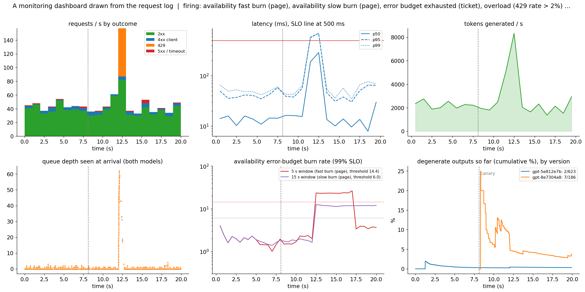

**What to look at:** six panels any on-call engineer would recognize, all computed from
the log (the dashed line is the canary rollout at 8 s). Requests/s by outcome: the 429
spike at 12 s. Latency percentiles: p95/p99 jump above the 500 ms SLO line during the
burst only. Tokens/s: the engine peaks at ~8k during the burst. Queue depth at arrival:
from ~0 to 60+. Burn rate: both windows cross their thresholds at 12.5 s; the fast one
recovers at ~17 s, the slow one stays high. Degenerate outputs by version: the canary's
cumulative rate starts noisy (its first outputs) and settles near 4%, the stable
version's near 0.3%.

## 16. Closing the loop: failures → eval cases → fixes → regression gate

Monitoring is only useful if what it finds changes the system. `monitor.py` exports
failing requests as eval cases, `serving/logs/eval_cases.jsonl` (141 in this run: at most
20 per mode, one per prompt, overload/client issues excluded), each with the input to
replay, what was observed and the check that should pass after a fix:

```json
{"id": "prod-degenerate_repetition-4b989935f5dd", "source": "production",
 "failure_mode": "degenerate_repetition", "request_id": "cmpl-500e5f0b3d8d",
 "model_version": "gpt-8e7304a8",
 "input": {"prompt": "you bread and honey.\"\n\n\"Good morning", "max_tokens": 148,
           "temperature": 0.0, "top_k": null, "seed": 798148038, "stop": null},
 "observed": {"status": 200, "output": " a small boy.\"\n\n\"Good morning a basket of bread
              and her stairs lead and the sun.\n\n\"Good morning a basket ...", "rep4": 0.3517},
 "check": {"type": "max_repetition_ratio", "value": 0.35}}
```

The loop, which [`../evals/`](../evals/) implements on the offline side:

1. **Detect** in production (alerts, taxonomy, user feedback).
2. **Export** representative failures as eval cases (deduplicated, PII-scrubbed).
3. **Fix**: roll back the canary; add a repetition penalty; switch to a byte-level
   tokenizer for the unknown characters; extend the context; fine-tune on the failure
   cases (`../finetuning/`); document `max_tokens`.
4. **Regression gate**: the eval set, now including these cases, runs in CI and before
   every canary is promoted. A new model version must pass the old failures.
5. **Canary** the fix, compare by version in production, promote or roll back.

## 17. The same in PyTorch

`serving_pytorch.py` takes the GPT module of `../transformer/transformer_pytorch.py` and
gives it a KV-cache decode loop (prefill with `F.scaled_dot_product_attention(is_causal=True)`,
then one-token steps that `torch.cat` onto the cache):

- prefill 1 token + 31 decode steps vs one full forward, float64: max |logit diff|
  **1.6·10⁻¹⁴**; greedy generation of 120 tokens (3 window slides) is identical to NumPy's
  `generate.py` for both test prompts.
- **Quantization on the trained model** (held-out text):

| variant | held-out loss | top-1 = fp32 | KL vs fp32 |
|---|---|---|---|
| torch fp32 | 2.8307 | 100.0% | 0 |
| torch int8 (`quantize_dynamic`) | 2.8348 | 98.0% | 0.00372 |
| torch bf16 | 2.8316 | 99.5% | 0.00025 |
| ours, int8 per-tensor | 2.8311 | 99.3% | 0.00157 |
| ours, int8 per-channel | 2.8302 | 99.3% | 0.00042 |

  `quantize_dynamic` stores int8 weights per tensor *and* quantizes the activations to
  int8 on the fly for every matmul (W8A8), so it errs more than our weight-only int8.
- **Speed**, one decode step at batch 1 with 64 cached tokens, a random 53M-parameter GPT
  (d = 1024, 4 layers, 211 MB in fp32): torch fp32 2.91 ms, int8 dynamic 3.43 ms, bf16
  1.79 ms, NumPy fp32 1.77 ms, NumPy int8 (dequantize then matmul) 13.98 ms. bf16 halves
  the bytes and is 1.6× faster; int8 is slower on this ARM CPU (qnnpack re-quantizes
  activations every step). `torch.compile` of the decode step worked here (1.4 s to
  compile) but ran at 0.86× eager: at this size the step is dominated by matmuls that
  were already library calls. Timings on a shared laptop CPU vary ±30% between runs.
- **Batched decode throughput** of the same model: 2.34 ms/step at batch 1 (427
  tokens/s), 6.2–7.1 ms from batch 2 to 16 (2,243 tokens/s at 16), 35.0 ms at batch 256
  (7,315 tokens/s): 256× the tokens for 15× the time. The jump from batch 1 to 2 is the
  matrix-vector fast path of section 2 again.

## 18. Results (and an honest look at them)

| What | Result |
|---|---|
| Batched generation == one at a time | static and continuous, greedy and seeded sampling, with preemption and window slides: identical tokens |
| Continuous vs static (300 req/s, batch 16) | median TTFT 140.6 → 0.7 ms, p99 latency 271.1 → 72.4 ms, 1.14× tokens/s |
| Continuous vs static (saturated, batch 16 / 64) | 1.81× / 1.78× tokens/s |
| KV memory utilization | static rectangles 29%, paged (blocks of 8) 88% |
| int8 per-channel / int4 group 32 | 3.25× / 4.80× smaller; 99.3% / 90.5% top-1 agreement |
| Outlier column, int8 per-tensor | top-1 agreement 99.3% → 85.6%; per-channel 98.6% |
| Speculative decoding | exact distribution (chi-square passes, naive rule fails); 1.78× with an n-gram draft at temperature 0.8, 0.85× with a GPT draft |
| Load test | 972 requests, 809 OK, availability 90.4% (9.6× the 99% budget), every failure classified |
| Monitoring | canary regression found at p = 9·10⁻⁵; drift PSI 0.85 (length) / 5.00 (characters); 7 alerts firing for the right reasons |

**Honest caveats.** Everything runs on a laptop CPU with a 108k-parameter model, so
absolute numbers are toys: per-step costs are dominated by Python overhead, not memory
bandwidth (the 53M-parameter PyTorch model and the roofline measurements are the real
memory-bound evidence). The relative effects (continuous ≫ static under load, paging ≫
contiguous reservation, int8 ≈ free and int4 not, per-tensor quantization fragile to
outliers, speculative decoding exact but only as fast as its draft is cheap) are the
same ones the papers report on GPUs. Timing-based numbers move ±10–30% between runs on a
shared machine; the correctness results, the quantization numbers and the statistical
tests are deterministic.

## 19. Practical tips and debugging

- **Prove batching exact before measuring it.** Batched output must equal unbatched
  output in float64 with greedy decoding (and with per-request seeds). Most batching bugs
  are padding visible to attention, positions counted from the pad, or a cache that wasn't
  cleared; they produce *plausible* text, so only an equality test catches them.
- **Per-request RNGs.** If requests share one random generator, the output of a request
  depends on who else is in the batch: irreproducible and hard to debug. Seed per request.
- **Measure TTFT and TPOT separately**, and percentiles, never only means. Report the
  load (arrival rate, prompt/output length distribution) with every latency number.
- **Bound every queue** and set every timeout: request read, generation deadline, drain.
  Check the kernel listen backlog too (our 128 connection errors).
- **Abort means free.** A timed-out or disconnected request must release its KV blocks
  and batch slot immediately, or abandoned requests slow everyone down.
- **Version everything in the logs**: model hash, quantization, tokenizer, prompt
  template. Compare versions with a statistical test, not by eye.
- **Quantization**: compare against the same model in fp16 on agreement/KL and task evals,
  not just perplexity (our int4 *improved* held-out perplexity). Look for outliers
  (`max|W| / mean|W|` per tensor) before choosing per-tensor scales.
- **Speculative decoding**: test greedy equality first (any mismatch is a cache rollback
  or position bug), then the distribution with a chi-square test. Measure the draft's cost
  ratio before tuning γ.
- **Don't trust a single heuristic quality signal**: calibrate thresholds on the stable
  version (our 4-gram detector flags the training text's own repetitions).
- **Logs must be parseable by a dumb tool**: one JSON object per line, stable field
  names, no multi-line messages; the monitor counts malformed lines instead of crashing.

## 20. From this folder to production / frontier labs (why this matters for an AI engineer)

Every LLM product is a serving system. The difference between a demo and a product is
exactly this folder: the model is the same, but somebody has to make it answer thousands
of concurrent users within an SLO at an acceptable cost, notice when it degrades, and
turn what it gets wrong into the next eval set.

| | this folder | a production LLM service |
|---|---|---|
| Engine | NumPy, one thread, continuous batching, paged KV (blocks of 8) | vLLM / TGI / TensorRT-LLM / SGLang on GPUs: CUDA graphs, PagedAttention and FlashAttention kernels, chunked prefill, prefix caching |
| Scale | 108k params, 32-token context, ~2.4k tokens/s over HTTP | 7B–400B+ params, 8k–1M context, tensor-parallel across 8+ GPUs, thousands of tokens/s per GPU |
| Quantization | int8/int4 in NumPy, measured | FP8/INT8 activations, INT4 (GPTQ/AWQ) weights, FP8 KV cache with fused kernels |
| Speculative decoding | GPT and n-gram drafts | small draft models, Medusa/EAGLE heads, n-gram lookup |
| API | `/v1/completions`, SSE, 429/504 | the same, plus chat templates, tool calls, structured output, auth, per-tenant rate limits |
| Monitoring | JSON logs, hand-written Prometheus text, a Python monitor | Prometheus/Grafana, OpenTelemetry traces, log pipelines, on-call rotations, LLM-judge sampling of outputs |
| Loop | failures → `eval_cases.jsonl` → `../evals/` | the same loop: production traces feed eval sets, fine-tuning data and regression gates |

The owner's goal for this repo is to "ship monitored end-to-end systems" and "track
failure modes in production logs". The skills here map directly: estimating latency and
cost from the inference arithmetic before buying GPUs; choosing batch size, quantization
and speculative decoding from measurements instead of folklore; designing an API that
fails loudly and predictably; and, above all, the habit of logging the right fields so that
"the model got worse last Tuesday for long prompts from one client" is a query, not a
mystery. Frontier labs run exactly these loops at enormous scale: their inference teams
live in the roofline and the KV cache, and their product teams in the taxonomy, the
canary and the eval set.

## 21. Interview check

Answer each one out loud in under a minute:

1. Define TTFT, TPOT, end-to-end latency, throughput and goodput. Which does batching
   improve and which does it hurt?
2. Estimate the time per token of a 7B fp16 model at batch 1 on a GPU with 2 TB/s. What
   is the ceiling on tokens/s, and how much of the GPU's compute is used?
3. Derive the arithmetic intensity of a decode step vs a prefill. Where is the ridge
   point of an A100, and what does it imply for the batch size?
4. Give the KV-cache size formula. Compute it for LLaMA-2-7B at 4k tokens, and say how
   GQA changes it for a 70B model.
5. Why is prefill compute-bound and decode memory-bound? What is chunked prefill for?
6. Explain left padding, the attention mask and per-sequence positions in static
   batching. What breaks if you right-pad, or count positions from column 0?
7. What is continuous (iteration-level) batching, and why does it beat static batching
   in throughput *and* latency? What is "selective batching"?
8. Explain PagedAttention: block tables, free list, internal vs external fragmentation,
   and why it allows bigger batches. How does it enable prefix sharing?
9. What happens when the KV pool runs out mid-generation? Compare recompute and swap
   preemption.
10. Write int8 absmax quantization and its error bound. Per-tensor vs per-channel vs
    group-wise: costs and benefits.
11. What is the outlier problem? How do LLM.int8(), SmoothQuant, GPTQ and AWQ each
    deal with it?
12. Why can a quantized model be *slower* than fp32? When does quantization give speed?
13. Write the speculative-decoding accept/reject rule and prove the output distribution
    equals the target's. What is the expected number of tokens per target pass?
14. When does speculative decoding not help? What determines the best γ?
15. Design the API of an LLM completion endpoint: validation, errors, streaming,
    idempotency, timeouts. Why reject unknown fields?
16. What is backpressure and why is a bounded queue + 429 better than an unbounded queue?
17. How do you shut down an inference server without dropping requests?
18. Open-loop vs closed-loop load testing: what is coordinated omission?
19. Little's law: estimate the concurrency needed for 100 req/s at 2 s latency.
20. SLI, SLO, error budget, burn rate: define them and design a multi-window burn-rate
    alert. Why two windows?
21. Why are Prometheus histograms aggregatable and summaries/percentiles not?
22. List ten failure modes of an LLM endpoint in production and how you would detect each
    from logs.
23. A new model version has the same latency but users complain. How do you find out,
    statistically, whether it is worse?
24. What is PSI, how is it related to KL divergence, and how do you choose bins? What
    makes it noisy?
25. How do production failures become eval cases and a regression gate? What do you have
    to be careful about (PII, deduplication, bias toward loud failures)?

## 22. Exercises

1. Break one line of `padded_prefill` in `batching.py` (drop `& valid[:, None, :]` from
   the mask so pads are visible) and watch `serving_check.py` fail its static-batching
   check. Then try counting positions from column 0 instead of from each row's first token.
2. Break the residual in `speculative.accept_reject` (resample from `ps[i]` instead of
   `max(ps[i] - qs[i], 0)`) and watch the distribution check fail (TV jumps from ~0.02 to
   ~0.16). Then change the int4 scale from `/ 7` to `/ 8` and watch the `s/2` bound fail.
3. Add **top-p** to the server: validation (`top_p` in (0, 1]), sampling in the batcher,
   and a check that batched == unbatched with top-p.
4. Implement **swap** preemption: copy a preempted request's blocks to a CPU-side store
   and back, instead of recomputing. Compare the time per preemption with recompute.
5. Implement **prefix caching**: hash each full block of prompt tokens (chained with the
   previous block's hash), keep finished requests' blocks with reference counts, and
   reuse them. Replay a trace where 80% of prompts share a 24-token prefix; measure TTFT
   and the hit rate.
6. Implement **chunked prefill**: admit long prompts 8 tokens per engine step alongside
   the decodes. Measure the p99 TPOT of running requests with and without it on a trace
   with occasional 32-token prompts.
7. **AWQ-lite**: before int4 group quantization, scale each input channel of a Linear by
   `mean|x_i|^0.5` (measured on the training text) and fold the inverse into the previous
   LayerNorm; measure top-1 agreement vs plain int4.
8. Store the **paged KV cache in int8** (values + one scale per token and head) and
   measure greedy agreement with fp32 over 1,000 tokens, plus the memory saved.
9. Log the **mean log-probability** of each generated token (a cheap confidence signal),
   add it to `monitor.py`, and check whether it separates the canary from the stable model
   better than `rep4`.
10. **Automatic canary analysis**: in `load_test.py`, raise the canary fraction 10% → 30% →
    100% every few seconds unless `monitor.py`'s quality-regression rule fires on the log
    so far; then roll back to 0%.
11. Turn `eval_cases.jsonl` into a **regression gate**: a script that replays every case
    against a running server, applies its `check`, and exits non-zero if more than 5%
    still fail. Run it against the stable model and the canary.
12. Add a **latency SLO burn-rate alert** (fraction of requests over 500 ms, 99% target)
    with two windows, and tune the windows so the burst pages but a single slow request
    doesn't.

## 23. Resources

- Kwon et al. (2023), *Efficient Memory Management for Large Language Model Serving with
  PagedAttention* (vLLM, SOSP 2023).
- Yu et al. (2022), *Orca: A Distributed Serving System for Transformer-Based Generative
  Models* (OSDI 2022): iteration-level scheduling and selective batching.
- Leviathan, Kalman & Matias (2023), *Fast Inference from Transformers via Speculative
  Decoding* (ICML 2023).
- Chen et al. (2023), *Accelerating Large Language Model Decoding with Speculative
  Sampling* (DeepMind).
- Dettmers et al. (2022), *LLM.int8(): 8-bit Matrix Multiplication for Transformers at
  Scale*.
- Frantar et al. (2022), *GPTQ: Accurate Post-Training Quantization for Generative
  Pre-trained Transformers*.
- Lin et al. (2023), *AWQ: Activation-aware Weight Quantization for LLM Compression and
  Acceleration*.
- Xiao et al. (2022), *SmoothQuant: Accurate and Efficient Post-Training Quantization for
  Large Language Models*.
- Pope et al. (2022), *Efficiently Scaling Transformer Inference*.
- Williams, Waterman & Patterson (2009), *Roofline: An Insightful Visual Performance
  Model for Multicore Architectures* (Communications of the ACM).
- Beyer, Jones, Petoff & Murphy (eds.) (2016), *Site Reliability Engineering* (the Google
  SRE book), chapter 4 "Service Level Objectives" and chapter 6 "Monitoring Distributed
  Systems"; and Beyer et al. (eds.) (2018), *The Site Reliability Workbook*, chapter 5
  "Alerting on SLOs" (multi-window, multi-burn-rate alerts).
- Agrawal et al. (2024), *Taming Throughput-Latency Tradeoff in LLM Inference with
  Sarathi-Serve* (OSDI 2024): chunked prefill.
- Zheng et al. (2023), *SGLang: Efficient Execution of Structured Language Model
  Programs* (RadixAttention prefix caching).
- Dao et al. (2022), *FlashAttention: Fast and Memory-Efficient Exact Attention with
  IO-Awareness*; Dao, Haziza, Massa & Sizov (2023), *Flash-Decoding for long-context
  inference* (blog post).
- Shazeer (2019), *Fast Transformer Decoding: One Write-Head is All You Need* (MQA);
  Ainslie et al. (2023), *GQA: Training Generalized Multi-Query Transformer Models from
  Multi-Head Checkpoints*.
- Cai et al. (2024), *Medusa: Simple LLM Inference Acceleration Framework with Multiple
  Decoding Heads*; Li et al. (2024), *EAGLE: Speculative Sampling Requires Rethinking
  Feature Uncertainty*.
- Zhong et al. (2024), *DistServe: Disaggregating Prefill and Decoding for
  Goodput-optimized Large Language Model Serving*.
- Little (1961), *A Proof for the Queuing Formula: L = λW* (Operations Research).
- Kullback & Leibler (1951), *On Information and Sufficiency* (KL divergence).
- Cade Daniel et al. (2023), *How continuous batching enables 23x throughput in LLM
  inference while reducing p50 latency* (Anyscale blog).
- kipply (2022), *Transformer Inference Arithmetic* (blog post); Horace He (2022),
  *Making Deep Learning Go Brrrr From First Principles* (blog post).
- The Prometheus documentation: *Exposition formats* and *Histograms and summaries*;
  the WHATWG HTML Living Standard, *Server-sent events*; RFC 9112, *HTTP/1.1* (chunked
  transfer coding).
