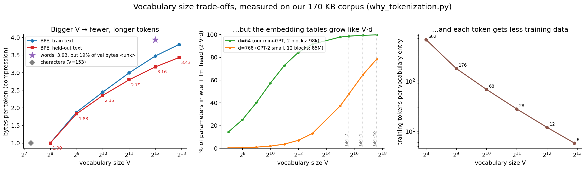
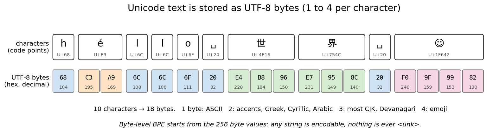
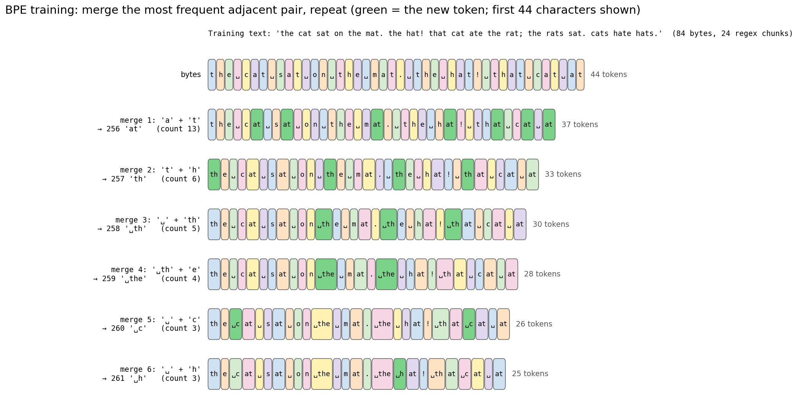
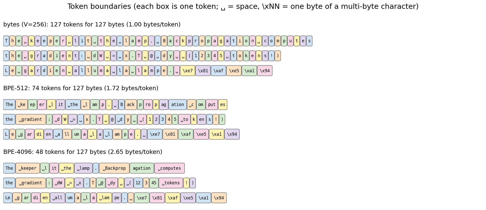
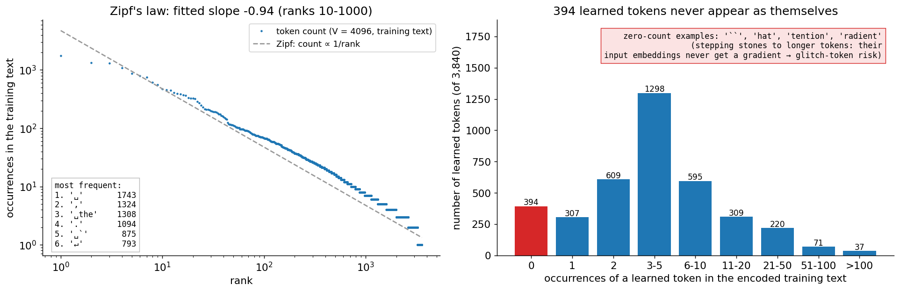
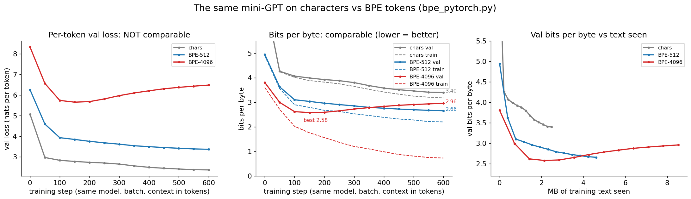
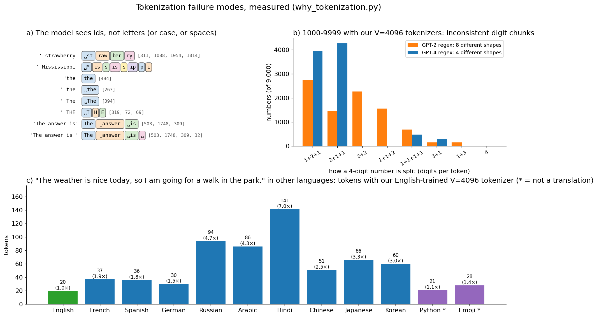

# Tokenization: byte-level BPE from scratch

A hands-on guide to the first and last thing every LLM does: turning text into integer
ids and back. The intuition, Unicode and UTF-8, the byte-pair encoding (BPE) algorithm
of GPT-2/3/4 and LLaMA-3 written from scratch in pure Python (training, encoding,
decoding, the pre-tokenization regex, special tokens), a check script that compares it
with slow reference implementations, the same trainer in PyTorch tensor ops, and the
experiment that matters: the mini-GPT of [`../transformer/`](../transformer/) trained
on characters vs BPE tokens, compared fairly in **bits per byte**. Along the way: why
LLMs can't count the r's in "strawberry", why they are bad at arithmetic, and why the
same sentence costs 7× more in Hindi.

> **Prerequisite:** [`../transformer/`](../transformer/) (the mini-GPT trained here;
> its section 15 introduces BPE in one paragraph, this folder is the full story) and
> [`../rnn/`](../rnn/) (next-token language models, loss per character, perplexity,
> and `input.txt`, part of the corpus used here). No NumPy backprop in this folder: a
> tokenizer has nothing to train by gradient descent, it is counting and merging.

## Files

| File | What it teaches |
|------|-----------------|
| `bpe.py` | Byte-level BPE in pure Python: the GPT-2 and GPT-4 pre-tokenization regexes (stdlib `re` versions), training with **incremental pair counts** and a heap (3,840 merges from 170 KB in 0.1 s), encoding by merge rank with a heap over a linked list + a chunk cache, decoding with `errors="replace"`, special tokens (`<|endoftext|>`, ChatML), save/load JSON. Run it to train and save `tokenizer.json`. |
| `bpe_visual.py` | Step-by-step terminal walkthrough: characters → UTF-8 bytes → regex chunks → 10 merges on a tiny corpus (pair-count table, the winning pair, the new token, the sequence shrinking) → encoding a new word with the learned merges → the real tokenizer on English, numbers, code, French, Chinese, emoji, with coloured token boundaries. |
| `bpe_check.py` | The tokenizer's `gradient_check.py`: round-trips on random Unicode (emoji, ZWJ, CJK, combining marks, random code points), fast encoder == naive encoder == replaying the merges, fast trainer == naive trainer (same merges, including ties and `"aaaa"`), determinism, truncation, special tokens never split, vocabulary bookkeeping, JSON. Optional comparison with `tiktoken`'s GPT-2 if it happens to be installed. ~1.5 s. |
| `why_tokenization.py` | The key trade-offs, measured: words vs characters vs bytes vs BPE-256…7687 (compression, `<unk>` rate, embedding cost, data per token), what the regex buys, Zipf's law and never-seen "stepping stone" tokens, and five failure modes (letters, digits, case/leading space, other languages, trailing space). |
| `bpe_pytorch.py` | (1) The same BPE trainer in tensor ops (`torch.unique`, `scatter_add_`, masked merges), proven to learn the identical 3,840 merges. (2) The `GPT` of `../transformer/transformer_pytorch.py` trained on characters, BPE-512 and BPE-4096 with the same model, batch, steps and context, compared in bits per byte on a held-out split (~2 min). |
| `make_figures.py` → `images/` | Draws every picture in this README from real computations (~3 s once `bpe_pytorch.npz` exists, ~2 min from scratch). |

### Suggested order

1. Read sections 1–2 (look closely at the pictures).
2. Run `python tokenizer/bpe_visual.py` and press Enter to watch BPE learn its first
   merges. Try `--word " thatch"` and `--merges 15`.
3. Read sections 3–6. Then read `bpe.py` top to bottom: it is in the same order.
4. Run `python tokenizer/bpe.py` (trains in 0.1 s, saves `tokenizer/tokenizer.json`)
   and `python tokenizer/bpe_check.py`.
5. Read section 7 with `python tokenizer/why_tokenization.py` running.
6. Read section 8, then run `python tokenizer/bpe_pytorch.py` (~2 min).
7. Read sections 9–10 (failure modes, other tokenizers), then 11–12.
8. Answer the interview questions out loud and do the exercises.

To redraw the pictures: `python tokenizer/make_figures.py`.

Run the scripts from the repo root with the venv active (see the root `README.md`).
Everything here is pure Python + NumPy + PyTorch; `tiktoken` is **not** required (the
check script uses it only if it is already installed). The corpus is read at run time
from `../rnn/input.txt` and the READMEs of `../mlp/`, `../cnn/`, `../rnn/`, `../lstm/`,
`../attention/` and `../transformer/` (188 KB); if those files change, the tokenizer is
retrained automatically and the numbers below shift slightly.

---

## 1. Why tokenize at all?

A language model maps a sequence of integer ids to a probability for the next id
(`../transformer/`). Something has to cut text into those ids, and the choice of the
unit decides how long the sequences are, how big the embedding table is, and what the
model can and can't "see".

| Unit | Vocabulary | Problem |
|------|-----------|---------|
| **Words** | every word you've seen (millions) | Unseen words, typos, names, code → `<unk>`. "run", "runs", "running" share nothing. |
| **Characters** | ~100 (ASCII) to 150k (all of Unicode) | Sequences are long (attention costs `T²`, the context holds little text); unseen characters → `<unk>`. |
| **Bytes** | exactly 256 | No `<unk>` ever, but even longer sequences (non-ASCII characters are 2–4 bytes). |
| **Subwords (BPE)** | chosen: 32k–200k | Frequent words are one token, rare words are pieces, anything else falls back to bytes. Short sequences **and** no `<unk>`. |



**What to look at:** `why_tokenization.py` measures all of them on our corpus (169,549
training bytes, the held-out set is the last 18,740 bytes):

```
  scheme                             V train tok bytes/tok val b/tok val <unk> 256 tok = 2·V·d d=64   d=768 tok/entry
  words (4095 + <unk>)            4096    44,647      3.80      3.93     19.5%    1007 B       524k    6.3M        11
  characters (+ <unk>)             153   167,813      1.01      1.01      0.1%     257 B        20k    235k      1097
  bytes (BPE, 0 merges)            256   169,549      1.00      1.00      0.0%     256 B        33k    393k       662
  BPE 512                          512    90,367      1.88      1.83      0.0%     468 B        66k    786k       176
  BPE 1024                        1024    69,341      2.45      2.35      0.0%     602 B       131k    1.6M        68
  BPE 2048                        2048    56,714      2.99      2.79      0.0%     715 B       262k    3.1M        28
  BPE 4096                        4096    48,888      3.47      3.16      0.0%     809 B       524k    6.3M        12
  BPE 7687 (every chunk merged)   7687    44,647      3.80      3.43      0.0%     877 B       984k   11.8M         6
```

Left panel: every doubling of `V` buys fewer, longer tokens: 1.00 → 3.16 bytes per token
on held-out text from 256 to 4,096 tokens, i.e. a 256-token context window holds 809
bytes instead of 256. A word vocabulary of the same size looks even better (3.93), but
only because 19.5% of the held-out bytes are thrown away into `<unk>`; characters need
`<unk>` for 0.1% (characters that never occurred in training). Bytes and BPE never do.
Middle: the price is the embedding table and output head, `2·V·d` parameters: 524k at
`V = 4096, d = 64`, five times the 99k weights in the two blocks of our mini-GPT; even
in GPT-2 small, the 50k vocabulary is a large share of the model. Right: the same
training text spread over more entries gives each embedding less data: 662 occurrences
per byte, 12 per BPE-4096 token. At `V = 7,687` merging ran out of pairs: every
distinct regex chunk of the training text is one token, and BPE has become a word
vocabulary that falls back to pieces for new words.

## 2. Unicode and UTF-8: text is bytes

Python's `str` is a sequence of **code points**: integers from 0 to 0x10FFFF that
Unicode assigns to characters (`ord("é") = 233`, `ord("世") = 0x4E16`). There are
~150k assigned characters, too many for a vocabulary, and new ones (emoji) appear every
year. On disk and over the network, text is stored as **UTF-8**, a variable-length
encoding:

| Code points | Bytes | Examples |
|-------------|-------|----------|
| U+0000–U+007F | 1: `0xxxxxxx` | ASCII: English, digits, code |
| U+0080–U+07FF | 2: `110xxxxx 10xxxxxx` | é, ñ, Greek, Cyrillic, Hebrew, Arabic |
| U+0800–U+FFFF | 3: `1110xxxx 10xxxxxx 10xxxxxx` | most CJK, Devanagari, `─`, `→` |
| U+10000–U+10FFFF | 4: `11110xxx 10xxxxxx ×3` | emoji, rare CJK |



**What to look at:** 10 characters become 18 bytes. The lead byte says how many bytes
follow (`E4` = `1110 0100`: three), continuation bytes all start with `10`, so a decoder
can always find where characters start. (The emoji U+1F642 🙂 is drawn as ☺ because
matplotlib can't draw colour emoji; the bytes are real.)

**Byte-level BPE** (GPT-2, Radford et al. 2019) starts from the 256 byte values: any
string in any language, any emoji, even binary junk, has an encoding, so there is no
`<unk>` token. The cost: one non-ASCII character is several base tokens, and a learned
token can contain *part* of a character. Our tokenizer learned
`'\x80───────────────\xe2\x94'`: the last byte of one `─` (`E2 94 80`), 15 whole `─`, and
the first two bytes of the next one, because the READMEs draw boxes with them.

## 3. The BPE training algorithm

BPE was a data-compression algorithm (Gage 1994) before Sennrich et al. (2016) used it
for subword vocabularies. Training is a greedy loop:

```
ids = the corpus as bytes                       vocabulary: 256 tokens
repeat V - 256 times:
    count every adjacent pair (a, b) in ids
    (a, b) = the most frequent pair             ties: the smallest (a, b), for determinism
    new id = 256 + number of merges so far
    replace every (a, b) in ids by the new id, left to right
    record merges[(a, b)] = new id
```

The output is just the **ordered list of merges** (GPT-2: 50,000 of them; ours:
3,840). The vocabulary is derived from it: `vocab[new] = vocab[a] + vocab[b]` (bytes
concatenated).

**Worked example** (`python tokenizer/bpe_visual.py`) on the 84-byte text
`"the cat sat on the mat. the hat! that cat ate the rat; the rats sat. cats hate hats."`:

| Merge | Most frequent pair | Count | New token | Tokens left |
|-------|--------------------|-------|-----------|-------------|
| — | (bytes) | | | 84 |
| 1 | `'a' + 't'` | 13 | 256 = `at` | 71 |
| 2 | `'t' + 'h'` | 6 | 257 = `th` | 65 |
| 3 | `'␣' + 'th'` | 5 | 258 = `␣th` | 60 |
| 4 | `'␣th' + 'e'` | 4 | 259 = `␣the` | 56 |
| 5 | `'␣' + 'c'` | 3 | 260 = `␣c` | 53 |
| 6 | `'␣' + 'h'` | 3 | 261 = `␣h` | 50 |

Each merge removes exactly `count` tokens. After 10 merges the text is 41 tokens (2.05
bytes per token). Merges build on merges: `␣the` = `␣th` + `e` = (`␣` + `th`) + `e`.



**What to look at:** the first 44 characters of the toy text after each merge, the new
token in green. Note that `the` at the very start stays `th|e` while `␣the` becomes one
token: without a leading space it is a different chunk (section 5) and would need its
own merge.

On the real corpus (`python tokenizer/bpe.py`) the first merges are `'␣␣'` (3,539
times: indented code and tables in the READMEs), `'␣t'`, `'he'`, `'␣a'`, `'on'`, `'er'`,
`'in'`, and merge 8 is already `'␣the'` (1,444). Late merges are rare: merge 2,000 is
`'␣local'` (6 occurrences), merge 3,500 `'024'` (2).

### Making training fast: incremental pair counts

The naive loop recounts every pair of the corpus after every merge: `O(N)` per merge,
`O(N · merges)` total. `train_bpe` in `bpe.py` does three things that real trainers
(HF `tokenizers`, SentencePiece) also do:

1. **Count identical chunks once.** The 44,647 regex chunks of the training text are
   only 5,017 distinct strings (`" the"` appears ~1,300 times); each is stored once with
   its frequency, and `stats[pair] = Σ frequency × occurrences`.
2. **Only touch what changed.** `where[pair]` = the set of chunks that contain the pair.
   A merge of `(a, b)` re-counts only those chunks: subtract their old pairs, add their
   new ones (`delta` in the code).
3. **A heap** finds the most frequent pair. Changed counts are pushed again; stale
   entries are skipped when popped (`stats[pair] != count`).

```python
for wi in where.pop(pair):              # only the chunks containing the merged pair
    w, f = words[wi], freqs[wi]
    new = merge(w, pair, idx)
    for p in zip(w, w[1:]):   delta[p] -= f
    for p in zip(new, new[1:]): delta[p] += f
    ...
for p, d in delta.items():               # apply the net change, push new counts on the heap
    stats[p] += d; heapq.heappush(heap, (-stats[p], p))
```

Result: 3,840 merges from 170 KB in **0.1 s** of pure Python. `bpe_check.py` trains
both versions on four small corpora (including ties and overlapping pairs like
`"aaaa"`) and checks they learn the **same merges** (~0.02 s vs ~0.9 s there).
`bpe_pytorch.py` part 1 writes the naive full-recount version with tensor ops (one flat
id tensor with `-1` between chunks, `torch.unique` + `scatter_add_` for the counts, a
masked rewrite for the merge) and checks that all 3,840 merges are identical on the
full training text (~3 s: recounting everything is simple and parallel, but it does
`O(N)` work per merge).

Two properties fall out of the greedy loop:

- **Prefix property.** The tokenizer with `V = 512` is exactly the first 256 merges of
  the `V = 4096` one (`Tokenizer.truncated`, checked by `bpe_check.py`). This is how
  `why_tokenization.py` gets all vocabulary sizes from one training run.
- **The overlap rule.** In `"aaa"`, the pair `(a, a)` occurs twice but only one merge
  fits; `merge()` goes left to right and gives `aa|a`. The counts include overlaps (like
  minbpe and the original BPE); both trainers agree because they use the same rule.

## 4. Encoding and decoding

**Encoding new text** must reproduce what training would have done: inside each chunk,
apply the merges **in the order they were learned**. Equivalently (tiktoken, minbpe):
repeatedly find the adjacent pair with the **lowest rank** (= smallest new id) that is in
the merge table, merge it, and stop when no pair is mergeable.

```
' thats' (never seen in training)        merges learned: 0:'at' 1:'th' 2:'␣th' ... 6:'ats'
bytes:   ␣ t h a t s
rank 0:  ␣ t h [at] s          present merges: 'at':0 'th':1
rank 1:  ␣ [th] at s           present merges: 'th':1 'ats':6
rank 2:  [␣th] at s            present merges: '␣th':2 'ats':6
rank 6:  ␣th [ats]             -> [258, 262]
```

`Tokenizer._encode_chunk` implements this with a heap of `(rank, position)` over a
doubly linked list: pop the lowest-ranked pair, merge the two nodes, push the two new
neighbouring pairs, skip stale entries. That is `O(n log n)` per chunk instead of the
`O(n²)` "recount the pairs after each merge" loop, plus a cache of already-encoded
chunks (natural text repeats chunks constantly), so encoding all 170 KB takes ~0.04 s.
`bpe_check.py` checks the heap encoder against both the naive loop and literally
replaying all 3,840 merges in training order, on 250 random Unicode strings and real
text.

Why lowest rank first is right: a merge of rank `r` can only create pairs that involve
the new token, and every merge using that token was learned *after* `r`. So applying
merges by rank never needs to go back, exactly like training.

**Decoding** is a lookup and a concatenation: `b"".join(vocab[i] for i in ids)`, then
`.decode("utf-8", errors="replace")`. The `errors="replace"` matters: a model can sample
a token sequence that ends in the middle of a character, or that is invalid UTF-8
altogether (`decode([0xE4])` gives `'\ufffd'`, the replacement character �). Streaming
APIs must buffer bytes until a character is complete.



**What to look at:** the same three lines with 0, 256 and 3,840 merges: 127 → 74 → 48
tokens. With `V = 4096`, frequent words of this corpus are single tokens with their
leading space (`␣keeper`, `␣gradient`, `␣tokens`); a rarer word is split into
meaningful-ish pieces (`␣Backprop|agation`), the number into `12|3|45`, French into
fragments, and the two Chinese characters stay six raw bytes: the training text had
none.

## 5. Pre-tokenization: the regex

GPT-2 does not run BPE on raw text. A regex first cuts the text into **chunks**, and
merges never cross a chunk boundary:

```
GPT-2:  's|'t|'re|'ve|'m|'ll|'d| ?\p{L}+| ?\p{N}+| ?[^\s\p{L}\p{N}]+|\s+(?!\S)|\s+
GPT-4:  '(?i:[sdmt]|ll|ve|re)|[^\r\n\p{L}\p{N}]?+\p{L}+|\p{N}{1,3}| ?[^\s\p{L}\p{N}]++[\r\n]*|\s*[\r\n]|\s+(?!\S)|\s+
```

Read the GPT-2 one left to right: English contractions; an optional space + letters (a
word *with its leading space*); an optional space + digits; an optional space +
punctuation; whitespace not followed by a non-space (so the last space of a run stays
for the next word); any other whitespace.

| Text | GPT-2 regex | GPT-4 regex |
|------|-------------|-------------|
| `Hello world's  123!!` | `Hello` `␣world` `'s` `␣` `␣123` `!!` | `Hello` `␣world` `'s` `␣` `␣` `123` `!!` |
| `12345678` | `12345678` | `123` `456` `78` |
| `WE'LL` | `WE` `'` `LL` (case-sensitive bug) | `WE` `'LL` |
| `foo_bar(1)\n    x` | `foo` `_` `bar` `(` `1` `)` `\n␣␣␣` `␣x` | `foo` `_bar` `(` `1` `)\n` `␣␣␣` `␣x` |

**Why split at all?** Without it, BPE happily learns `dog.`, `dog!`, `dog?` and
`the␣`, wasting vocabulary on combinations. `why_tokenization.py` measures it by
training the same `V = 4096` BPE on whole lines instead of regex chunks:

```
  Why pre-tokenize? The same V=4096 BPE trained on whole lines (no regex):
     bytes/token train 4.11, val 3.43   (GPT-4 regex: train 3.47, val 3.16)
     1,882 of 3,840 learned tokens glue a word to the next one (GPT-4 regex: 0), e.g. 'e␣', 's␣', 't␣', ',␣', 'd␣', 'the␣', '.␣', 'y␣'
```

Honest result: on this text, no regex compresses *better* (frequent cross-word strings
like `'the␣'` are real patterns). But half the vocabulary becomes word-space-punctuation
glue, the same word gets many unrelated tokens depending on its neighbours, and the
model loses the clean "one token ≈ one word piece" structure. GPT-2's paper
(Radford et al. 2019) introduced the regex for exactly this reason. GPT-4's version adds
case-insensitive contractions, splits numbers into chunks of at most 3 digits (section
9), and keeps newlines with punctuation.

**Our version uses stdlib `re`**, which has no `\p{L}`. `bpe.py` approximates "a
letter" as `[^\W\d_]` (a word character that is not a digit or underscore) and "a
number" as `\d`; possessive quantifiers (`?+`, `++`, Python 3.11+) are dropped, which
does not change what these alternatives match. The result is identical on ASCII and
on all the scripts tested by `bpe_check.py`; it differs only on rare characters such as
`²` or `Ⅻ` (numbers in Unicode, letters for `\w`). Production code uses the `regex`
package (tiktoken compiles the pattern in Rust).

## 6. Special tokens and chat templates

Special tokens are ids **outside** the BPE vocabulary, added after training:
`<|endoftext|>` (GPT-2 id 50256) separates documents in pretraining. Ours get ids
4096–4098:

```python
tok.encode("Hi<|endoftext|>", allowed_special="all")   # [..., 4096]   one token
tok.encode("Hi<|endoftext|>", allowed_special="none")  # the string as ordinary text (8 tokens for it)
tok.encode("Hi<|endoftext|>")                           # ValueError (the default, like tiktoken)
```

`encode` first splits the text on the special strings (longest first), so a special
token is **never** split or merged with its neighbours, then BPE-encodes the pieces in
between. The default refuses text that contains a special string: if a user can type
`<|im_end|>` and it becomes the real control token, they can close their turn and
impersonate the system (a tokenizer-level prompt injection).

**Chat templates** turn a conversation into one token stream. ChatML (GPT-3.5/4, Qwen and
others), as produced by `render_chat` in `bpe.py`:

```
<|im_start|>system
You are terse.<|im_end|>
<|im_start|>user
Hi!<|im_end|>
<|im_start|>assistant
```

`python tokenizer/bpe.py` encodes it to 28 tokens, 5 of them special. The model was
fine-tuned to produce `<|im_end|>` when its answer is done, and the server stops there.
LLaMA-3 uses `<|begin_of_text|>`, `<|start_header_id|>`…`<|end_header_id|>` and
`<|eot_id|>` instead; the idea is identical. Using the **wrong template** for a model
is one of the most common causes of mysteriously bad outputs from open models (see
`../finetuning/` and `../serving/`). Note that `system`, `user`, `assistant` and the
newlines are ordinary tokens (`s|y|st|em` with our small vocabulary).

## 7. Vocabulary size: compression vs parameters vs rare tokens

From the table in section 1, a bigger `V`:

- **compresses more** (3.16 held-out bytes per token at 4,096 vs 1.83 at 512): shorter
  sequences, cheaper attention (`T²`), more text in the context window, fewer decoding
  steps at inference;
- **costs parameters**: `wte` and `lm_head` are `V × d` each, and the softmax over `V`
  is computed for every position (`V·d` multiply-adds per token for the head);
- **thins the data**: the training text is split among more entries (12 occurrences
  per token at 4,096), so rare tokens are poorly trained;
- and **generalizes worse per merge**: held-out compression grows slower than training
  compression (3.47 vs 3.16 at 4,096; 3.80 vs 3.43 at 7,687), because late merges
  memorize strings that are frequent only in the training text.

Production choices: GPT-2 50,257; GPT-4 (`cl100k_base`) ~100k; GPT-4o (`o200k_base`)
~200k; LLaMA-1/2 32k; LLaMA-3 128k. The trend is up: at large `d` and `L`, the
embedding share is small, and better compression of code and many languages pays for it.



**What to look at:** left, token counts of the `V = 4096` tokenizer on its own
training text follow **Zipf's law** (fitted slope −0.94 on ranks 10–1000; a perfect
Zipf law has −1). The top tokens are `␣` (1,743), `,` (1,324), `␣the` (1,308) and `.`
(1,094). Right: 2,608 of the 3,840 learned tokens occur 5 times or fewer, and **394
occur zero times** as themselves (`'``'`, `'hat'`, `'tention'`, `'radient'`, …). Those
were **stepping stones**: `tention` was only a step towards `ttention`, `attention`
and `␣attention`, which then swallowed every occurrence. In a model, such a token's input embedding never receives a
gradient (only weight decay) and its output row is only ever pushed down. This is the
mechanism behind **glitch tokens** (section 9).

## 8. Bits per byte: comparing models across tokenizers

The loss each training run reports is **per token**. That number cannot be compared
across tokenizers: a BPE-4096 token carries 3.5 bytes, so predicting it is a harder
problem than predicting one character, but you need 3.5× fewer predictions. The fair
unit is the cost of the whole text, normalized by something every tokenizer agrees on,
its size in UTF-8 bytes:

```
bits per byte = Σ_tokens −ln p(token | context)  /  (ln 2 · number of UTF-8 bytes predicted)
              = (loss per token in nats) / ln 2  /  (bytes per token)
```

Shapes: the sum runs over every predicted position `(B·T)`; the denominator sums
`len(vocab[y])` over the same target tokens. A uniform guess over 256 byte values is 8
bits per byte; good compressors and LLMs on English are around 1. (Perplexity has the
same problem; "per-byte" or "per-word" perplexity fixes it. The Pile paper, Gao et al.
2020, reports BPB for this reason.)

`python tokenizer/bpe_pytorch.py` trains the `GPT` of
`../transformer/transformer_pytorch.py` (imported unchanged: 3 layers, `d_model = 96`, 4
heads, dropout 0.1, AdamW + warmup + cosine) on the same 169,549 training bytes cut three
ways, with the same batch (32), steps (600) and context (128 **tokens**), so roughly the
same compute. The held-out set is the last 10% of the corpus.

```
               V     params bytes/tok ctx bytes val nats/tok train bpb  val bpb best val   time
chars        154    377,568      1.01       129        2.366     3.177    3.397    3.397    33s
BPE-512      515    446,880      1.88       240        3.367     2.202    2.658    2.658    35s
BPE-4096    4099  1,135,008      3.47       444        6.485     0.732    2.959    2.581    39s
uniform                                                          8.000    8.000
```



**What to look at:** left, the per-token loss ranks the models backwards: characters
"win" with 2.37 nats per token, BPE-4096 "loses" with 6.49. Middle, in bits per byte,
BPE-512 is best at the end (2.66 vs 3.40 for characters), and BPE-4096 is best of all
early on (2.58 at step 150) but then **overfits**: its training bpb falls to 0.73 while
validation rises to 2.96. Right, per megabyte of text seen, BPE models learn faster:
with the same 128-token context, each step shows them 1.9× (BPE-512) or 3.4×
(BPE-4096) more text, and they see 240 or 444 bytes of context instead of 129.

**Honest caveats.** This corpus is tiny for a 4,096-token vocabulary: 48,888 training
tokens means 12 occurrences per vocabulary entry, and 69% of the BPE-4096 model's
1.1M parameters sit in `wte` + `lm_head`, so it memorizes the training text (train
0.73 vs val 2.96 bits per byte). With early stopping it would still win. The character
model is the opposite: at 600 steps it has seen only 2.5 MB and is still improving;
trained much longer it would close part of the gap, but it would need ~3.4× the steps
to see the same text. With real data (billions of tokens) every entry of a 50k–200k
vocabulary is well trained and the compression advantage dominates, which is why every
frontier LLM uses subword tokens. The samples make the same point: the BPE-4096 model
writes whole words (`"The keeper climbed the stairs, girl was cales, ..."`), the
character model is still at the misspelled-word stage. Run-to-run, the table above is
reproducible on this machine (fixed seeds); timings vary with load.

## 9. Tokenization failure modes

Many "LLMs are dumb at X" stories are tokenization stories. `why_tokenization.py`
measures each with our tokenizer:



**What to look at:** panel a: the model only receives the ids on the right. Panel b:
how our two `V = 4096` tokenizers split the 9,000 numbers 1000–9999. Panel c: the same
sentence in ten languages (plus code and emoji).

- **Counting and spelling.** `" strawberry"` is `␣st|raw|ber|ry` = `[311, 1088, 1054,
  1014]`. Asking "how many r's?" requires the model to have memorized the spelling of
  each token inside its embedding; the letters are not in the input. Same for
  reversing a word, rhyming, or character-level edits. (Large models mostly can spell
  their tokens, because spelling appears in training data, but it's indirect.)
- **Arithmetic.** With the GPT-2 regex, all digits of a number form one chunk and BPE
  splits it however its merges happen to fall: 8 different split shapes for 4-digit
  numbers (`1|01|0`, `10|30`, `1|7|00`, …). The same digit position lands in a
  different token from one number to the next, so column-wise addition has to be
  relearned for every alignment. The GPT-4 regex caps chunks at 3 digits (4 shapes
  here, because our small vocabulary lacks many 2- and 3-digit tokens; a 100k
  vocabulary makes it consistent); LLaMA-1/2 split every digit; splitting
  right-to-left (aligned to the ones' place) helps further (Singh & Strouse 2024).
- **Same word, different tokens.** `the`, `␣the`, `The`, `␣The` are four unrelated ids
  (494, 263, 503, 394) and `␣THE` is three pieces. 481 words of our vocabulary exist both
  with and without a leading space. The model must learn from data that they mean the
  same thing.
- **Other languages cost more.** Our English-trained tokenizer needs 20 tokens for the
  English sentence, 30–37 for German, Spanish and French, 51–66 for Chinese, Korean and
  Japanese, 86–94 for Arabic and Russian, and 141 (7.0×) for Hindi, where every byte is
  a token. Real tokenizers are trained on multilingual data, but the imbalance remains:
  Petrov et al. (2023) find up to ~15× differences in tokenized length for the same text
  across languages, which means higher API prices, a shorter effective context, and less
  training signal per idea for those languages.
- **Trailing whitespace.** `"The answer is "` ends with a lone `␣` token. In the training
  text the lone `␣` (id 32) appears 1,743 times and is followed by a digit 1,411 times,
  by whitespace 325 times, and by a letter only twice, because the regex glues a space
  to the following word (`␣answer`). A prompt ending in a space puts the model in a
  state it has barely seen: completions get worse. Strip trailing spaces, or use **token
  healing** (back up one token and constrain the next one to start with the removed
  text, as the `guidance` library does).
- **Glitch tokens.** Rumbelow & Watkins (2023) found GPT-2/3 tokens such as
  `SolidGoldMagikarp` (a Reddit username from r/counting) that existed in the
  tokenizer's training data but almost never in the model's: asked to repeat them, the
  models evaded, insulted the user or said something else entirely. It's the
  zero-count effect of section 7 at scale: an untrained embedding sitting in the
  vocabulary. Land & Bartolo (2024) detect such under-trained tokens automatically in
  many open models. Fix: train the tokenizer on the same distribution as the model.
- **Prompt boundaries.** A prompt `"https:"` followed by a model continuation `"//"` is
  tokenized differently than the full string `"https://"`; constrained decoding and
  "stop sequences" must handle token boundaries that don't match string boundaries.

## 10. Other tokenizers

| Algorithm | Used in | Training | Encoding |
|-----------|---------|----------|----------|
| **Byte-level BPE** (this folder) | GPT-2/3/4, LLaMA-3, Qwen, … | merge the most frequent pair | apply merges by rank |
| **WordPiece** (Schuster & Nakajima 2012; Wu et al. 2016) | BERT (30,522 tokens) | merge the pair that most increases training-data likelihood: `count(ab) / (count(a)·count(b))` | greedy longest-match from the left; continuation pieces marked `##ing` |
| **Unigram LM** (Kudo 2018) | T5, ALBERT, XLNet | start from a huge candidate set, repeatedly **remove** the pieces whose loss hurts the corpus likelihood least | Viterbi: the most probable segmentation under a unigram model; can **sample** segmentations (subword regularization) |
| **SentencePiece** (Kudo & Richardson 2018) | LLaMA-1/2 (BPE, 32k), T5 (Unigram), Gemma | a library implementing BPE and Unigram on raw text, with spaces as `▁` (no pre-tokenizer needed, works for languages without spaces) | |

- **Byte fallback** (SentencePiece, used by LLaMA-1/2): the vocabulary is characters
  and merges of characters; a character that isn't in it is encoded as `<0xE4><0xB8>…`
  byte tokens instead of `<unk>`. Same guarantee as byte-level BPE, different base.
- **tiktoken** (OpenAI) is an encoder only (no training), written in Rust: the regex
  split, then the rank-based merge loop of section 4 on each chunk, with a cache. Our
  `bpe_check.py` can verify our encoder against it with the real GPT-2 merges if you
  `pip install tiktoken` (it is optional and not installed by this repo). GPT-2's
  original `encoder.py` maps the 256 bytes to printable Unicode characters
  (`bytes_to_unicode`) so the BPE could run on strings; that's why GPT-2 vocab files
  show `Ġthe` for `␣the`.
- **Tokenizer-free models** operate on bytes directly: ByT5 (Xue et al. 2022), and
  hierarchical models such as MEGABYTE (Yu et al. 2023) and the Byte Latent
  Transformer (Pagnoni et al. 2024) that group bytes into dynamic patches. They avoid
  every failure mode above but must deal with 3–4× longer sequences, which is exactly
  the trade-off measured in section 8.

## 11. Practical tips and debugging

- **Always round-trip.** `decode(encode(s)) == s` on weird inputs (emoji with ZWJ, flags,
  combining accents, `\r\n`, tabs, NUL, random code points) is the first test of any
  tokenizer (`bpe_check.py`).
- **Look at the tokens**, not just the ids: print `tok.token_str(i)` for a sample of
  your data (`bpe_visual.py` step 6). Surprises (code indentation as a dozen `␣`
  tokens, a domain term split into five pieces) show up immediately.
- **Train the tokenizer on data like your model's**, with the same mix of languages and
  code. Mismatch causes under-trained tokens (section 7) and poor compression.
- **Measure compression** (bytes per token) on held-out data for each domain/language
  you care about; it directly sets cost and context length.
- **Compare models in bits per byte** (or per character/word), never in per-token loss
  or perplexity, when tokenizers differ.
- **Never let user text produce special tokens**: encode untrusted input with special
  handling off (`allowed_special="none"` or the default `none_raise`), insert control
  tokens only from your own template code.
- **Use the model's own tokenizer and chat template**, byte for byte. A different
  whitespace convention or a missing BOS token silently degrades an open model.
- **Count tokens with the real tokenizer** for budgets (context limits, API cost); the
  "4 characters per token" rule of thumb holds only for English prose.
- **Strip trailing whitespace** from prompts, and be careful when a prompt ends in the
  middle of what would be one token.
- **Streaming decode**: emit text only when the accumulated bytes form complete UTF-8
  characters, otherwise you print `�` in the middle of a CJK character or an emoji.

## 12. From this folder to production / frontier labs (why this matters for an AI engineer)

Every system you will build sits on a tokenizer: pretraining data pipelines (tokenize
trillions of tokens once, store the ids), fine-tuning (chat templates, loss masks on
assistant tokens only, see `../finetuning/`), evals (comparing models with different
vocabularies needs bits per byte, see `../evals/`), RAG (chunk sizes are in tokens, see
`../rag/`), agents (tool-call formats are special-token templates, see `../agents/`),
and serving (stop sequences, streaming UTF-8, token-based billing and rate limits, see
`../serving/`).

| | this folder | GPT-2 (2019) | GPT-4o / LLaMA-3 class |
|---|---|---|---|
| Algorithm | byte-level BPE | byte-level BPE | byte-level BPE (tiktoken) |
| Training text | 170 KB English Markdown | WebText (~40 GB) | multilingual web + code, many TB |
| Merges | 3,840 | 50,000 | ~128k–200k vocabulary |
| Regex | GPT-4 style (stdlib `re`) | GPT-2 | GPT-4 style and newer |
| Special tokens | `<|endoftext|>`, ChatML | `<|endoftext|>` | chat roles, tools, end-of-turn, fill-in-the-middle |
| Speed | ~0.04 s for 170 KB (pure Python, cached) | — | Rust, multi-threaded, GB/s |

What changes at scale is engineering, not the algorithm: the trainer runs over
deduplicated chunk counts from a huge sample (exactly our `Counter` of chunks), encoding
runs in Rust in parallel over shards, and the vocabulary is designed together with the
model (size divisible by 64/128 for GPU efficiency, reserved special-token slots for
future chat/tool formats). Tokenizer changes are expensive: a new vocabulary means new
embeddings, so models keep their tokenizer for a whole family.

## 13. Interview check

Answer each one out loud in under a minute:

1. Why not use words as tokens? Why not characters? Why not raw bytes?
2. What is UTF-8? How many bytes for `a`, `é`, `世`, `🙂`, and how does a decoder know
   where a character starts?
3. Write the BPE training loop. What is the output of training?
4. How do you make BPE training fast? What do you count incrementally, and why does a
   heap need lazy deletion?
5. How does BPE encode a word it has never seen? Why "lowest rank first"?
6. Why must decoding use `errors="replace"` (or buffering), and when does it matter?
7. What does the pre-tokenization regex do, and what goes wrong without it?
8. What did GPT-4's regex change compared with GPT-2's, and why does the 3-digit rule
   matter?
9. What are special tokens? How do you stop users from injecting `<|im_end|>`?
10. What is a chat template? What happens if you use the wrong one?
11. How does vocabulary size trade off compression, parameters and compute? Estimate
    the embedding + head parameters of a 128k vocabulary at `d = 4096`.
12. What is the prefix property of BPE merges?
13. Why can't you compare per-token losses of two models with different tokenizers?
    Define bits per byte and convert a loss of 2.0 nats/token at 4 bytes/token.
14. Why might BPE-4096 lose to characters on a tiny corpus, and win at scale?
15. Why do LLMs struggle to count letters or reverse words?
16. Why are LLMs bad at arithmetic, and what tokenizer choices help?
17. What are glitch tokens (SolidGoldMagikarp)? Where do they come from and how do you
    detect them?
18. Why does the same text cost more tokens in Hindi than in English? Why does that
    matter commercially and for model quality?
19. Why can a trailing space in a prompt hurt the completion? What is token healing?
20. Byte-level BPE vs WordPiece vs Unigram/SentencePiece: how do training and
    encoding differ?
21. What is byte fallback?
22. Why do models keep the same tokenizer across versions? What does changing it cost?

## 14. Exercises

1. In `train_bpe` (`bpe.py`), delete the two lines `for p in zip(w, w[1:]): delta[p] -= f`
   (forget to subtract the old pairs). Run `bpe_check.py` and watch the four "same
   merges" checks FAIL. Then break `_encode_chunk` by pushing only the right-hand new
   pair (`for left in (i,):`) and watch both encoder checks catch it.
2. In `Tokenizer.encode`, remove the capturing parentheses around the special-token
   pattern (`pat = "|".join(...)`). Which check fails, and why do the special tokens
   disappear?
3. Change `best_pair` to break ties by the *largest* pair. The naive trainer in
   `bpe_check.py` uses `best_pair`, but the heap in `train_bpe` has its own tie-break
   (`(-count, pair)`), so the "same merges" checks fail on ties. Make the heap agree
   again (hint: what should it push?) and explain why a deterministic tie-break matters
   for reproducible tokenizers.
4. Train with `--pattern gpt2` and compare the number splits and compression with the
   default (`why_tokenization.py` does part of this; add bytes/token to the table).
5. Implement `encode` for streaming: a `decode_stream(ids)` generator that yields text
   only when the bytes form complete UTF-8 characters. Test it on emoji.
6. Add a **right-to-left 3-digit** split for numbers (e.g. pre-process `1234567` into
   `1|234|567`), retrain, and redo the digit-shape histogram of `why_tokenization.py`.
7. Implement WordPiece encoding (greedy longest match with `##` continuation) on top of
   our vocabulary, and compare its token counts with BPE on the held-out text.
8. Implement **BPE-dropout** (Provilkov et al. 2020): during encoding, skip each
   possible merge with probability `p`. Train the BPE-4096 model of `bpe_pytorch.py`
   with it (`p = 0.1`): does the overfitting in section 8 shrink?
9. Find the zero-count tokens of section 7 in a trained BPE-4096 model from
   `bpe_pytorch.py`: compare the norms of their `wte` rows with the others.
10. Run `python tokenizer/bpe_pytorch.py --vocabs 256 1024 2048` and plot best val bits
    per byte vs vocabulary size. Where is the optimum for this corpus? Try
    `--steps 1500`: does it move?
11. If you have `tiktoken`, run `bpe_check.py` with it installed (it downloads the GPT-2
    merges once) and confirm our encoder reproduces GPT-2's ids. Then count how many
    GPT-2 tokens our 170 KB corpus needs vs our tokenizer.
12. Add a byte-fallback character tokenizer (characters seen ≥ N times + 256 byte
    tokens) and compare its compression and `<unk>`-free guarantee with byte-level BPE.

## 15. Resources

- Sennrich, Haddow & Birch (2016), *Neural Machine Translation of Rare Words with
  Subword Units* (BPE for NLP).
- Gage (1994), *A New Algorithm for Data Compression* (the original byte-pair encoding).
- Radford et al. (2019), *Language Models are Unsupervised Multitask Learners* (GPT-2:
  byte-level BPE and the pre-tokenization regex).
- Kudo (2018), *Subword Regularization: Improving Neural Network Translation Models
  with Multiple Subword Candidates* (the Unigram LM tokenizer).
- Kudo & Richardson (2018), *SentencePiece: A simple and language independent subword
  tokenizer and detokenizer for Neural Text Processing*.
- Andrej Karpathy, the `minbpe` repository and the video *Let's build the GPT Tokenizer*
  (2024): the rank-based encoder and the GPT-4 regex here follow the same design.
- Rumbelow & Watkins (2023), *SolidGoldMagikarp (plus, prompt generation)*, LessWrong
  (glitch tokens).
- Petrov, La Malfa, Torr & Bibi (2023), *Language Model Tokenizers Introduce Unfairness
  Between Languages* (NeurIPS 2023).
- Land & Bartolo (2024), *Fishing for Magikarp: Automatically Detecting Under-trained
  Tokens in Large Language Models*.
- Singh & Strouse (2024), *Tokenization counts: the impact of tokenization on
  arithmetic in frontier LLMs*.
- Schuster & Nakajima (2012), *Japanese and Korean Voice Search* (WordPiece); Wu et al.
  (2016), *Google's Neural Machine Translation System* (WordPiece in NMT).
- Provilkov, Emelianenko & Voita (2020), *BPE-Dropout: Simple and Effective Subword
  Regularization*.
- Gao et al. (2020), *The Pile: An 800GB Dataset of Diverse Text for Language Modeling*
  (reports bits per byte).
- Xue et al. (2022), *ByT5: Towards a token-free future with pre-trained byte-to-byte
  models*; Yu et al. (2023), *MEGABYTE*; Pagnoni et al. (2024), *Byte Latent
  Transformer: Patches Scale Better Than Tokens*.
- OpenAI `tiktoken` (GitHub) and Hugging Face `tokenizers` (GitHub): production
  encoders/trainers, written in Rust.
- The Unicode Standard and RFC 3629 (*UTF-8, a transformation format of ISO 10646*).
