# Transformers: a GPT-style decoder from scratch

A hands-on guide to the model behind GPT, Claude, Gemini and LLaMA: the intuition,
every equation with its shapes, a from-scratch NumPy mini-GPT with a hand-written
backward pass for every layer, the same model in PyTorch, a KV-cache sampler, and the
path from this folder to ChatGPT. It trains on the same text as [`../rnn/`](../rnn/),
so you can compare the two models number for number.

> **Prerequisite:** [`../mlp/`](../mlp/) (linear layers, backprop, the MLP block that
> makes up 2/3 of a Transformer), [`../rnn/`](../rnn/) (next-token language models,
> sampling, perplexity, the char-level setup reused here) and
> [`../attention/`](../attention/) (queries, keys, values and scaled dot-product
> attention in seq2seq). Section 3 recaps attention, so this folder also stands alone.

## Files

| File | What it teaches |
|------|-----------------|
| `transformer_numpy.py` | A complete mini-GPT in NumPy: token + position embeddings, LayerNorm, causal multi-head self-attention, GELU MLP, residuals, final LN, output head, cross-entropy, all with **hand-written backward**; AdamW, warmup + cosine LR, gradient clipping. Trains on `../rnn/input.txt` and saves `model.npz`. |
| `attention_step_visual.py` | Step-by-step terminal walkthrough: the trained model reads "The keeper". Token ids, embeddings, one head's Q, K, V, the masked score matrix, the softmax heatmap, the weighted mix of values, residual + MLP, the next-char guesses, and the prediction after every prefix. |
| `gradient_check.py` | Numerical vs analytic gradients for every layer on its own (Linear, Embedding, LayerNorm, GELU, masked attention, softmax-CE, a whole block) and for every parameter of a tiny full GPT (separate and tied embeddings). |
| `generate.py` | Prompt → continuation with `--temperature`, `--top-k`, interactive mode. Uses a **KV cache** (prefill + one-token decode steps) and proves it matches a full recompute. `--benchmark` times it. |
| `transformer_pytorch.py` | (a) An equivalent PyTorch module (`nn.LayerNorm`, `nn.Linear`, `F.scaled_dot_product_attention`); copies our NumPy weights in and asserts identical logits **and gradients**. (b) Idiomatic training with a validation split, dropout, AdamW, warmup + cosine, `clip_grad_norm_`, compared with a char-RNN on the same batches. |
| `why_transformers.py` | The key insight, measured: an associative-recall task where a Transformer gets 100% and a GRU/RNN with the same budget forget; plus timing of sequential vs parallel computation and the T² cost of attention. |
| `make_figures.py` → `images/` | Draws every picture in this README from real computations (~15 s once `model.npz` and `why_transformers.npz` exist, ~50 s from scratch). |

### Suggested order

1. Read sections 1–3 (look closely at the pictures).
2. Run `python transformer/attention_step_visual.py` and press Enter to watch the real
   model read "The keeper". Try `--head 0` … `--head 3` and `--prompt "said the girl"`.
3. Read sections 4–6. Then read `transformer_numpy.py` top to bottom: every class is
   one box of the architecture picture.
4. Read section 7 and run `python transformer/gradient_check.py`.
5. Train: `python transformer/transformer_numpy.py` (~10 s). Then talk to it:
   `python transformer/generate.py` and type `The keeper`. Like the RNN, it is a text
   *continuer*, not a chatbot.
6. Read sections 8–10, then run `python transformer/transformer_pytorch.py` and
   `python transformer/generate.py --benchmark`.
7. Read sections 1 and 11 again with `python transformer/why_transformers.py` running.
8. Read sections 12–15 (how this becomes ChatGPT), then answer the interview questions
   out loud and do the exercises.

To redraw the pictures: `python transformer/make_figures.py`.

Run the scripts from the repo root with the venv active (see the root `README.md`).
On Macs, NumPy 2.0 with Apple Accelerate emits spurious
`RuntimeWarning: ... encountered in matmul` messages even when results are correct.
The scripts filter out just those warnings.

---

## 1. Why Transformers?

Recap of [`../rnn/`](../rnn/): an RNN reads one token at a time and squeezes
everything it has read into one hidden vector `h_t`. That has two problems.

1. **Fading, fixed-size memory.** Everything must fit in `h_t`, and old
   information gets overwritten by new. Gradients from far back vanish
   (`../rnn/` section 5). LSTMs/GRUs help, but the memory is still one vector.
2. **Sequential computation.** `h_t` needs `h_{t-1}`, so training must walk through
   the sequence step by step. GPUs, which want huge parallel matrix multiplies, sit idle.

**Attention** fixes both. Keep a vector for *every* token. When token `t` needs
something, it compares its **query** with the **key** of every earlier token and takes
a weighted average of their **values**. Any earlier token is one step away, however far
back it is. And because nothing depends on a previous time step, all `T` positions of a
layer are computed at once with matrix multiplies.

A **Transformer** (Vaswani et al. 2017) is just attention + MLPs + residual
connections + LayerNorm, stacked. A **GPT** is the decoder-only version trained to
predict the next token, exactly like the char-RNN.

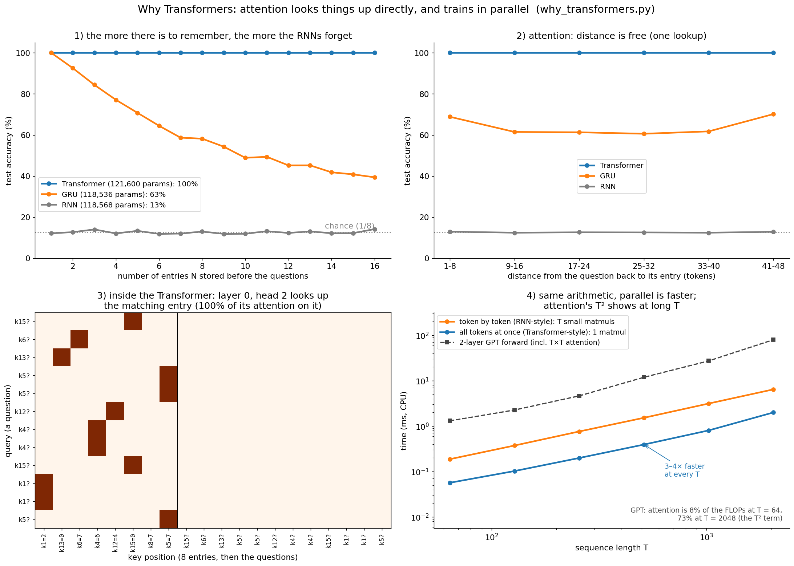

**What to look at:** `why_transformers.py` trains three models with the same budget
(1,500 steps, ~120k parameters each) on a tiny "phone book" task: N entries like
`k3=5` (name 3 has number 5), then questions like `k3?`. Panel 1: the Transformer is
at 100% for every N; the GRU drops from 100% (one entry) to 39% (16 entries) because
everything must fit in one hidden vector; the vanilla RNN never gets past chance
(13%). Panel 2: for attention, distance costs nothing. Panel 3: inside the Transformer,
layer 0 head 2 puts 100% of a question's attention on exactly the matching entry:
attention *is* a lookup by content. Panel 4: the same matrix work done token by token
(as an RNN must) vs all at once (as a Transformer can) is 3–4× faster on this 4-thread
CPU (far more on a GPU), but the GPT's T × T attention grows from 8% of its FLOPs at
T = 64 to 73% at T = 2048.

Honest caveat from the same script: on a CPU, a small GRU's forward pass is still
faster than our 2-layer GPT (it does ~12× less arithmetic per token). Transformers win
because the arithmetic they do is parallel and because the model *quality* per unit of
compute is better at scale, not because each token is cheap.

## 2. From characters to vectors: token and position embeddings

Our tokens are characters (V = 44, as in `../rnn/`). Each id looks up two learned
vectors of size `C = d_model = 64` and adds them:

```
x_t = wte[id_t] + wpe[t]          wte: (V, C)  "WHAT the token is"
                                  wpe: (T_max, C)  "WHERE it is"
```

`wte[id]` is exactly the one-hot × matrix product the RNN wrote as `W_xh · x_t`, done
as a row lookup. Without `wpe`, attention treats its inputs as a **set**: `q·k` compares
contents only, so "dog bites man" and "man bites dog" would look alike to a head. (The
causal mask leaks a little order information, since token `t` sees exactly `t + 1`
tokens, but explicit positions make order easy to use.)

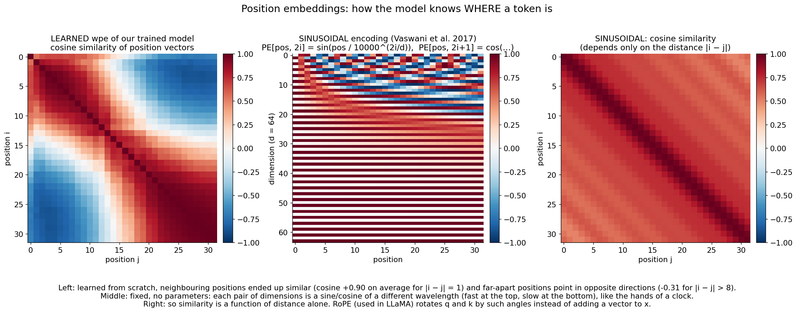

**What to look at:** left, the learned `wpe` of our trained model: nobody told it that
positions are ordered, yet neighbours ended up similar (cosine +0.90 at distance 1) and
far-apart positions point in opposite directions (−0.31 beyond 8). Middle, the fixed
**sinusoidal** encoding of the original Transformer: sine/cosine pairs with
wavelengths from 2π to 10000·2π, like the hands of a clock. Right, its similarity
depends only on the distance `|i − j|`.

Other options you should know:

| Scheme | Used in | Idea |
|--------|---------|------|
| Learned absolute (this folder) | GPT-2, BERT | A trainable vector per position. Can't go past `T_max`. |
| Sinusoidal | original Transformer | Fixed sin/cos, no parameters. |
| **RoPE** (Su et al. 2021) | LLaMA, Mistral, most modern LLMs | **Rotate** each (q, k) dimension pair by an angle ∝ position. Then `q_i·k_j` depends only on `i − j`: relative position, for free. Context can be extended by rescaling the angles. |
| ALiBi (Press et al. 2021) | BLOOM, MPT | No embedding: subtract `m · (i − j)` from the score, a per-head linear distance penalty. |

## 3. Self-attention, with the causal mask

**Recap from [`../attention/`](../attention/):** given queries `Q`, keys `K` and
values `V`, scaled dot-product attention is

```
Attention(Q, K, V) = softmax(Q Kᵀ / √d_k) V
```

Each query scores every key (dot product = "how well do we match?"), softmax turns the
scores into weights that sum to 1, and the output is the weighted average of the values.
In seq2seq the queries came from the decoder and the keys/values from the encoder.

**Self-attention:** `Q`, `K` and `V` all come from the **same** sequence `x`:

```
q = x W_q      "what am I looking for?"            x: (T, C)   W_q, W_k, W_v: (C, d_k)
k = x W_k      "what do I contain?"                q, k, v: (T, d_k)
v = x W_v      "what do I hand over if picked?"
S = q kᵀ / √d_k                                    S: (T, T)   S[i, j] = how much i wants j
S[i, j] = -∞  for j > i                            the causal mask
A = softmax(S, along each row)                     A: (T, T), each row sums to 1
y = A v                                            y: (T, d_k), row i = Σ_j A[i, j] v_j
```

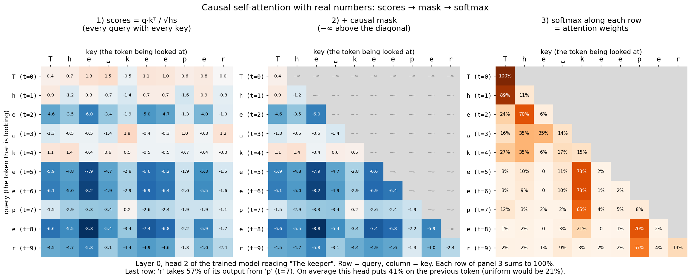

**What to look at:** the real layer-0 head 2 of our trained model reading "The keeper".
Panel 1: every query scored against every key. Panel 2: the mask sets the upper
triangle to −∞. Panel 3: after the softmax, each row is a probability distribution over
the visible tokens; `exp(−∞) = 0`, so the future gets exactly 0%. The last row: `'r'`
takes 57% of its output from `'p'`. This head puts 41% of its weight on the previous
character on average (uniform would be 21%). Run
`python transformer/attention_step_visual.py` to see the same numbers appear step by step.

### Why divide by √d_k?

If the entries of `q` and `k` have mean 0 and variance 1 (roughly what LayerNorm and a
fresh init give you), then `q·k = Σ_{i=1..d_k} q_i k_i` has variance `d_k`. Big scores
push the softmax into a one-hot corner, where its gradient `diag(p) − p pᵀ` is ≈ 0.

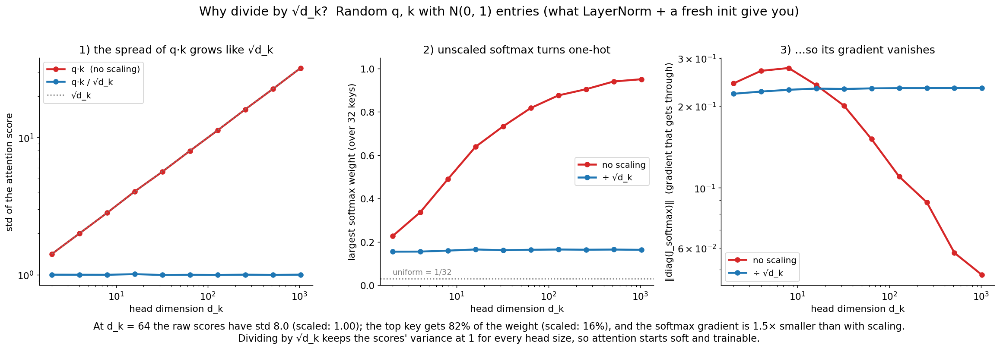

**What to look at:** at `d_k = 64` the raw scores have std 8.0, and the top key already
gets 82% of the weight (16% after scaling); at larger `d_k` the softmax is nearly
one-hot and its gradient shrinks (panel 3). Dividing by `√d_k` keeps the scores'
variance at 1 for every head size, so attention starts soft and learnable.

### Why the causal mask makes parallel training = generation

A language model must predict token `t+1` from tokens `0..t` only. The mask enforces
that inside attention (the only place tokens mix: embeddings, LayerNorm and the MLP act
on each position separately). So row `t` of one forward pass over the whole sequence is
**exactly** what the model would compute if the text stopped at `t`.

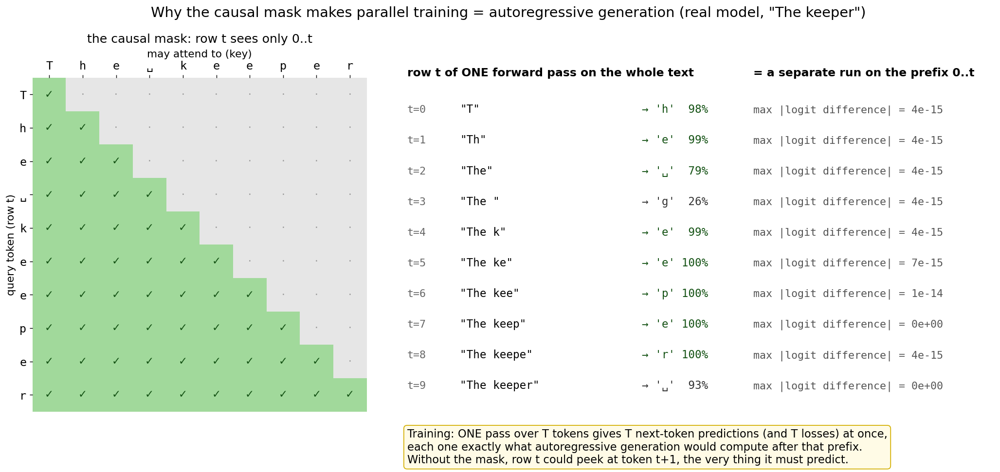

**What to look at:** one forward pass over "The keeper" (left: who may look at whom)
gives 10 predictions at once. Running the model separately on each prefix "T", "Th",
"The", … gives the same logits to within 1e-14. Training therefore gets `T` next-token
losses from one parallel pass, while generation (section 10) uses only the last row.
Without the mask, row `t` could look at token `t+1`, the very answer it must predict
(try exercise 2).

## 4. Multi-head attention

One softmax row is **one** weighted average: a head can attend strongly to one place,
or blur across several. Language needs several kinds of lookups at once (the previous
character, the start of the word, the matching quote mark, the subject of the verb). So
we run `n_head` small attentions in parallel and concatenate them:

```
head_size hs = C / n_head                      ours: 64 / 4 = 16
q, k, v = x W_qkv split into n_head heads      (B, T, C) → (B, nh, T, hs) each
y_h = softmax(q_h k_hᵀ / √hs + mask) v_h       (B, nh, T, hs), all heads in one batched matmul
y = concat(y_1 … y_nh) W_o                     (B, T, C) @ (C, C) → (B, T, C)
```

`W_q, W_k, W_v` for all heads are one `(C, 3C)` matrix (`c_attn` in the code, as in
GPT-2), and `W_o` (`c_proj`) mixes the heads' results back into `C` dims. Multi-head
costs the same parameters (`4C²`) and about the same FLOPs as one head of size `C`: it
trades one big attention pattern for `n_head` independent smaller ones.

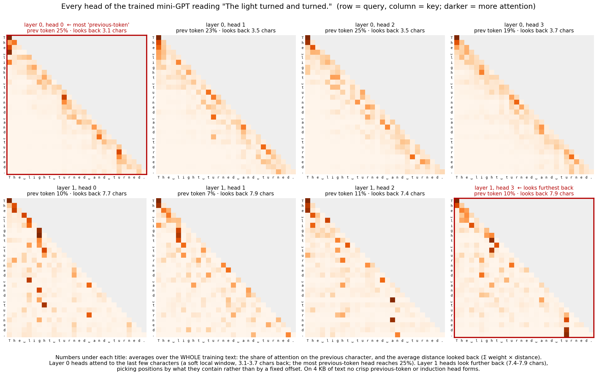

**What to look at:** every head of the trained model reading "The light turned and
turned." Layer 0 heads attend to the last few characters (they look back 3.1–3.7
characters on average over the whole text; the most "previous-token" one puts 25% on the
previous character). Layer 1 heads look further back (7.4–7.9 characters) and pick
positions by content rather than by a fixed offset. Honest note: trained for 10 s on
4 KB of text, our model does **not** form crisp previous-token or induction heads
(section 13); large models trained on lots of text do, reliably.

## 5. The Transformer block and the residual stream

A GPT is a stack of identical blocks. GPT-2 (and this folder) uses **pre-LayerNorm**:

```
x = x + Attn(LN_1(x))           tokens exchange information
x = x + MLP(LN_2(x))            each token processes what it gathered, on its own
MLP(x) = GELU(x W_1 + b_1) W_2 + b_2       W_1: (C, 4C)   W_2: (4C, C)
```

After the last block: `logits = LN_f(x) W_head`, with `W_head: (C, V)`.

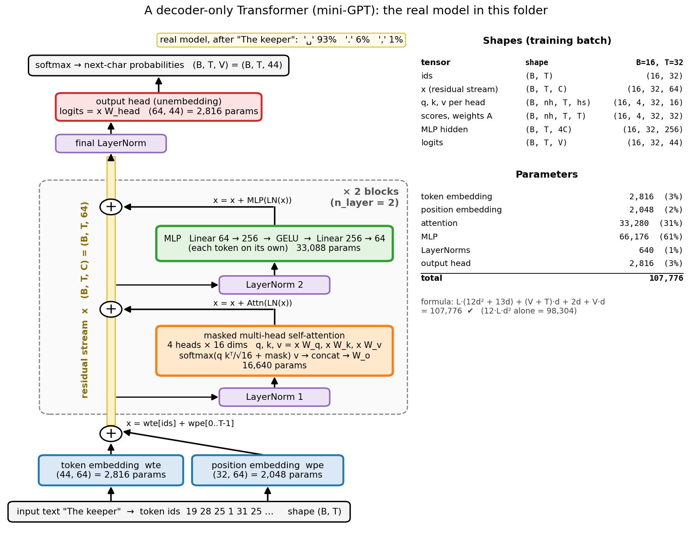

**What to look at:** the real model in this folder, from the input ids at the bottom to
the next-character probabilities at the top (after "The keeper": `'␣'` 93%). The yellow
bar is the residual stream; each block reads from it twice and adds back twice. The
tables on the right are the shapes during training and where the 107,776 parameters
are; the formula matches the code exactly.

### LayerNorm

For each token separately, over its `C` features:

```
μ = mean(x),   σ² = var(x),   x̂ = (x − μ) / √(σ² + ε),   y = γ ⊙ x̂ + β      γ, β: (C,)
```

It keeps the inputs of every sublayer at a fixed scale, whatever the stream's size.
**Why not BatchNorm?** BatchNorm averages over the batch (and positions): its statistics
would mix in other sequences and *future* tokens, differ between training and
one-token-at-a-time generation, and be noisy for small batches. LayerNorm uses only the
token's own features, so training and inference are identical. (LLaMA uses **RMSNorm**:
no mean subtraction and no `β`, `y = γ ⊙ x / √(mean(x²) + ε)`, slightly cheaper.)

### GELU

`GELU(x) = x · Φ(x)` (Hendrycks & Gimpel 2016), a smooth ReLU that lets small negative
values through. GPT-2 (and we) use the tanh approximation:

```
GELU(x) ≈ 0.5 x (1 + tanh(√(2/π) (x + 0.044715 x³)))
```

### The residual stream view

Read the block equations as: there is one vector per token, the **residual stream**,
and every sublayer *reads* it (through a LayerNorm) and *adds* an update. Attention
moves information between positions; the MLP transforms it within a position. The
logits are read from the final stream. This view (Elhage et al. 2021, "A Mathematical
Framework for Transformer Circuits") is how interpretability researchers think about
Transformers: layers communicate by writing to and reading from a shared stream.

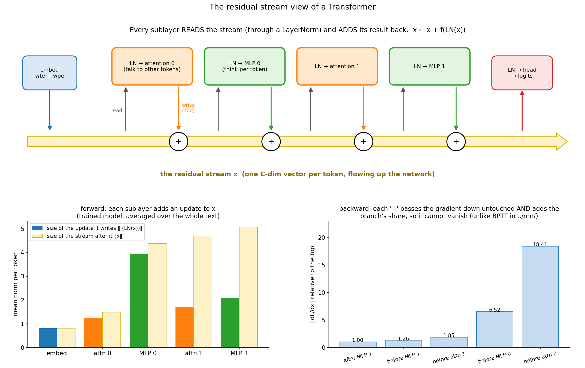

**What to look at:** bottom left, measured on the trained model: each sublayer's update
and the stream after it (the MLPs write the biggest updates). Bottom right: the
gradient at each point of the stream during backprop. Each `+` hands the incoming
gradient down **untouched** and adds the branch's contribution, so it cannot vanish the
way BPTT's did in `../rnn/`. Here it even grows going down (1.0 → 18.4×), mostly
because the first LayerNorm divides by the small std of the raw embeddings (σ ≈ 0.1),
which multiplies its backward gradient by ≈ 10.

**Pre-LN vs post-LN.** The original Transformer used post-LN, `x = LN(x + Sublayer(x))`:
every gradient must pass through a LayerNorm at every block, which makes deep models
unstable without a careful learning-rate warmup. Pre-LN keeps a clean identity path
from the loss to the embeddings (plus a final `LN_f`), so it trains stably (Xiong et al.
2020). Almost every modern LLM is pre-norm.

## 6. Shapes and parameter count

| Symbol | Meaning | Ours | GPT-2 small |
|--------|---------|------|-------------|
| `B` | batch size (sequences) | 16 | 512 |
| `T` | context length (`block_size`) | 32 | 1,024 |
| `C` = `d_model` | width of the residual stream | 64 | 768 |
| `n_head`, `hs = C / n_head` | heads, head size | 4, 16 | 12, 64 |
| `V` | vocabulary size | 44 | 50,257 |
| `L` = `n_layer` | blocks | 2 | 12 |

| Tensor | Shape |
|--------|-------|
| ids, targets | `(B, T)` |
| `x` (residual stream), every block's input/output | `(B, T, C)` |
| `qkv = LN(x) W_qkv` | `(B, T, 3C)` |
| `q, k, v` per head | `(B, nh, T, hs)` |
| scores `S`, weights `A` | `(B, nh, T, T)` |
| head outputs concatenated | `(B, T, C)` |
| MLP hidden | `(B, T, 4C)` |
| logits | `(B, T, V)` |

**Parameters per block** (with biases, as in GPT-2):

```
attention:  W_qkv (C, 3C) + b (3C) + W_o (C, C) + b (C)   = 4C² + 4C
MLP:        W_1 (C, 4C) + b (4C) + W_2 (4C, C) + b (C)    = 8C² + 5C
2 LayerNorms: γ, β                                         = 4C
block total                                                = 12C² + 13C
model = L·(12C² + 13C) + V·C (wte) + T·C (wpe) + 2C (LN_f) + V·C (head, 0 if tied)
      ≈ 12·L·C² + embeddings
```

Ours: `2·(12·64² + 13·64) + 44·64 + 32·64 + 2·64 + 44·64 = 107,776`, exactly what
`transformer_numpy.py` counts (it asserts this). GPT-2 small with tied weights:
`12·(12·768² + 13·768) + 50,257·768 + 1,024·768 + 2·768 = 124,439,808`: the famous
"124M".

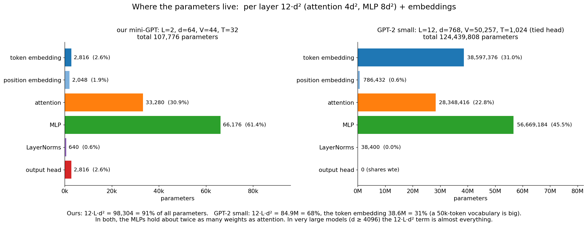

**What to look at:** in both models the MLPs hold about twice as many weights as
attention (`8C²` vs `4C²`). In ours `12·L·C²` is 91% of the parameters; in GPT-2 small
it is 68%, because a 50k-token embedding table is big (31%). In a 7B+ model the
`12·L·C²` term is nearly everything, which is why `N ≈ 12·L·d²` is the quick estimate.

**Weight tying** (Press & Wolf 2017; GPT-2): use `wte` as the output matrix,
`logits = x wteᵀ`. It saves `V·C` parameters (38.6M in GPT-2 small) and often helps,
since "which vector means token i" and "which vector predicts token i" are related.
`--tie-weights` turns it on here; the gradient of `wte` is then the sum of both uses.

## 7. The backward pass, layer by layer

Each class in `transformer_numpy.py` has `forward` (which caches what it needs) and
`backward` (gradient of the output → gradient of the input, plus parameter gradients).
Row-vector convention, `dZ` means `∂L/∂Z`.

**Cross-entropy** (mean over the `N = B·T` positions):
```
dlogits = (softmax(logits) − onehot(targets)) / N
```

**Linear** `y = x W + b` (all tokens flattened to rows):
```
dW = xᵀ dy      db = Σ_rows dy      dx = dy Wᵀ
```

**Embeddings**: a lookup is a one-hot matmul, so its gradient is a scatter-add: every
occurrence of id `i` adds its `dx` row into `dwte[i]` (`np.add.at`). The position table
gets `dx` summed over the batch. With tied weights, `dwte` also gets `dlogitsᵀ x` from
the head.

**LayerNorm**: `x̂` depends on `x` directly *and* through `μ` and `σ`:
```
dγ = Σ dy ⊙ x̂        dβ = Σ dy        dx̂ = dy ⊙ γ
dx = (1/σ) · (dx̂ − mean(dx̂) − x̂ ⊙ mean(dx̂ ⊙ x̂))        means over the C features
```
The two subtracted terms remove the components of the gradient that would only shift
or rescale the token, which LayerNorm undoes anyway.

**GELU** (tanh form, `u = √(2/π)(x + 0.044715 x³)`):
```
dx = dy ⊙ [ 0.5 (1 + tanh u) + 0.5 x (1 − tanh² u) · √(2/π) (1 + 3·0.044715 x²) ]
```

**Attention**, per head (`S = q kᵀ/√hs`, `A = softmax(S)`, `y = A v`):
```
dA = dy vᵀ                dv = Aᵀ dy
dS = A ⊙ (dA − rowsum(dA ⊙ A))           softmax backward, row by row
dq = dS k / √hs           dk = dSᵀ q / √hs
```
then the heads are merged back, `dqkv = [dq dk dv]`, and the `c_attn` Linear backward
gives `dx`. Masked entries have `A = 0`, so `dS = 0` there: no gradient flows from the
future into the past. `gradient_check.py` checks that explicitly.

**Residual**: `y = x + f(x)` gives `dx = dy + f'(x)ᵀ dy`. The gradient is copied: one
copy skips the sublayer unchanged (the **gradient highway**), the other goes through it.

A curiosity the gradient check reveals: the **key bias** `b_k` always gets exactly zero
gradient (5e-15). It adds `q·b_k` to every score in a row, and softmax ignores a
constant shift. GPT-2 has it anyway; LLaMA drops all biases.

`python transformer/gradient_check.py` compares all of this with central differences in
float64: 84 checks (each layer on its own, then all 29 parameter tensors of a tiny GPT,
separate and tied), worst relative error 2.3e-9, `Gradient check PASSED`.
`transformer_pytorch.py` then shows PyTorch's autograd gives the same gradients as our
backward to 3e-16.

## 8. Training

```
for step in range(steps):
    x, y = random (B, T) windows of the text, y = x shifted by one
    loss = model.forward(x, y)            # T predictions per window, in parallel
    grads = model.backward()
    clip the global gradient norm to 1.0
    AdamW step with lr = warmup + cosine schedule
```

- **AdamW** (Loshchilov & Hutter 2019): Adam with *decoupled* weight decay
  `w ← w − lr·λ·w`, applied outside the adaptive update. Decay only matrices (not
  biases, LayerNorm `γ, β`), `betas = (0.9, 0.95)` as in GPT-2/3 training.
- **Warmup + cosine decay**: Adam's second-moment estimates are poor in the first steps,
  so the LR ramps up linearly (100 steps here), then decays along a cosine to 10% of the peak.
- **Gradient clipping** by global norm (1.0): rare spikes don't wreck the weights.
- **Init**: `N(0, 0.02)`, and the two projections that write into the residual stream
  (`W_o`, `W_2`) scaled by `1/√(2·n_layer)` so the stream doesn't grow with depth.
- **Dropout** (PyTorch version): on the attention weights, on each sublayer's output
  before the residual add, and on the embeddings. Big pretraining runs often use 0;
  small data needs it.

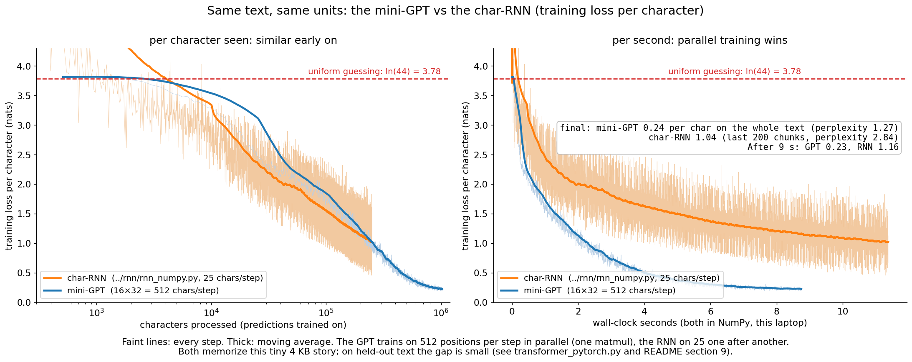

**What to look at:** both models on the same text, same units (training loss per
character). Left: per character seen, the two learn at a similar pace early on. Right:
per second (both in NumPy, same laptop), the mini-GPT is far ahead, because each step
trains 512 positions with a few big matmuls while the RNN walks through 25 characters
one by one. After about 9 s the GPT is at 0.23 while the RNN is still above 1.1.

## 9. Results (and an honest look at them)

`python transformer/transformer_numpy.py` (2,000 steps of 16 × 32 characters, ~10 s):

```
data: 3898 chars, vocab size V = 44, uniform guessing = ln(44) = 3.784 per char (perplexity 44)
model: n_layer=2 n_head=4 d_model=64 block_size=32 -> 107,776 parameters (12·L·d² = 98,304)
step     0 | loss/char 3.815 ...
step  1999 | loss/char 0.216 (avg 0.231) | ppl   1.26 ...
loss over the whole text: 0.235 per char = perplexity 1.27
```

Same units as `../rnn/README.md`: the char-RNN (`../rnn/rnn_numpy.py` settings, retrained
by `make_figures.py`) ends at 1.04 per character (perplexity 2.84). The sample reproduces whole sentences of the story, because with 108k
parameters and 3.9k characters the model can **memorize** the text. Training loss
alone can't tell learning from memorizing.

`python transformer/transformer_pytorch.py` holds out the last 10% of the story and
trains the PyTorch mini-GPT (dropout 0.1) and the `../rnn/rnn_pytorch.py` char-RNN on
identical batches:

```
            train loss  val loss  best val  val ppl
mini-GPT         0.322     0.925     0.925     2.52
char-RNN         0.262     0.983     0.976     2.67
uniform          3.784     3.784                 44
```

On 3.5k training characters the Transformer is only a little better on unseen text.
That is the honest result: Transformers shine with long contexts, lots of data and
large scale (section 15), and `why_transformers.py` shows the mechanism where it
matters. On a tiny dataset, inductive bias and regularization matter more than
architecture. (`../rnn/rnn_pytorch.py` prints ~0.02 *training* loss: memorized, with no
validation split.)

## 10. Generation: sampling and the KV cache

Generation is the RNN's loop: run the model, take the **last** position's logits,
sample a token, append it, repeat.

- **Temperature** `softmax(z / τ)`: `τ < 1` sharper and safer, `τ > 1` flatter and wilder.
- **Top-k**: keep the `k` most likely tokens, renormalize, sample (`--top-k`).
- **Top-p (nucleus)**: keep the smallest set of tokens whose probabilities sum to `p`
  (e.g. 0.9); adapts to how confident the model is (exercise 8).
- **Greedy** (`τ → 0`) is deterministic but repetitive.

**The KV cache.** Without it, generating token `t+1` re-runs the model on all `t` tokens,
recomputing keys and values that have not changed (the causal mask guarantees that
earlier positions never depend on later ones). With it:

```
prefill:  run the prompt in ONE parallel pass; store K, V of every layer   (nh, t, hs) each
decode:   for the newest token only: q, k, v = LN(x) W_qkv
          append k, v to the cache;  y = softmax(q K_cacheᵀ / √hs) V_cache
          (no mask needed: the cache holds only the past)
```

Per new token, the MLPs and projections now cost `O(1)` tokens' worth and attention
`O(t)` instead of re-running `O(t)` tokens with `O(t²)` attention.
`python transformer/generate.py` checks this every time it starts: decoding "The keeper
opened the door and sa" one token at a time with the cache gives the same logits as one
full forward pass to 1.7e-14.

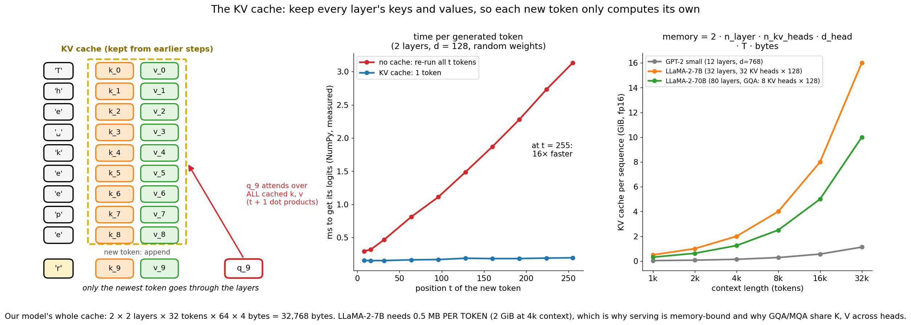

**What to look at:** left, the cache: only the new token `'r'` goes through the layers;
its query attends over every cached key. Middle, measured in NumPy: without a cache the
time per token grows linearly with the position (it re-processes all `t` tokens); with
it, it stays flat (15–20× faster at `t = 255`; the exact number varies a little from run
to run). Right: the price is memory,

```
KV cache = 2 (K and V) · n_layer · n_kv_heads · d_head · T · batch · bytes_per_number
```

0.5 MB per token for LLaMA-2-7B in fp16 (2 GiB for one 4k-token sequence), which is why
LLM serving is limited by memory bandwidth and why GQA/MQA (section 15) share K and V
across heads. `python transformer/generate.py --benchmark` measures whole generations:
about 2× faster for our 32-token model and about 9× for a random model with a
256-token context (1.6× and 8.7× in the last run).

Our learned positions only go up to 32, so when the window is full `generate.py` keeps
the last 16 tokens, prefills them again and continues (`--no-cache` slides the window
by one token and recomputes everything instead). Models with RoPE can keep their cache
when the window slides, because attention only depends on relative positions.

## 11. Cost: why long context is expensive

Per layer and per sequence of `T` tokens (multiply-adds, forward pass):

```
projections + MLP:   12 · T · d²        (linear in T)
attention scores:     T² · d   (q kᵀ)    + T² · d (A v)   = 2 · T² · d    (quadratic in T)
```

They are equal at `T = 6d`: for our `why_transformers.py` timing model (`d = 128`) at
`T = 768`; at `T = 2048` attention is 73% of the FLOPs. The `T × T` score matrix also
costs `O(T²)` **memory** per head, which is the bigger problem in practice.

- **FlashAttention** (Dao et al. 2022) computes exact attention in tiles that stay in
  fast on-chip SRAM, never writing the `T × T` matrix to GPU memory: same math, much
  less memory traffic, linear memory in `T`. PyTorch's `F.scaled_dot_product_attention`
  uses such kernels on GPU.
- Approximations (sparse/sliding-window attention, linear attention, state-space models
  like Mamba) trade exactness for sub-quadratic cost.

**Training vs inference compute.** A forward pass costs ≈ `2N` FLOPs per token
(`N` = parameters; one multiply-add per weight), the backward ≈ `4N`, so training costs
≈ `6N` FLOPs per token and a training run ≈ `6·N·D` for `D` tokens. Generation costs
≈ `2N` per token, but one token at a time, so it is limited by reading the weights and
the KV cache from memory, not by arithmetic.

## 12. Encoder, decoder, encoder-decoder

| Type | Attention | Trained to | Examples | Good for |
|------|-----------|-----------|----------|----------|
| **Encoder-only** | bidirectional (no mask) | fill in masked tokens | BERT, RoBERTa | understanding: classification, retrieval embeddings |
| **Decoder-only** (this folder) | causal | predict the next token | GPT-2/3/4, LLaMA, Claude | generation, and everything else via prompting |
| **Encoder-decoder** | encoder bidirectional, decoder causal + **cross-attention** to the encoder | map input → output | original Transformer, T5, BART, Whisper | translation, summarization, speech |

Cross-attention is the [`../attention/`](../attention/) setup: decoder queries,
encoder keys and values. Decoder-only won for LLMs because one simple objective on raw
text scales well, and any task can be phrased as "continue this text".

## 13. What attention heads learn

Interpretability research (Elhage et al. 2021; Olsson et al. 2022) finds recurring head
types in trained Transformers:

- **Previous-token heads** attend to position `t − 1`, copying "what came just before
  me" into the token's stream. Our layer-0 heads are a soft version of this (section 4).
- **Induction heads** (two heads in different layers working together): if the context
  contains `… A B … A`, attend to the token that followed the earlier `A` and predict
  `B`. In an earlier layer, a previous-token head writes "the token before me was A"
  into `B`'s stream. In a later layer, the current `A`'s query matches that key, so it
  attends to `B` and copies it. Induction heads appear suddenly during training (a visible bump in the loss
  curve) and are a large part of **in-context learning**: copying and continuing
  patterns that appear in the prompt.
- Our phone-book task (section 1) needs only a one-layer **lookup** head, because the
  name and the number share a token. While building this folder we also tried the
  classic induction test (a random segment followed by its exact repeat), which needs
  the two-layer circuit: the same 2-layer GPT sat near chance for thousands of steps, the plateau that comes before
  induction heads form, and was still only at 45% after 4,000 steps (~90 s). Too slow for
  a demo, so `why_transformers.py` uses the lookup task; exercise 11 asks you to build
  the induction version.

## 14. Practical tips and debugging

- **First loss ≈ ln(V)** (3.78 here). If not, check the init and the loss.
- **Overfit one batch** to ~0 first. If you can't, there is a bug.
- **Gradient-check every new layer** in float64, then compare with PyTorch.
- **Check the mask**: a model whose training loss drops suspiciously fast but generates
  garbage is probably peeking at the future (exercise 2). Test that output `t` doesn't
  change when you change token `t + 1`.
- **Shapes**: most bugs are in the `(B, T, nh, hs)` ↔ `(B, nh, T, hs)` transposes.
  `reshape` without the `transpose` silently mixes heads and positions.
- **dtype leaks**: in NumPy 2, `np.sqrt(16)` is a strong float64 scalar that silently
  upcasts float32 arrays (it made our first version 2× slower). Use Python floats.
- **Loss spikes / NaN**: lower the LR, lengthen the warmup, check clipping. Use bf16
  rather than fp16 for big models.
- **Val loss rises while train loss falls**: overfitting; more data, dropout, weight
  decay, early stopping (see `../mlp/` section 9).

## 15. From this folder to ChatGPT (why this matters for an AI engineer)

`../rnn/README.md` section 8 promised that attention would fix the RNN's fading memory
and sequential training. This folder is that model. Everything a frontier LLM does at
inference is what `generate.py` does: embed, run the blocks, read the last logits,
sample, append, use a KV cache. The differences are scale and a set of well-understood
upgrades.

| | char-RNN ([`../rnn/`](../rnn/)) | mini-GPT (this folder) | GPT-2 small (2019) |
|---|---|---|---|
| Tokens | characters, V = 44 | characters, V = 44 | byte-level BPE, V = 50,257 |
| Memory of the past | one vector `h_t` (H = 100) | attention over a 32-token window | attention over 1,024 tokens |
| Layers × width | 1 recurrent layer, H = 100 | 2 blocks, d = 64, 4 heads | 12 blocks, d = 768, 12 heads |
| Parameters | 18,944 | 107,776 | 124,439,808 |
| Training data | 3.9 KB story | the same 3.9 KB story | WebText, ~40 GB |
| Train loss per char (same text) | 1.04 | 0.235 | — |
| Training parallel over | nothing (one chunk at a time) | batch and sequence | batch and sequence, many GPUs |

**The modern stack, piece by piece:**

- **Tokenization (BPE).** Byte-pair encoding (Sennrich et al. 2016) starts from bytes
  and repeatedly merges the most frequent adjacent pair into a new token, until the
  vocabulary has ~50k–200k entries. Common words become one token, rare ones split into
  pieces. Shorter sequences than characters, no unknown tokens. It is also why LLMs
  struggle to count letters.
- **Scaling laws.** Loss falls as a smooth power law in parameters `N`, data `D` and
  compute `C ≈ 6ND` (Kaplan et al. 2020). Chinchilla (Hoffmann et al. 2022) showed that
  for a fixed compute budget, models should be smaller and trained on more data than
  previously thought: about **20 tokens per parameter** (Chinchilla, 70B params on 1.4T
  tokens, beat the 280B Gopher). Today's models are often trained far past that point,
  because a smaller model is cheaper to serve.
- **Pretraining → SFT → RLHF/DPO.** Pretraining (next-token prediction on trillions of
  tokens, exactly our loss) gives a base model that continues text. **Supervised
  fine-tuning** on (instruction, good answer) pairs teaches it the assistant format.
  **RLHF** (InstructGPT, Ouyang et al. 2022) trains a reward model on human preference
  comparisons and optimizes the LLM against it with PPO; **DPO** (Rafailov et al. 2023)
  gets a similar result with a simple classification-style loss directly on preference
  pairs. That is how a text continuer becomes ChatGPT.
- **Architecture upgrades (LLaMA-style).** RMSNorm instead of LayerNorm, **SwiGLU**
  MLP (`(Swish(x W_1) ⊙ x W_3) W_2`, Shazeer 2020) instead of GELU, **RoPE** instead
  of learned positions, no biases, pre-norm. The skeleton is the block in section 5.
- **GQA / MQA.** Multi-query attention (one K, V head shared by all query heads,
  Shazeer 2019) and grouped-query attention (groups of query heads share K, V; Ainslie
  et al. 2023; LLaMA-2-70B uses 8 KV heads for 64 query heads) shrink the KV cache by
  `n_head / n_kv_heads`, which speeds up generation a lot for little quality loss.
- **Mixture-of-experts.** Replace the MLP by `E` expert MLPs plus a router that sends
  each token to the top-1 or top-2 (Shazeer et al. 2017; Switch Transformer; Mixtral
  8×7B uses 2 of 8). Many more parameters, but each token only pays for the experts it
  uses.
- **Long context and serving.** FlashAttention, RoPE scaling, paged KV caches, batching
  many users, speculative decoding: engineering around sections 10–11.

## 16. Interview check

Answer each one out loud in under a minute:

1. Derive the shapes of `q, k, v`, the scores, and the output of multi-head attention
   for input `(B, T, C)` with `h` heads.
2. Why divide the scores by `√d_k`? What happens without it?
3. What does the causal mask do, and why does it let training process all positions in
   parallel while matching autoregressive generation?
4. Self-attention vs cross-attention: where do `Q`, `K`, `V` come from in each?
5. How does multi-head attention differ from one big head of size `C`? Same parameters?
6. Write a Transformer block (pre-LN) from memory. What does the MLP do that attention
   can't?
7. Derive the parameter count of one GPT layer (`12d² + 13d`). Estimate GPT-2 small's
   total and say where the rest comes from.
8. Pre-LN vs post-LN: what's the difference, and why is pre-LN easier to train?
9. Why LayerNorm and not BatchNorm in Transformers?
10. Write the LayerNorm backward pass. Why are there two extra terms?
11. Write the softmax / attention backward pass.
12. What is the residual stream, and why do residual connections fix vanishing gradients?
13. What are positional encodings for? Learned vs sinusoidal vs RoPE vs ALiBi; why do
    modern LLMs use RoPE?
14. What is the KV cache? Give its memory formula and estimate it for a 7B model at 4k
    tokens. How do GQA/MQA change it?
15. What is the time complexity of attention in `T` and `d`? When does the `T²` term
    dominate, and what does FlashAttention change (and not change)?
16. Training vs inference compute per token (`6N` vs `2N`). Why is generation
    memory-bandwidth bound?
17. How do temperature, top-k and top-p sampling work?
18. What is weight tying and why does it help?
19. Encoder-only vs decoder-only vs encoder-decoder: give an example of each and what
    it's good for.
20. What is an induction head, and why does it matter for in-context learning?
21. What do the Kaplan and Chinchilla scaling laws say? How many tokens for a 7B model
    to be "Chinchilla-optimal"?
22. Pretraining → SFT → RLHF/DPO: what does each stage change?
23. Why did Transformers replace RNNs, and what is one thing RNNs (or state-space
    models) still do better?

## 17. Exercises

1. Break one line of `LayerNorm.backward` (drop a subtracted term) or of the softmax
   backward in `CausalSelfAttention.backward`, and watch `gradient_check.py` catch it.
2. Remove the causal mask (`scores = np.where(mask, ...)`). Train: why does the loss
   collapse toward 0? Generate: why is the output garbage?
3. Remove the `/ √hs` scaling and train with `--d-model 128 --n-head 1`. Compare the
   first few hundred steps with the scaled version.
4. Same `d_model = 64`: compare `--n-head 1`, `4` and `8`. Then look at the heads with
   `attention_step_visual.py`.
5. Train with `--tie-weights`. How many parameters do you save? Does the loss change?
6. Zero the position embeddings (and their gradient). What can the model still learn,
   and what does it get wrong? (Hint: try prompts that differ only in order.)
7. Add dropout to the NumPy model: a mask in forward (training only), the same mask in
   backward, and extend `gradient_check.py` (with a fixed mask).
8. Add **top-p** sampling to `generate.py` (`--top-p 0.9`).
9. In `transformer_pytorch.py`, make it LLaMA-style: RMSNorm, SwiGLU, no biases, RoPE.
   With RoPE, change `generate.py`'s cache to slide instead of re-prefilling.
10. Implement post-LN in the NumPy model and compare stability at `--lr 1e-2` with and
    without warmup (`--warmup 0`).
11. `python transformer/why_transformers.py --steps 3000`: does the GRU catch up? Try
    a bigger hidden size. Then build the induction version of the task (separate name
    and number tokens) and see how many steps the Transformer needs.
12. Train on a 1 MB+ text (`--file`, e.g. a Project Gutenberg book you saved locally)
    with `--block-size 128`, and compare the validation loss with the char-RNN.

## 18. Resources

- Vaswani et al. (2017), *Attention Is All You Need*.
- Radford et al. (2019), *Language Models are Unsupervised Multitask Learners* (GPT-2).
- Brown et al. (2020), *Language Models are Few-Shot Learners* (GPT-3).
- Andrej Karpathy, *Let's build GPT: from scratch, in code, spelled out* (YouTube), and
  the `nanoGPT` repository, on which our layer names (`c_attn`, `c_proj`, `c_fc`) are modeled.
- Jay Alammar, *The Illustrated Transformer* and *The Illustrated GPT-2* (blog).
- Elhage et al. (2021), *A Mathematical Framework for Transformer Circuits* (Anthropic).
- Olsson et al. (2022), *In-context Learning and Induction Heads* (Anthropic).
- Xiong et al. (2020), *On Layer Normalization in the Transformer Architecture*.
- Su et al. (2021), *RoFormer: Enhanced Transformer with Rotary Position Embedding*.
- Kaplan et al. (2020), *Scaling Laws for Neural Language Models*.
- Hoffmann et al. (2022), *Training Compute-Optimal Large Language Models* (Chinchilla).
- Dao et al. (2022), *FlashAttention: Fast and Memory-Efficient Exact Attention with IO-Awareness*.
- Ba, Kiros & Hinton (2016), *Layer Normalization*.
- Hendrycks & Gimpel (2016), *Gaussian Error Linear Units (GELUs)*.
- Also referenced above: Loshchilov & Hutter (2019), *Decoupled Weight Decay
  Regularization* (AdamW); Press & Wolf (2017), *Using the Output Embedding to Improve
  Language Models*; Press et al. (2021), *Train Short, Test Long* (ALiBi); Sennrich et
  al. (2016), *Neural Machine Translation of Rare Words with Subword Units* (BPE);
  Shazeer (2019), *Fast Transformer Decoding: One Write-Head is All You Need* (MQA);
  Ainslie et al. (2023), *GQA*; Shazeer (2020), *GLU Variants Improve Transformer*
  (SwiGLU); Zhang & Sennrich (2019), *Root Mean Square Layer Normalization*; Shazeer et
  al. (2017), *Outrageously Large Neural Networks* (MoE); Ouyang et al. (2022),
  *Training language models to follow instructions with human feedback*; Rafailov et
  al. (2023), *Direct Preference Optimization*.
